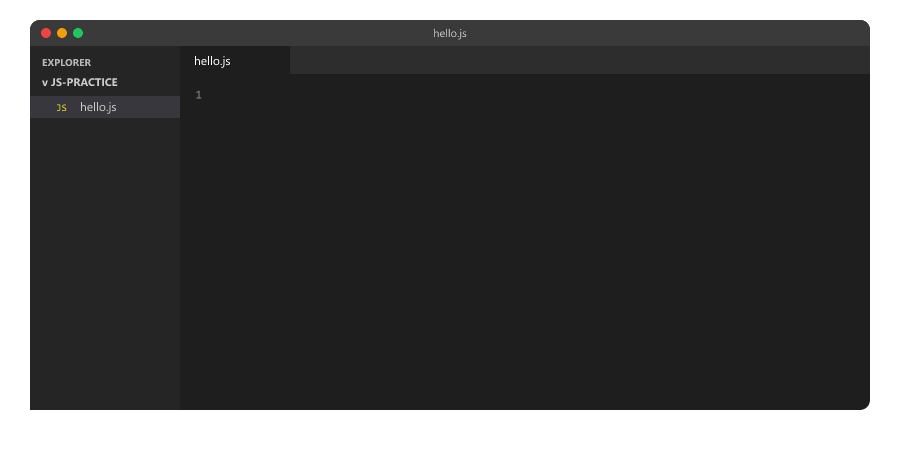
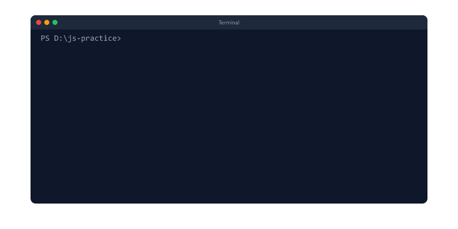
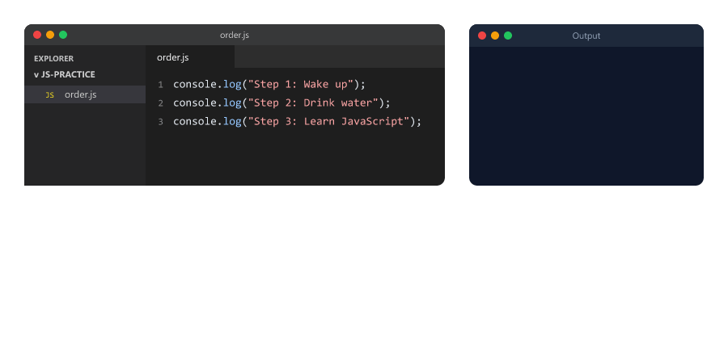
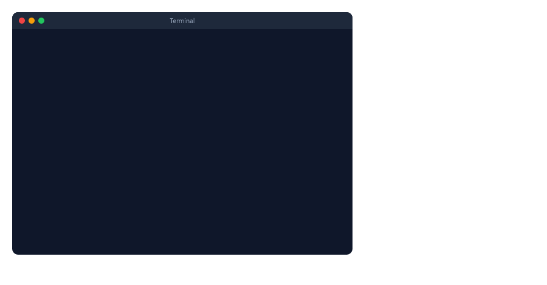

# Introduction to JavaScript

## Table of Contents
- [What is JavaScript](#what-is-javascript)
- [Frontend and Backend](#frontend-and-backend)
- [How This Course Works](#how-this-course-works)
- [JavaScript is Not Java](#javascript-is-not-java)
- [What You Can Build with JavaScript](#what-you-can-build-with-javascript)
- [A Short History](#a-short-history)
- [How JavaScript Runs: the Engine](#how-javascript-runs-the-engine)
- [Set Up Your Computer](#set-up-your-computer)
- [Your First Program](#your-first-program)
- [The Node.js REPL](#the-nodejs-repl)
- [console.log()](#consolelog)
- [Code Runs Top to Bottom](#code-runs-top-to-bottom)
- [Statements and Semicolons](#statements-and-semicolons)
- [Comments](#comments)
- [JavaScript is Case-Sensitive](#javascript-is-case-sensitive)
- [Reading Error Messages](#reading-error-messages)
- [Browser Code Does Not Work in Node.js](#browser-code-does-not-work-in-nodejs)
- [Mini Example: Your Profile Card](#mini-example-your-profile-card)
- [Beginner Mistakes](#beginner-mistakes)
- [Practice Exercises](#practice-exercises)
- [Interview Questions](#interview-questions)

---

## What is JavaScript

JavaScript is a programming language. You use it to give instructions to a computer.

It started in 1995 as the language of web browsers. In 2009, **Node.js** made it possible to run JavaScript on computers and servers too. Today JavaScript is one of the most used languages in the world.

Simple definition: **JavaScript is a language you can use to build both the screens people see and the servers behind them.**

This course teaches JavaScript for the **backend**: the server side. Everything runs with Node.js.

---

## Frontend and Backend

Most apps have two parts


|             | Frontend                                  | Backend                                          |
| ----------- | ----------------------------------------- | ------------------------------------------------ |
| What it is  | The app or website people see and tap     | The server behind it                             |
| Its job     | Show buttons, lists and forms             | Store data, check passwords, do the calculations |
| Example     | The product list in a shopping app        | The code that finds the products in the database |
| Runs on     | The user's phone or browser               | A server                                         |

When you open a shopping app, the frontend asks the backend "show me the products". The backend finds them in the database and sends them back.

Backend developers write the backend. With JavaScript, they use **Node.js**.

---

## How This Course Works

This course teaches the JavaScript **language**. You run every example with Node.js, in a terminal. There are no web pages, no buttons and no browser code.


| Part                | Sessions | Topics                                                      |
| ------------------- | -------- | ----------------------------------------------------------- |
| Basics              | 1 to 9   | Variables, data types, operators, conditions, loops, strings, numbers |
| Building blocks     | 10 to 17 | Functions, arrays, objects, closures, classes               |
| Real programs       | 18 to 21 | Error handling, JSON, Map and Set, modules                  |
| Async JavaScript    | 22 to 25 | Timers, the event loop, promises, async/await               |
| Mini project        | 26       | A complete Node.js program using everything                 |

After this course comes the **Node.js course**: servers, APIs and databases. It uses everything you learn here, in the same style.

---

## JavaScript is Not Java

The names are similar, but they are two different languages. In 1995 Java was very popular, so the new language was named "JavaScript" to sound modern.

A famous joke: *"Java is to JavaScript what car is to carpet."*

|             | Java                                 | JavaScript                         |
| ----------- | ------------------------------------ | ---------------------------------- |
| Created by  | Sun Microsystems (1995)              | Netscape (1995)                    |
| Runs in     | The Java Virtual Machine             | Node.js and web browsers           |
| Used for    | Android apps, large business systems | Servers, APIs, websites, apps      |
| File ending | `.java`                              | `.js`                              |

---

## What You Can Build with JavaScript


| What                 | Examples                                                      |
| -------------------- | ------------------------------------------------------------- |
| Servers and APIs     | The backend of shopping, banking and social media apps        |
| Command-line tools   | Programs you run in a terminal. `npm` itself is written in JavaScript |
| Real-time apps       | Chat apps, live scores, online games                          |
| Automation scripts   | Rename 500 files, create a report every morning               |
| Database work        | Save, find and update data                                    |

JavaScript is also used for websites, mobile apps and desktop apps (VS Code is built with it). This course focuses on the backend.

---

## A Short History


| Year         | What happened                                                         |
| ------------ | --------------------------------------------------------------------- |
| 1995         | Brendan Eich created JavaScript at Netscape in **10 days**            |
| 1997         | It became an official standard called **ECMAScript**                  |
| 2009         | **Node.js** made it possible to run JavaScript outside the browser    |
| 2015         | **ES6** (also called ES2015): a big update with `let`, `const`, arrow functions and classes |
| 2016 → today | A new version every year (ES2016, ES2017, and so on)                  |

Fun facts

* Its first name was **Mocha**, then **LiveScript**, then JavaScript
* **ECMAScript** is the official name of the standard. JavaScript is the language that follows it
* When people say "modern JavaScript" or "ES6+", they mean the features added in 2015 and later. This course teaches modern JavaScript

---

## How JavaScript Runs: the Engine

Your computer does not understand JavaScript directly. A program called a **JavaScript engine** reads your code and runs it.


| Where           | Engine            |
| --------------- | ----------------- |
| Node.js         | V8                |
| Chrome, Edge    | V8 (the same engine) |
| Firefox         | SpiderMonkey      |
| Safari          | JavaScriptCore    |

Modern engines are fast: they turn your code into machine instructions while it runs. This is called **JIT** (just-in-time) compilation.

**Node.js = the V8 engine + extra features**, like reading files and creating servers. You will use those extras in the Node.js course.

---

## Set Up Your Computer

You need two free programs and one folder.

**1. Node.js.** Download it from [nodejs.org](https://nodejs.org/). Choose the **LTS** version (Long Term Support: the stable one).

**2. A code editor.** Install [VS Code](https://code.visualstudio.com/).

**3. A practice folder.** Create a folder called `js-practice`. In VS Code, choose **File → Open Folder** and open it.

To open a terminal inside VS Code, choose **Terminal → New Terminal** (shortcut: `` Ctrl + ` ``). It opens in your practice folder.

Check that Node.js is installed

```bash
node -v
```

Output

```text
v24.19.0
```


Your number may be higher. Any version from 22 up works for this course.

---

## Your First Program

**Step 1.** In VS Code, create a file called `hello.js` in your practice folder

hello.js

```javascript
console.log("Hello, JavaScript!");
```

Save it with `Ctrl + S`.

**Step 2.** In the terminal, run

```bash
node hello.js
```

Output

```text
Hello, JavaScript!
```



| Part       | Meaning                                    |
| ---------- | ------------------------------------------ |
| `node`     | Start Node.js                              |
| `hello.js` | The file Node.js should run                |

Tips

* Run the command in the folder that contains the file. The VS Code terminal starts there
* `node hello` (without `.js`) also works: Node.js adds `.js` for you
* Always save before running. A white dot on the VS Code tab means "not saved yet"

This is how you will run every example in this course: write a `.js` file, then `node file.js`.

---

## The Node.js REPL

Type `node` with nothing after it, and Node.js opens an interactive console in your terminal. It is called the **REPL**

| Letter | Meaning                          |
| ------ | -------------------------------- |
| R      | **Read** what you type           |
| E      | **Evaluate** (run) it            |
| P      | **Print** the result             |
| L      | **Loop**: wait for the next line |

```text
PS D:\js-practice> node
Welcome to Node.js v24.19.0.
Type ".help" for more information.
> 2 + 3
5
> "Hi " + "there"
'Hi there'
> console.log("Hello")
Hello
undefined
> .exit
PS D:\js-practice>
```



**Why does it say `undefined` after `console.log()`?** The REPL shows two things

| Line        | Meaning                                                              |
| ----------- | -------------------------------------------------------------------- |
| `Hello`     | What `console.log()` printed                                         |
| `undefined` | The result of the line. `console.log()` only prints, it gives back nothing, and "nothing" is called `undefined` |

It is **not an error**. You will learn about `undefined` in Session 03.

The REPL is great for quick tests and as a calculator. But when you leave it, your code is gone. Real programs are written in files.

To leave the REPL, type `.exit` or press `Ctrl + C` twice.

---

## console.log()

`console.log()` prints whatever you put inside the brackets. You will use it in every lesson.

log.js

```javascript
console.log("I am learning JavaScript");
console.log(25);
console.log(10 + 5);
console.log("Price:", 499);
console.log("Sum of 2 and 3 is", 2 + 3);
```

Run

```bash
node log.js
```

Output

```text
I am learning JavaScript
25
15
Price: 499
Sum of 2 and 3 is 5
```

The rules

| Code                         | Output        | Why                                          |
| ---------------------------- | ------------- | -------------------------------------------- |
| `console.log("Hello")`       | `Hello`       | Text goes inside quotes                      |
| `console.log(25)`            | `25`          | Numbers need no quotes                       |
| `console.log(10 + 5)`        | `15`          | Math is calculated first                     |
| `console.log("10 + 5")`      | `10 + 5`      | Inside quotes it is just text, not math      |
| `console.log("Price:", 499)` | `Price: 499`  | A comma prints several values, with a space between them |

Text inside quotes is called a **string**. You will learn strings and numbers properly in Session 03.

On a server, `console.log()` is how you see what your program is doing. Backend developers use it every day.

---

## Code Runs Top to Bottom

JavaScript runs your code one line at a time, starting from the top.

order.js

```javascript
console.log("Step 1: Wake up");
console.log("Step 2: Drink water");
console.log("Step 3: Learn JavaScript");
```

Output

```text
Step 1: Wake up
Step 2: Drink water
Step 3: Learn JavaScript
```



Change the order of the lines and the output changes too. Each line finishes before the next one starts.

---

## Statements and Semicolons

Each instruction is called a **statement**. A statement usually ends with a semicolon `;`

```javascript
console.log("One statement");
console.log("Another statement");
```

| Rule                                        | Details                                            |
| ------------------------------------------- | -------------------------------------------------- |
| End each statement with `;`                 | JavaScript can add missing semicolons for you, but this course always writes them: it is clearer |
| One statement per line                      | Easier to read                                     |
| Spaces, blank lines and indentation         | JavaScript ignores them. Use them to make code readable for humans |

---

## Comments

Text after `//` is a **comment**. JavaScript ignores it. Comments are notes for people.

comments.js

```javascript
// Print a greeting
console.log("Good morning!"); // JavaScript ignores this part too
```

Output

```text
Good morning!
```

This course uses comments to explain code. You will learn more about comments in Session 02.

---

## JavaScript is Case-Sensitive

Capital and small letters are different in JavaScript. `console`, `Console` and `CONSOLE` are three different names.


| Code                  | Result                                    |
| --------------------- | ----------------------------------------- |
| `console.log("Hi");`  | `Hi`                                      |
| `Console.log("Hi");`  | `ReferenceError: Console is not defined`  |
| `console.Log("Hi");`  | `TypeError: console.Log is not a function` |

Almost everything in JavaScript is written in small letters, with a capital letter in the middle of long names: `console.log`, `toUpperCase`, `isInteger`. This style is called **camelCase** (Session 02).

---

## Reading Error Messages

Errors are normal. Every developer sees them every day. The trick is to read them.

typo.js

```javascript
consol.log("Hello");
```

Run it

```bash
node typo.js
```

Output

```text
D:\js-practice\typo.js:1
consol.log("Hello");
^

ReferenceError: consol is not defined
    at Object.<anonymous> (D:\js-practice\typo.js:1:1)
    at Module._compile (node:internal/modules/cjs/loader:1872:14)
    at Object..js (node:internal/modules/cjs/loader:2003:10)
    at Module.load (node:internal/modules/cjs/loader:1594:32)
    at Module._load (node:internal/modules/cjs/loader:1396:12)
    at wrapModuleLoad (node:internal/modules/cjs/loader:255:19)
    at Module.executeUserEntryPoint [as runMain] (node:internal/modules/run_main:154:5)
    at node:internal/main/run_main_module:33:47

Node.js v24.19.0
```

(Your folder path will be different.)



| Part                                  | Meaning                                         |
| ------------------------------------- | ----------------------------------------------- |
| `typo.js:1`                           | The file and the line number                    |
| `consol.log("Hello");`                | The line with the problem                       |
| `^`                                   | Where on the line it went wrong                 |
| `ReferenceError`                      | The type of error                               |
| `consol is not defined`               | The message: what is wrong                      |
| `at ...` lines                        | Where it happened inside Node.js. You can usually skip them |

Fix: change `consol` to `console`.

The three errors you will see most often

| Error            | Meaning                                         | Example                                   |
| ---------------- | ----------------------------------------------- | ----------------------------------------- |
| `SyntaxError`    | The code is not written correctly               | A missing quote or bracket                |
| `ReferenceError` | JavaScript does not know this name              | A typo like `consol`                      |
| `TypeError`      | Something is used the wrong way                 | `console.Log` is not a function           |

**An error stops the program.** Lines after the error do not run

stops.js

```javascript
console.log("Line 1 runs");
consol.log("Line 2 has a typo");
console.log("Line 3 never runs");
```

Output (the "at ..." lines removed)

```text
Line 1 runs
D:\js-practice\stops.js:2
consol.log("Line 2 has a typo");
^

ReferenceError: consol is not defined
```

`Line 3 never runs` is never printed. On a server, an error like this would stop the whole server. You will learn how to handle errors without stopping in Session 18.

---

## Browser Code Does Not Work in Node.js

Many JavaScript tutorials online are written for web browsers. They use things like `alert()` or `document`. Those exist **only in browsers**, not in Node.js.

app.js (copied from a browser tutorial)

```javascript
alert("Welcome!");
```

Run it

```bash
node app.js
```

Output (the "at ..." lines removed)

```text
D:\js-practice\app.js:1
alert("Welcome!");
^

ReferenceError: alert is not defined
```


| Browser only (not in Node.js)   | Error in Node.js                          |
| ------------------------------- | ----------------------------------------- |
| `alert("Hi")`                   | `ReferenceError: alert is not defined`    |
| `prompt("Your name?")`          | `ReferenceError: prompt is not defined`   |
| `document.title = "Home"`       | `ReferenceError: document is not defined` |
| `console.log(window)`           | `ReferenceError: window is not defined`   |

What works in Node.js

* `console.log()`
* The whole JavaScript language: everything in this course
* Node.js extras like files and servers (in the Node.js course)

If you copy code from the internet and see one of these errors, the code was written for a browser.

---

## Mini Example: Your Profile Card

card.js

```javascript
console.log("==============================");
console.log("       MY PROFILE CARD");
console.log("==============================");
console.log("Name:", "Sara");
console.log("City:", "Pune");
console.log("Learning:", "JavaScript");
console.log("Hours per week:", 5 * 2);
console.log("==============================");
```

Run

```bash
node card.js
```

Output

```text
==============================
       MY PROFILE CARD
==============================
Name: Sara
City: Pune
Learning: JavaScript
Hours per week: 10
==============================
```

`*` means multiply. You will learn all the math operators in Session 04.

---

## Beginner Mistakes

### Mistake 1: Typing `node hello.js` inside the REPL

**Incorrect**

```text
> node hello.js
     ^^^^^

Uncaught SyntaxError: Unexpected identifier 'hello'
```

The `>` prompt means you are inside the REPL, which expects JavaScript, not terminal commands.

**Correct:** leave the REPL with `.exit`, then run `node hello.js`.

### Mistake 2: Running the file from the wrong folder

**Incorrect**

```text
Error: Cannot find module 'D:\hello.js'
```

Node.js looks for the file in the folder where the terminal is.

**Correct:** open the terminal in your practice folder (the VS Code terminal does this), or move there with `cd js-practice` first.

### Mistake 3: Forgetting to save

You change the code, run it, and see the **old** output.

**Correct:** press `Ctrl + S` before running. In VS Code, **File → Auto Save** saves for you.

### Mistake 4: Curly quotes from Word or WhatsApp

**Incorrect**

```javascript
console.log(“Hello”);
```

```text
SyntaxError: Invalid or unexpected token
```

**Correct:** use straight quotes, typed in your code editor

```javascript
console.log("Hello");
```

### Mistake 5: A missing quote or bracket

**Incorrect**

```javascript
console.log("Hello";
```

```text
SyntaxError: missing ) after argument list
```

**Incorrect**

```javascript
console.log("Hello);
```

```text
SyntaxError: Invalid or unexpected token
```

**Correct:** every `"` and every `(` needs a partner

```javascript
console.log("Hello");
```

### Mistake 6: Text without quotes

**Incorrect**

```javascript
console.log(Hello);
```

```text
ReferenceError: Hello is not defined
```

Without quotes, JavaScript thinks `Hello` is a name, not text.

**Correct**

```javascript
console.log("Hello");
```

### Mistake 7: Wrong capital letters

**Incorrect**

```javascript
Console.log("Hi");
console.Log("Hi");
```

**Correct**

```javascript
console.log("Hi");
```

### Mistake 8: Running browser code in Node.js

**Incorrect:** code from a browser tutorial with `alert()`, `prompt()`, `document` or `window` gives `ReferenceError: ... is not defined`.

**Correct:** in Node.js, use `console.log()` to show results. This course only uses code that works in Node.js.

### Mistake 9: Thinking `undefined` in the REPL is an error

`undefined` after `console.log()` in the REPL is normal. It means "this line gave back nothing". Your code worked.

---

## Practice Exercises

### Exercise 1

Run `node -v` in the terminal and write down your Node.js version.

### Exercise 2

Create `about-me.js` that prints your name, your city and your favourite food, each on its own line. Run it with Node.js.

### Exercise 3

Print the results of `15 + 27`, `100 - 42` and `12 * 12` with labels, for example `15 + 27 = 42`. Hint: `console.log("15 + 27 =", 15 + 27);`

### Exercise 4

Start the Node.js REPL. Calculate `365 * 24` (the hours in a year), `1000 / 8` and `"Java" + "Script"`. Leave it with `.exit`.

### Exercise 5

Break your code on purpose, one mistake at a time: remove a quote, remove a bracket, write `Console` with a capital C. Run it each time and read the error type and line number. Then fix it.

### Exercise 6

Create `steps.js` with five `console.log()` lines that describe your morning, in order. Then move the last line to the top and run it again. What changed?

### Exercise 7

Make your own profile card like the [mini example](#mini-example-your-profile-card), with a box made of `*` or `-` characters and at least five lines of information.

---

## Interview Questions

### What is JavaScript?

A programming language. It started in web browsers, and with Node.js it also runs on computers and servers, so it is used for both frontend and backend.

### What is the difference between frontend and backend?

The frontend is the part people see and use (an app or website). The backend is the server behind it: it stores data, checks passwords and sends data to the frontend.

### Is JavaScript the same as Java?

No. They are different languages with different uses. The similar name was a marketing choice in 1995.

### What is ECMAScript?

The official standard for JavaScript. JavaScript follows the ECMAScript specification. ES6 (ES2015) is a famous version.

### What is ES6?

The 2015 version of ECMAScript (also called ES2015). It added `let`, `const`, arrow functions, classes, template literals and more. Since then a new version comes out every year.

### What is Node.js?

A program that runs JavaScript outside the browser. It is built on Chrome's V8 engine and adds features like reading files and creating servers.

### What is a JavaScript engine?

The program that reads and runs JavaScript. Node.js and Chrome use V8, Firefox uses SpiderMonkey, Safari uses JavaScriptCore.

### Is JavaScript compiled or interpreted?

Both, in a way. Modern engines read the code and compile it to machine instructions while it runs. This is called just-in-time (JIT) compilation.

### What is the Node.js REPL?

An interactive console you start by typing `node` alone. It reads a line, evaluates it, prints the result and waits for the next line (Read, Evaluate, Print, Loop).

### Why does the REPL show `undefined` after `console.log()`?

The REPL shows the result of every line. `console.log()` only prints and gives back nothing, which JavaScript calls `undefined`.

### Is JavaScript case-sensitive?

Yes. `console.log` works, but `Console.log` and `console.Log` give errors.

### Why does `alert()` not work in Node.js?

`alert()` is a browser feature, not part of the JavaScript language. Node.js does not have it, so it gives `ReferenceError: alert is not defined`. The same is true for `prompt`, `document` and `window`.

### What are the three most common error types?

`SyntaxError` (code written incorrectly), `ReferenceError` (unknown name) and `TypeError` (something used the wrong way).
