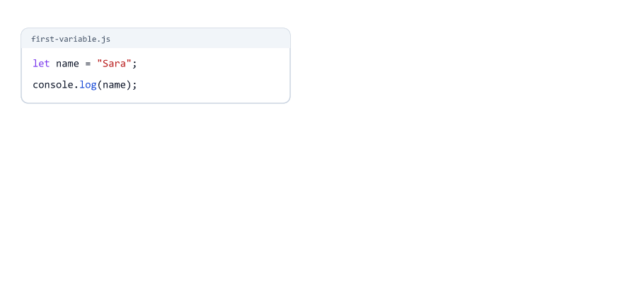
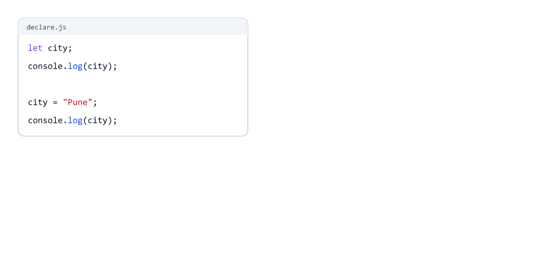
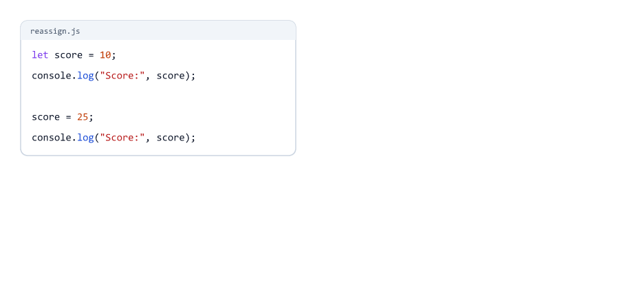
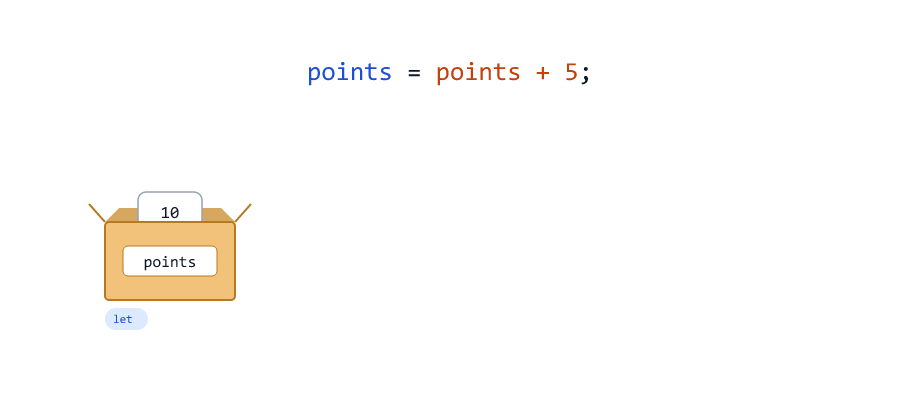
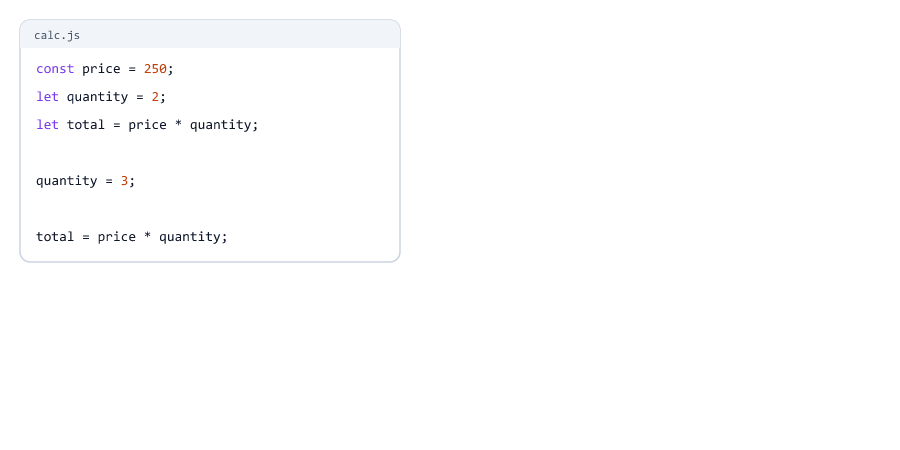
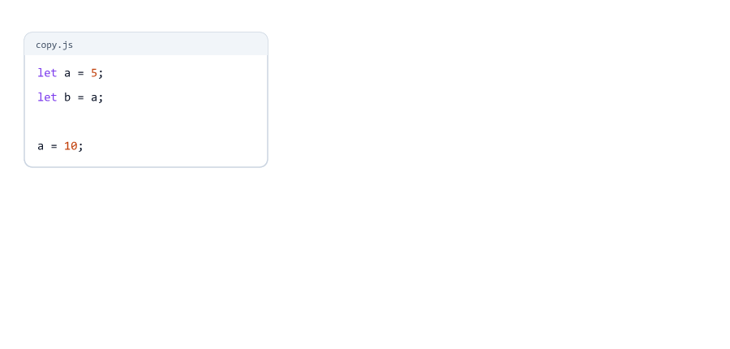
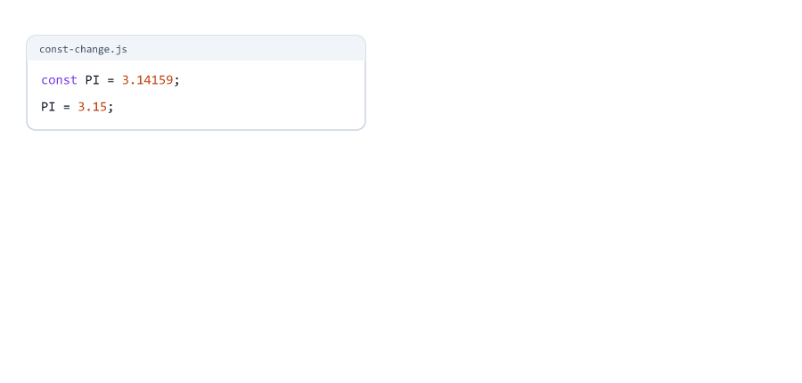
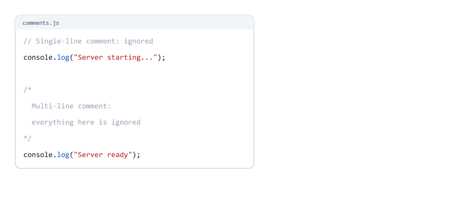

# Variables and Comments

> **Session 2 of 25** | Part 1: Basics | [All sessions](README.md#course-outline)

## Table of Contents
- [What is a Variable](#what-is-a-variable)
- [Creating a Variable with let](#creating-a-variable-with-let)
- [Declare Now, Assign Later](#declare-now-assign-later)
- [Changing a Value](#changing-a-value)
- [Updating a Variable with Its Own Value](#updating-a-variable-with-its-own-value)
- [A Variable Stores a Value, Not a Formula](#a-variable-stores-a-value-not-a-formula)
- [Copying a Value](#copying-a-value)
- [const: Values That Do Not Change](#const-values-that-do-not-change)
- [var: the Old Way](#var-the-old-way)
- [let vs const vs var](#let-vs-const-vs-var)
- [Declaring Several Variables](#declaring-several-variables)
- [Naming Rules](#naming-rules)
- [Reserved Words](#reserved-words)
- [Naming Conventions](#naming-conventions)
- [Variables in the REPL](#variables-in-the-repl)
- [Two Errors: "not defined" and "before initialization"](#two-errors-not-defined-and-before-initialization)
- [Comments](#comments)
- [Mini Example: An Order Bill](#mini-example-an-order-bill)
- [Beginner Mistakes](#beginner-mistakes)
- [Practice Exercises](#practice-exercises)
- [Interview Questions](#interview-questions)

---

## What is a Variable

A **variable** is a named box that stores a value. You put a value in the box, and later you use the name to get the value back.

first-variable.js

```javascript
let name = "Sara";
console.log(name);
console.log("Hello,", name);
```

Run

```bash
node first-variable.js
```

Output

```text
Sara
Hello, Sara
```



Notice: `console.log(name)` has **no quotes**. Without quotes, JavaScript looks for a variable called `name` and prints what is inside.

Why do we need variables? Programs remember things: a user's name, the items in a cart, the number of login attempts. A server is full of variables.

---

## Creating a Variable with let

```javascript
let name = "Sara";
```

| Part     | Meaning                                   |
| -------- | ----------------------------------------- |
| `let`    | Create a new variable                     |
| `name`   | The name of the variable (the label on the box) |
| `=`      | Put this value into it (assignment)       |
| `"Sara"` | The value                                 |
| `;`      | End of the statement                      |

The `=` sign does **not** mean "is equal to" like in math. It means "store the value on the right in the variable on the left".

---

## Declare Now, Assign Later

You can create the box first and put a value in it later

declare.js

```javascript
let city;           // declare: create an empty box
console.log(city);

city = "Pune";      // assign: put a value in it
console.log(city);
```

Output

```text
undefined
Pune
```



| Word                  | Meaning                                  | Example             |
| --------------------- | ---------------------------------------- | ------------------- |
| Declaration           | Creating the variable                    | `let city;`         |
| Assignment            | Putting a value in it                    | `city = "Pune";`    |
| Initialization        | The first assignment, often in the same line | `let city = "Pune";` |

A declared variable without a value holds `undefined`: JavaScript's word for "no value yet". You will learn more about `undefined` in Session 03.

---

## Changing a Value

A `let` variable can get a new value at any time. Write the name, `=` and the new value, **without** `let`

reassign.js

```javascript
let score = 10;
console.log("Score:", score);

score = 25;
console.log("Score:", score);
```

Output

```text
Score: 10
Score: 25
```



The old value is gone. A variable holds **one** value at a time.

---

## Updating a Variable with Its Own Value

Very often the new value depends on the old one: add points, count a new login, increase a price

update.js

```javascript
let points = 10;
points = points + 5;
console.log(points);

points = points * 2;
console.log(points);
```

Output

```text
15
30
```



How `points = points + 5` works

1. JavaScript calculates the **right side** first: the current value `10` + `5` = `15`
2. Then it stores the result in the variable on the left

There is a shorter way to write this (`points += 5`). You will learn it in Session 04.

---

## A Variable Stores a Value, Not a Formula

calc.js

```javascript
const price = 250;
let quantity = 2;
let total = price * quantity;
console.log("Total:", total);

quantity = 3;
console.log("Total:", total);

total = price * quantity;
console.log("Total:", total);
```

Output

```text
Total: 500
Total: 500
Total: 750
```



`total` stored the **result** `500`, not the formula `price * quantity`. Changing `quantity` later does not change `total`. To update it, run the calculation again.

(This is different from a spreadsheet like Excel, where a cell with a formula updates by itself.)

---

## Copying a Value

copy.js

```javascript
let a = 5;
let b = a;   // b gets a copy of the value 5

a = 10;
console.log("a:", a);
console.log("b:", b);
```

Output

```text
a: 10
b: 5
```



`let b = a` copies the value. After that, `a` and `b` are two separate boxes.

This is true for numbers and text. Objects and arrays behave differently when copied. You will learn why in Session 15.

---

## const: Values That Do Not Change

`const` (short for **constant**) creates a variable whose value is set **once**

const-ok.js

```javascript
const PI = 3.14159;
const appName = "Task Manager";

console.log(PI);
console.log(appName);
```

Output

```text
3.14159
Task Manager
```

Try to change it

const-change.js

```javascript
const PI = 3.14159;
PI = 3.15;
```

Output (the "at ..." lines removed)

```text
D:\js-practice\const-change.js:2
PI = 3.15;
   ^

TypeError: Assignment to constant variable.
```



A `const` must also get its value immediately

```javascript
const country;
```

```text
const country;
      ^^^^^^^

SyntaxError: Missing initializer in const declaration
```

| `const` rule                         | What happens if you break it                          |
| ------------------------------------ | ----------------------------------------------------- |
| Give it a value in the same line     | `SyntaxError: Missing initializer in const declaration` |
| Never assign a new value             | `TypeError: Assignment to constant variable.`         |

Why is this useful? `const` protects values that should never change, like a port number or a tax rate. If someone changes it by mistake, JavaScript stops them with an error.

> With objects and arrays, `const` locks the box but not what is inside. You will see this in Sessions 12 and 13.

---

## var: the Old Way

Before 2015, JavaScript had only `var`. You will still see it in old code and old tutorials

var-demo.js

```javascript
var color = "red";
var color = "blue";   // var allows this
color = "green";
console.log(color);
```

Output

```text
green
```

Why modern code avoids `var`

| Problem                                   | Example                                       |
| ----------------------------------------- | --------------------------------------------- |
| You can create the same name twice        | In a big file, you can overwrite a variable by accident and get no error |
| You can use it before the line that creates it | You get `undefined` instead of a clear error (see below) |
| It ignores blocks `{ }`                   | You will see this in Session 16               |

var-before.js

```javascript
console.log(city);
var city = "Pune";
```

Output

```text
undefined
```

With `let`, the same mistake gives a clear error (see [Two Errors](#two-errors-not-defined-and-before-initialization)). This course uses only `let` and `const`.

---

## let vs const vs var


| Feature                          | `let`          | `const`          | `var`                |
| -------------------------------- | -------------- | ---------------- | -------------------- |
| Can get a new value later        | Yes            | No               | Yes                  |
| Can create the same name again   | No             | No               | Yes (risky)          |
| Must get a value at once         | No             | Yes              | No                   |
| Added in                         | ES6 (2015)     | ES6 (2015)       | The first version    |
| Use it                           | When the value changes | **By default** | Only in old code   |

The rule professional developers follow

1. Start with `const`
2. If you need to change the value later, use `let`
3. Do not use `var`


choose.js

```javascript
const birthYear = 2001;   // never changes: const
let cartItems = 0;        // changes when the user adds items: let

cartItems = cartItems + 1;
cartItems = cartItems + 1;

console.log("Born in", birthYear);
console.log("Items in cart:", cartItems);
```

Output

```text
Born in 2001
Items in cart: 2
```

Settings that never change are often written in capital letters

settings.js

```javascript
const PORT = 3000;
const APP_NAME = "Task Manager";
const MAX_LOGIN_ATTEMPTS = 5;

console.log(APP_NAME, "runs on port", PORT);
console.log("Allowed login attempts:", MAX_LOGIN_ATTEMPTS);
```

Output

```text
Task Manager runs on port 3000
Allowed login attempts: 5
```

You will see `PORT` again in the Node.js course: every server listens on a port.

---

## Declaring Several Variables

You can declare several variables in one statement, separated by commas

multi.js

```javascript
let firstName = "Sara", lastName = "Khan", age = 24;
console.log(firstName, lastName, age);
```

Output

```text
Sara Khan 24
```

It works, but one variable per line is easier to read and to change. This course uses one per line.

---

## Naming Rules

These rules are **required**. Break one and you get a `SyntaxError`

| Rule                                          | Allowed            | Not allowed      |
| --------------------------------------------- | ------------------ | ---------------- |
| Use letters, digits, `_` and `$`              | `user_name`, `$price` | `first-name`  |
| Do not start with a digit                     | `item2`            | `1stPlace`       |
| No spaces                                     | `myName`           | `my name`        |
| Do not use reserved words                     | `className`        | `let`, `class`   |

good-names.js

```javascript
let userName = "sara_k";
let user_name = "sara_k";
let $price = 499;
let _count = 3;
let item2 = "Pen";
console.log(userName, user_name, $price, _count, item2);
```

Output

```text
sara_k sara_k 499 3 Pen
```


The real errors

| Code                       | Error                                                |
| -------------------------- | ---------------------------------------------------- |
| `let 1stPlace = "Sara";`   | `SyntaxError: Invalid or unexpected token`           |
| `let first-name = "Sara";` | `SyntaxError: Unexpected token '-'`                  |
| `let my name = "Sara";`    | `SyntaxError: Unexpected identifier 'name'`          |
| `let let = 5;`             | `SyntaxError: let is disallowed as a lexically bound name` |
| `let class = "10A";`       | `SyntaxError: Unexpected token 'class'`              |

`first-name` fails because `-` means minus: JavaScript reads it as `first - name`.

Names are **case-sensitive** (Session 01), so these are three different variables

case-names.js

```javascript
let age = 24;
let Age = 30;
let AGE = 50;
console.log(age, Age, AGE);
```

Output

```text
24 30 50
```

Do not do this in real code: it is very confusing.

---

## Reserved Words

Reserved words (also called **keywords**) have a special meaning in JavaScript, so you cannot use them as names.

Some you will learn in this course

| Keywords                                       | Used for             | Session |
| ---------------------------------------------- | -------------------- | ------- |
| `let`, `const`, `var`                          | Variables            | 02      |
| `if`, `else`, `switch`, `case`, `default`      | Conditions           | 06      |
| `for`, `while`, `do`, `break`, `continue`      | Loops                | 07      |
| `function`, `return`                           | Functions            | 10      |
| `class`, `extends`, `new`, `this`, `super`     | Classes              | 17      |
| `try`, `catch`, `finally`, `throw`             | Error handling       | 18      |
| `async`, `await`                               | Async code           | 25      |
| `true`, `false`, `null`, `typeof`              | Values and types     | 03      |

You do not need to memorise the list. If a name gives a strange `SyntaxError`, it may be a reserved word.

---

## Naming Conventions

These are not rules, but every JavaScript developer follows them. Good names make code easy to read.


| Style              | Example        | Used for                                    |
| ------------------ | -------------- | ------------------------------------------- |
| camelCase          | `totalAmount`  | Variables and functions (**the normal style**) |
| UPPER_SNAKE_CASE   | `TOTAL_AMOUNT` | Fixed settings, like `PORT` or `MAX_LOGIN_ATTEMPTS` |
| PascalCase         | `TotalAmount`  | Classes (Session 17)                        |
| snake_case         | `total_amount` | Other languages and database columns, not JavaScript variables |

**camelCase**: start with a small letter, and start each new word with a capital: `firstName`, `cartItems`, `isLoggedIn`.

Choose names that say what is inside

| Bad name   | Good name         | Why                                   |
| ---------- | ----------------- | ------------------------------------- |
| `x`        | `userAge`         | Says what the value is                |
| `n`        | `itemCount`       | Easy to understand later              |
| `data`     | `orderTotal`      | `data` could mean anything            |
| `flag`     | `isLoggedIn`      | Yes/no values usually start with `is` or `has` |
| `temp1`    | `discountPrice`   | Numbered names hide the meaning       |

Short names like `i` are fine in very small places, like loops (Session 07).

---

## Variables in the REPL

You can try variables in the Node.js REPL (Session 01)

```text
> let x = 5
undefined
> x
5
> x = 8
8
> x + 2
10
```

`let x = 5` shows `undefined` because creating a variable gives back nothing (the same reason as `console.log()` in Session 01). Typing just the name shows its value.

---

## Two Errors: "not defined" and "before initialization"

Two common errors look similar but mean different things.

**1. The variable does not exist at all** (often a typo)

typo-name.js

```javascript
let userName = "Sara";
console.log(username);
```

Output (the "at ..." lines removed)

```text
D:\js-practice\typo-name.js:2
console.log(username);
            ^

ReferenceError: username is not defined
```

`userName` and `username` are different names (capital N).

**2. The variable exists, but you used it before the line that creates it**

before.js

```javascript
console.log(total);
let total = 100;
```

Output (the "at ..." lines removed)

```text
D:\js-practice\before.js:1
console.log(total);
            ^

ReferenceError: Cannot access 'total' before initialization
```

| Error message                                 | Meaning                                  | Fix                                     |
| --------------------------------------------- | ---------------------------------------- | --------------------------------------- |
| `x is not defined`                            | No variable with this name exists        | Check the spelling and capital letters  |
| `Cannot access 'x' before initialization`     | It exists, but is used too early         | Move the `let` / `const` line above     |

The area above the `let` line, where the variable cannot be used yet, has a name: the **temporal dead zone**. You will learn why it exists in Session 16.

---

## Comments

Comments are notes for people. JavaScript ignores them.

| Type                | Syntax          | Use                                  |
| ------------------- | --------------- | ------------------------------------ |
| Single-line comment | `// text`       | Short notes, at the end of a line or on its own line |
| Multi-line comment  | `/* text */`    | Longer explanations over several lines |
| Doc comment         | `/** text */`   | Describing a value or function for tools and editors |

comments.js

```javascript
// Single-line comment: JavaScript ignores this line
console.log("Server starting...");

/*
  Multi-line comment:
  everything between the two markers is ignored
*/
console.log("Server ready");
```

Output

```text
Server starting...
Server ready
```



**Commenting out code.** Put `//` in front of a line to switch it off without deleting it. Useful when you are testing

comment-out.js

```javascript
console.log("Step 1");
// console.log("Step 2");
console.log("Step 3");
```

Output

```text
Step 1
Step 3
```

In VS Code, press `Ctrl + /` to comment or uncomment the selected lines.

**Doc comments** start with `/**`. Code editors show them when you hover over the name

jsdoc.js

```javascript
/**
 * The port number the server listens on.
 * Tools and code editors can read this kind of comment.
 */
const PORT = 3000;
console.log("Port:", PORT);
```

Output

```text
Port: 3000
```

In the Node.js course (Session 27), doc comments like this are used to create API documentation.

**Good comments explain why, not what**

```javascript
// Bad: says what the code already says
let price = 250; // price is 250

// Good: explains why
const DELIVERY_FEE = 40; // the courier company charges 40 per order
```

Good names often make comments unnecessary: `let orderTotal` needs no comment, `let t` does.

---

## Mini Example: An Order Bill

order-bill.js

```javascript
// Order bill: what an online shop's server calculates
const SHOP_NAME = "Sara's Books";
const DELIVERY_FEE = 40;

let customer = "Ravi";
let bookPrice = 250;
let quantity = 3;
let discount = 50;

let subtotal = bookPrice * quantity;
let total = subtotal + DELIVERY_FEE - discount;

console.log("==========", SHOP_NAME, "==========");
console.log("Customer:", customer);
console.log("Books:", quantity, "x", bookPrice, "=", subtotal);
console.log("Delivery:", DELIVERY_FEE);
console.log("Discount:", discount);
console.log("Total to pay:", total);
```

Run

```bash
node order-bill.js
```

Output

```text
========== Sara's Books ==========
Customer: Ravi
Books: 3 x 250 = 750
Delivery: 40
Discount: 50
Total to pay: 740
```

| Variable                     | Why `const` or `let`                                 |
| ---------------------------- | ---------------------------------------------------- |
| `SHOP_NAME`, `DELIVERY_FEE`  | Fixed settings: `const` in UPPER_SNAKE_CASE          |
| `customer`, `quantity`, ...  | Change with every order: `let` in camelCase          |
| `subtotal`, `total`          | Calculated from the other values                     |

Try it: change `quantity` to `5`, run again, and check that `total` changes. (It does, because the calculation runs after the new value is set.)

---

## Beginner Mistakes

### Mistake 1: Changing a const

**Incorrect**

```javascript
const PI = 3.14159;
PI = 3.15;
```

```text
TypeError: Assignment to constant variable.
```

**Correct:** if the value must change, use `let`. If it must not change, do not assign it again.

### Mistake 2: A const without a value

**Incorrect**

```javascript
const country;
```

```text
SyntaxError: Missing initializer in const declaration
```

**Correct:** `const` needs its value in the same line: `const country = "India";`

### Mistake 3: Writing let again to change a value

**Incorrect**

```javascript
let score = 10;
let score = 20;
```

```text
SyntaxError: Identifier 'score' has already been declared
```

**Correct:** use `let` only once, when you create the variable. To change it, write `score = 20;`

### Mistake 4: Using a variable before creating it

**Incorrect**

```javascript
console.log(total);
let total = 100;
```

```text
ReferenceError: Cannot access 'total' before initialization
```

**Correct:** create the variable first, then use it. Code runs top to bottom (Session 01).

### Mistake 5: A typo or a wrong capital letter

**Incorrect**

```javascript
let userName = "Sara";
console.log(username);
```

```text
ReferenceError: username is not defined
```

**Correct:** use exactly the same name: `console.log(userName);`

### Mistake 6: Putting the variable name in quotes

**Incorrect**

```javascript
let name = "Sara";
console.log("name");
```

```text
name
```

With quotes, it is just the text "name". **Correct:** `console.log(name);` prints `Sara`.

### Mistake 7: Expecting a variable to update by itself

**Incorrect:** changing `quantity` and expecting `total` to change. See [A Variable Stores a Value, Not a Formula](#a-variable-stores-a-value-not-a-formula).

**Correct:** run the calculation again after changing the values.

### Mistake 8: Invalid names

**Incorrect:** `let 1stPlace`, `let first-name`, `let my name`

**Correct:** `let firstPlace`, `let firstName`, `let myName`

### Mistake 9: Using var in new code

**Incorrect:** `var total = 0;`

**Correct:** `const` or `let`. `var` hides mistakes that `let` and `const` report as errors.

### Mistake 10: A comment inside a multi-line comment

**Incorrect**

nested.js

```javascript
/* Outer comment
   /* inner comment */
   This line is no longer inside a comment
*/
console.log("Hello");
```

```text
D:\js-practice\nested.js:3
   This line is no longer inside a comment
        ^^^^

SyntaxError: Unexpected identifier 'line'
```

The first `*/` ends the whole comment. **Correct:** do not put `/* */` inside `/* */`. Use `//` for the inner lines.

---

## Practice Exercises

### Exercise 1

Create variables for your name, your age and your city. Print them in one line, like `Sara 24 Pune`.

### Exercise 2

Create `let steps = 0;`. Add 2500 three times using `steps = steps + 2500;` and print the result after each step.

### Exercise 3

Create `const COUNTRY = "India";`, then try to change it. Read the error. Then try `const ZIP;` without a value and read that error too.

### Exercise 4

Which of these names are valid? Guess first, then test each one: `total_price`, `2ndItem`, `$discount`, `user-email`, `isAdmin`, `class`, `_secret`.

### Exercise 5

Rename these to good camelCase names: `x` (a user's email), `n` (number of orders), `flag` (whether the user is an admin), `MAXSIZE` (a fixed upload limit, use UPPER_SNAKE_CASE).

### Exercise 6

Create `let a = 3;` and `let b = 7;`. Swap their values so that `a` is 7 and `b` is 3. Hint: you need a third variable, like a third glass when you swap two drinks.

### Exercise 7

Write a "server settings" file with three `const` settings (`PORT`, `APP_NAME`, `MAX_USERS`) and one `let` variable `onlineUsers` that starts at 0. Increase `onlineUsers` twice and print everything.

### Exercise 8

Change the [mini example](#mini-example-an-order-bill): add a `const TAX = 30;` and include it in `total`. Add comments that explain each part.

---

## Interview Questions

### What is a variable?

A named container that stores a value, so the program can use and change it later.

### What is the difference between let, const and var?

`let` can be reassigned. `const` cannot be reassigned and must get a value immediately. `var` is the old way: it can be declared again with the same name and has other problems, so modern code uses `let` and `const`.

### Which one should you use by default?

`const`. Switch to `let` only when the value must change. Avoid `var`.

### What is the difference between declaration and initialization?

Declaration creates the variable (`let city;`). Initialization gives it its first value (`let city = "Pune";`).

### What value does a declared but unassigned variable have?

`undefined`.

### What happens if you reassign a const?

JavaScript throws `TypeError: Assignment to constant variable.`

### Can you declare a const without a value?

No. You get `SyntaxError: Missing initializer in const declaration`.

### What happens if you declare the same let variable twice?

`SyntaxError: Identifier '...' has already been declared`. With `var` there is no error, which can hide bugs.

### What are the rules for variable names?

Letters, digits, `_` and `$`; they cannot start with a digit, cannot contain spaces or `-`, and cannot be reserved words. Names are case-sensitive.

### What is camelCase?

A naming style where the first word is lowercase and each next word starts with a capital letter: `firstName`, `isLoggedIn`. It is the standard style for JavaScript variables.

### What is the difference between "x is not defined" and "Cannot access 'x' before initialization"?

"Not defined" means no variable with that name exists (often a typo). "Before initialization" means the variable exists, but is used above the line where it is created with `let` or `const`.

### What are the types of comments in JavaScript?

Single-line `//`, multi-line `/* */`, and doc comments `/** */` that tools and editors can read.

### Does changing one variable change a copy of it?

For numbers and text, no: `let b = a` copies the value, so changing `a` later does not change `b`. Objects and arrays are different (Session 15).

---

| Previous | All sessions | Next |
| :--- | :---: | ---: |
| [01. Introduction to JavaScript](01-introduction-to-javascript.md) | [Course outline](README.md#course-outline) | [03. Data Types](03-data-types.md) |
