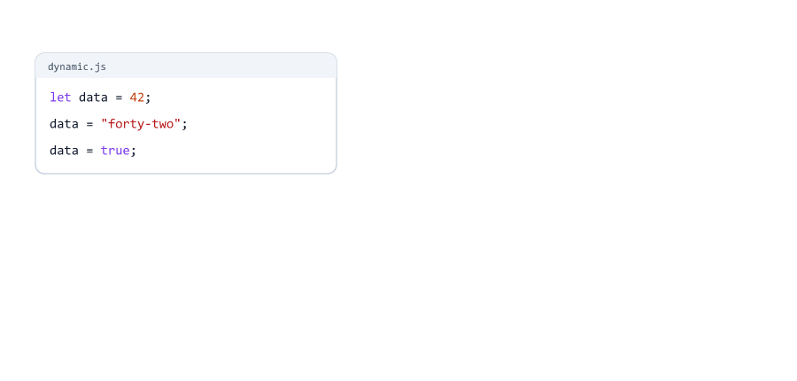

# Data Types

> **Session 3 of 25** | Part 1: Basics | [All sessions](README.md#course-outline)

## Table of Contents
- [What is a Data Type](#what-is-a-data-type)
- [The 8 Data Types](#the-8-data-types)
- [String](#string)
- [Number](#number)
- [NaN: Not a Number](#nan-not-a-number)
- [BigInt](#bigint)
- [Boolean](#boolean)
- [undefined and null](#undefined-and-null)
- [Symbol](#symbol)
- [Objects](#objects)
- [The typeof Operator](#the-typeof-operator)
- [Checking for null and Arrays](#checking-for-null-and-arrays)
- [Seeing Types in the REPL](#seeing-types-in-the-repl)
- [Dynamic Typing](#dynamic-typing)
- [Primitive vs Reference Types](#primitive-vs-reference-types)
- [Data Types on a Server](#data-types-on-a-server)
- [Mini Example: A User Record](#mini-example-a-user-record)
- [Beginner Mistakes](#beginner-mistakes)
- [Practice Exercises](#practice-exercises)
- [Interview Questions](#interview-questions)

---

## What is a Data Type

Every value in JavaScript has a **type**. The type tells JavaScript what kind of value it is, and what you can do with it.

| Value      | Type      | You can...                     |
| ---------- | --------- | ------------------------------ |
| `"Sara"`   | string    | Join it with other text        |
| `25`       | number    | Add, subtract, multiply        |
| `true`     | boolean   | Use it for yes/no decisions    |

The same-looking value can have different types: `25` is a number, but `"25"` (in quotes) is text. They behave differently, as you will see below. On a server this matters a lot, because data from users often arrives as text.

---

## The 8 Data Types

JavaScript has **7 primitive types** and **1 object type**.


| Type        | Example                | What it is                                   |
| ----------- | ---------------------- | -------------------------------------------- |
| `string`    | `"Sara"`               | Text                                         |
| `number`    | `42`, `3.14`           | Numbers, whole or decimal                    |
| `bigint`    | `9007199254740993n`    | Very big whole numbers                       |
| `boolean`   | `true`, `false`        | Yes or no                                    |
| `undefined` | `undefined`            | "No value yet"                               |
| `null`      | `null`                 | "No value, on purpose"                       |
| `symbol`    | `Symbol("id")`         | A unique identifier                          |
| `object`    | `{ name: "Sara" }`     | A collection of values (also arrays, functions, dates) |

**Primitive** means "one simple value". Objects are collections of many values.

---

## String

A string is **text**. Write it inside quotes

strings.js

```javascript
const single = 'Hello';
const double = "Hello";
const backticks = `Hello`;
const empty = "";
const age = "25";        // in quotes: this is text, not a number

console.log(single, double, backticks);
console.log(empty);
console.log(age);
```

Output

```text
Hello Hello Hello

25
```

The empty string `""` prints an empty line.

| Quotes          | Example     | Notes                                       |
| --------------- | ----------- | ------------------------------------------- |
| Single `' '`    | `'Hello'`   | Same as double quotes                       |
| Double `" "`    | `"Hello"`   | This course uses double quotes              |
| Backticks `` ` ` `` | `` `Hello` `` | Can also insert variables (Session 08) |

The quotes are not part of the value: `console.log()` prints `Hello`, without quotes.

**Quotes inside a string.** Use the other kind of quote around it

quotes-inside.js

```javascript
const message = "It's sunny";
const quote = 'Riya said "Hi"';
console.log(message);
console.log(quote);
```

Output

```text
It's sunny
Riya said "Hi"
```

With the same kind of quote, the string ends too early

quotes-error.js

```javascript
const message = 'It's sunny';
```

```text
D:\js-practice\quotes-error.js:1
const message = 'It's sunny';
                    ^

SyntaxError: Unexpected identifier 's'
```


You will learn string methods (like making text uppercase) in Session 08.

---

## Number

JavaScript has **one** number type for whole numbers and decimals

numbers.js

```javascript
const age = 25;
const price = 99.5;
const temperature = -8;
const population = 1_400_000_000;   // _ makes big numbers easier to read

console.log(age, price, temperature);
console.log(population);
```

Output

```text
25 99.5 -8
1400000000
```

The `_` is only for reading. JavaScript ignores it.

Numbers also have three special values

special-numbers.js

```javascript
console.log(10 / 0);
console.log(-10 / 0);
console.log("abc" * 2);
console.log(0.1 + 0.2);
```

Output

```text
Infinity
-Infinity
NaN
0.30000000000000004
```


| Value        | When you get it                             |
| ------------ | ------------------------------------------- |
| `Infinity`   | A number too big, or dividing by 0          |
| `-Infinity`  | A negative number too big                   |
| `NaN`        | A calculation that makes no sense           |

And `0.1 + 0.2` is not exactly `0.3`! Computers store decimals in a way that causes tiny errors. You will learn how to handle this in Session 09.

---

## NaN: Not a Number

`NaN` means "Not a Number". You get it when a calculation fails

typeof-nan.js

```javascript
const result = "abc" * 2;
console.log(result);
console.log(typeof result);
```

Output

```text
NaN
number
```


Funny but true: `NaN` is of type `number`. It is the number type's way of saying "this result is invalid". (`typeof` is explained [below](#the-typeof-operator).)

On a server, `NaN` often appears when a user types text where a number was expected. Session 05 shows how to check for it.

---

## BigInt

Normal numbers are exact only up to **9007199254740991** (about 9 quadrillion). Above that, the last digits become wrong

big.js

```javascript
console.log(Number.MAX_SAFE_INTEGER);
console.log(9007199254740993);    // one more than safe: printed wrong!

const bigNumber = 9007199254740993n;   // n at the end = BigInt
console.log(bigNumber);
console.log(bigNumber + 2n);
```

Output

```text
9007199254740991
9007199254740992
9007199254740993n
9007199254740995n
```


A **BigInt** is a whole number with `n` at the end. It can be as big as you want and stays exact.

You cannot mix BigInt and normal numbers

bigint-mix.js

```javascript
const total = 10n + 5;
```

```text
D:\js-practice\bigint-mix.js:1
const total = 10n + 5;
                  ^

TypeError: Cannot mix BigInt and other types, use explicit conversions
```

Write both as BigInt: `10n + 5n`. Where is BigInt used? For very large IDs (some databases and social media apps have IDs bigger than the safe limit) and huge counters. For normal numbers, use `number`.

---

## Boolean

A boolean has only two values: `true` and `false`. Like a light switch: on or off

booleans.js

```javascript
const isLoggedIn = true;
const hasPaid = false;
const isAdult = 20 > 18;

console.log(isLoggedIn, hasPaid);
console.log(isAdult);
console.log(5 > 10);
```

Output

```text
true false
true
false
```


`true` and `false` are written **without quotes**. `"true"` in quotes is a string.

Comparisons like `20 > 18` give a boolean. You will learn all comparisons in Session 04, and use booleans to make decisions in Session 06.

Boolean names usually start with `is`, `has` or `can`: `isLoggedIn`, `hasPaid`, `canEdit`.

---

## undefined and null

Both mean "no value", but in different ways

undefined-null.js

```javascript
let phoneNumber;             // nothing assigned yet
let profilePicture = null;   // we know: the user has no picture

console.log(phoneNumber);
console.log(profilePicture);
```

Output

```text
undefined
null
```


|               | `undefined`                              | `null`                                   |
| ------------- | ---------------------------------------- | ---------------------------------------- |
| Meaning       | "No value was given yet"                 | "There is no value, on purpose"          |
| Who sets it   | JavaScript, automatically                | You, in your code                        |
| Example       | `let phoneNumber;`                       | `let profilePicture = null;`             |
| `typeof`      | `"undefined"`                            | `"object"` (an old bug, see below)       |

Rule of thumb: let JavaScript create `undefined`. When **you** want to say "empty", use `null`. Databases and JSON (Session 19) also use `null` for empty values.

---

## Symbol

A symbol is a value that is always unique, even when two symbols have the same description

symbol.js

```javascript
const id1 = Symbol("id");
const id2 = Symbol("id");

console.log(id1);
console.log(id1 === id2);
```

Output

```text
Symbol(id)
false
```

(`===` checks if two values are exactly the same. Session 04 explains it.)

Symbols are used by libraries to create hidden, unique keys. Beginners rarely need them, but you should know the type exists.

---

## Objects

Everything that is not one of the 7 primitive types is an **object**: a collection of values

objects.js

```javascript
const user = { name: "Sara", age: 24 };
const scores = [90, 75, 88];
const today = new Date("2026-01-15");

console.log(user);
console.log(scores);
console.log(today);
```

Output

```text
{ name: 'Sara', age: 24 }
[ 90, 75, 88 ]
2026-01-15T00:00:00.000Z
```

Notice: when Node.js prints an object, it shows strings with **single** quotes (`'Sara'`), even if you wrote double quotes. That is just how Node.js displays them.

| Kind of object | Example                  | Session |
| -------------- | ------------------------ | ------- |
| Object         | `{ name: "Sara" }`       | 13      |
| Array          | `[90, 75, 88]`           | 12      |
| Function       | `console.log`            | 10      |
| Date           | `new Date("2026-01-15")` | 19      |

For now, just know that they exist and that their type is `object`.

---

## The typeof Operator

`typeof` tells you the type of a value. It gives back the type's name as a string

typeof.js

```javascript
console.log(typeof "Sara");
console.log(typeof 42);
console.log(typeof 3.14);
console.log(typeof 10n);
console.log(typeof true);
console.log(typeof undefined);
console.log(typeof null);
console.log(typeof Symbol("id"));
console.log(typeof { name: "Sara" });
console.log(typeof [1, 2, 3]);
console.log(typeof new Date());
console.log(typeof console.log);
```

Output

```text
string
number
number
bigint
boolean
undefined
object
symbol
object
object
object
function
```


Two surprises

| Code              | Result       | Why                                                    |
| ----------------- | ------------ | ------------------------------------------------------ |
| `typeof null`     | `"object"`   | A bug from 1995 that can never be fixed: fixing it would break old websites |
| `typeof [1, 2, 3]`| `"object"`   | Arrays are objects                                     |
| `typeof console.log` | `"function"` | Functions are objects, but `typeof` gives them their own name |

`typeof` works with variables too, and always gives back a **string**

typeof-vars.js

```javascript
const price = 499;
const label = "499";

console.log(typeof price);
console.log(typeof label);
console.log(typeof typeof price);   // typeof always gives back a string
```

Output

```text
number
string
string
```

`typeof` even works on a name that does not exist, without an error

typeof-undeclared.js

```javascript
console.log(typeof notCreatedYet);
console.log(notCreatedYet);
```

Output

```text
undefined
D:\js-practice\typeof-undeclared.js:2
console.log(notCreatedYet);
            ^

ReferenceError: notCreatedYet is not defined
```

The first line prints `undefined`. Only the second line, which tries to use the value, gives an error.

---

## Checking for null and Arrays

Because `typeof` says `"object"` for both `null` and arrays, use these checks instead

check-null-array.js

```javascript
const picture = null;
const tags = ["js", "node"];

console.log(typeof picture);          // "object" - not helpful
console.log(picture === null);        // true - the right way

console.log(typeof tags);             // "object" - not helpful
console.log(Array.isArray(tags));     // true - the right way
```

Output

```text
object
true
object
true
```

| To check            | Use                       |
| ------------------- | ------------------------- |
| Is it `null`?       | `value === null`          |
| Is it an array?     | `Array.isArray(value)`    |
| Anything else       | `typeof value`            |

---

## Seeing Types in the REPL

`console.log()` prints `"25"` and `25` exactly the same way. The Node.js REPL (Session 01) shows the difference: strings appear **with quotes**

```text
> "25"
'25'
> 25
25
> typeof "25"
'string'
> null
null
> 10n
10n
```

Use the REPL when you are not sure which type a value has.

---

## Dynamic Typing

In JavaScript, a variable does not have a fixed type. It can hold any type, and the type can change

dynamic.js

```javascript
let data = 42;
console.log(data, typeof data);

data = "forty-two";
console.log(data, typeof data);

data = true;
console.log(data, typeof data);
```

Output

```text
42 number
forty-two string
true boolean
```



This is called **dynamic typing**. It is flexible, but it can hide mistakes: nothing stops you from putting text where a number should be.

That is why many Node.js teams use **TypeScript**, a version of JavaScript where variables have fixed types. It is built on top of JavaScript, so everything in this course still applies.

---

## Primitive vs Reference Types

Primitive values are **copied**. Objects are **shared**

reference.js

```javascript
// Primitive: the value is copied
let a = "Sara";
let b = a;
a = "Ravi";
console.log(a, b);

// Object: both names point to the same object
const user1 = { name: "Sara" };
const user2 = user1;
user1.name = "Ravi";
console.log(user1.name, user2.name);
```

Output

```text
Ravi Sara
Ravi Ravi
```


| Kind        | `let b = a` does                     | Changing `a` later          |
| ----------- | ------------------------------------ | --------------------------- |
| Primitive   | Copies the value into a new box      | Does not change `b`         |
| Object      | Makes `b` point to the **same** object | `b` sees the change too   |

(`user1.name` reads the `name` inside the object: Session 13.) This difference causes many bugs. Session 15 shows how to make real copies of objects.

---

## Data Types on a Server

Text and numbers can look the same, but they behave differently

string-vs-number.js

```javascript
const ageFromForm = "25";   // text typed into a form
const ageFromDatabase = 25; // a real number

console.log(ageFromForm, ageFromDatabase);
console.log(typeof ageFromForm, typeof ageFromDatabase);

console.log(ageFromForm + 5);
console.log(ageFromDatabase + 5);
```

Output

```text
25 25
string number
255
30
```


`"25" + 5` glues text together: `"255"`. `25 + 5` adds numbers: `30`.

On a server, you get data from many places


| Data comes from            | Types you get                                  |
| -------------------------- | ---------------------------------------------- |
| A URL (`?page=2`)          | Always strings: `"2"`                          |
| A web form                 | Always strings: `"25"`, `"true"`               |
| JSON (Session 19)          | Strings, numbers, booleans, `null`, objects, arrays |
| A database                 | Real types: numbers, booleans, `null`, dates   |

So a backend developer always asks: "which type do I have here?" Session 05 shows how to convert `"25"` into the number `25`.

---

## Mini Example: A User Record

user-record.js

```javascript
// A user record, like a backend gets from a database
const userId = 1024;
const userName = "sara_k";
const isVerified = true;
const lastLogin = null;          // never logged in
let phoneNumber;                 // not given yet
const totalViews = 9007199254740993n;

console.log("userId:", userId, typeof userId);
console.log("userName:", userName, typeof userName);
console.log("isVerified:", isVerified, typeof isVerified);
console.log("lastLogin:", lastLogin, typeof lastLogin);
console.log("phoneNumber:", phoneNumber, typeof phoneNumber);
console.log("totalViews:", totalViews, typeof totalViews);
```

Run

```bash
node user-record.js
```

Output

```text
userId: 1024 number
userName: sara_k string
isVerified: true boolean
lastLogin: null object
phoneNumber: undefined undefined
totalViews: 9007199254740993n bigint
```

Notice `lastLogin: null object`: the `typeof null` bug in action.

---

## Beginner Mistakes

### Mistake 1: Numbers in quotes

**Incorrect**

```javascript
const ageFromForm = "25";   // text typed into a form
console.log(ageFromForm + 5);
```

```text
255
```

**Correct:** keep numbers without quotes (`25`), or convert text to a number first (Session 05).

### Mistake 2: The same quote inside a string

**Incorrect**

```javascript
const message = 'It's sunny';
```

```text
SyntaxError: Unexpected identifier 's'
```

**Correct**

```javascript
const message = "It's sunny";
```

### Mistake 3: Mixing BigInt and normal numbers

**Incorrect**

```javascript
const total = 10n + 5;
```

```text
TypeError: Cannot mix BigInt and other types, use explicit conversions
```

**Correct:** use BigInt on both sides: `10n + 5n`.

### Mistake 4: Checking null with typeof

**Incorrect:** `typeof picture` gives `"object"` for `null`.

**Correct:** `picture === null`.

### Mistake 5: Checking arrays with typeof

**Incorrect:** `typeof tags` gives `"object"` for arrays.

**Correct:** `Array.isArray(tags)`.

### Mistake 6: Expecting exact decimals

`0.1 + 0.2` gives `0.30000000000000004`, not `0.3`. This is normal for computers. Session 09 shows how to round results.

### Mistake 7: Thinking NaN is a string or an error

`NaN` is a special value of type `number`. It does not stop your program: it quietly spreads into later calculations. Check for it (Session 05).

### Mistake 8: Writing huge IDs as numbers

**Incorrect:** `9007199254740993` is printed as `9007199254740992`.

**Correct:** use BigInt (`9007199254740993n`), or keep such IDs as strings.

### Mistake 9: Setting undefined yourself

**Incorrect:** `let profilePicture = undefined;`

**Correct:** `let profilePicture = null;`. Use `null` when **you** mean "empty". Then `undefined` always means "never set", which makes bugs easier to find.

---

## Practice Exercises

### Exercise 1

Create one variable of each primitive type (string, number, bigint, boolean, undefined, null, symbol). Print each value and its `typeof`.

### Exercise 2

Guess the result, then check with `typeof`: `"42"`, `42`, `"false"`, `false`, `null`, `[]`, `{}`, `""`.

### Exercise 3

Print `typeof NaN`, `typeof Infinity` and `10 / 0`. Explain each result in a comment.

### Exercise 4

Write a string that contains both an apostrophe and double quotes, like `It's called "JavaScript"`. Hint: you will need backticks.

### Exercise 5

Print `9007199254740991 + 2` and `9007199254740991n + 2n`. Which one is correct?

### Exercise 6

Create `const price = "499";` and `const quantity = 2;`. Print `price + quantity` and `price * quantity`. One glues, one multiplies. Write down which is which (Session 05 explains why).

### Exercise 7

Create a product record for an online shop: name, price, in-stock status, discount (`null` if there is none) and a description that is not written yet. Print every value with its type, like the [mini example](#mini-example-a-user-record).

### Exercise 8

In the Node.js REPL, type `"10"`, `10`, `typeof "10"` and `typeof 10`. How does the REPL show strings differently from numbers?

---

## Interview Questions

### How many data types does JavaScript have?

Eight: seven primitive types (string, number, bigint, boolean, undefined, null, symbol) and object.

### What is the difference between primitive and object types?

A primitive holds one simple value and is copied when assigned to another variable. An object is a collection of values, and assigning it to another variable shares the same object.

### What is the difference between undefined and null?

`undefined` means a value was never set; JavaScript sets it automatically. `null` means "no value, on purpose"; you set it in your code.

### What does typeof null return, and why?

`"object"`. It is a bug from the first version of JavaScript that was never fixed, because fixing it would break old code.

### How do you check if a value is an array?

`Array.isArray(value)`. `typeof` returns `"object"` for arrays.

### What is NaN, and what is its type?

"Not a Number": the result of an invalid calculation like `"abc" * 2`. Its type is `number`.

### Why is 0.1 + 0.2 not equal to 0.3?

Computers store decimal numbers in binary, which cannot represent some decimals exactly. The result is `0.30000000000000004`.

### What is BigInt, and when do you need it?

A type for whole numbers of any size, written with `n` at the end. You need it for integers above `Number.MAX_SAFE_INTEGER` (9007199254740991), like very large IDs.

### Can you add a BigInt and a number?

No. `10n + 5` throws `TypeError: Cannot mix BigInt and other types`. Both must be BigInt.

### What is dynamic typing?

A variable can hold any type, and the type can change at any time. JavaScript is dynamically typed.

### What does typeof return?

Always a string with the type name, like `"number"` or `"string"`. So `typeof typeof 42` is `"string"`.

### What is a Symbol?

A primitive value that is always unique, even if two symbols have the same description. Used for unique keys.

### Why does it matter on a server whether a value is a string or a number?

Data from URLs and forms arrives as strings. `"25" + 5` gives `"255"`, not `30`, so the server must convert values to the right type before calculating.

---

| Previous | All sessions | Next |
| :--- | :---: | ---: |
| [02. Variables and Comments](02-variables-and-comments.md) | [Course outline](README.md#course-outline) | [04. Operators](04-operators.md) |
