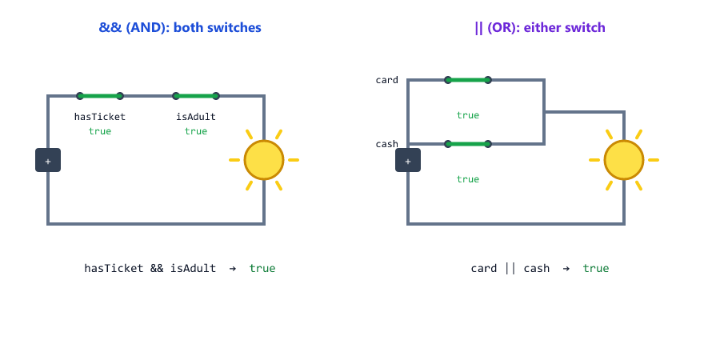

# Operators

## Table of Contents
- [What is an Operator](#what-is-an-operator)
- [Types of Operators](#types-of-operators)
- [Arithmetic Operators](#arithmetic-operators)
- [The Remainder Operator %](#the-remainder-operator-)
- [The Power Operator **](#the-power-operator-)
- [+ Joins Text](#-joins-text)
- [Increment and Decrement](#increment-and-decrement)
- [Assignment Operators](#assignment-operators)
- [Comparison Operators](#comparison-operators)
- [== vs ===](#-vs-)
- [Comparing NaN](#comparing-nan)
- [Comparing Text](#comparing-text)
- [Comparing Objects](#comparing-objects)
- [Logical Operators](#logical-operators)
- [Short-Circuit Evaluation](#short-circuit-evaluation)
- [Default Values with || and ??](#default-values-with--and-)
- [Operator Precedence](#operator-precedence)
- [Try Operators in the REPL](#try-operators-in-the-repl)
- [Mini Example: Checkout Check](#mini-example-checkout-check)
- [Beginner Mistakes](#beginner-mistakes)
- [Practice Exercises](#practice-exercises)
- [Interview Questions](#interview-questions)

---

## What is an Operator

An **operator** is a symbol that does something with values: add them, compare them, combine them.


| Word        | Meaning                                    | In `5 + 3`        |
| ----------- | ------------------------------------------ | ----------------- |
| Operator    | The symbol that does the work              | `+`               |
| Operand     | A value the operator works on              | `5` and `3`       |
| Expression  | Any piece of code that produces a value    | `5 + 3` (gives `8`) |

`price * quantity > 1000` is also an expression: it produces `true` or `false`.

---

## Types of Operators

| Type         | Operators                              | Example                | Result    |
| ------------ | -------------------------------------- | ---------------------- | --------- |
| Arithmetic   | `+ - * / % **`                         | `17 % 5`               | `2`       |
| Assignment   | `= += -= *= /= %= **=`                 | `score += 5`           | adds 5    |
| Comparison   | `> < >= <= === !== == !=`              | `age >= 18`            | `true`    |
| Logical      | `&& \|\| !`                            | `isAdult && hasTicket` | `true`    |
| Nullish      | `??`                                   | `null ?? "Guest"`      | `"Guest"` |
| Type         | `typeof`                               | `typeof 42`            | `"number"` (Session 03) |

There is one more: the conditional operator `? :`. You will learn it with conditions in Session 06.

---

## Arithmetic Operators

arithmetic.js

```javascript
const a = 17;
const b = 5;

console.log(a + b);    // addition
console.log(a - b);    // subtraction
console.log(a * b);    // multiplication
console.log(a / b);    // division
console.log(a % b);    // remainder
console.log(2 ** 10);  // exponent: 2 to the power of 10
```

Output

```text
22
12
85
3.4
2
1024
```


| Operator | Name           | Example   | Result  |
| -------- | -------------- | --------- | ------- |
| `+`      | Addition       | `17 + 5`  | `22`    |
| `-`      | Subtraction    | `17 - 5`  | `12`    |
| `*`      | Multiplication | `17 * 5`  | `85`    |
| `/`      | Division       | `17 / 5`  | `3.4`   |
| `%`      | Remainder      | `17 % 5`  | `2`     |
| `**`     | Exponent       | `2 ** 10` | `1024`  |

Notice: `17 / 5` gives `3.4`, not `3`. JavaScript division keeps the decimals. (Rounding is in Session 09.)

---

## The Remainder Operator %

`%` gives what is **left over** after dividing. It is often called "modulo".


remainder.js

```javascript
// Even or odd: the remainder after dividing by 2
console.log(8 % 2);   // 0 means even
console.log(7 % 2);   // 1 means odd

// 135 minutes = how many hours and minutes?
const totalMinutes = 135;
const minutesLeft = totalMinutes % 60;
const hours = (totalMinutes - minutesLeft) / 60;
console.log(hours, "hours and", minutesLeft, "minutes");
```

Output

```text
0
1
2 hours and 15 minutes
```

| Use                        | Example                 |
| -------------------------- | ----------------------- |
| Even or odd                | `n % 2` is `0` for even numbers |
| Split time                 | `135 % 60` is `15` minutes left |
| Every Nth item             | `itemNumber % 3` is `0` for every third item |

---

## The Power Operator **

exp-ok.js

```javascript
console.log((-2) ** 2);
console.log(-(2 ** 2));
console.log(2 ** 3 ** 2);
console.log(100 / 10 / 2);
```

Output

```text
4
-4
512
5
```

| Code             | Result | Why                                                  |
| ---------------- | ------ | ---------------------------------------------------- |
| `(-2) ** 2`      | `4`    | -2 times -2                                          |
| `-(2 ** 2)`      | `-4`   | minus (2 times 2)                                    |
| `2 ** 3 ** 2`    | `512`  | `**` works from the **right**: `2 ** 9`              |
| `100 / 10 / 2`   | `5`    | Most operators work from the left: `10 / 2`          |

Writing `-2 ** 2` without brackets is not allowed, because it is unclear

exp-error.js

```javascript
console.log(-2 ** 2);
```

```text
console.log(-2 ** 2);
            ^^^^^

SyntaxError: Unary operator used immediately before exponentiation expression. Parenthesis must be used to disambiguate operator precedence
```

---

## + Joins Text

With text, `+` does not add. It **joins** (concatenates)

plus-strings.js

```javascript
const firstName = "Sara";
const lastName = "Khan";

console.log(firstName + " " + lastName);
console.log("Total: " + 499);
console.log("5" + 1);
console.log(1 + 2 + "3");
console.log("1" + 2 + 3);
console.log("10" - 2);
```

Output

```text
Sara Khan
Total: 499
51
33
123
8
```


The rules

| Code            | Result    | Why                                                   |
| --------------- | --------- | ----------------------------------------------------- |
| `"5" + 1`       | `"51"`    | If one side is text, `+` joins                        |
| `1 + 2 + "3"`   | `"33"`    | Left to right: `1 + 2 = 3` first, then `3 + "3"`      |
| `"1" + 2 + 3`   | `"123"`   | `"1" + 2 = "12"`, then `"12" + 3`                     |
| `"10" - 2`      | `8`       | `-`, `*`, `/` always do math, so `"10"` becomes `10`  |

This is one of the most common bugs on servers, because values from forms and URLs are text (Session 03). Session 05 explains all the conversion rules. A cleaner way to put values into text is template literals (Session 08).

---

## Increment and Decrement

`++` adds 1 and `--` subtracts 1

increment.js

```javascript
let count = 5;
count++;              // add 1
console.log(count);

count--;              // subtract 1
console.log(count);

let a = 5;
console.log(a++);     // prints the OLD value, then adds 1
console.log(a);

let b = 5;
console.log(++b);     // adds 1 first, then prints the NEW value
```

Output

```text
6
5
5
6
6
```


| Code   | Name           | Gives back      | Then the variable is |
| ------ | -------------- | --------------- | -------------------- |
| `a++`  | Post-increment | The old value   | +1                   |
| `++a`  | Pre-increment  | The new value   | +1                   |
| `a--`  | Post-decrement | The old value   | -1                   |
| `--a`  | Pre-decrement  | The new value   | -1                   |

Tip: write `count++;` on its own line. Then "before" or "after" does not matter, and your code is easy to read.

`++` and `--` only work on variables: `5++` is an error. A `const` cannot use them either, because they change the value.

---

## Assignment Operators

You know `=` from Session 02. Each math operator also has a short form

assignment.js

```javascript
let score = 10;

score += 5;    // score = score + 5
console.log(score);
score -= 3;    // score = score - 3
console.log(score);
score *= 2;    // score = score * 2
console.log(score);
score /= 4;    // score = score / 4
console.log(score);
score %= 4;    // score = score % 4
console.log(score);
score **= 3;   // score = score ** 3
console.log(score);

let message = "Hello";
message += ", world";
message += "!";
console.log(message);
```

Output

```text
15
12
24
6
2
8
Hello, world!
```


| Operator | Example      | Same as             |
| -------- | ------------ | ------------------- |
| `=`      | `x = 5`      | Store 5             |
| `+=`     | `x += 5`     | `x = x + 5`         |
| `-=`     | `x -= 3`     | `x = x - 3`         |
| `*=`     | `x *= 2`     | `x = x * 2`         |
| `/=`     | `x /= 4`     | `x = x / 4`         |
| `%=`     | `x %= 4`     | `x = x % 4`         |
| `**=`    | `x **= 3`    | `x = x ** 3`        |

`+=` also works with text: it adds text to the end.

---

## Comparison Operators

A comparison always gives a boolean: `true` or `false` (Session 03)

compare.js

```javascript
const age = 20;

console.log(age > 18);    // greater than
console.log(age < 18);    // less than
console.log(age >= 20);   // greater than or equal
console.log(age <= 19);   // less than or equal
console.log(age === 20);  // equal
console.log(age !== 20);  // not equal
```

Output

```text
true
false
true
false
true
false
```

| Operator | Meaning                   | Example      | Result  |
| -------- | ------------------------- | ------------ | ------- |
| `>`      | Greater than              | `20 > 18`    | `true`  |
| `<`      | Less than                 | `20 < 18`    | `false` |
| `>=`     | Greater than or equal     | `20 >= 20`   | `true`  |
| `<=`     | Less than or equal        | `20 <= 19`   | `false` |
| `===`    | Equal (value and type)    | `20 === 20`  | `true`  |
| `!==`    | Not equal                 | `20 !== 20`  | `false` |

In Session 06 you will use comparisons to make decisions, like "if the user is 18 or older, allow sign-up".

---

## == vs ===

JavaScript has two kinds of "equal"

equality.js

```javascript
console.log(5 == "5");     // loose: converts "5" to 5 first
console.log(5 === "5");    // strict: a number is not a string

console.log(5 != "5");
console.log(5 !== "5");
```

Output

```text
true
false
false
true
```


| Operator | Name             | Converts types first? |
| -------- | ---------------- | --------------------- |
| `==`     | Loose equality   | Yes                   |
| `===`    | Strict equality  | No                    |
| `!=`     | Loose inequality | Yes                   |
| `!==`    | Strict inequality| No                    |

The conversion of `==` gives surprising results

loose-surprises.js

```javascript
console.log(0 == "");           // true!
console.log(0 == false);        // true!
console.log("1" == true);       // true!
console.log(null == undefined); // true!

console.log(0 === "");          // false
console.log(0 === false);       // false
console.log("1" === true);      // false
console.log(null === undefined);// false
```

Output

```text
true
true
true
true
false
false
false
false
```


**The rule: always use `===` and `!==`.** Professional code and code checkers (linters) do the same. If you need to compare a string with a number, convert it first (Session 05).

---

## Comparing NaN

`NaN` (Session 03) is not equal to anything, **not even itself**

nan-compare.js

```javascript
const result = "abc" * 2;
console.log(result === NaN);   // false! NaN is not equal to anything
console.log(NaN === NaN);      // false
```

Output

```text
false
false
```

So `=== NaN` never works. Session 05 shows the right check: `Number.isNaN()`.

---

## Comparing Text

Text is compared letter by letter, like words in a dictionary

string-compare.js

```javascript
console.log("apple" < "banana");   // a comes before b
console.log("Zebra" < "apple");    // capital letters come first!
console.log("10" < "9");           // compared as text: "1" < "9"
console.log(10 < 9);               // compared as numbers
```

Output

```text
true
true
true
false
```


| Comparison         | Result   | Why                                           |
| ------------------ | -------- | --------------------------------------------- |
| `"apple" < "banana"` | `true` | `a` comes before `b`                          |
| `"Zebra" < "apple"`  | `true` | All capital letters come before small letters |
| `"10" < "9"`         | `true` | The first letters decide: `"1"` < `"9"`       |

`"10" < "9"` is a real backend bug: a URL like `?minPrice=10` gives the **text** `"10"`. Convert it to a number before comparing (Session 05).

---

## Comparing Objects

Objects are compared by **reference**: is it the same object? Not "do they look the same?" (Session 03)

object-compare.js

```javascript
const user1 = { name: "Sara" };
const user2 = { name: "Sara" };
const user3 = user1;

console.log(user1 === user2);   // two different objects
console.log(user1 === user3);   // the same object
```

Output

```text
false
true
```

`user1` and `user2` look the same, but they are two separate objects. Session 13 shows how to compare their contents.

---

## Logical Operators

Logical operators combine booleans

logical.js

```javascript
const age = 20;
const hasTicket = true;
const isVip = false;

console.log(age >= 18 && hasTicket);   // AND: both must be true
console.log(age >= 18 && isVip);
console.log(hasTicket || isVip);       // OR: at least one must be true
console.log(isVip || age < 18);
console.log(!isVip);                   // NOT: flips true and false
```

Output

```text
true
false
true
false
true
```



| Operator | Name | True when                          |
| -------- | ---- | ---------------------------------- |
| `&&`     | AND  | **Both** sides are true            |
| `\|\|`   | OR   | **At least one** side is true      |
| `!`      | NOT  | The value is false (it flips it)   |

Truth tables

| `a`     | `b`     | `a && b` | `a \|\| b` |
| ------- | ------- | -------- | ---------- |
| `true`  | `true`  | `true`   | `true`     |
| `true`  | `false` | `false`  | `true`     |
| `false` | `true`  | `false`  | `true`     |
| `false` | `false` | `false`  | `false`    |

Real backend examples

| Question                                     | Code                                   |
| -------------------------------------------- | -------------------------------------- |
| Can this user edit the post?                 | `isLoggedIn && isAuthor`               |
| Can they pay?                                | `hasCard \|\| hasWallet`               |
| Is the account usable?                       | `!isBlocked`                           |

---

## Short-Circuit Evaluation

`&&` and `||` stop as soon as they know the answer. The right side may **never run**

short-circuit.js

```javascript
const isLoggedIn = false;
// && stops at the first false: the right side never runs
isLoggedIn && console.log("Welcome back!");

const isGuest = true;
// || stops at the first true: the right side never runs
isGuest || console.log("You are not a guest");

console.log("Done");
```

Output

```text
Done
```

| Operator | Stops when the left side is | Because                              |
| -------- | --------------------------- | ------------------------------------ |
| `&&`     | `false`                     | The answer is `false`, whatever the right side is |
| `\|\|`   | `true`                      | The answer is `true`, whatever the right side is  |

This is called **short-circuit evaluation**. You will see it a lot in real code.

---

## Default Values with || and ??

`||` and `??` can also choose between two values. This is used to give a **default value** when something is missing

defaults.js

```javascript
let nickname = null;
console.log(nickname || "Guest");
console.log(nickname ?? "Guest");

let quantity = 0;              // the user really wants 0 items
console.log(quantity || 1);    // 1: wrong! || treats 0 as empty
console.log(quantity ?? 1);    // 0: right! ?? only replaces null and undefined
```

Output

```text
Guest
Guest
1
0
```


| Operator | Uses the default when the left side is                  |
| -------- | ------------------------------------------------------- |
| `\|\|`   | Any "empty-like" value: `null`, `undefined`, `0`, `""`, `false`, `NaN` |
| `??`     | Only `null` or `undefined`                              |

The "empty-like" values are called **falsy** values. You will learn them in Session 05.

Use `??` when `0` or `""` are real values: a quantity of 0, a price of 0, an empty comment. `??` is called the **nullish coalescing** operator (ES2020).

---

## Operator Precedence

When an expression has several operators, some go first. This is called **precedence**

precedence.js

```javascript
console.log(2 + 3 * 4);        // * first: 2 + 12
console.log((2 + 3) * 4);      // ( ) first: 5 * 4
console.log(10 - 4 - 3);       // left to right: 6 - 3

const price = 300;
const quantity = 4;
const isMember = true;
console.log(price * quantity > 1000 && isMember);
```

Output

```text
14
20
3
true
```


The order, from first to last

| Order | Operators                   |
| ----- | --------------------------- |
| 1     | `( )` brackets              |
| 2     | `!`, `++`, `--`, `typeof`   |
| 3     | `**`                        |
| 4     | `*`, `/`, `%`               |
| 5     | `+`, `-`                    |
| 6     | `<`, `>`, `<=`, `>=`        |
| 7     | `===`, `!==`, `==`, `!=`    |
| 8     | `&&`                        |
| 9     | `\|\|`, `??`                |
| 10    | `=`, `+=`, `-=` and the other assignments |

`price * quantity > 1000 && isMember` works step by step: `300 * 4 = 1200`, then `1200 > 1000` is `true`, then `true && true` is `true`.

You do not need to memorise the table. **When in doubt, add brackets**: `(price * quantity > 1000) && isMember` is easier to read.

---

## Try Operators in the REPL

The Node.js REPL (Session 01) is perfect for testing operators

```text
> let x = 5
undefined
> x++
5
> x
6
> ++x
7
> 5 == "5"
true
> 5 === "5"
false
```

---

## Mini Example: Checkout Check

checkout.js

```javascript
// Checkout check: what a shop's server works out before taking payment
const FREE_DELIVERY_FROM = 500;
const MAX_PER_ORDER = 10;

const itemPrice = 180;
let quantity = 2;
quantity += 1;                        // the user adds one more

const couponDiscount = null;          // no coupon used
const discount = couponDiscount ?? 0;

const subtotal = itemPrice * quantity - discount;
const freeDelivery = subtotal >= FREE_DELIVERY_FROM;

const isLoggedIn = true;
const canCheckout = isLoggedIn && quantity > 0 && quantity <= MAX_PER_ORDER;

console.log("Items:", quantity);
console.log("Subtotal:", subtotal);
console.log("Free delivery:", freeDelivery);
console.log("Can check out:", canCheckout);
```

Run

```bash
node checkout.js
```

Output

```text
Items: 3
Subtotal: 540
Free delivery: true
Can check out: true
```

| Operator used   | Where                                                   |
| --------------- | ------------------------------------------------------- |
| `+=`            | Adding one more item                                    |
| `??`            | No coupon (`null`) means a discount of `0`              |
| `*` and `-`     | Price times quantity, minus the discount                |
| `>=`            | Free delivery from 500                                  |
| `&&`, `>`, `<=` | Logged in, at least one item, not more than 10          |

Try it: change `quantity` to `12`, or `isLoggedIn` to `false`, and run it again.

---

## Beginner Mistakes

### Mistake 1: Using == instead of ===

**Incorrect:** `0 == ""` is `true`, `0 == false` is `true`.

**Correct:** use `===` and `!==`. They never convert types.

### Mistake 2: Using = when you mean ===

**Incorrect**

```javascript
let price = 100;
console.log(price = 200);
```

```text
200
```

`=` **stores** a value; it does not compare. This changed `price` to `200`! **Correct:** `console.log(price === 200);`

### Mistake 3: Writing =+ instead of +=

**Incorrect**

```javascript
let total = 10;
total =+ 5;
console.log(total);
```

```text
5
```

`=+ 5` means "store +5". No error, just a wrong result. **Correct:** `total += 5;` gives `15`.

### Mistake 4: Chaining comparisons like in math

**Incorrect**

```javascript
const age = 20;
console.log(30 > age > 10);
```

```text
false
```

JavaScript does `30 > 20` (`true`) first, then `true > 10`, which is `false`. **Correct:** `age > 10 && age < 30`.

### Mistake 5: Adding numbers that are text

**Incorrect:** `"5" + 1` gives `"51"`.

**Correct:** make sure both are numbers before adding (Session 05).

### Mistake 6: Comparing numbers that are text

**Incorrect:** `"10" < "9"` gives `true`.

**Correct:** convert to numbers first: `10 < 9` gives `false`.

### Mistake 7: Checking NaN with ===

**Incorrect:** `result === NaN` is always `false`.

**Correct:** `Number.isNaN(result)` (Session 05).

### Mistake 8: A minus sign before **

**Incorrect:** `-2 ** 2` is a `SyntaxError`.

**Correct:** `(-2) ** 2` (gives `4`) or `-(2 ** 2)` (gives `-4`).

### Mistake 9: || for defaults when 0 is a real value

**Incorrect:** `quantity || 1` turns a real `0` into `1`.

**Correct:** `quantity ?? 1` keeps the `0`.

### Mistake 10: Confusing a++ and ++a

**Incorrect:** `console.log(a++)` prints the **old** value.

**Correct:** put `a++;` on its own line, then print `a`.

---

## Practice Exercises

### Exercise 1

Create `const a = 25;` and `const b = 4;`. Print the result of all six arithmetic operators.

### Exercise 2

Use `%` to print whether `14`, `27` and `100` are even (0) or odd (1).

### Exercise 3

A video is `5000` seconds long. Calculate and print the hours, minutes and seconds. Hint: use `%` and `/` like the minutes example.

### Exercise 4

Guess, then check: `"3" + 4 + 5`, `3 + 4 + "5"`, `"20" - 5`, `"6" * "7"`.

### Exercise 5

Create `let balance = 1000;`. Use `-=` for two purchases (250 and 120), `+=` for a refund of 50, and print the balance after each step.

### Exercise 6

Create `age`, `hasId` and `isBanned`. Print whether the person can enter a club: they must be 18 or older, have an ID, and not be banned. Use `&&` and `!`.

### Exercise 7

Create `let pageSize = null;` and `let pageNumber = 0;`. Use `??` to give `pageSize` a default of `20` and `pageNumber` a default of `1`. What do you get? What would `||` give for `pageNumber`?

### Exercise 8

Without running it, work out the result of `10 + 2 * 3 ** 2 > 25 && !false`. Then add brackets that show the order, and run it to check.

---

## Interview Questions

### What is the difference between == and ===?

`==` converts both values to the same type before comparing, which gives surprises like `0 == ""` being `true`. `===` compares both value and type, without converting. Use `===`.

### What does the % operator do?

It gives the remainder of a division: `17 % 5` is `2`. It is used to check even/odd numbers and to split values like minutes into hours.

### What is the difference between a++ and ++a?

Both add 1. `a++` gives back the old value, `++a` gives back the new value.

### What is the result of "5" + 1 and "5" - 1?

`"5" + 1` is `"51"` because `+` joins when one side is text. `"5" - 1` is `4` because `-` always does math.

### What is the result of 1 + 2 + "3"?

`"33"`. JavaScript works left to right: `1 + 2` is `3`, then `3 + "3"` joins to `"33"`.

### What do && and || return?

With booleans, `true` or `false`. More precisely, they return one of the two values: `&&` stops at the first false value, `||` stops at the first true value.

### What is short-circuit evaluation?

`&&` and `||` stop evaluating as soon as the result is known. In `false && x`, `x` never runs; in `true || x`, `x` never runs.

### What is the difference between || and ???

`||` uses the default for any falsy value (`0`, `""`, `false`, `null`, `undefined`, `NaN`). `??` uses it only for `null` and `undefined`, so `0 ?? 5` is `0` but `0 || 5` is `5`.

### Why is NaN === NaN false?

`NaN` is defined to be unequal to every value, including itself. Use `Number.isNaN()` to check for it.

### Why is "10" < "9" true?

Both are strings, so they are compared letter by letter. `"1"` comes before `"9"`, so `"10"` is smaller.

### How are objects compared with ===?

By reference: `===` is `true` only if both sides are the same object, not just objects with the same contents.

### What is operator precedence?

The order in which operators run in an expression. `*` runs before `+`, so `2 + 3 * 4` is `14`. Brackets change the order.

### Why is -2 ** 2 a SyntaxError?

It is unclear whether you mean `(-2) ** 2` or `-(2 ** 2)`, so JavaScript requires brackets.

### What does x += 5 mean?

It is short for `x = x + 5`.
