# Conditionals

> **Session 6 of 25** | Part 1: Basics | [All sessions](README.md#course-outline)

## Table of Contents
- [What are Conditionals](#what-are-conditionals)
- [The if Statement](#the-if-statement)
- [if...else](#ifelse)
- [else if](#else-if)
- [The Order of Checks Matters](#the-order-of-checks-matters)
- [Conditions with Truthy and Falsy Values](#conditions-with-truthy-and-falsy-values)
- [Combining Conditions](#combining-conditions)
- [Nested if vs Flat else if](#nested-if-vs-flat-else-if)
- [The Ternary Operator](#the-ternary-operator)
- [switch](#switch)
- [Forgetting break: Fall-Through](#forgetting-break-fall-through)
- [Grouping Cases](#grouping-cases)
- [switch Uses ===](#switch-uses-)
- [if or switch?](#if-or-switch)
- [Blocks and Scope](#blocks-and-scope)
- [Always Use Braces](#always-use-braces)
- [Mini Example 1: Checkout Total](#mini-example-1-checkout-total)
- [Mini Example 2: Sign-up Validation](#mini-example-2-sign-up-validation)
- [Beginner Mistakes](#beginner-mistakes)
- [Practice Exercises](#practice-exercises)
- [Interview Questions](#interview-questions)

---

## What are Conditionals

Until now, every line of your code ran, top to bottom. **Conditionals** let your program make decisions: run some code only when a condition is true.

A server makes decisions all the time

| Question                                  | Decision                                  |
| ----------------------------------------- | ----------------------------------------- |
| Is the password correct?                  | Log in, or show an error                  |
| Is the product in stock?                  | Add it to the cart, or say "Sold out"     |
| Is the user an admin?                     | Show the admin panel, or refuse           |
| Is the order over 1000?                   | Free delivery, or charge a fee            |

JavaScript has three tools for decisions: `if`, `switch`, and the ternary operator `? :`.

---

## The if Statement

if-basic.js

```javascript
const age = 20;

if (age >= 18) {
  console.log("You can create an account");
}

console.log("Done");
```

Output

```text
You can create an account
Done
```

Change the age to 15

if-skip.js

```javascript
const age = 15;

if (age >= 18) {
  console.log("You can create an account");
}

console.log("Done");
```

Output

```text
Done
```

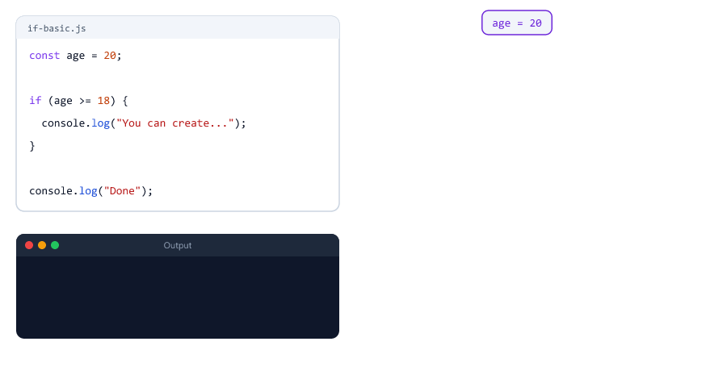

| Part                     | Meaning                                              |
| ------------------------ | ---------------------------------------------------- |
| `if`                     | The keyword                                          |
| `(age >= 18)`            | The **condition**, in brackets. Usually gives `true` or `false` |
| `{ ... }`                | The **block**: the code that runs when the condition is true |
| The indentation          | Two spaces inside the block, to make it easy to read |

`Done` always prints, because it is outside the block.

---

## if...else

`else` gives a second block that runs when the condition is **false**

if-else.js

```javascript
const stock = 0;

if (stock > 0) {
  console.log("Add to cart");
} else {
  console.log("Sold out");
}
```

Output

```text
Sold out
```

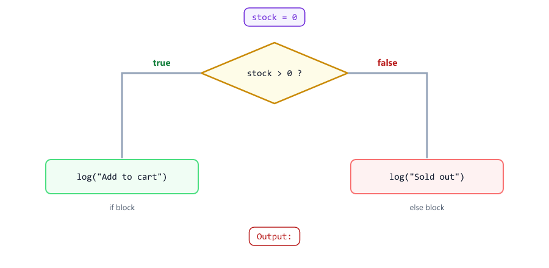

With `if...else`, **exactly one** of the two blocks runs. Never both, never none.

---

## else if

When there are more than two choices, chain them with `else if`

delivery.js

```javascript
const subtotal = 650;
let deliveryFee;

if (subtotal >= 1000) {
  deliveryFee = 0;
} else if (subtotal >= 500) {
  deliveryFee = 20;
} else {
  deliveryFee = 40;
}

console.log("Delivery fee:", deliveryFee);
```

Output

```text
Delivery fee: 20
```

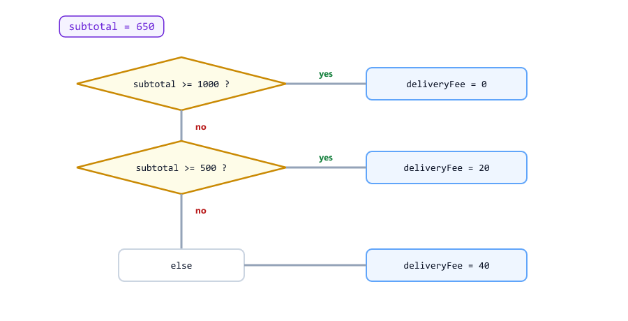

JavaScript checks the conditions **from the top** and runs only the **first** block whose condition is true. The rest are skipped. The final `else` (optional) catches everything else.

Notice `let deliveryFee;` is declared **before** the `if`, so it can be used after it (see [Blocks and Scope](#blocks-and-scope)).

Another backend example: HTTP status codes (you will use them in the Node.js course)

status-codes.js

```javascript
const statusCode = 404;

if (statusCode >= 500) {
  console.log("Server error");
} else if (statusCode >= 400) {
  console.log("Client error");
} else if (statusCode >= 300) {
  console.log("Redirect");
} else if (statusCode >= 200) {
  console.log("Success");
} else {
  console.log("Unknown status");
}
```

Output

```text
Client error
```

---

## The Order of Checks Matters

order-wrong.js

```javascript
const subtotal = 1200;
let deliveryFee;

if (subtotal >= 500) {          // checked first: 1200 stops here
  deliveryFee = 20;
} else if (subtotal >= 1000) {  // never reached for big orders
  deliveryFee = 0;
} else {
  deliveryFee = 40;
}

console.log("Delivery fee:", deliveryFee);
```

Output

```text
Delivery fee: 20
```


1200 is also `>= 500`, so the first check catches it, and free delivery is never reached. There is no error, just a wrong result.

**Rule:** put the most specific check first. With "bigger than" checks, start with the biggest number.

---

## Conditions with Truthy and Falsy Values

The condition does not have to be a boolean. JavaScript uses truthy and falsy (Session 05)

truthy-if.js

```javascript
const userName = "";

if (userName) {
  console.log("Hello,", userName);
} else {
  console.log("Please enter your name");
}
```

Output

```text
Please enter your name
```

`""` is falsy, so the `else` block runs. This is a short way to check "is there a value?". But be careful with two traps

zero-trap.js

```javascript
const quantity = 0;   // the user really chose 0

if (quantity) {
  console.log("Quantity:", quantity);
} else {
  console.log("Quantity is missing");   // wrong: 0 is a real value
}

if (quantity >= 0) {
  console.log("Quantity:", quantity);   // right: compare explicitly
}
```

Output

```text
Quantity is missing
Quantity: 0
```

false-string-if.js

```javascript
const sendEmails = "false";   // text from a settings file

if (sendEmails) {
  console.log("Sending emails...");   // runs! "false" is truthy
}

if (sendEmails === "true") {
  console.log("Sending emails (fixed version)...");
}
```

Output

```text
Sending emails...
```

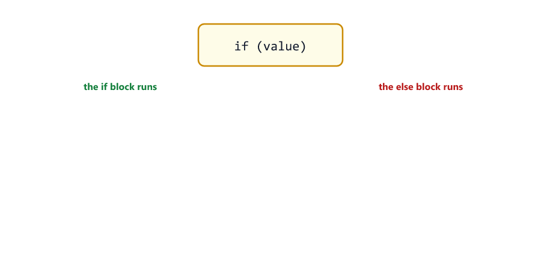

| Condition             | Good for                          | Watch out                                     |
| --------------------- | --------------------------------- | --------------------------------------------- |
| `if (userName)`       | "Is there any text?"              | `" "` (a space) is truthy                     |
| `if (quantity)`       | Rarely a good idea for numbers    | `0` is falsy, but it is a real number         |
| `if (setting)`        | Never for text settings           | `"false"` is truthy                           |

When `0`, `""` or `"false"` are possible values, **compare explicitly**: `quantity >= 0`, `setting === "true"`.

---

## Combining Conditions

Use `&&`, `||` and `!` from Session 04 to check several things at once

combined.js

```javascript
const isLoggedIn = true;
const role = "editor";

if (isLoggedIn && (role === "admin" || role === "editor")) {
  console.log("You can edit this post");
} else {
  console.log("You cannot edit this post");
}
```

Output

```text
You can edit this post
```

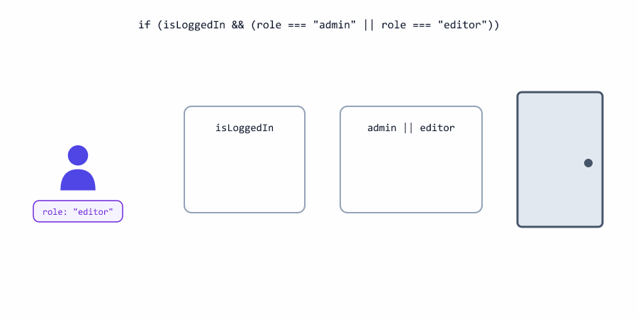

The brackets around `role === "admin" || role === "editor"` make sure the `||` is checked as one unit (Session 04: `&&` runs before `||`).

---

## Nested if vs Flat else if

You can put an `if` inside another `if`

nested.js

```javascript
const isLoggedIn = true;
const hasPaid = false;

if (isLoggedIn) {
  if (hasPaid) {
    console.log("Download started");
  } else {
    console.log("Please pay first");
  }
} else {
  console.log("Please log in");
}
```

The same logic, flat

flat.js

```javascript
const isLoggedIn = true;
const hasPaid = false;

if (!isLoggedIn) {
  console.log("Please log in");
} else if (!hasPaid) {
  console.log("Please pay first");
} else {
  console.log("Download started");
}
```

Both print

```text
Please pay first
```


The flat version checks the **problems first** ("not logged in?", "not paid?") and leaves the happy case for the end. It is easier to read, and easier to add a new check. Backend code often looks like this: check every reason to refuse, then do the work. In Session 10 you will write this even more cleanly with functions and `return`.

---

## The Ternary Operator

The **ternary operator** `? :` is a short `if...else` that **gives back a value**

ternary.js

```javascript
const stock = 3;
const label = stock > 0 ? "In stock" : "Sold out";
console.log(label);

const items = 1;
console.log("You have", items, items === 1 ? "item" : "items");
```

Output

```text
In stock
You have 1 item
```

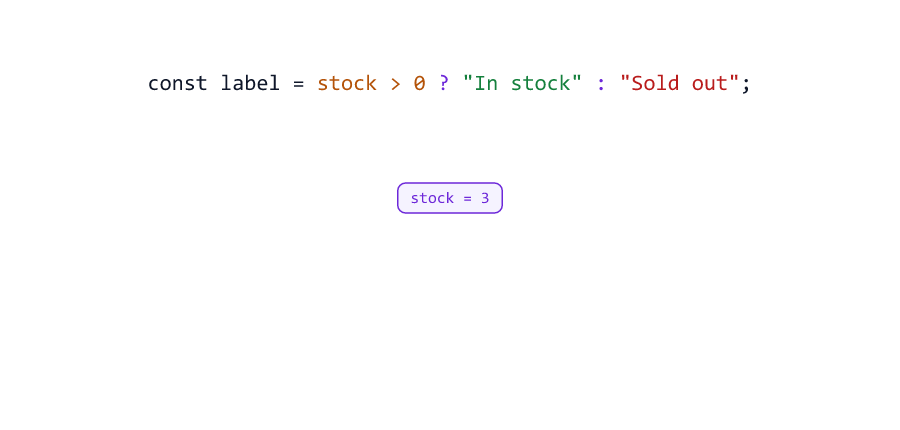

| Part           | Meaning                          |
| -------------- | -------------------------------- |
| `stock > 0`    | The condition                    |
| `?`            | "If true, use..."                |
| `"In stock"`   | The value when true              |
| `:`            | "Otherwise, use..."              |
| `"Sold out"`   | The value when false             |

It is called "ternary" because it has three parts. Use it to **choose a value**. To run several lines of code, use `if...else`.

Avoid nesting ternaries: it works, but it is hard to read

ternary-nested.js

```javascript
const score = 72;
const grade = score >= 90 ? "A" : score >= 70 ? "B" : score >= 50 ? "C" : "F";
console.log(grade);
```

Output

```text
B
```

For more than two choices, use `if...else if` instead.

---

## switch

`switch` compares **one value** against a list of possible values

switch.js

```javascript
const role = "editor";

switch (role) {
  case "admin":
    console.log("Full access");
    break;
  case "editor":
    console.log("Can edit posts");
    break;
  case "viewer":
    console.log("Can read posts");
    break;
  default:
    console.log("Unknown role");
}
```

Output

```text
Can edit posts
```

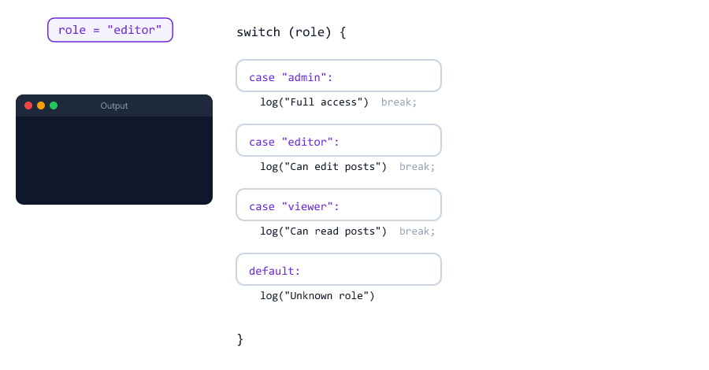

| Part            | Meaning                                            |
| --------------- | -------------------------------------------------- |
| `switch (role)` | The value to check                                 |
| `case "admin":` | "If `role === "admin"`, start here"                |
| `break;`        | Stop and jump out of the switch                    |
| `default:`      | Runs when no case matches (like `else`). Optional  |

---

## Forgetting break: Fall-Through

Without `break`, JavaScript does not stop at the end of a case. It **falls through** into the next cases

switch-no-break.js

```javascript
const role = "editor";

switch (role) {
  case "admin":
    console.log("Full access");
  case "editor":
    console.log("Can edit posts");
  case "viewer":
    console.log("Can read posts");
  default:
    console.log("Unknown role");
}
```

Output

```text
Can edit posts
Can read posts
Unknown role
```

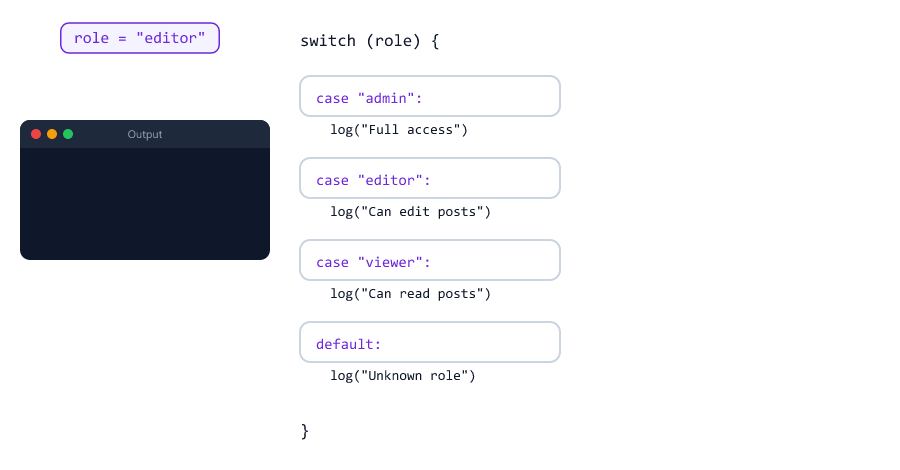

There is no error, just wrong behaviour. Always end each case with `break`.

---

## Grouping Cases

Fall-through is useful in one situation: several values that need the **same** code

switch-group.js

```javascript
const day = "Sun";

switch (day) {
  case "Sat":
  case "Sun":
    console.log("Weekend: the shop closes at 6 pm");
    break;
  default:
    console.log("Weekday: the shop closes at 9 pm");
}
```

Output

```text
Weekend: the shop closes at 6 pm
```

`"Sat"` has no code, so it falls through to the `"Sun"` code. Both days share it.

---

## switch Uses ===

`switch` compares with `===` (Session 04): the type must match too

switch-strict.js

```javascript
const pageText = "1";   // from a URL: text!

switch (pageText) {
  case 1:
    console.log("First page");
    break;
  default:
    console.log("No match: \"1\" is not 1");
}
```

Output

```text
No match: "1" is not 1
```

Convert the value first (Session 05): `switch (Number(pageText))`.

---

## if or switch?

| Use              | When                                                   | Example                          |
| ---------------- | ------------------------------------------------------ | -------------------------------- |
| `if...else`      | Ranges, combined conditions, different variables       | `subtotal >= 1000`, `isLoggedIn && isAdmin` |
| `switch`         | One value compared with many exact values              | `role`, `status`, `day`          |
| Ternary `? :`    | Choosing between two **values**                        | `stock > 0 ? "In stock" : "Sold out"` |

Anything `switch` does, `if...else if` can do too. `switch` is just easier to read for long lists of exact values.

---

## Blocks and Scope

A variable created with `let` or `const` **inside** a block `{ }` exists only inside that block

block-scope.js

```javascript
const age = 20;

if (age >= 18) {
  const message = "Welcome!";
  console.log(message);
}

console.log(message);
```

Output

```text
Welcome!
D:\js-practice\block-scope.js:8
console.log(message);
            ^

ReferenceError: message is not defined
```

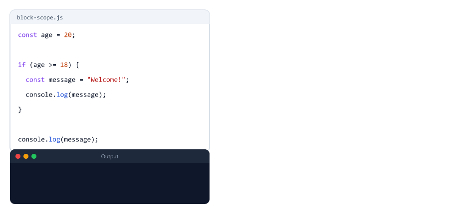

To use the value after the `if`, declare the variable **before** the block

block-fixed.js

```javascript
const age = 20;
let message;

if (age >= 18) {
  message = "Welcome!";
} else {
  message = "Sorry, adults only";
}

console.log(message);
```

Output

```text
Welcome!
```

The area where a variable can be used is called its **scope**. Session 16 explains scope in detail.

---

## Always Use Braces

JavaScript allows an `if` without `{ }`, but then it controls **only the next line**

no-braces.js

```javascript
const isAdmin = false;

if (isAdmin)
  console.log("Deleting user...");
  console.log("User deleted");      // looks inside the if, but always runs!
```

Output

```text
User deleted
```

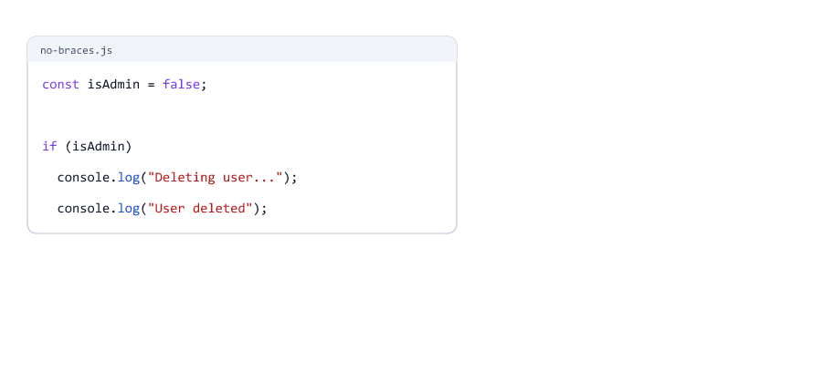

Indentation means nothing to JavaScript. The second line looks like it is inside the `if`, but it is not. **Always use braces**, even for one line.

A semicolon right after the condition is just as dangerous

semicolon-if.js

```javascript
const isAdmin = false;

if (isAdmin); {
  console.log("Welcome to the admin panel");   // runs even for non-admins!
}
```

Output

```text
Welcome to the admin panel
```

The `;` ends the `if` immediately (it controls an empty statement). The `{ }` block after it is a normal block that always runs.

---

## Mini Example 1: Checkout Total

`else if`, `switch` and the ternary operator working together

checkout.js

```javascript
// Checkout: delivery fee, coupon and a final message
const subtotal = 650;
const coupon = "SAVE10";

let deliveryFee;
if (subtotal >= 1000) {
  deliveryFee = 0;
} else if (subtotal >= 500) {
  deliveryFee = 20;
} else {
  deliveryFee = 40;
}

let discount;
switch (coupon) {
  case "SAVE10":
    discount = subtotal * 0.1;
    break;
  case "FLAT50":
    discount = 50;
    break;
  default:
    discount = 0;
}

const total = subtotal + deliveryFee - discount;

console.log("Subtotal:", subtotal);
console.log("Delivery:", deliveryFee === 0 ? "free" : deliveryFee);
console.log("Discount:", discount);
console.log("Total:", total);
```

Run

```bash
node checkout.js
```

Output

```text
Subtotal: 650
Delivery: 20
Discount: 65
Total: 605
```

Try it: change `subtotal` to `1200` and `coupon` to `"FLAT50"`.

---

## Mini Example 2: Sign-up Validation

Before creating an account, a server checks the input. Each check that fails sends an error back with a **status code** (`400` = bad request, `201` = created). You will send real status codes in the Node.js course

signup.js

```javascript
// Sign-up check: what a server does before creating an account
const ageText = "17";      // from a form: text
const password = "secret123";
const acceptedTerms = true;

const age = Number(ageText);
let statusCode;
let message;

if (!Number.isFinite(age)) {
  statusCode = 400;
  message = "Age must be a number";
} else if (age < 18) {
  statusCode = 400;
  message = "You must be 18 or older";
} else if (!password) {
  statusCode = 400;
  message = "Password is required";
} else if (!acceptedTerms) {
  statusCode = 400;
  message = "Please accept the terms";
} else {
  statusCode = 201;
  message = "Account created";
}

console.log(statusCode, message);
```

Run

```bash
node signup.js
```

Output

```text
400 You must be 18 or older
```

With `ageText = "25"` the output is `201 Account created`, and with `ageText = "abc"` it is `400 Age must be a number`.

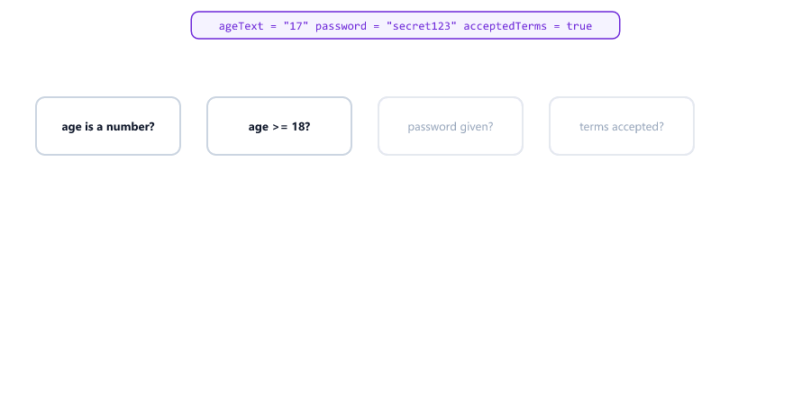

| Pattern used                         | Why                                                    |
| ------------------------------------ | ------------------------------------------------------ |
| Convert, then check (Session 05)     | `"abc"` becomes `NaN`, which `Number.isFinite` rejects |
| Problems first, success last         | Flat `else if` chain, easy to extend                   |
| `let statusCode; let message;` before the `if` | So they can be used after it                  |

---

## Beginner Mistakes

### Mistake 1: = instead of === in a condition

**Incorrect**

```javascript
let role = "viewer";

if (role = "admin") {        // = stores "admin" instead of comparing!
  console.log("Admin access granted");
}

console.log("role is now:", role);
```

```text
Admin access granted
role is now: admin
```

`=` stores `"admin"` and the result (`"admin"`) is truthy. A viewer became an admin! **Correct:** `if (role === "admin")`.

### Mistake 2: An if without braces

**Incorrect:** only the first line belongs to the `if` (see [Always Use Braces](#always-use-braces)).

**Correct:** always write `{ }`.

### Mistake 3: A semicolon after if (...)

**Incorrect:** `if (isAdmin); { ... }` runs the block for everyone.

**Correct:** no `;` between `)` and `{`.

### Mistake 4: Checks in the wrong order

**Incorrect:** `subtotal >= 500` before `subtotal >= 1000`: big orders never get free delivery.

**Correct:** the most specific check first.

### Mistake 5: Forgetting break in a switch

**Incorrect:** the matching case and every case below it run.

**Correct:** end each case with `break;`.

### Mistake 6: if (quantity) when 0 is a valid number

**Incorrect:** `0` is falsy, so `if (quantity)` treats a real 0 as "missing".

**Correct:** `if (quantity >= 0)` or another explicit comparison.

### Mistake 7: if (setting) with the text "false"

**Incorrect:** `"false"` is truthy, so the block runs.

**Correct:** `if (setting === "true")`.

### Mistake 8: switch on text from a URL with number cases

**Incorrect:** `switch ("1")` never matches `case 1:`.

**Correct:** convert first: `switch (Number(pageText))`.

### Mistake 9: Using a block variable outside the block

**Incorrect:** `const message` created inside `if { }`, then used after it: `ReferenceError: message is not defined`.

**Correct:** declare `let message;` before the `if`.

### Mistake 10: Nested ternaries

**Incorrect:** `a ? b : c ? d : e ? f : g` is hard to read and easy to get wrong.

**Correct:** use `if...else if` for more than two choices.

---

## Practice Exercises

### Exercise 1

Create `const temperature = 31;`. Print "Hot" if it is above 30, "Cold" if below 15, and "Nice" otherwise.

### Exercise 2

Create `const number = 7;`. Use `%` (Session 04) and `if...else` to print whether it is even or odd.

### Exercise 3

Grades: 90 and above is "A", 75 and above is "B", 50 and above is "C", below 50 is "Fail". Test your code with 95, 75, 60 and 30. Make sure 95 does not print "B".

### Exercise 4

Create `const day = "Tue";`. Use a `switch` to print the opening hours: "Mon" to "Fri" 9-18, "Sat" 10-14, "Sun" closed. Group the weekdays.

### Exercise 5

Rewrite this with the ternary operator: `let fee; if (isMember) { fee = 0; } else { fee = 50; }`

### Exercise 6

A login check: create `username`, `password`, `failedAttempts` and `const MAX_ATTEMPTS = 3;`. Print "Account locked" if `failedAttempts >= MAX_ATTEMPTS`, "Username required" if the username is empty, "Wrong password" if the password is not `"secret123"`, and "Welcome!" otherwise. Write the checks flat, problems first.

### Exercise 7

The value `const limitText = "abc";` comes from a URL. Convert it. If it is not a finite number, use `10`. If it is bigger than `100`, use `100`. Print the final limit. Test with `"abc"`, `"50"` and `"500"`.

### Exercise 8

Add a third coupon to the [checkout example](#mini-example-1-checkout-total): `"HALF"` gives 50% off, but only if the subtotal is at least 1000. Otherwise it gives no discount.

---

## Interview Questions

### What is the difference between if...else and switch?

`if...else` can check any condition: ranges, combined conditions, different variables. `switch` compares one value against a list of exact values using `===`.

### What happens if you forget break in a switch?

Execution falls through: the matching case and every case after it run, until a `break` or the end of the switch.

### When is fall-through useful?

To give several cases the same code, for example `case "Sat": case "Sun":` for the weekend.

### Does switch use == or ===?

`===`. So `switch ("1")` does not match `case 1:`.

### What is the ternary operator?

A short `if...else` that returns a value: `condition ? valueIfTrue : valueIfFalse`. It has three parts, hence "ternary".

### What values does if treat as false?

The falsy values: `false`, `0`, `-0`, `0n`, `""`, `null`, `undefined` and `NaN`. Everything else runs the `if` block.

### Why is if (role = "admin") a bug?

`=` assigns instead of comparing. The variable is changed to `"admin"`, and the result is truthy, so the block always runs.

### What is a block, and what is block scope?

A block is the code between `{ }`. Variables declared with `let` or `const` inside a block can only be used inside it.

### Why should you always use braces with if?

Without braces, `if` controls only the next statement. Other indented lines look like they belong to the `if`, but they always run.

### Why does the order of else if checks matter?

JavaScript runs only the first matching block. If a general check comes before a specific one, the specific one is never reached.

### Is the else block required?

No. An `if` can stand alone, and an `if...else if` chain can end without `else`. Then nothing runs when no condition is true.

### How would you validate user input before using it?

Convert it to the right type, then check each requirement in turn (type, range, required fields). Handle the failures first and do the main work only when everything passes.

---

| Previous | All sessions | Next |
| :--- | :---: | ---: |
| [05. Type Conversion](05-type-conversion.md) | [Course outline](README.md#course-outline) | [07. Loops](07-loops.md) |
