# Loops

## Table of Contents
- [What are Loops](#what-are-loops)
- [The for Loop](#the-for-loop)
- [How a for Loop Runs](#how-a-for-loop-runs)
- [Counting in Different Ways](#counting-in-different-ways)
- [Looping Through a String](#looping-through-a-string)
- [The while Loop](#the-while-loop)
- [The do...while Loop](#the-dowhile-loop)
- [for...of with Strings](#forof-with-strings)
- [Which Loop Should I Use?](#which-loop-should-i-use)
- [break: Stop Early](#break-stop-early)
- [continue: Skip One Round](#continue-skip-one-round)
- [Infinite Loops](#infinite-loops)
- [Off-by-One Errors](#off-by-one-errors)
- [Common Loop Patterns](#common-loop-patterns)
- [Nested Loops](#nested-loops)
- [Loop Variables and Scope](#loop-variables-and-scope)
- [Mini Example 1: Database Connection Retry](#mini-example-1-database-connection-retry)
- [Mini Example 2: Password Strength Check](#mini-example-2-password-strength-check)
- [Beginner Mistakes](#beginner-mistakes)
- [Practice Exercises](#practice-exercises)
- [Interview Questions](#interview-questions)

---

## What are Loops

A **loop** runs the same code again and again, as long as you want.

Say your server must send a reminder to 5 users. Without a loop

without-loop.js

```javascript
console.log("Reminder sent to user 1");
console.log("Reminder sent to user 2");
console.log("Reminder sent to user 3");
console.log("Reminder sent to user 4");
console.log("Reminder sent to user 5");
```

With a loop

with-loop.js

```javascript
for (let userId = 1; userId <= 5; userId++) {
  console.log("Reminder sent to user " + userId);
}
```

Both print the same

```text
Reminder sent to user 1
Reminder sent to user 2
Reminder sent to user 3
Reminder sent to user 4
Reminder sent to user 5
```

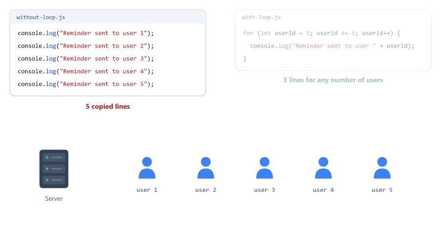

With 10,000 users, the first version needs 10,000 lines. The loop needs only one change: `userId <= 10000`.

A server loops all the time

| Task                                     | Why it needs a loop                         |
| ---------------------------------------- | ------------------------------------------- |
| Send a reminder to every user            | The same code, once per user                |
| Check every character of a password      | Look at each character in turn              |
| Retry a database connection              | Try again until it works, or give up        |
| Send a big file in chunks                | Repeat until everything is sent             |
| Show search results page by page         | Once per page                               |

JavaScript has these loops: `for`, `while`, `do...while` and `for...of`. You will learn all four in this session.

---

## The for Loop

The shape of a `for` loop

```javascript
for (start; condition; step) {
  // code to repeat
}
```

| Part          | In `with-loop.js`  | When it runs                    | What it does                          |
| ------------- | ------------------ | ------------------------------- | ------------------------------------- |
| **start**     | `let userId = 1`   | Once, before everything else    | Creates the counter                   |
| **condition** | `userId <= 5`      | Before every round              | `true` → run the body, `false` → stop |
| **step**      | `userId++`         | After every round               | Moves the counter on                  |
| **body**      | `{ ... }`          | Every round                     | The code that repeats                 |

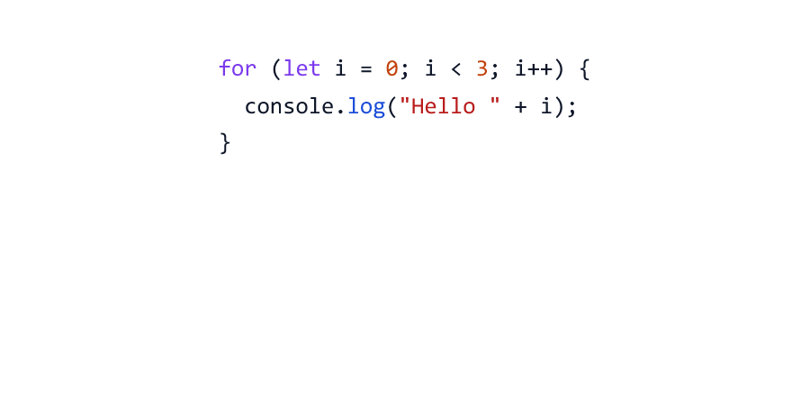

One run of the body is called an **iteration** (one round).

Counters are often called `i` (for "index"). As Session 02 said, short names like `i` are fine in small places like loops.

---

## How a for Loop Runs

for-trace.js

```javascript
for (let i = 0; i < 3; i++) {
  console.log("Hello " + i);
}

console.log("Loop finished");
```

Output

```text
Hello 0
Hello 1
Hello 2
Loop finished
```

Step by step

| Step          | `i`  | `i < 3` | What happens                     |
| ------------- | ---- | ------- | -------------------------------- |
| start         | `0`  |         | `let i = 0`                      |
| round 1       | `0`  | `true`  | Prints `Hello 0`, then `i++`     |
| round 2       | `1`  | `true`  | Prints `Hello 1`, then `i++`     |
| round 3       | `2`  | `true`  | Prints `Hello 2`, then `i++`     |
| check again   | `3`  | `false` | The loop stops                   |
| after         |      |         | Prints `Loop finished`           |

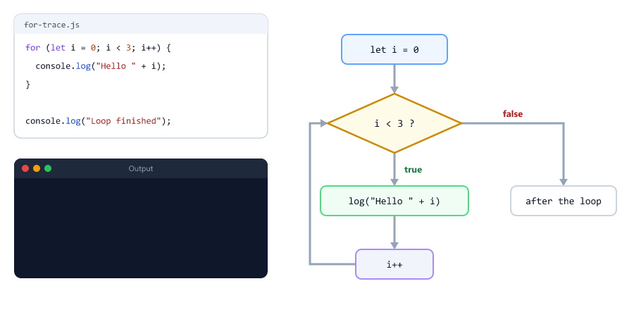

The body ran **3** times, but the condition was checked **4** times. The last check (`3 < 3` is `false`) is what stops the loop.

---

## Counting in Different Ways

Count **down** with `--`

count-down.js

```javascript
for (let seconds = 3; seconds >= 1; seconds--) {
  console.log("Restarting in " + seconds);
}

console.log("Restarting now");
```

Output

```text
Restarting in 3
Restarting in 2
Restarting in 1
Restarting now
```

Jump by **2** with `+=` (Session 04)

even.js

```javascript
for (let i = 2; i <= 10; i += 2) {
  console.log(i);
}
```

Output

```text
2
4
6
8
10
```

Use the counter in a calculation

times-table.js

```javascript
for (let i = 1; i <= 5; i++) {
  console.log("5 x " + i + " = " + 5 * i);
}
```

Output

```text
5 x 1 = 5
5 x 2 = 10
5 x 3 = 15
5 x 4 = 20
5 x 5 = 25
```

`5 * i` needs no brackets here, because `*` runs before `+` (Session 04).

| Loop header                          | Values of `i`   | Rounds |
| ------------------------------------ | --------------- | ------ |
| `for (let i = 0; i < 5; i++)`        | 0 1 2 3 4       | 5      |
| `for (let i = 1; i <= 5; i++)`       | 1 2 3 4 5       | 5      |
| `for (let i = 5; i >= 1; i--)`       | 5 4 3 2 1       | 5      |
| `for (let i = 0; i <= 10; i += 5)`   | 0 5 10          | 3      |

---

## Looping Through a String

A string is a row of characters. Each character has a **position**, called its **index**. The first index is **0**, not 1.

string-basics.js

```javascript
const word = "Node";

console.log(word.length);   // 4
console.log(word[0]);       // first character
console.log(word[3]);       // last character
console.log(word[4]);       // there is nothing at position 4
```

Output

```text
4
N
e
undefined
```

| Code                     | Meaning                      | Value for `"Node"` |
| ------------------------ | ---------------------------- | ------------------ |
| `word.length`            | How many characters          | `4`                |
| `word[0]`                | The first character          | `"N"`              |
| `word[word.length - 1]`  | The last character           | `"e"`              |
| `word[4]`                | Past the end                 | `undefined`        |

The last index is always `length - 1`. Session 08 teaches much more about strings.

Now visit every character with a loop

string-loop.js

```javascript
const word = "Node";

for (let i = 0; i < word.length; i++) {
  console.log(i, word[i]);
}
```

Output

```text
0 N
1 o
2 d
3 e
```

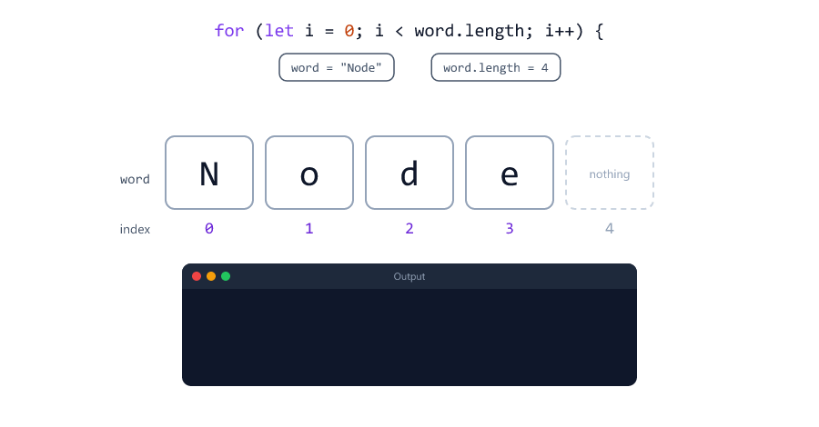

`i` goes 0, 1, 2, 3. When `i` becomes 4, `4 < 4` is `false` and the loop stops, so it never reads past the end.

---

## The while Loop

A `while` loop has only a condition

```javascript
while (condition) {
  // code to repeat
}
```

The start goes **before** the loop, and the step goes **inside** the body

while-basic.js

```javascript
let count = 1;

while (count <= 3) {
  console.log("Count: " + count);
  count++;
}

console.log("Done");
```

Output

```text
Count: 1
Count: 2
Count: 3
Done
```

This does the same job as a `for` loop. `while` is the better choice when you **don't know how many rounds** you need, only when to stop.

A server sends a big file in pieces called **chunks**. How many chunks? That depends on the file size

upload.js

```javascript
// Send a 2500 KB file in chunks of 1000 KB
const fileSize = 2500;
const chunkSize = 1000;

let sent = 0;
let chunk = 0;

while (sent < fileSize) {
  let size = chunkSize;
  if (fileSize - sent < chunkSize) {
    size = fileSize - sent;   // the last chunk is smaller
  }

  sent += size;
  chunk++;
  console.log("Chunk " + chunk + ": " + size + " KB (sent " + sent + " of " + fileSize + ")");
}

console.log("Upload complete");
```

Output

```text
Chunk 1: 1000 KB (sent 1000 of 2500)
Chunk 2: 1000 KB (sent 2000 of 2500)
Chunk 3: 500 KB (sent 2500 of 2500)
Upload complete
```

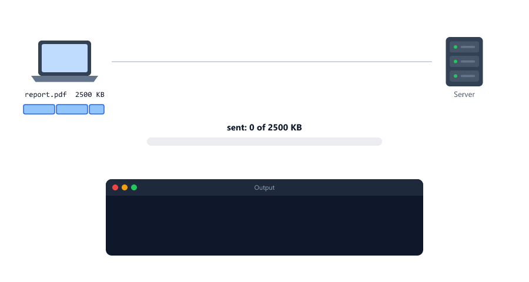

Change `fileSize` to `4200` and the same loop sends 5 chunks. Node.js reads big files in chunks too (Node.js course, Session 08).

---

## The do...while Loop

`do...while` runs the body **first** and checks the condition **after**

```javascript
do {
  // code to repeat
} while (condition);
```

So the body always runs **at least once**, even when the condition is false from the start

do-while.js

```javascript
let stock = 0;

while (stock > 0) {
  console.log("while: selling one item");
  stock--;
}

do {
  console.log("do...while: this runs once anyway");
} while (stock > 0);
```

Output

```text
do...while: this runs once anyway
```

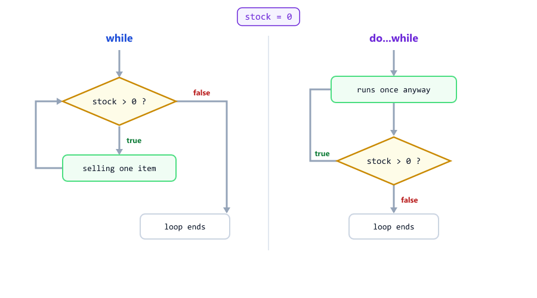

| Loop          | Checks the condition | Smallest number of rounds |
| ------------- | -------------------- | ------------------------- |
| `while`       | Before the body      | 0                         |
| `do...while`  | After the body       | 1                         |

Use `do...while` when something must happen once before you can decide whether to repeat it: try to connect, then retry if it failed ([Mini Example 1](#mini-example-1-database-connection-retry)).

Note the `;` after `while (condition)` at the end.

---

## for...of with Strings

`for...of` gives you each character directly. No counter, no index, no `length`

for-of.js

```javascript
const word = "Node";

for (const letter of word) {
  console.log(letter);
}
```

Output

```text
N
o
d
e
```

Read it as "for each `letter` of `word`". Each round gets a new `letter`, so `const` works here.

A real use: clean a phone number that a user typed with spaces and dashes

clean-phone.js

```javascript
// Remove spaces and dashes from a phone number typed by a user
const phoneText = "98765 432-10";
let digits = "";

for (const ch of phoneText) {
  if (ch !== " " && ch !== "-") {
    digits += ch;
  }
}

console.log(digits);
```

Output

```text
9876543210
```

| Loop          | Gives you                       | Use it when                               |
| ------------- | ------------------------------- | ----------------------------------------- |
| Classic `for` | The index `i` (and `word[i]`)   | The position matters (masking, searching) |
| `for...of`    | The character                   | You only need the characters              |

In Session 12 you will use `for...of` on arrays (lists of values), which is the most common loop on a server. There is also a `for...in` loop, which is for objects (Session 13).

---

## Which Loop Should I Use?

| Situation                                      | Loop          | Example                              |
| ---------------------------------------------- | ------------- | ------------------------------------ |
| You know how many rounds                       | `for`         | Send 5 reminders                     |
| You repeat until something changes             | `while`       | Send chunks until the file is sent   |
| The body must run at least once                | `do...while`  | Try to connect, then retry           |
| You need every character (later: every item)   | `for...of`    | Clean a phone number                 |

---

## break: Stop Early

`break` stops the whole loop at once. The program continues after the loop

break.js

```javascript
let stock = 3;

for (let order = 1; order <= 5; order++) {
  if (stock === 0) {
    console.log("Out of stock. Stopped at order " + order);
    break;
  }

  stock--;
  console.log("Order " + order + " packed. Stock left: " + stock);
}

console.log("Packing finished");
```

Output

```text
Order 1 packed. Stock left: 2
Order 2 packed. Stock left: 1
Order 3 packed. Stock left: 0
Out of stock. Stopped at order 4
Packing finished
```

Order 5 is never checked. You already met `break` in `switch` (Session 06). It works the same way here.

---

## continue: Skip One Round

`continue` skips the **rest of this round** and goes straight to the next one

continue.js

```javascript
const blockedUserId = 4;

for (let userId = 1; userId <= 6; userId++) {
  if (userId === blockedUserId) {
    continue;   // skip this user, go to the next round
  }

  console.log("Reminder sent to user " + userId);
}
```

Output

```text
Reminder sent to user 1
Reminder sent to user 2
Reminder sent to user 3
Reminder sent to user 5
Reminder sent to user 6
```

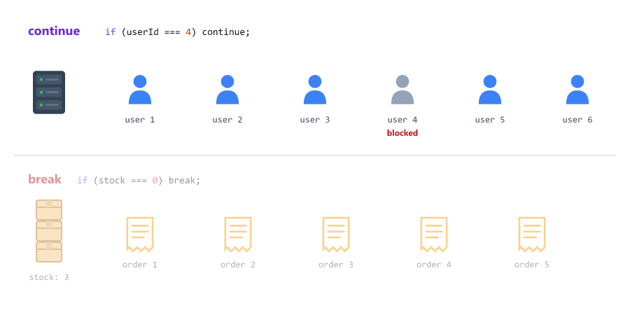

| Keyword    | What it stops    | What happens next                   |
| ---------- | ---------------- | ----------------------------------- |
| `break`    | The whole loop   | The code after the loop runs        |
| `continue` | This round only  | The loop goes on with the next round |

Both work in every loop: `for`, `while`, `do...while` and `for...of`.

---

## Infinite Loops

A loop whose condition **never becomes false** runs forever. This is an **infinite loop**

infinite.js

```javascript
let userId = 1;

while (userId <= 3) {
  console.log("Reminder sent to user " + userId);
  // forgot userId++
}
```

Output

```text
Reminder sent to user 1
Reminder sent to user 1
Reminder sent to user 1
Reminder sent to user 1
...                        (forever)
```

`userId` stays `1`, so `userId <= 3` is always `true`. To stop a program that is stuck, click in the terminal and press **Ctrl + C**.

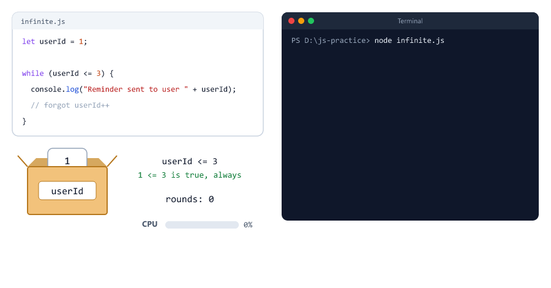

Common causes

| Cause                                         | Example                                    |
| --------------------------------------------- | ------------------------------------------ |
| The step is missing                           | `while (userId <= 3)` without `userId++`   |
| The step goes the wrong way                   | `for (let i = 10; i >= 1; i++)`            |
| `continue` jumps over the step in a `while`   | See [Mistake 2](#mistake-2-continue-before-the-step-in-a-while-loop) |

**Why this matters on a server:** Node.js runs your JavaScript one line at a time, on a single thread (Node.js course, Session 03). While a loop runs, the server cannot answer anyone else. An infinite loop freezes the whole server. Even a loop that does end can hurt: one billion rounds take about one second, and every user waits that second.

---

## Off-by-One Errors

An **off-by-one error** is a loop that runs one round too many or one too few. It is one of the most common bugs in programming

off-by-one.js

```javascript
const word = "Node";

for (let i = 0; i <= word.length; i++) {   // <= goes one step too far
  console.log(i, word[i]);
}
```

Output

```text
0 N
1 o
2 d
3 e
4 undefined
```

There is no error, just a wrong extra round. The last index is `length - 1`, so the correct condition is `i < word.length`.

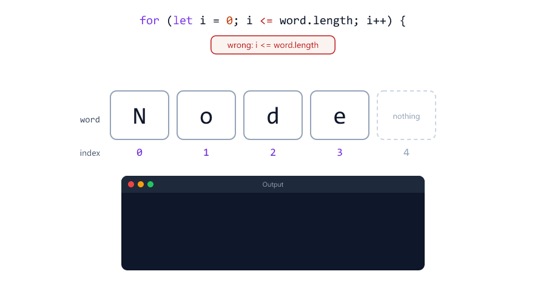

To count the rounds, look at the start and the condition

| Start   | Condition  | Rounds for `n = 4` |
| ------- | ---------- | ------------------ |
| `0`     | `i < n`    | 4 (0 1 2 3)        |
| `1`     | `i <= n`   | 4 (1 2 3 4)        |
| `0`     | `i <= n`   | 5: one too many!   |
| `1`     | `i < n`    | 3: one too few!    |

For strings (and arrays, Session 12) use `let i = 0; i < length`.

---

## Common Loop Patterns

Most loops you will write follow one of these four patterns.

### Counter: count the matches

count-digits.js

```javascript
// Count the digits in a phone number
const phone = "98765-43210";
let digitCount = 0;

for (const ch of phone) {
  if (ch >= "0" && ch <= "9") {
    digitCount++;
  }
}

console.log("Digits:", digitCount);
console.log(digitCount === 10 ? "Valid phone number" : "Invalid phone number");
```

Output

```text
Digits: 10
Valid phone number
```

`ch >= "0" && ch <= "9"` compares text with text (Session 04). The digit characters come in order, `"0"` to `"9"`, so this means "ch is a digit".

### Running total: add up as you go

sum.js

```javascript
let total = 0;

for (let n = 1; n <= 5; n++) {
  total += n;
}

console.log("Total:", total);
```

Output

```text
Total: 15
```

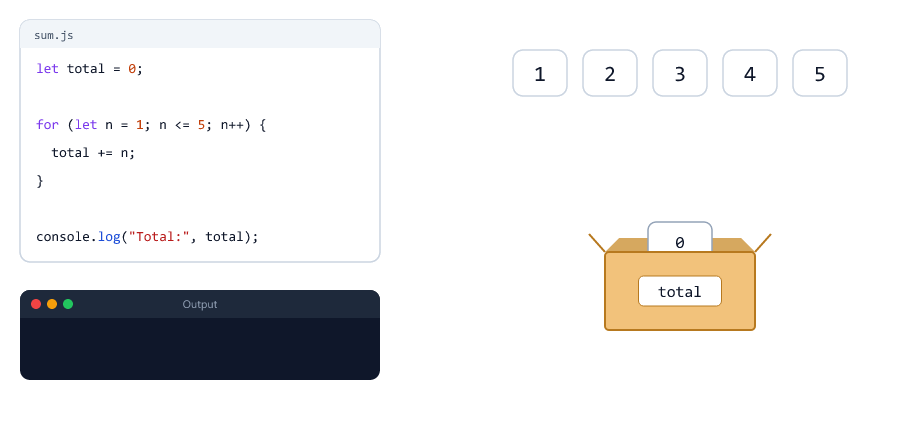

Three rules for a running total

1. Create it **before** the loop, with a starting value (`0`)
2. Add to it **inside** the loop
3. Use it **after** the loop

Change `5` to `100` and you get `5050`. In Session 12 you will add up real order prices this way.

### Building a string: make new text

Card numbers, passwords and tokens must never appear in full in logs (Node.js course, Session 26). Mask them

mask-card.js

```javascript
// Never write a full card number to the logs
const cardNumber = "4111222233334444";
let masked = "";

for (let i = 0; i < cardNumber.length; i++) {
  if (i < cardNumber.length - 4) {
    masked += "*";
  } else {
    masked += cardNumber[i];
  }
}

console.log(masked);
```

Output

```text
************4444
```

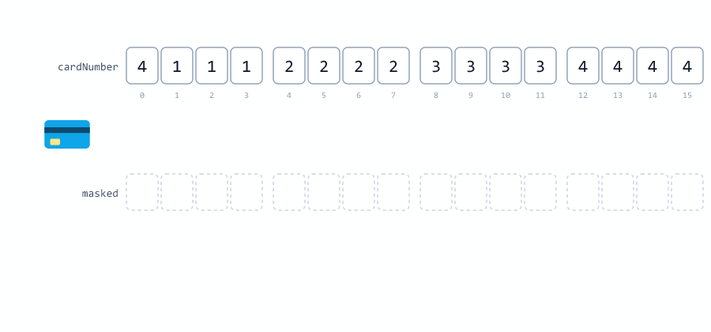

This needs the classic `for`, because the position decides what to add.

### Search: stop at the first match

find-at.js

```javascript
const email = "sara@example.com";
let atPosition = -1;   // -1 means "not found yet"

for (let i = 0; i < email.length; i++) {
  if (email[i] === "@") {
    atPosition = i;
    break;   // found it, no need to check the rest
  }
}

console.log("@ is at position", atPosition);
```

Output

```text
@ is at position 4
```

If there is no `@`, `atPosition` stays `-1`. JavaScript's own search methods use `-1` for "not found" too (Session 08).

| Pattern        | Before the loop       | Inside the loop                   | After the loop        |
| -------------- | --------------------- | --------------------------------- | --------------------- |
| Counter        | `let count = 0;`      | `count++` when it matches         | Use `count`           |
| Running total  | `let total = 0;`      | `total += value`                  | Use `total`           |
| Build a string | `let text = "";`      | `text += piece`                   | Use `text`            |
| Search         | `let found = -1;`     | Save the position, then `break`   | Check for `-1`        |

---

## Nested Loops

A loop inside another loop is a **nested loop**. The inner loop runs **completely** for every round of the outer loop.

A booking system lists time slots: 3 days, 3 slots per day

slots.js

```javascript
for (let day = 1; day <= 3; day++) {
  for (let hour = 9; hour <= 11; hour++) {
    console.log("Day " + day + " at " + hour + ":00");
  }
}
```

Output

```text
Day 1 at 9:00
Day 1 at 10:00
Day 1 at 11:00
Day 2 at 9:00
Day 2 at 10:00
Day 2 at 11:00
Day 3 at 9:00
Day 3 at 10:00
Day 3 at 11:00
```

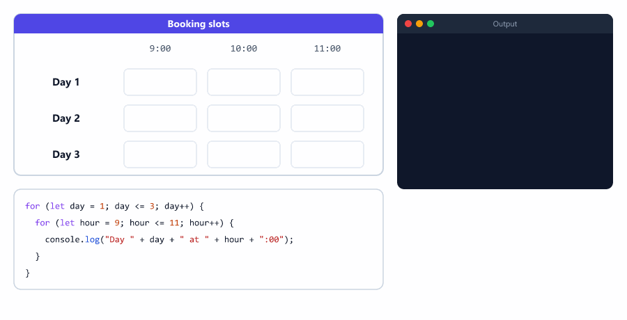

3 days × 3 hours = 9 lines. Nested loops multiply: 1,000 users × 1,000 orders = 1,000,000 rounds. Remember this when a server gets slow.

`break` inside the inner loop stops **only the inner loop**

nested-break.js

```javascript
for (let day = 1; day <= 3; day++) {
  for (let hour = 9; hour <= 11; hour++) {
    if (hour === 10) {
      break;   // stops only the inner (hour) loop
    }
    console.log("Day " + day + " at " + hour + ":00");
  }
}
```

Output

```text
Day 1 at 9:00
Day 2 at 9:00
Day 3 at 9:00
```

The day loop goes on. To stop both loops, set a variable (for example `let done = true;`) and add it to the outer condition, or put the loops in a function and use `return` (Session 10).

---

## Loop Variables and Scope

The counter of a `for` loop is created with `let`, so it lives **only inside the loop**, like the block variables in Session 06

scope-let.js

```javascript
for (let i = 0; i < 3; i++) {
  // i exists only inside the loop
}

console.log(i);
```

Output

```text
D:\js-practice\scope-let.js:5
console.log(i);
            ^

ReferenceError: i is not defined
```

With the old `var`, the counter leaks out of the loop

scope-var.js

```javascript
for (var i = 0; i < 3; i++) {
  // ...
}

console.log(i);   // var leaks out of the loop
```

Output

```text
3
```

That is another reason to use `let` (Session 02). Session 16 explains scope in detail.

`const` does **not** work for a classic `for` counter, because the step changes it

const-for.js

```javascript
for (const i = 0; i < 3; i++) {
  console.log(i);
}
```

Output

```text
0
D:\js-practice\const-for.js:1
for (const i = 0; i < 3; i++) {
                          ^

TypeError: Assignment to constant variable.
```

The first round runs, then `i++` tries to change a constant. In `for...of`, `const` is fine, because each round creates a **new** variable

const-for-of.js

```javascript
for (const letter of "Hi!") {
  console.log(letter);   // a new letter variable every round
}
```

Output

```text
H
i
!
```

| Loop          | Declare the variable with |
| ------------- | ------------------------- |
| Classic `for` | `let`                     |
| `for...of`    | `const`                   |

---

## Mini Example 1: Database Connection Retry

When a server starts, it connects to its database. Sometimes the first try fails (the database is still starting, or the network is slow). So servers **retry** a few times before giving up

retry.js

```javascript
// Try to connect to the database, at most 5 times
const MAX_ATTEMPTS = 5;
let attempt = 0;
let connected = false;

do {
  attempt++;
  console.log("Connecting to the database... attempt " + attempt);

  connected = attempt === 3;   // pretend: the 3rd attempt works

  if (!connected) {
    console.log("Failed");
  }
} while (!connected && attempt < MAX_ATTEMPTS);

if (connected) {
  console.log("Connected to the database");
} else {
  console.log("Could not connect after " + MAX_ATTEMPTS + " attempts");
}
```

Run

```bash
node retry.js
```

Output

```text
Connecting to the database... attempt 1
Failed
Connecting to the database... attempt 2
Failed
Connecting to the database... attempt 3
Connected to the database
```

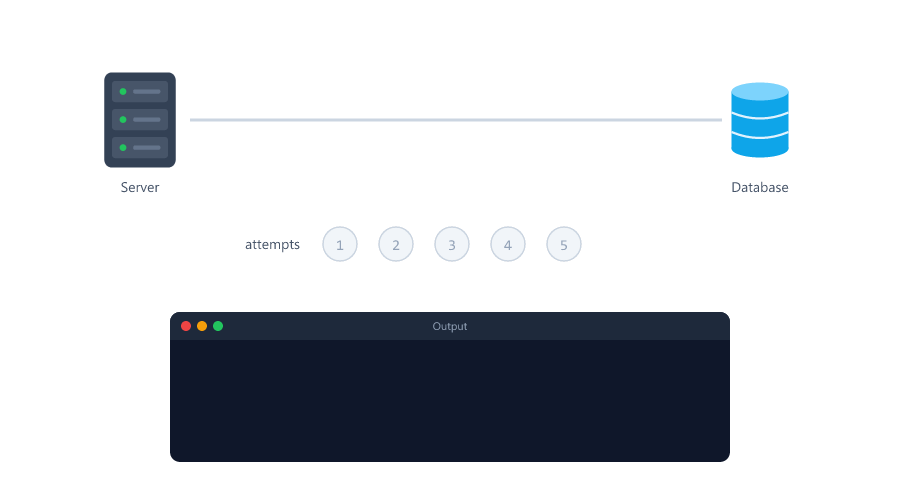

Try it: change `attempt === 3` to `attempt === 9`. Every attempt fails, the loop stops at 5, and the last line is `Could not connect after 5 attempts`.

| Pattern used                              | Why                                                 |
| ----------------------------------------- | --------------------------------------------------- |
| `do...while`                              | Always try at least once                            |
| Two conditions with `&&`                  | Stop when connected **or** when the attempts run out |
| `MAX_ATTEMPTS` setting (Session 02)       | No infinite loop, even if the database is down      |
| `if` after the loop                       | Decide what happened                                |

A real connection takes time, so real code also waits between attempts. You will learn how to wait with timers (Session 22) and async/await (Session 25). The loop idea stays the same.

---

## Mini Example 2: Password Strength Check

Before a server saves a new password, it checks that the password is strong enough. Only then is the password hashed and saved (Node.js course, Session 23)

password.js

```javascript
// Check a new password before saving it
const password = "secret123";

let hasDigit = false;
let hasCapital = false;

for (const ch of password) {
  if (ch >= "0" && ch <= "9") {
    hasDigit = true;
  } else if (ch >= "A" && ch <= "Z") {
    hasCapital = true;
  }
}

let problems = 0;

if (password.length < 8) {
  console.log("Needs at least 8 characters");
  problems++;
}
if (!hasDigit) {
  console.log("Needs a number");
  problems++;
}
if (!hasCapital) {
  console.log("Needs a capital letter");
  problems++;
}

const statusCode = problems === 0 ? 201 : 400;
console.log(statusCode, problems === 0 ? "Password accepted" : "Weak password");
```

Run

```bash
node password.js
```

Output

```text
Needs a capital letter
400 Weak password
```

With `"Secret123"` the output is `201 Password accepted`. With `"abc"` you get all three problems

```text
Needs at least 8 characters
Needs a number
Needs a capital letter
400 Weak password
```

| Pattern used                                 | Why                                                  |
| -------------------------------------------- | ---------------------------------------------------- |
| `for...of`                                   | Only the characters matter, not their positions      |
| **Flags** `hasDigit`, `hasCapital`           | Start `false`, switch to `true` when found           |
| Checks **after** the loop                    | The answer is known only when every character was seen |
| Counter `problems`                           | Decide the status code: `201` or `400` (Session 06)  |

---

## Beginner Mistakes

### Mistake 1: Forgetting to move the counter

**Incorrect**

```javascript
let userId = 1;

while (userId <= 3) {
  console.log("Reminder sent to user " + userId);
  // forgot userId++
}
```

The same line prints forever (see [Infinite Loops](#infinite-loops)). **Correct:** add `userId++;` inside the loop, or use a `for` loop, where the step is part of the header.

### Mistake 2: continue before the step in a while loop

**Incorrect**

```javascript
let userId = 1;

while (userId <= 5) {
  if (userId === 3) {
    continue;   // jumps back to the check, but userId++ never runs!
  }
  console.log("Reminder sent to user " + userId);
  userId++;
}
```

```text
Reminder sent to user 1
Reminder sent to user 2
```

Then the program hangs: `userId` stays `3` forever. **Correct:** move the counter on before `continue`

```javascript
let userId = 1;

while (userId <= 5) {
  if (userId === 3) {
    userId++;   // move on first
    continue;
  }
  console.log("Reminder sent to user " + userId);
  userId++;
}
```

Or use a `for` loop: its step runs even after `continue`.

### Mistake 3: i <= length

**Incorrect:** `for (let i = 0; i <= word.length; i++)` reads one place past the end and gets `undefined`.

**Correct:** `i < word.length`.

### Mistake 4: Starting at 1

**Incorrect**

```javascript
const word = "Node";

for (let i = 1; i < word.length; i++) {   // starts at 1: skips the first letter
  console.log(word[i]);
}
```

```text
o
d
e
```

**Correct:** indexes start at `0`: `let i = 0`.

### Mistake 5: A semicolon after for (...)

**Incorrect**

```javascript
for (let userId = 1; userId <= 3; userId++); {
  console.log("Sending reminder");
}
```

```text
Sending reminder
```

The `;` ends the loop, so it repeats nothing. The block after it is a normal block that runs once (the same trap as `if (...);` in Session 06). **Correct:** no `;` between `)` and `{`.

### Mistake 6: Counting down with i++

**Incorrect**

```javascript
for (let i = 10; i >= 1; i++) {   // counting down, but i goes up!
  console.log(i);
}
```

It prints `10`, `11`, `12`, ... forever, because `i >= 1` stays `true`. **Correct:** `i--`.

### Mistake 7: Creating the total inside the loop

**Incorrect**

```javascript
for (let n = 1; n <= 5; n++) {
  let total = 0;   // set back to 0 in every round!
  total += n;
  console.log("Total so far:", total);
}
```

```text
Total so far: 1
Total so far: 2
Total so far: 3
Total so far: 4
Total so far: 5
```

**Correct:** create it once, before the loop

```javascript
let total = 0;   // created once, before the loop

for (let n = 1; n <= 5; n++) {
  total += n;
  console.log("Total so far:", total);
}
```

```text
Total so far: 1
Total so far: 3
Total so far: 6
Total so far: 10
Total so far: 15
```

### Mistake 8: Checking for digits with numbers

**Incorrect**

```javascript
const phone = "98765 43210";
let digitCount = 0;

for (const ch of phone) {
  if (ch >= 0 && ch <= 9) {   // compares as numbers: " " becomes 0!
    digitCount++;
  }
}

console.log("Digits:", digitCount);
```

```text
Digits: 11
```

`" " >= 0` converts the space to the number `0` (Session 05), so the space counts as a digit. **Correct:** compare text with text: `ch >= "0" && ch <= "9"`.

### Mistake 9: const in a classic for loop

**Incorrect:** `for (const i = 0; i < 3; i++)` gives `TypeError: Assignment to constant variable.` after the first round.

**Correct:** `let` for a classic `for`. `const` is fine in `for...of`.

### Mistake 10: Expecting break to stop all loops

**Incorrect:** a `break` in the inner loop of a nested loop, hoping to stop everything. The outer loop keeps going (see [Nested Loops](#nested-loops)).

**Correct:** use a variable that the outer loop checks too, or `return` from a function (Session 10).

---

## Practice Exercises

### Exercise 1

Print the numbers 1 to 10 with a `for` loop. Then print 10 down to 1 with a `while` loop.

### Exercise 2

Print the 7 times table, from `7 x 1 = 7` to `7 x 10 = 70`.

### Exercise 3

Add up all even numbers from 1 to 100. The answer is `2550`. Try it two ways: with `i += 2`, and with `%` (Session 04) and `if`.

### Exercise 4

FizzBuzz, a classic interview task: print the numbers 1 to 20, but print `Fizz` for multiples of 3, `Buzz` for multiples of 5, and `FizzBuzz` for multiples of both. Watch the order of your checks (Session 06).

### Exercise 5

Count how many times the letter `"a"` appears in `"banana bread"`. The answer is `4`.

### Exercise 6

Reverse a string: turn `"node"` into `"edon"`. Hint: start at the last index, `word.length - 1`, and count down to `0`.

### Exercise 7

Pagination: a shop has 47 products and shows 10 per page. Print

```text
Page 1: products 1 to 10
Page 2: products 11 to 20
Page 3: products 21 to 30
Page 4: products 31 to 40
Page 5: products 41 to 47
```

Hint: it works like the [upload example](#the-while-loop). The Node.js course uses pagination in Session 20.

### Exercise 8

Use nested loops to print this triangle

```text
*
**
***
****
*****
```

Hint: the outer loop counts the rows. The inner loop builds a string of stars for that row.

---

## Interview Questions

### What is a loop, and why do we need it?

A loop runs the same code many times. Without loops you would copy the code once for every user, character or item, and you could not handle data whose size you don't know in advance.

### What are the three parts of a for loop, and when does each run?

The start runs once, before the loop. The condition is checked before every round. The step runs after every round.

### If a loop body runs n times, how many times is the condition checked?

`n + 1` times. The last check is the one that gives `false` and stops the loop.

### What is the difference between while and do...while?

`while` checks the condition before the body, so the body can run 0 times. `do...while` checks after the body, so the body always runs at least once.

### When would you use while instead of for?

When you don't know how many rounds you need, only when to stop. For example, sending a file in chunks until everything is sent.

### What is the difference between break and continue?

`break` stops the whole loop. `continue` skips only the rest of the current round and goes on with the next round.

### What is an infinite loop, and why is it dangerous on a Node.js server?

A loop whose condition never becomes `false`. Node.js runs JavaScript on a single thread, so while the loop runs, the server cannot answer any request. It freezes until it is restarted.

### What is an off-by-one error?

A loop that runs one round too many or one too few, usually from `<=` instead of `<`, or from starting at 1 instead of 0.

### What are the first and the last index of a string?

The first is `0`. The last is `length - 1`.

### Why does for (const i = 0; i < 3; i++) fail, while for (const letter of text) works?

The classic `for` reuses the same counter, and `i++` tries to change a constant: `TypeError: Assignment to constant variable.` `for...of` creates a new variable for every round, so nothing is changed.

### What is the difference between let and var in a for loop?

A `let` counter exists only inside the loop. A `var` counter leaks out and can still be used after the loop.

### Does break stop all nested loops?

No. It stops only the loop it is in, the innermost one. The outer loop continues.

### What is the difference between for...of and for...in?

`for...of` gives the values: the characters of a string, or the items of an array (Session 12). `for...in` gives the keys (property names) of an object (Session 13).
