# Strings and Template Literals

## Table of Contents
- [Strings on a Server](#strings-on-a-server)
- [Length and Indexes](#length-and-indexes)
- [Escape Characters](#escape-characters)
- [Joining Strings with +](#joining-strings-with-)
- [Template Literals](#template-literals)
- [Expressions Inside ${}](#expressions-inside-)
- [Multi-line Strings](#multi-line-strings)
- [Template Literals in Backend Code](#template-literals-in-backend-code)
- [What is a Method?](#what-is-a-method)
- [Changing Case](#changing-case)
- [Removing Spaces with trim](#removing-spaces-with-trim)
- [Searching in a String](#searching-in-a-string)
- [Cutting Out Part of a String with slice](#cutting-out-part-of-a-string-with-slice)
- [Replacing Text](#replacing-text)
- [Padding and Repeating](#padding-and-repeating)
- [Chaining Methods](#chaining-methods)
- [String Methods at a Glance](#string-methods-at-a-glance)
- [Regular Expressions: A First Look](#regular-expressions-a-first-look)
- [Mini Example 1: Cleaning a Sign-up Form](#mini-example-1-cleaning-a-sign-up-form)
- [Mini Example 2: Reading the Authorization Header](#mini-example-2-reading-the-authorization-header)
- [Beginner Mistakes](#beginner-mistakes)
- [Practice Exercises](#practice-exercises)
- [Interview Questions](#interview-questions)

---

## Strings on a Server

A **string** is text. Session 03 showed the three ways to write one

quotes.js

```javascript
const single = 'Hello';
const double = "Hello";
const backtick = `Hello`;

console.log(single, double, backtick);
console.log(typeof backtick);
```

Output

```text
Hello Hello Hello
string
```

All three make the same kind of value. Backticks have extra powers, which you will learn in [Template Literals](#template-literals).

A backend works with strings all day

| Where it comes from              | Example                                   |
| -------------------------------- | ----------------------------------------- |
| A form the user filled in        | `"  Sara@Example.COM "`                   |
| The URL                          | `"/api/products?page=2"` (and `"2"` is text too, Session 05) |
| A request header                 | `"Bearer eyJhbGciOi..."`                  |
| A file name from an upload       | `"Holiday-Photo.JPG"`                     |
| A message the server sends back  | `"Order #1042 has been shipped"`          |

This session teaches you how to **build**, **clean**, **check** and **cut** these strings.

---

## Length and Indexes

You met these in Session 07. Each character has a position, its **index**, starting at **0**

length-index.js

```javascript
const code = "NODE24";

console.log(code.length);              // 6
console.log(code[0]);                  // first character
console.log(code[code.length - 1]);    // last character
console.log(code[10]);                 // nothing there
```

Output

```text
6
N
4
undefined
```

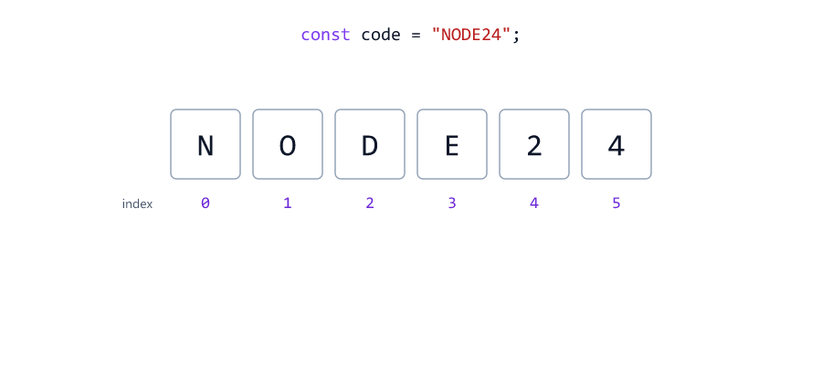

Spaces count as characters too: `"a b".length` is `3`.

---

## Escape Characters

Some characters cannot be typed directly inside a string. A **backslash** `\` starts a special code, called an **escape character**

escapes.js

```javascript
console.log("Line 1\nLine 2");
console.log("Name:\tSara");
console.log("She said \"hi\"");
console.log('It\'s fine');
console.log("C:\\Users\\sara");
```

Output

```text
Line 1
Line 2
Name:	Sara
She said "hi"
It's fine
C:\Users\sara
```

| Code   | Means                                    |
| ------ | ---------------------------------------- |
| `\n`   | New line                                 |
| `\t`   | Tab                                      |
| `\"`   | A `"` inside a `"..."` string            |
| `\'`   | A `'` inside a `'...'` string            |
| `\\`   | One real backslash                       |

This matters for **Windows paths**, which are full of backslashes

windows-path.js

```javascript
const folder = "C:\new\test";

console.log(folder);
```

Output

```text
C:
ew	est
```

No error, just a broken path: `\n` became a new line and `\t` became a tab. Fix it with `\\`, or use forward slashes, which Node.js also understands

windows-path-fixed.js

```javascript
const folder1 = "C:\\new\\test";   // escaped backslashes
const folder2 = "C:/new/test";     // forward slashes also work in Node.js

console.log(folder1);
console.log(folder2);
```

Output

```text
C:\new\test
C:/new/test
```

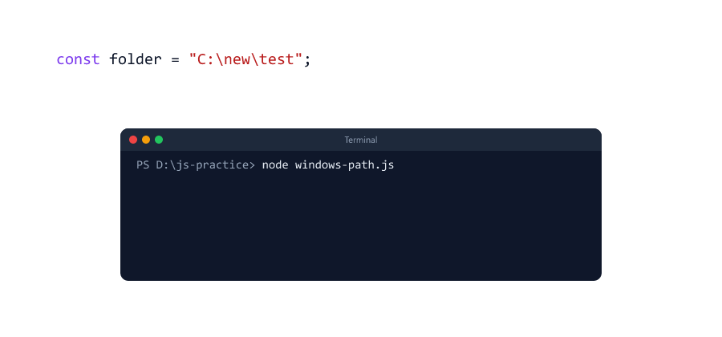

In the Node.js course you will build paths with `path.join()`, which handles slashes for you (Node.js course, Session 06).

---

## Joining Strings with +

Session 04 showed that `+` joins strings

join-plus.js

```javascript
const firstName = "Sara";
const lastName = "Khan";

const fullName = firstName + " " + lastName;
console.log(fullName);

console.log("Total: " + 10 + 5);
console.log("Total: " + (10 + 5));
```

Output

```text
Sara Khan
Total: 105
Total: 15
```

`"Total: " + 10` gives the text `"Total: 10"`, and then `+ 5` adds `"5"` to the end. Brackets do the math first.

With many pieces, `+` gets hard to read: lots of quotes, spaces and pluses to get right. Template literals fix that.

---

## Template Literals

A **template literal** is a string written with **backticks** `` ` ``. Inside it, `${ }` puts a value into the text

template.js

```javascript
const name = "Sara";
const items = 3;
const total = 1250;

const oldWay = "Hi " + name + ", your order of " + items + " items costs " + total + ".";
const newWay = `Hi ${name}, your order of ${items} items costs ${total}.`;

console.log(oldWay);
console.log(newWay);
```

Output

```text
Hi Sara, your order of 3 items costs 1250.
Hi Sara, your order of 3 items costs 1250.
```

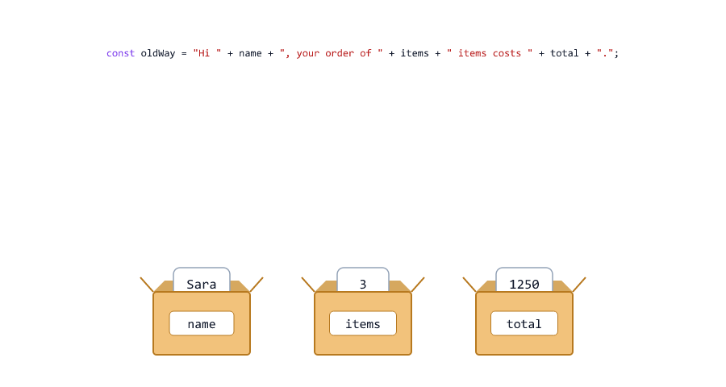

| Part              | Meaning                                       |
| ----------------- | --------------------------------------------- |
| `` ` `` ... `` ` ``   | Backticks start and end the template literal |
| `${name}`         | A **placeholder**: the value of `name` goes here |
| Everything else   | Normal text, exactly as you typed it          |

On most keyboards, the backtick key is at the top left, below `Esc`.

---

## Expressions Inside ${}

`${ }` can hold any **expression**: a calculation, a comparison, or a ternary (Session 06)

template-expressions.js

```javascript
const price = 400;
const quantity = 1;
const isMember = true;

console.log(`Subtotal: ${price * quantity}`);
console.log(`Delivery: ${isMember ? "free" : 40}`);
console.log(`You ordered ${quantity} item${quantity === 1 ? "" : "s"}`);
console.log(`Big order: ${price * quantity >= 1000}`);
```

Output

```text
Subtotal: 400
Delivery: free
You ordered 1 item
Big order: false
```

The third line is a common trick: `item` for 1, `items` for any other number. Change `quantity` to `3` and it prints `You ordered 3 items`.

Keep `${ }` short. If the expression gets long, calculate it in a variable first.

---

## Multi-line Strings

A template literal can go over **several lines**. The line breaks become part of the text

multiline.js

```javascript
const name = "Sara";
const orderId = 1042;

const email = `Hi ${name},

Your order #${orderId} has been shipped.

Thanks,
The Shop Team`;

console.log(email);
```

Output

```text
Hi Sara,

Your order #1042 has been shipped.

Thanks,
The Shop Team
```

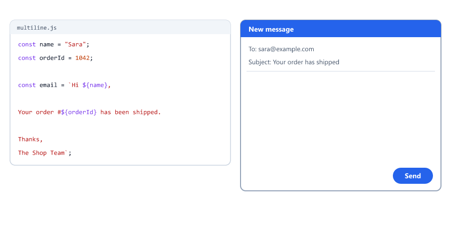

With normal quotes, you would need `\n` for every line break. Servers build emails, receipts and messages exactly like this.

---

## Template Literals in Backend Code

**A log line.** The Node.js course writes a line like this for every request (Node.js course, Session 26)

log-line.js

```javascript
const method = "GET";
const url = "/api/products";
const status = 200;
const ms = 12;

console.log(`[INFO] ${method} ${url} ${status} - ${ms} ms`);
```

Output

```text
[INFO] GET /api/products 200 - 12 ms
```

**A URL with user input.** Be careful here. Characters like `&`, `?`, `#` and spaces have special meanings in a URL

url-bad.js

```javascript
const search = "tom & jerry";

const url = `https://shop.example.com/search?q=${search}&page=2`;
console.log(url);
```

Output

```text
https://shop.example.com/search?q=tom & jerry&page=2
```

The server reads `q` as `"tom "`, and `" jerry"` becomes a separate, broken parameter. The `&` in the search text split it in two. Wrap user input in `encodeURIComponent()`

url-good.js

```javascript
const search = "tom & jerry";

const url = `https://shop.example.com/search?q=${encodeURIComponent(search)}&page=2`;
console.log(url);
```

Output

```text
https://shop.example.com/search?q=tom%20%26%20jerry&page=2
```

Now the server reads `q` as `"tom & jerry"`. A space became `%20` and `&` became `%26`.

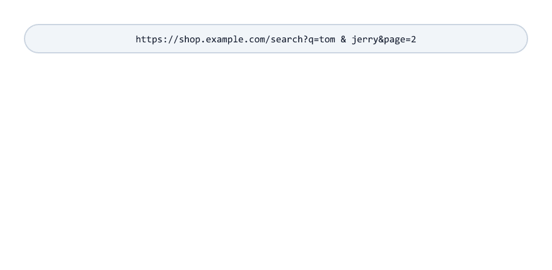

The Node.js course uses `encodeURIComponent()` for database passwords inside a connection string (Node.js course, Session 17).

---

## What is a Method?

A **method** is an action that belongs to a value. You call it with a dot and brackets: `value.method()`

methods.js

```javascript
const city = "Pune";

console.log(city.toUpperCase());   // a new string
console.log(city.toLowerCase());   // another new string
console.log(city);                 // the original is not changed
```

Output

```text
PUNE
pune
Pune
```

String methods **never change the original string**. They give back a **new** string. In fact, strings can never be changed at all. They are **immutable**

immutable.js

```javascript
let name = "sara";

name[0] = "S";       // try to change the first letter
console.log(name);   // nothing changed

name = "Sara";       // store a new string instead
console.log(name);
```

Output

```text
sara
Sara
```

JavaScript silently ignores `name[0] = "S"`. To get a different string, create a new one and store it in the variable.

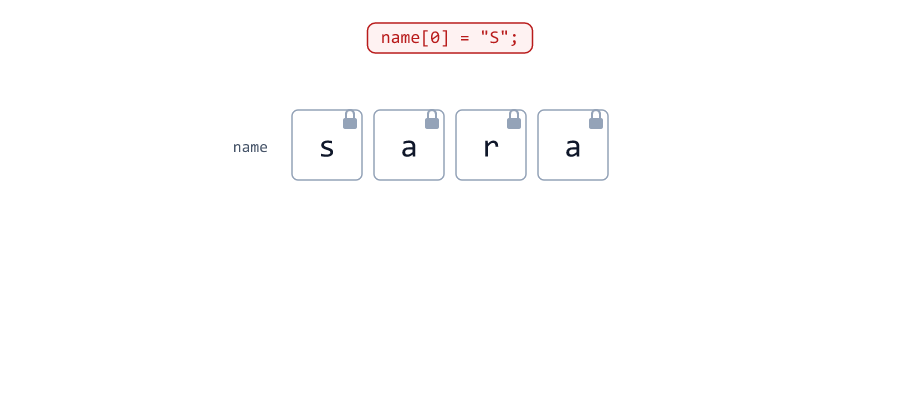

| Rule                                       | So you must                                 |
| ------------------------------------------ | ------------------------------------------- |
| Methods need brackets `()`                 | Write `city.toUpperCase()`, not `city.toUpperCase` |
| Methods return a new string                | Save the result: `email = email.toLowerCase();` |
| Strings are immutable                      | Never expect a method to "fix" the original |

`length` has no brackets, because it is not a method. It is a **property**: a value stored on the string.

---

## Changing Case

`toUpperCase()` and `toLowerCase()` change the case of letters.

Their most important job on a server: **comparing text without caring about case.** `===` is case-sensitive

case-compare.js

```javascript
const savedEmail = "sara@example.com";   // saved in lowercase
const typedEmail = "Sara@Example.com";   // typed by the user

console.log(typedEmail === savedEmail);
console.log(typedEmail.toLowerCase() === savedEmail);
```

Output

```text
false
true
```

Without `toLowerCase()`, Sara could not log in just because she typed a capital S. That is why the Node.js course saves emails in lowercase and lowercases the email at login (Node.js course, Sessions 19 and 22).

---

## Removing Spaces with trim

Users often type extra spaces by accident. `trim()` removes spaces (and tabs and new lines) from **both ends** of a string

trim.js

```javascript
const typed = "   sara@example.com  ";

console.log(`[${typed}]`);
console.log(`[${typed.trim()}]`);
console.log(`[${typed.trimStart()}]`);
console.log(`[${typed.trimEnd()}]`);
console.log(typed.length, typed.trim().length);
```

Output

```text
[   sara@example.com  ]
[sara@example.com]
[sara@example.com  ]
[   sara@example.com]
21 16
```

The `[ ]` in the output make the spaces visible.

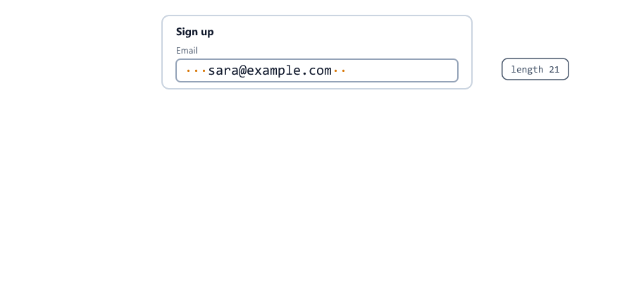

| Method          | Removes spaces from |
| --------------- | ------------------- |
| `trim()`        | Both ends           |
| `trimStart()`   | The start only      |
| `trimEnd()`     | The end only        |

Spaces in the **middle** stay: `"  Sara Khan  ".trim()` gives `"Sara Khan"`.

`trim()` also fixes a validation trap. A string of only spaces is **truthy** (Session 05), so `if (!name)` lets it through

empty-check.js

```javascript
const name = "   ";   // the user typed only spaces

if (!name) {
  console.log("Name is required");
} else {
  console.log("Name accepted?!");
}

if (name.trim() === "") {
  console.log("Name is required");
}
```

Output

```text
Name accepted?!
Name is required
```

---

## Searching in a String

search.js

```javascript
const email = "sara@example.com";

console.log(email.includes("@"));        // true
console.log(email.startsWith("sara"));   // true
console.log(email.endsWith(".com"));     // true
console.log(email.indexOf("@"));         // 4
console.log(email.indexOf("#"));         // -1 (not found)
```

Output

```text
true
true
true
4
-1
```

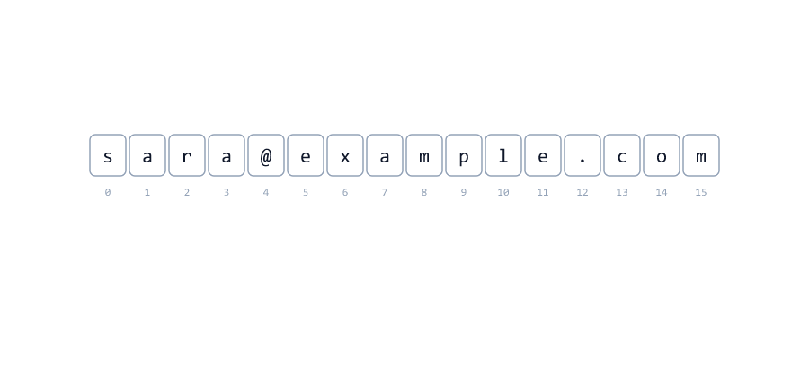

| Method              | Answers                                | Gives back       |
| ------------------- | -------------------------------------- | ---------------- |
| `includes(x)`       | Is `x` anywhere in the string?         | `true` / `false` |
| `startsWith(x)`     | Does the string start with `x`?        | `true` / `false` |
| `endsWith(x)`       | Does the string end with `x`?          | `true` / `false` |
| `indexOf(x)`        | Where is the **first** `x`?            | A position, or `-1` |
| `lastIndexOf(x)`    | Where is the **last** `x`?             | A position, or `-1` |

`-1` means "not found", the same idea as the search loop in Session 07. For a yes/no question, use `includes()`. Use `indexOf()` when you need the position.

`lastIndexOf()` finds the last match, useful for file extensions

last-index.js

```javascript
const fileName = "report.final.pdf";

console.log(fileName.indexOf("."));       // the first dot
console.log(fileName.lastIndexOf("."));   // the last dot
```

Output

```text
6
12
```

All of these are **case-sensitive**

case-search.js

```javascript
const message = "Payment FAILED for order 1042";

console.log(message.includes("failed"));
console.log(message.toLowerCase().includes("failed"));
```

Output

```text
false
true
```

A real check: accept only images when a user uploads a file (Node.js course, Sessions 06 and 25)

upload-check.js

```javascript
const fileName = "Holiday-Photo.JPG";
const lower = fileName.toLowerCase();

if (lower.endsWith(".jpg") || lower.endsWith(".png")) {
  console.log("Upload accepted");
} else {
  console.log("Only .jpg and .png files are allowed");
}
```

Output

```text
Upload accepted
```

Without `toLowerCase()`, `"Holiday-Photo.JPG"` would be refused, because `".JPG"` is not `".jpg"`.

---

## Cutting Out Part of a String with slice

`slice(start, end)` copies part of a string. The character at `start` is included. The character at `end` is **not**

slice.js

```javascript
const text = "Hello World";

console.log(text.slice(0, 5));   // from 0 up to (not including) 5
console.log(text.slice(6));      // from 6 to the end
console.log(text.slice(-5));     // the last 5 characters
console.log(text.slice(3, 7));
console.log(text.at(-1));        // the last character
```

Output

```text
Hello
World
World
lo W
d
```

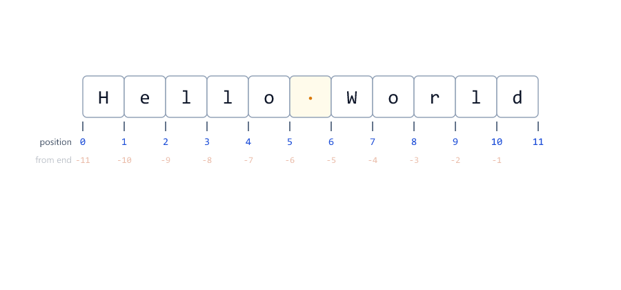

| Call               | Result      | Why                                          |
| ------------------ | ----------- | -------------------------------------------- |
| `slice(0, 5)`      | `"Hello"`   | Positions 0, 1, 2, 3, 4                      |
| `slice(6)`         | `"World"`   | No end: go to the end of the string          |
| `slice(-5)`        | `"World"`   | A negative number counts from the end        |
| `slice(3, 7)`      | `"lo W"`    | Positions 3, 4, 5, 6                         |
| `at(-1)`           | `"d"`       | One character; `-1` is the last one          |

Tip: `end - start` is the number of characters you get. `slice(0, 5)` gives 5.

`indexOf()` and `slice()` work well together. Split an email into its two parts

email-parts.js

```javascript
const email = "sara@example.com";
const at = email.indexOf("@");

const user = email.slice(0, at);
const domain = email.slice(at + 1);

console.log(user);
console.log(domain);
```

Output

```text
sara
example.com
```

You will also see two older methods in other people's code

old-methods.js

```javascript
const text = "Hello World";

console.log(text.slice(3, 7));       // positions 3 to 7
console.log(text.substring(3, 7));   // same here
console.log(text.substr(3, 7));      // old: 7 characters from position 3
```

Output

```text
lo W
lo W
lo Worl
```

| Method                | Second number means | Negative numbers | Use it?                 |
| --------------------- | ------------------- | ---------------- | ----------------------- |
| `slice(start, end)`   | End position        | Count from the end | Yes                   |
| `substring(start, end)` | End position      | Treated as 0     | Works, but `slice` is simpler |
| `substr(start, length)` | **Length**        | Start only       | No, it is deprecated (old) |

---

## Replacing Text

replace.js

```javascript
const message = "Hi NAME, welcome! NAME, your code is ready.";

console.log(message.replace("NAME", "Sara"));
console.log(message.replaceAll("NAME", "Sara"));
```

Output

```text
Hi Sara, welcome! NAME, your code is ready.
Hi Sara, welcome! Sara, your code is ready.
```

`replace()` changes only the **first** match. `replaceAll()` changes **every** match.

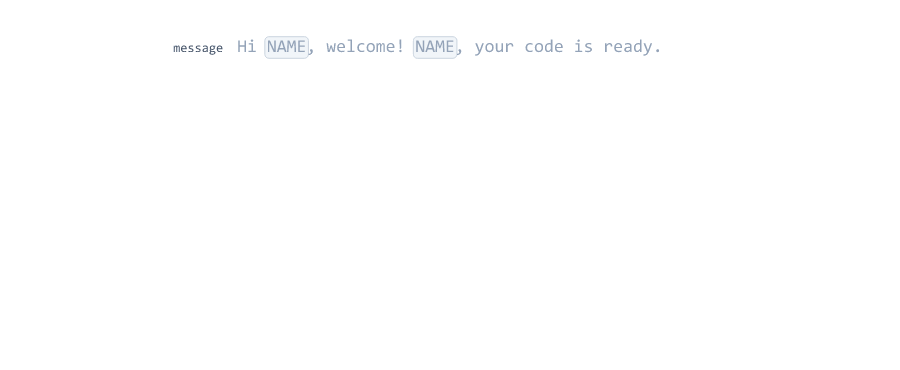

Two everyday uses

replace-uses.js

```javascript
const phone = "98765 432 10";
console.log(phone.replaceAll(" ", ""));

const title = "My First Post";
console.log(title.toLowerCase().replaceAll(" ", "-"));
```

Output

```text
9876543210
my-first-post
```

In Session 07 you removed spaces with a loop. `replaceAll()` does it in one line. The second result is a **slug**: a URL-friendly version of a title, like `/blog/my-first-post`.

---

## Padding and Repeating

`padStart(length, filler)` adds characters at the **start** until the string is long enough. `padEnd()` adds them at the end. `repeat(n)` repeats a string

pad.js

```javascript
const orderNumber = 42;
const orderId = "ORD-" + String(orderNumber).padStart(5, "0");
console.log(orderId);

const minutes = 5;
console.log(`9:${String(minutes).padStart(2, "0")}`);

console.log("-".repeat(20));
```

Output

```text
ORD-00042
9:05
--------------------
```

`padStart()` is a **string** method, so convert numbers with `String()` first (Session 05).

Padding also lines up text into columns, for receipts and reports printed in the terminal

receipt.js

```javascript
console.log("Item".padEnd(12) + "Price".padStart(8));
console.log("-".repeat(20));
console.log("Keyboard".padEnd(12) + String(1500).padStart(8));
console.log("Mouse".padEnd(12) + String(450).padStart(8));
console.log("-".repeat(20));
console.log("Total".padEnd(12) + String(1950).padStart(8));
```

Output

```text
Item           Price
--------------------
Keyboard        1500
Mouse            450
--------------------
Total           1950
```

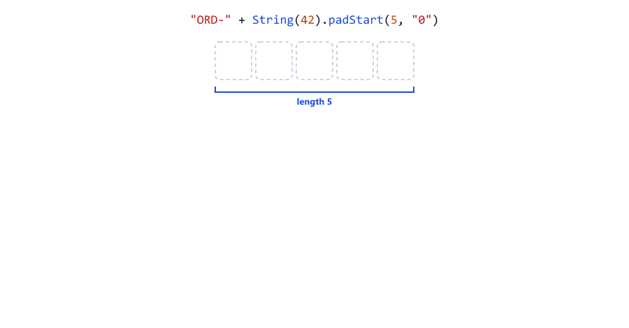

Without a filler, `padEnd(12)` and `padStart(8)` use spaces. The Node.js course lines up its test output with `padEnd()` too (Node.js course, Session 22).

---

## Chaining Methods

A method returns a string, so you can call another method on the result right away. This is called **chaining**

chain.js

```javascript
const typedEmail = "  Sara@Example.COM ";

const email = typedEmail.trim().toLowerCase();

console.log(`[${email}]`);
console.log(email === "sara@example.com");
```

Output

```text
[sara@example.com]
true
```

A chain runs **left to right**: first `trim()`, then `toLowerCase()` on the trimmed string.

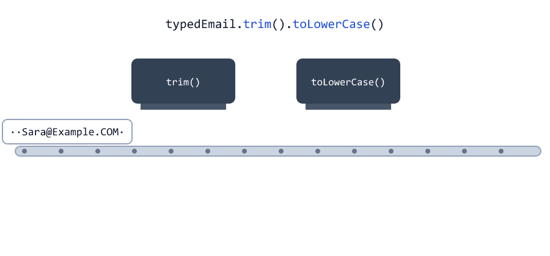

`.trim().toLowerCase()` is the standard way to clean an email before saving it or comparing it.

---

## String Methods at a Glance

| Method                    | Example                                  | Result         |
| ------------------------- | ---------------------------------------- | -------------- |
| `toUpperCase()`           | `"pune".toUpperCase()`                   | `"PUNE"`       |
| `toLowerCase()`           | `"PUNE".toLowerCase()`                   | `"pune"`       |
| `trim()`                  | `"  hi  ".trim()`                        | `"hi"`         |
| `includes(x)`             | `"sara@x.com".includes("@")`             | `true`         |
| `startsWith(x)`           | `"Bearer abc".startsWith("Bearer ")`     | `true`         |
| `endsWith(x)`             | `"cv.pdf".endsWith(".pdf")`              | `true`         |
| `indexOf(x)`              | `"sara@x.com".indexOf("@")`              | `4`            |
| `lastIndexOf(x)`          | `"a.b.pdf".lastIndexOf(".")`             | `3`            |
| `slice(start, end)`       | `"Hello".slice(1, 3)`                    | `"el"`         |
| `at(i)`                   | `"Hello".at(-1)`                         | `"o"`          |
| `replace(a, b)`           | `"a-b-c".replace("-", "+")`              | `"a+b-c"`      |
| `replaceAll(a, b)`        | `"a-b-c".replaceAll("-", "+")`           | `"a+b+c"`      |
| `padStart(n, x)`          | `"7".padStart(3, "0")`                   | `"007"`        |
| `padEnd(n, x)`            | `"7".padEnd(3, "0")`                     | `"700"`        |
| `repeat(n)`               | `"ab".repeat(3)`                         | `"ababab"`     |

`split()` turns a string into a list of pieces. It gives back an **array**, so you will learn it with arrays in Session 12.

---

## Regular Expressions: A First Look

A **regular expression** (regex) is a pattern for text, written between slashes: `/.../`. With `test()` you ask "does this string match the pattern?"

regex.js

```javascript
const onlyDigits = /^[0-9]+$/;

console.log(onlyDigits.test("9876543210"));    // true
console.log(onlyDigits.test("98765-43210"));   // false

console.log(/failed/i.test("Payment FAILED"));   // i: ignore case

const emailShape = /^\S+@\S+\.\S+$/;
console.log(emailShape.test("sara@example.com"));   // true
console.log(emailShape.test("sara@example"));       // false

console.log("98765 432-10".replace(/[ -]/g, ""));   // g: replace all
```

Output

```text
true
false
true
true
false
9876543210
```

| Symbol    | Means                                        |
| --------- | -------------------------------------------- |
| `^`       | The start of the string                      |
| `$`       | The end of the string                        |
| `[0-9]`   | One character from this range (a digit)     |
| `[ -]`    | One character from this list (a space or `-`) |
| `+`       | One or more of the thing before it           |
| `\S`      | One character that is not a space            |
| `\.`      | A real dot (a plain `.` means "any character") |
| `i` (after the last `/`) | Ignore upper/lower case       |
| `g` (after the last `/`) | Global: every match, not just the first |

So `/^[0-9]+$/` reads: "from the start to the end, only digits, at least one". And `/^\S+@\S+\.\S+$/` reads: "some characters, an `@`, some characters, a dot, some characters". The Node.js course uses this exact email pattern (Node.js course, Session 29).

Regular expressions are a big topic. This is just enough to read the ones you will meet. For simple checks, the string methods above are easier to read.

---

## Mini Example 1: Cleaning a Sign-up Form

Everything from a form arrives as a string, and users make mistakes: extra spaces, capital letters, missing parts. A server cleans the input first, then checks it

signup.js

```javascript
// Raw values from a sign-up form: always strings, often messy
const rawName = "  Sara Khan ";
const rawEmail = " Sara.Khan@Example.COM  ";
const rawUsername = "Sara_99";

const name = rawName.trim();
const email = rawEmail.trim().toLowerCase();
const username = rawUsername.trim().toLowerCase();

let error = "";

if (name === "") {
  error = "Name is required";
} else if (!email.includes("@") || email.startsWith("@") || email.endsWith("@")) {
  error = "Email is not valid";
} else if (username.length < 3 || username.length > 15) {
  error = "Username must be 3 to 15 characters";
}

if (error) {
  console.log(`400 ${error}`);
} else {
  console.log(`201 Welcome, ${name}!`);
  console.log(`Saved: ${email} (@${username})`);
}
```

Run

```bash
node signup.js
```

Output

```text
201 Welcome, Sara Khan!
Saved: sara.khan@example.com (@sara_99)
```

With `rawEmail = "sara.example.com"` the output is `400 Email is not valid`. With `rawName = "   "` it is `400 Name is required`.

| Step                        | Methods used                              |
| --------------------------- | ----------------------------------------- |
| 1. Clean                    | `trim()`, `toLowerCase()`, chaining       |
| 2. Check                    | `=== ""`, `includes()`, `startsWith()`, `endsWith()`, `length` |
| 3. Answer                   | Template literals with status codes `400` / `201` (Session 06) |

`error` starts as `""`, which is falsy (Session 05). If a check fails, `error` gets a message and becomes truthy.

---

## Mini Example 2: Reading the Authorization Header

After logging in, a client sends its token in a request header like `Authorization: Bearer <token>`. The server must check the format and cut out the token (Node.js course, Session 22)

auth-header.js

```javascript
// The header a client sends with every request after logging in
const header = "Bearer eyJhbGciOiJIUzI1NiJ9.eyJpZCI6IjQyIn0.k3J9xZ";

if (!header.startsWith("Bearer ")) {
  console.log("401 Not logged in. Please send a token.");
} else {
  const token = header.slice("Bearer ".length);

  console.log(`Token: ${token}`);
  console.log(`Length: ${token.length} characters`);
  console.log(`For the logs: ${token.slice(0, 10)}...`);
}
```

Run

```bash
node auth-header.js
```

Output

```text
Token: eyJhbGciOiJIUzI1NiJ9.eyJpZCI6IjQyIn0.k3J9xZ
Length: 43 characters
For the logs: eyJhbGciOi...
```

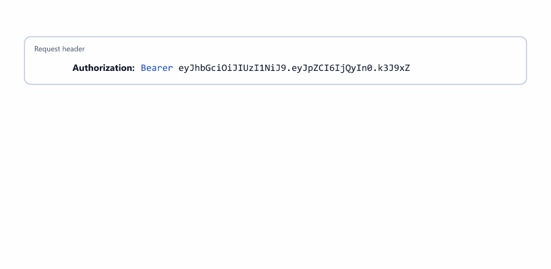

Remove `Bearer ` from the header and the output is `401 Not logged in. Please send a token.`

| Code                              | Why                                                    |
| --------------------------------- | ------------------------------------------------------ |
| `startsWith("Bearer ")`           | Wrong format? Refuse early with `401`                  |
| `"Bearer ".length`                | `7`, but clearer than typing the number 7              |
| `slice(...)` with one number      | Everything after `"Bearer "`                           |
| `token.slice(0, 10)` + `...`      | Never log a full token (like the card mask in Session 07) |

The Node.js course cuts out the token with `split()`, which you will learn in Session 12. The result is the same.

---

## Beginner Mistakes

### Mistake 1: ${} inside normal quotes

**Incorrect**

```javascript
const name = "Sara";

console.log("Hello ${name}");   // normal quotes: ${} is just text
console.log(`Hello ${name}`);
```

```text
Hello ${name}
Hello Sara
```

**Correct:** `${}` works only inside backticks.

### Mistake 2: Not saving the result of a method

**Incorrect**

```javascript
let email = "Sara@Example.com";

email.toLowerCase();   // makes a new string... and throws it away
console.log(email);
```

```text
Sara@Example.com
```

**Correct**

```javascript
let email = "Sara@Example.com";

email = email.toLowerCase();
console.log(email);
```

```text
sara@example.com
```

### Mistake 3: Forgetting the brackets

**Incorrect**

```javascript
const city = "Pune";

console.log(city.toUpperCase);
```

```text
[Function: toUpperCase]
```

Without `()`, you get the method itself, not its result. **Correct:** `city.toUpperCase()`.

### Mistake 4: Comparing or searching without fixing the case

**Incorrect:** `typedEmail === savedEmail` is `false` for `"Sara@Example.com"` and `"sara@example.com"`, and `includes("failed")` misses `"FAILED"`.

**Correct:** lowercase both sides first (see [Changing Case](#changing-case)).

### Mistake 5: Checking for an empty value without trim

**Incorrect:** `if (!name)` accepts `"   "`, because a string of spaces is truthy.

**Correct:** `if (name.trim() === "")`.

### Mistake 6: Single backslashes in a Windows path

**Incorrect:** `"C:\new\test"` prints `C:`, a new line, then `ew`, a tab and `est`.

**Correct:** `"C:\\new\\test"` or `"C:/new/test"`.

### Mistake 7: padStart on a number

**Incorrect**

```javascript
const orderNumber = 42;

console.log(orderNumber.padStart(5, "0"));
```

```text
D:\js-practice\m-pad-number.js:3
console.log(orderNumber.padStart(5, "0"));
                        ^

TypeError: orderNumber.padStart is not a function
```

Numbers don't have string methods. **Correct:** `String(orderNumber).padStart(5, "0")`.

### Mistake 8: Using replace when you mean replaceAll

**Incorrect:** `"98765 432 10".replace(" ", "")` removes only the first space: `"98765432 10"`.

**Correct:** `replaceAll(" ", "")`.

### Mistake 9: Treating slice's second number as a length

**Incorrect**

```javascript
const text = "Hello World";

console.log(text.slice(6, 5));    // wanted 5 characters from 6
console.log(text.slice(6, 11));   // the end position, not a length
```

```text

World
```

`slice(6, 5)` gives an empty string (the empty first line), because the end is before the start. **Correct:** the second number is the end position.

### Mistake 10: Indenting the lines of a multi-line template literal

**Incorrect**

```javascript
const name = "Sara";

const message = `Hi ${name},
    your order has shipped.`;   // these spaces are part of the text

console.log(message);
```

```text
Hi Sara,
    your order has shipped.
```

**Correct:** inside backticks, every space counts. Start the next lines at the left edge, as in [Multi-line Strings](#multi-line-strings).

### Mistake 11: Putting an object in a template literal

**Incorrect**

```javascript
const user = { name: "Sara" };

console.log(`User: ${user}`);
```

```text
User: [object Object]
```

**Correct:** use one of its values, `${user.name}` (objects: Session 13), or turn the whole object into text with `JSON.stringify()` (Session 19).

---

## Practice Exercises

### Exercise 1

Create `const firstName = "sARA";`. Print it with a capital first letter and the rest lowercase: `Sara`. Use `[0]` or `slice()`, `toUpperCase()`, `toLowerCase()` and a template literal.

### Exercise 2

Count the vowels in `"Node.js runs JavaScript on the server"`. Loop over the characters (Session 07) and use `"aeiou".includes(ch.toLowerCase())`.

### Exercise 3

A user uploads a file. Accept only `.pdf`, `.doc` and `.docx`, in any case. Test with `"CV.PDF"`, `"notes.txt"` and `"letter.docx"`.

### Exercise 4

Mask an email for display: `"sara@example.com"` becomes `"s***@example.com"`. Keep the first letter, replace the rest of the name with `*` (use `repeat()`), and keep the domain.

### Exercise 5

Turn `"  Learn Node.js In 30 Days  "` into the slug `"learn-node.js-in-30-days"`.

### Exercise 6

Check whether a word is a palindrome (the same backwards), like `"level"` or `"Racecar"`. Build the reversed string with a loop, and ignore the case.

### Exercise 7

Create invoice numbers from a year and a counter: year `2026` and counter `7` give `"INV-2026-0007"`. Use a template literal and `padStart()`.

### Exercise 8

Get the file extension from a file name: `"archive.tar.gz"` gives `"gz"`, and `"photo.JPG"` gives `"jpg"`. Use `lastIndexOf()` and `slice()`. What happens with `"README"`, which has no dot? Make it give `""`.

---

## Interview Questions

### What are the three ways to write a string, and what is special about backticks?

Single quotes, double quotes and backticks. Backticks create template literals, which can hold `${}` placeholders and span several lines.

### What is a template literal, and why is it better than +?

A string in backticks with `${}` placeholders for values or expressions. It is easier to read and write than joining many pieces with `+`, and it supports multi-line text.

### Are strings mutable in JavaScript?

No, they are immutable. `name[0] = "S"` is silently ignored. You can only create a new string and store it in the variable.

### Do string methods change the original string?

No. They return a new string. You must save the result, for example `email = email.trim();`.

### What is the difference between slice, substring and substr?

`slice(start, end)` takes an end position and accepts negative numbers from the end. `substring(start, end)` is similar but treats negative numbers as 0. `substr(start, length)` takes a length and is deprecated.

### What is the difference between includes and indexOf?

`includes()` returns `true` or `false`. `indexOf()` returns the position of the first match, or `-1` if there is none.

### What is the difference between replace and replaceAll?

With a string pattern, `replace()` changes only the first match. `replaceAll()` changes every match.

### How do you compare two strings without caring about upper and lower case?

Convert both to the same case first, for example `a.toLowerCase() === b.toLowerCase()`.

### How do you get the last character of a string?

`text[text.length - 1]` or `text.at(-1)`.

### What are escape characters?

Codes that start with a backslash inside a string: `\n` for a new line, `\t` for a tab, `\"` and `\'` for quotes, and `\\` for a backslash.

### Why should a server trim user input?

Users add spaces by accident. Without `trim()`, `" sara@example.com"` would not match the saved email, and a name of only spaces would pass an `if (!name)` check.

### How do you put user input into a URL safely?

Wrap it in `encodeURIComponent()`. It turns special characters like spaces, `&` and `?` into codes such as `%20` and `%26`, so they cannot break the URL.

### What is method chaining?

Calling a method on the result of another method, like `text.trim().toLowerCase()`. It works because each string method returns a new string. The calls run left to right.
