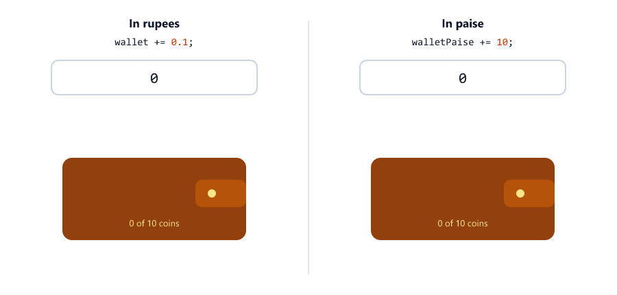
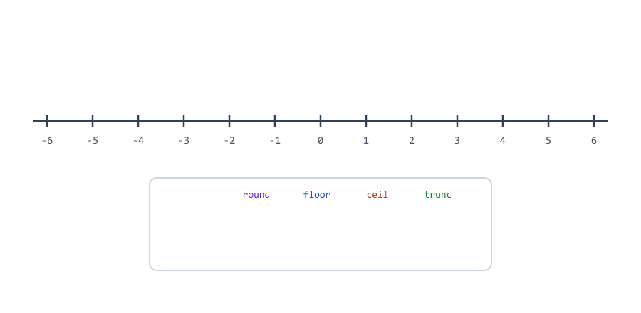
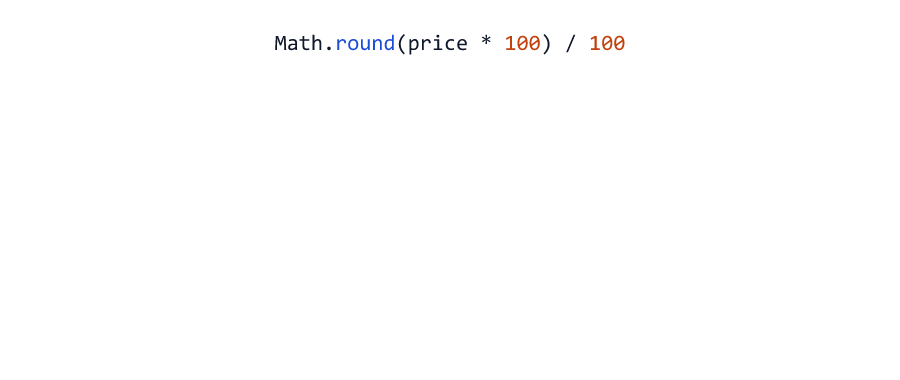
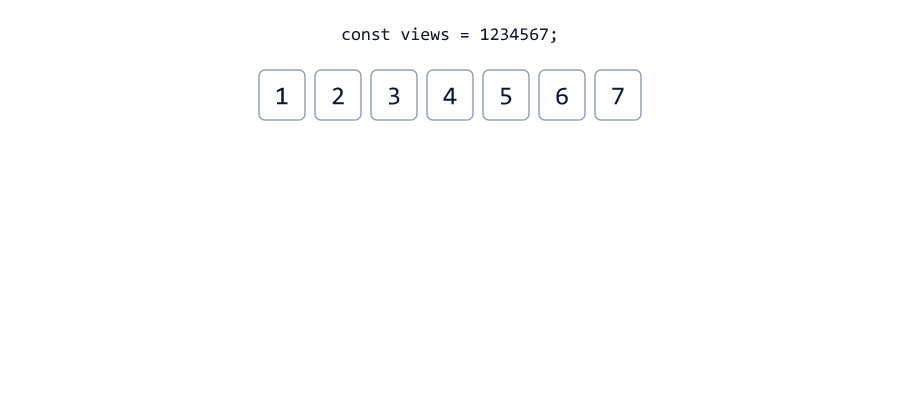
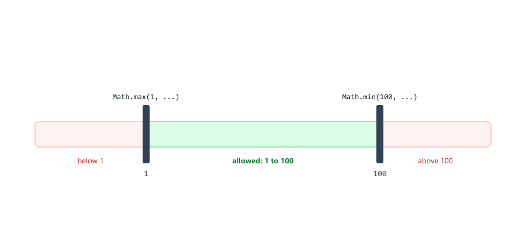
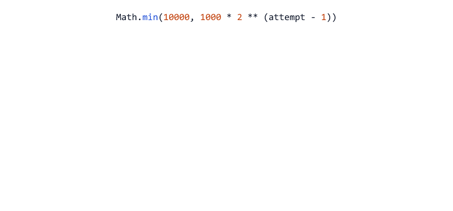
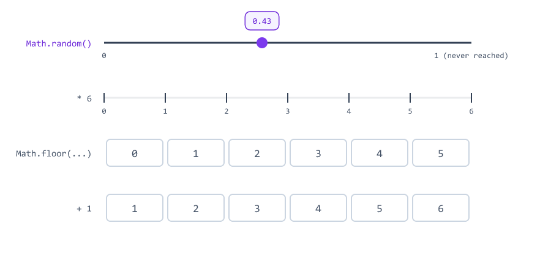
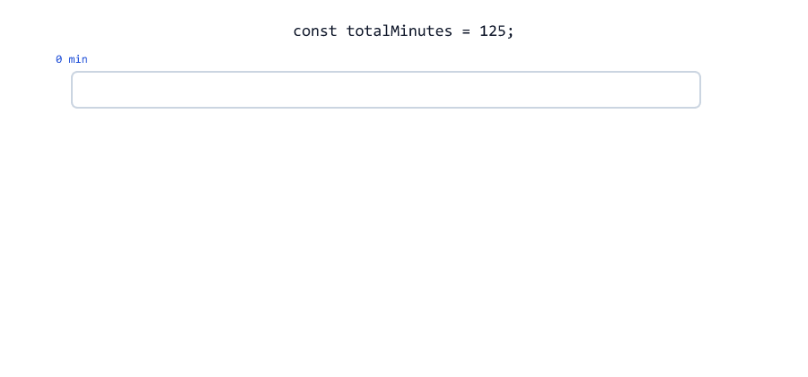

# Numbers and Math

## Table of Contents
- [Numbers in JavaScript](#numbers-in-javascript)
- [Decimal Numbers Are Not Exact](#decimal-numbers-are-not-exact)
- [Comparing Decimals](#comparing-decimals)
- [Money: Count in Paise, Not Rupees](#money-count-in-paise-not-rupees)
- [The Math Object](#the-math-object)
- [Rounding: round, floor, ceil and trunc](#rounding-round-floor-ceil-and-trunc)
- [Rounding to Decimal Places](#rounding-to-decimal-places)
- [toFixed Gives Back a String](#tofixed-gives-back-a-string)
- [Formatting Big Numbers](#formatting-big-numbers)
- [Math.max and Math.min](#mathmax-and-mathmin)
- [Math.abs, Math.pow and Math.sqrt](#mathabs-mathpow-and-mathsqrt)
- [Random Numbers](#random-numbers)
- [Random Codes](#random-codes)
- [Division by Zero: Infinity and NaN](#division-by-zero-infinity-and-nan)
- [Remainder % in Real Code](#remainder--in-real-code)
- [Mini Example 1: Cart Total in Paise](#mini-example-1-cart-total-in-paise)
- [Mini Example 2: Pagination Numbers](#mini-example-2-pagination-numbers)
- [Beginner Mistakes](#beginner-mistakes)
- [Practice Exercises](#practice-exercises)
- [Interview Questions](#interview-questions)

---

## Numbers in JavaScript

JavaScript has **one** number type for whole numbers and decimals (Session 03)

numbers-basics.js

```javascript
const quantity = 3;          // a whole number (integer)
const price = 249.5;         // a decimal
const balance = -150;        // a negative number
const views = 1_250_000;     // _ makes big numbers easy to read

console.log(typeof quantity, typeof price, typeof balance);
console.log(views);
console.log(10 / 4);         // division gives a decimal when needed
```

Output

```text
number number number
1250000
2.5
```

A server does math all the time

| Task                                  | Math needed                                |
| ------------------------------------- | ------------------------------------------ |
| Cart total, discount, tax             | Exact money math and rounding              |
| "Page 3 of 5"                         | Dividing and rounding **up**               |
| `?limit=500` from the URL             | Keeping a number between a min and a max   |
| One-time login codes                  | Random numbers                             |
| "2h 05m" or "12,34,567 views"         | `%` and number formatting                  |

Converting text to numbers (`Number()`, `parseInt()`, `parseFloat()`) was Session 05. This session is about calculating with them.

---

## Decimal Numbers Are Not Exact

Try this in Node.js

float.js

```javascript
console.log(0.1 + 0.2);
console.log(0.1 + 0.2 === 0.3);
console.log(1.1 + 2.2);
console.log(1.15 * 100);
```

Output

```text
0.30000000000000004
false
3.3000000000000003
114.99999999999999
```

This is not a bug in JavaScript. Computers store numbers in **binary** (0s and 1s), and most decimals like `0.1` cannot be stored exactly in binary. It is the same problem as writing 1/3 in decimal: `0.3333...` never ends, so it gets cut off somewhere. Python, Java and C# give the same results.


The tiny errors are usually harmless. Two places where they hurt:

1. **Comparing** decimals with `===`
2. **Money**, where every paisa must be correct

---

## Comparing Decimals

Never compare decimal results with `===`. Check that they are **very close** instead

compare-decimals.js

```javascript
const a = 0.1 + 0.2;
const b = 0.3;

console.log(a === b);
console.log(Math.abs(a - b) < Number.EPSILON);
```

Output

```text
false
true
```

`Math.abs(a - b)` is the distance between the two numbers (see [Math.abs](#mathabs-mathpow-and-mathsqrt)). `Number.EPSILON` is a tiny number, about `0.0000000000000002`. If the distance is smaller than that, the numbers are equal for all practical purposes.

Whole numbers (integers) don't have this problem: `1 + 2 === 3` is always `true`.

---

## Money: Count in Paise, Not Rupees

Small errors add up. Add Rs 0.10 to a wallet ten times

wallet-rupees.js

```javascript
// Add Rs 0.10 to a wallet ten times
let wallet = 0;

for (let i = 1; i <= 10; i++) {
  wallet += 0.1;
}

console.log(wallet);
console.log(wallet === 1);
```

Output

```text
0.9999999999999999
false
```

The fix used by payment systems everywhere: **store money as whole numbers in the smallest unit.** In India that is paise (Rs 1 = 100 paise). In the USA it is cents.

wallet-paise.js

```javascript
// The same wallet, counted in paise (Rs 1 = 100 paise)
let walletPaise = 0;

for (let i = 1; i <= 10; i++) {
  walletPaise += 10;
}

console.log(walletPaise);
console.log(walletPaise === 100);
console.log("Rs " + walletPaise / 100);
```

Output

```text
100
true
Rs 1
```



When a price arrives as rupees (for example from a form), convert it to paise **and round**

to-paise.js

```javascript
const priceText = "1.15";   // from a form

console.log(parseFloat(priceText) * 100);               // not exact
console.log(Math.round(parseFloat(priceText) * 100));   // 115 paise
```

Output

```text
114.99999999999999
115
```

| Rule                                  | Example                                    |
| ------------------------------------- | ------------------------------------------ |
| Store and calculate in paise          | `149900` for Rs 1,499.00                   |
| Convert to paise with `Math.round()`  | `Math.round(1.15 * 100)` is `115`          |
| Divide by 100 only to show the amount | `(149900 / 100).toFixed(2)` is `"1499.00"` |

Payment services like Razorpay and Stripe work exactly like this: you send them amounts in paise or cents.

---

## The Math Object

JavaScript has a built-in **`Math`** object: a toolbox of number methods. You call them like the string methods in Session 08, with a dot and brackets: `Math.round(4.7)`.

| Method              | What it does                                  |
| ------------------- | --------------------------------------------- |
| `Math.round(x)`     | Rounds to the nearest whole number            |
| `Math.floor(x)`     | Rounds down                                   |
| `Math.ceil(x)`      | Rounds up                                     |
| `Math.trunc(x)`     | Cuts off the decimals                         |
| `Math.max(a, b, ...)` | The biggest value                           |
| `Math.min(a, b, ...)` | The smallest value                          |
| `Math.abs(x)`       | The value without its minus sign              |
| `Math.pow(x, y)`    | `x` to the power `y` (same as `x ** y`)       |
| `Math.sqrt(x)`      | Square root                                   |
| `Math.random()`     | A random decimal from 0 up to (not including) 1 |

`Math` also has constants like `Math.PI` (`3.141592653589793`) and trigonometry like `Math.sin()`. Backend code rarely needs those.

---

## Rounding: round, floor, ceil and trunc

rounding.js

```javascript
console.log(Math.round(4.4));   // to the nearest whole number
console.log(Math.round(4.5));
console.log(Math.floor(4.9));   // always down
console.log(Math.ceil(4.1));    // always up
console.log(Math.trunc(4.9));   // cut off the decimals
```

Output

```text
4
5
4
5
4
```

With negative numbers, "down" means further from zero

rounding-negative.js

```javascript
console.log(Math.round(-4.5));
console.log(Math.floor(-4.2));
console.log(Math.ceil(-4.2));
console.log(Math.trunc(-4.2));
```

Output

```text
-4
-5
-4
-4
```



| Method          | `4.2` | `4.7` | `-4.2` | `-4.7` | Use it for                              |
| --------------- | ----- | ----- | ------ | ------ | --------------------------------------- |
| `Math.round()`  | 4     | 5     | -4     | -5     | Money in paise, ratings, percentages     |
| `Math.floor()`  | 4     | 4     | -5     | -5     | Whole hours in a number of minutes      |
| `Math.ceil()`   | 5     | 5     | -4     | -4     | Number of pages, boxes, trips needed    |
| `Math.trunc()`  | 4     | 4     | -4     | -4     | Just drop the decimals                  |

For positive numbers, `floor` and `trunc` give the same result.

---

## Rounding to Decimal Places

`Math.round()` always rounds to a whole number. To keep 2 decimals: multiply by 100, round, divide by 100

round-decimals.js

```javascript
const price = 12.3456;

console.log(Math.round(price * 100) / 100);   // 2 decimal places
console.log(Math.round(price * 10) / 10);     // 1 decimal place
```

Output

```text
12.35
12.3
```



| Step                   | Value       |
| ---------------------- | ----------- |
| `price * 100`          | `1234.56`   |
| `Math.round(...)`      | `1235`      |
| `... / 100`            | `12.35`     |

Because decimals are not exact, this trick is sometimes off by one in the last digit: `Math.round(1.005 * 100) / 100` gives `1`, not `1.01` (because `1.005 * 100` is `100.49999999999999`). For money, avoid the problem completely by working in paise.

---

## toFixed Gives Back a String

`toFixed(n)` formats a number with exactly `n` decimals, for showing it to people

tofixed.js

```javascript
const price = 12.5;

console.log(price.toFixed(2));
console.log(typeof price.toFixed(2));
console.log(price.toFixed(0));
```

Output

```text
12.50
string
13
```

The result is a **string**, not a number. That is perfect for a receipt or an email, where `12.50` must show two decimals. But it is a trap if you keep calculating ([Mistake 3](#mistake-3-adding-tofixed-results)).


If you need a number again, convert it back (Session 05)

tofixed-number.js

```javascript
const price = 12.3456;

const text = price.toFixed(2);   // "12.35" for the screen
const number = Number(text);     // 12.35 for more math

console.log(text, number);
console.log(typeof text, typeof number);
```

Output

```text
12.35 12.35
string number
```

**Rule:** calculate with numbers, use `toFixed()` only at the very end, when you show the result.

---

## Formatting Big Numbers

`toLocaleString()` adds separators the way people in a country read numbers

locale.js

```javascript
const views = 1234567;

console.log(views.toLocaleString("en-US"));
console.log(views.toLocaleString("en-IN"));
console.log(views.toLocaleString("de-DE"));
```

Output

```text
1,234,567
12,34,567
1.234.567
```



`"en-IN"` uses the Indian system: 12 lakh 34 thousand 567. `toLocaleString()` returns a string too, so use it only for display. It can also format currencies, which needs an options object (objects: Session 13).

---

## Math.max and Math.min

max-min.js

```javascript
console.log(Math.max(4, 9, 2));
console.log(Math.min(4, 9, 2));
```

Output

```text
9
2
```

Their most useful job on a server: **keeping a value inside a range** (called **clamping**). A user can type anything into a URL, like `?limit=500` or `?limit=-5`

clamp.js

```javascript
// ?limit=500 in the URL: allow 1 to 100 items, 10 if missing or not a number
const limitText = "500";

const limit = Math.min(100, Math.max(1, parseInt(limitText, 10) || 10));
console.log(limit);
```

Output

```text
100
```

Read it from the inside out

| Step                                | For `"500"`  | What it does                          |
| ----------------------------------- | ------------ | ------------------------------------- |
| `parseInt(limitText, 10)`           | `500`        | Text to number (Session 05)           |
| `... \|\| 10`                       | `500`        | `NaN` or `0` becomes the default `10` |
| `Math.max(1, ...)`                  | `500`        | Never below 1                         |
| `Math.min(100, ...)`                | `100`        | Never above 100                       |

More inputs

| `limitText` | `limit` | Why                                        |
| ----------- | ------- | ------------------------------------------ |
| `"20"`      | `20`    | Already inside the range                   |
| `"500"`     | `100`   | Too big                                    |
| `"-5"`      | `1`     | Too small                                  |
| `"abc"`     | `10`    | `NaN`, so the default                      |
| `"0"`       | `10`    | `0` is falsy (Session 05), so the default  |
| `"12.9"`    | `12`    | `parseInt` drops the decimals              |



The Node.js course limits every list exactly like this, so nobody can ask for a million records at once (Node.js course, Session 30).

---

## Math.abs, Math.pow and Math.sqrt

abs-pow.js

```javascript
const expected = 120;
const counted = 113;

console.log(Math.abs(counted - expected));   // how far off, always positive
console.log(Math.abs(-7));
console.log(Math.pow(2, 10));                // same as 2 ** 10
console.log(Math.sqrt(144));
```

Output

```text
7
7
1024
12
```

`Math.abs()` gives the **distance** between two numbers, no matter which is bigger: the stock is off by 7 either way.

Powers have a real backend use: **waiting longer after each failed attempt**, called **exponential backoff**. It stops a struggling server or database from being flooded with retries (Session 07 retried a database connection)

backoff.js

```javascript
// Wait longer after every failed attempt: 1 s, 2 s, 4 s ... but never more than 10 s
for (let attempt = 1; attempt <= 5; attempt++) {
  const waitMs = Math.min(10000, 1000 * 2 ** (attempt - 1));
  console.log(`Attempt ${attempt} failed. Waiting ${waitMs} ms`);
}
```

Output

```text
Attempt 1 failed. Waiting 1000 ms
Attempt 2 failed. Waiting 2000 ms
Attempt 3 failed. Waiting 4000 ms
Attempt 4 failed. Waiting 8000 ms
Attempt 5 failed. Waiting 10000 ms
```



The actual waiting needs timers, which you will learn in Session 22.

---

## Random Numbers

`Math.random()` gives a random decimal from `0` up to, but **not including**, `1`

random.js

```javascript
console.log(Math.random());
console.log(Math.random());
console.log(Math.random());
```

Output (yours will be different)

```text
0.8807031637465227
0.7716756953255699
0.8562676905658245
```

To get a whole number, like a dice roll from 1 to 6, use three steps

dice.js

```javascript
const roll = Math.floor(Math.random() * 6) + 1;   // 1 to 6

console.log(`You rolled ${roll}`);
```

Output (yours will be different)

```text
You rolled 3
```

| Step                       | Range                     |
| -------------------------- | ------------------------- |
| `Math.random()`            | `0` to `0.999...`         |
| `* 6`                      | `0` to `5.999...`         |
| `Math.floor(...)`          | `0`, `1`, `2`, `3`, `4` or `5` |
| `+ 1`                      | `1` to `6`                |



The general formula for a random whole number from `min` to `max`, both included

random-range.js

```javascript
const min = 10;
const max = 20;

const n = Math.floor(Math.random() * (max - min + 1)) + min;
console.log(n);   // 10 to 20, both included
```

Output (yours will be different)

```text
18
```

The `+ 1` in `max - min + 1` is what makes `max` possible. There are 11 numbers from 10 to 20, not 10.

---

## Random Codes

A login code sent by SMS is a random 6-digit number

otp.js

```javascript
// A 6-digit one-time code, like the ones sent by SMS
const code = String(Math.floor(Math.random() * 1000000)).padStart(6, "0");

console.log(`Your login code is ${code}`);
```

Output (yours will be different)

```text
Your login code is 528266
```

`Math.floor(Math.random() * 1000000)` gives `0` to `999999`. `padStart(6, "0")` (Session 08) keeps small numbers 6 digits long: `4215` becomes `"004215"`. A code is text, not a number you calculate with.

**Important:** `Math.random()` is fine for games, samples and tests, but it is **not secure**. Its numbers can be predicted. For real login codes, password-reset links and tokens, use Node.js's `crypto` module, for example `crypto.randomInt(0, 1000000)`. The Node.js course uses `crypto` for random file names and request ids (Node.js course, Sessions 25 and 26).

---

## Division by Zero: Infinity and NaN

Dividing by zero does **not** crash JavaScript

divide-zero.js

```javascript
console.log(10 / 0);
console.log(-10 / 0);
console.log(0 / 0);
```

Output

```text
Infinity
-Infinity
NaN
```

That sounds friendly, but it means bad values travel on quietly. A real case: the average order value on a day with no orders

average-bug.js

```javascript
const totalSales = 0;   // no orders yet today
const orderCount = 0;

const average = totalSales / orderCount;
console.log(`Average order: ${average}`);
```

Output

```text
Average order: NaN
```

`NaN` would show up on a dashboard, and in JSON it even turns into `null` (Session 19). Check before you divide

average-fixed.js

```javascript
const totalSales = 0;
const orderCount = 0;

const average = orderCount === 0 ? 0 : totalSales / orderCount;
console.log(`Average order: ${average}`);
```

Output

```text
Average order: 0
```


`Number.isFinite()` (Session 05) is `false` for `Infinity`, `-Infinity` and `NaN`, so it is a quick safety check before saving a calculated number.

---

## Remainder % in Real Code

Session 04 introduced `%`, the remainder. Together with `Math.floor()` it splits one number into parts

duration.js

```javascript
const totalMinutes = 125;

const hours = Math.floor(totalMinutes / 60);   // whole hours
const minutes = totalMinutes % 60;             // what is left over

console.log(`${hours}h ${String(minutes).padStart(2, "0")}m`);
```

Output

```text
2h 05m
```



| Expression          | Value | Meaning                       |
| ------------------- | ----- | ----------------------------- |
| `125 / 60`          | `2.0833...` | Hours, as a decimal     |
| `Math.floor(125 / 60)` | `2`  | Full hours                   |
| `125 % 60`          | `5`   | Minutes left over             |

The same idea turns seconds into `m:ss`, bytes into KB and MB, or paise into rupees and paise.

---

## Mini Example 1: Cart Total in Paise

A checkout with a discount and GST, calculated safely in paise and shown in rupees

cart.js

```javascript
// Cart total: all money in paise (Rs 1 = 100 paise)
const keyboardPaise = 149900;   // Rs 1,499.00
const mousePaise = 49950;       // Rs 499.50
const mouseQuantity = 2;

const subtotal = keyboardPaise + mousePaise * mouseQuantity;
const discount = Math.round(subtotal * 0.1);           // 10% off
const gst = Math.round((subtotal - discount) * 0.18);  // 18% GST
const total = subtotal - discount + gst;

console.log(`Subtotal: Rs ${(subtotal / 100).toFixed(2)}`);
console.log(`Discount: Rs ${(discount / 100).toFixed(2)}`);
console.log(`GST:      Rs ${(gst / 100).toFixed(2)}`);
console.log(`Total:    Rs ${(total / 100).toFixed(2)}`);
```

Run

```bash
node cart.js
```

Output

```text
Subtotal: Rs 2498.00
Discount: Rs 249.80
GST:      Rs 404.68
Total:    Rs 2652.88
```


| Pattern used                              | Why                                                  |
| ----------------------------------------- | ---------------------------------------------------- |
| All amounts in paise                      | Whole numbers are always exact                       |
| `Math.round()` after every percentage     | 10% or 18% can create fractions of a paisa           |
| `/ 100` and `toFixed(2)` only when printing | The calculation stays exact, the display shows `.00` |

The GST before rounding was `40467.6` paise. A shop cannot charge 0.6 paise, so it is rounded to `40468`.

---

## Mini Example 2: Pagination Numbers

An API that lists products shows them page by page. The page and limit come from the URL as text. The server must turn them into safe numbers and work out what to send (Node.js course, Sessions 13, 20 and 30)

pagination.js

```javascript
// Values from the URL: /api/products?page=3&limit=10
const pageText = "3";
const limitText = "10";
const totalItems = 47;   // counted in the database

const page = Math.max(1, parseInt(pageText, 10) || 1);
const limit = Math.min(100, Math.max(1, parseInt(limitText, 10) || 10));
const skip = (page - 1) * limit;
const totalPages = Math.ceil(totalItems / limit);

console.log(`skip: ${skip}, limit: ${limit}, totalPages: ${totalPages}`);

if (page > totalPages) {
  console.log(`Page ${page} is empty. The last page is ${totalPages}.`);
} else {
  const first = skip + 1;
  const last = Math.min(skip + limit, totalItems);
  console.log(`Page ${page} of ${totalPages}: items ${first} to ${last} of ${totalItems}`);
}
```

Run

```bash
node pagination.js
```

Output

```text
skip: 20, limit: 10, totalPages: 5
Page 3 of 5: items 21 to 30 of 47
```


Try other values

| Change                   | Output                                              |
| ------------------------ | --------------------------------------------------- |
| `pageText = "5"`         | `Page 5 of 5: items 41 to 47 of 47`                 |
| `pageText = "abc"`       | `Page 1 of 5: items 1 to 10 of 47`                  |
| `pageText = "9"`         | `Page 9 is empty. The last page is 5.`              |
| `limitText = "500"`      | `limit: 100`, `totalPages: 1`, and page 3 is empty  |

| Number        | Formula                          | Why                                         |
| ------------- | -------------------------------- | ------------------------------------------- |
| `skip`        | `(page - 1) * limit`             | Page 3 skips the 20 items of pages 1 and 2  |
| `totalPages`  | `Math.ceil(totalItems / limit)`  | 4.7 pages means 5 pages: the last one is not full |
| `last`        | `Math.min(skip + limit, totalItems)` | The last page stops at item 47, not 50  |

---

## Beginner Mistakes

### Mistake 1: Comparing decimals with ===

**Incorrect:** `0.1 + 0.2 === 0.3` is `false`.

**Correct:** `Math.abs(a - b) < Number.EPSILON`, or work with whole numbers (see [Comparing Decimals](#comparing-decimals)).

### Mistake 2: Calculating money in rupees with decimals

**Incorrect:** adding `0.1` ten times gives `0.9999999999999999`.

**Correct:** store and calculate in paise (whole numbers). Divide by 100 only to display.

### Mistake 3: Adding toFixed results

**Incorrect**

```javascript
const subtotal = (10.5).toFixed(2);
const delivery = (5.25).toFixed(2);

console.log(subtotal + delivery);   // text + text
```

```text
10.505.25
```

`toFixed()` returns strings, and `+` glues strings together (Session 04). **Correct:** add the numbers first, then call `toFixed()` once on the result.

### Mistake 4: Math.round for the number of pages

**Incorrect**

```javascript
const totalItems = 42;
const limit = 10;

console.log(Math.round(totalItems / limit));   // 4 pages: items 41 and 42 are lost!
console.log(Math.ceil(totalItems / limit));    // 5 pages
```

```text
4
5
```

**Correct:** `Math.ceil()`. A page that is not full is still a page.

### Mistake 5: Forgetting floor or + 1 in a random range

**Incorrect**

```javascript
console.log(Math.random() * 6);               // a decimal from 0 to 5.99...
console.log(Math.floor(Math.random() * 6));   // 0 to 5, never 6
```

Output (yours will be different)

```text
0.7009835343084259
1
```

**Correct:** `Math.floor(Math.random() * 6) + 1` for 1 to 6.

### Mistake 6: Dividing without checking for zero

**Incorrect:** `totalSales / orderCount` with no orders gives `NaN`.

**Correct:** `orderCount === 0 ? 0 : totalSales / orderCount`.

### Mistake 7: Clamping without a default

**Incorrect**

```javascript
const limitText = "abc";

console.log(Math.min(100, Math.max(1, parseInt(limitText, 10))));
console.log(Math.min(100, Math.max(1, parseInt(limitText, 10) || 10)));
```

```text
NaN
10
```

If any value given to `Math.max()` or `Math.min()` is `NaN`, the result is `NaN`. **Correct:** add a default with `|| 10` before clamping.

### Mistake 8: Calling a method directly on a number literal

**Incorrect**

```javascript
console.log(1250.toFixed(2));
```

```text
D:\js-practice\m-dot.js:1
console.log(1250.toFixed(2));
            ^^^^^

SyntaxError: Invalid or unexpected token
```

JavaScript reads `1250.` as the start of a decimal number. **Correct:** use a variable or brackets

```javascript
const amount = 1250;

console.log(amount.toFixed(2));
console.log((1250).toFixed(2));
```

```text
1250.00
1250.00
```

### Mistake 9: Math.floor to drop the decimals of a negative number

**Incorrect**

```javascript
const change = -4.7;

console.log(Math.floor(change));   // -5: floor goes DOWN, away from zero
console.log(Math.trunc(change));   // -4: only cuts off the decimals
```

```text
-5
-4
```

**Correct:** `Math.trunc()` when you only want to remove the decimals.

### Mistake 10: Math.random for security codes

**Incorrect:** login codes, password-reset tokens or API keys made with `Math.random()`. Its numbers can be predicted.

**Correct:** Node.js's `crypto` module (see [Random Codes](#random-codes)).

---

## Practice Exercises

### Exercise 1

Round `7.865` to 2 decimals in two ways: with `Math.round(x * 100) / 100` and with `toFixed(2)`. Print each result and its `typeof`.

### Exercise 2

Turn minutes into hours and minutes: `135` gives `2h 15m`, and `59` gives `0h 59m`.

### Exercise 3

A video is `3725` seconds long. Print it as `1:02:05` (hours, minutes, seconds). Use `Math.floor()`, `%` and `padStart()`.

### Exercise 4

Print a random whole number from 1 to 100. Then simulate a coin flip: print `Heads` if `Math.random() < 0.5`, otherwise `Tails`. Run it a few times.

### Exercise 5

Shipping in paise: orders of Rs 999 or more ship free, other orders pay Rs 49. Calculate the total for a cart of `89900` paise and for `120000` paise, and print both as rupees with 2 decimals.

### Exercise 6

Split a bill of Rs 1000 between 3 friends without losing a paisa. Work in paise: each friend pays `Math.floor(100000 / 3)`, and the first friend also pays the remainder `100000 % 3`. Print the three amounts and check that they add up to `100000`.

### Exercise 7

A server's disk has 128 GB and 37.5 GB are used. Print the used space as a percentage with 1 decimal: `29.3%`.

### Exercise 8

How many pages are needed with `limit = 10` for 0, 1, 10, 11 and 95 items? Calculate each with `Math.ceil()`. The answers are 0, 1, 1, 2 and 10.

---

## Interview Questions

### Why is 0.1 + 0.2 not equal to 0.3 in JavaScript?

Numbers are stored in binary, and most decimals like `0.1` cannot be stored exactly in binary, just like 1/3 cannot be written exactly in decimal. The tiny rounding errors show up as `0.30000000000000004`. Other languages that use the same number format behave the same.

### How should a backend store money?

As whole numbers in the smallest unit, such as paise or cents. Whole numbers are exact. Convert to rupees only for display.

### What is the difference between Math.round, Math.floor, Math.ceil and Math.trunc?

`round` goes to the nearest whole number, `floor` always goes down, `ceil` always goes up, and `trunc` cuts off the decimals (towards zero). They differ for negative numbers: `Math.floor(-4.2)` is `-5`, `Math.trunc(-4.2)` is `-4`.

### What does toFixed return?

A string with exactly the given number of decimals, for example `(12.5).toFixed(2)` is `"12.50"`. Use `Number()` if you need a number again.

### How do you round a number to 2 decimal places?

`Math.round(x * 100) / 100` gives a number. `x.toFixed(2)` gives a string for display. For money, work in paise instead.

### How do you get a random whole number between min and max?

`Math.floor(Math.random() * (max - min + 1)) + min`. Both `min` and `max` can come out.

### Is Math.random safe for passwords or login codes?

No. Its numbers can be predicted. Use Node.js's `crypto` module, for example `crypto.randomInt()` or `crypto.randomUUID()`.

### What do 10 / 0 and 0 / 0 give in JavaScript?

`10 / 0` is `Infinity` and `0 / 0` is `NaN`. JavaScript does not throw an error, so you must check for zero yourself.

### How do you compare two decimal numbers?

Check that they are very close: `Math.abs(a - b) < Number.EPSILON`.

### How do you keep a number inside a range?

Clamp it: `Math.min(max, Math.max(min, value))`. For example, a `limit` from the URL is kept between 1 and 100.

### What do Math.max() and Math.min() return with no arguments?

`Math.max()` returns `-Infinity` and `Math.min()` returns `Infinity`. Any value you compare will be bigger or smaller than them.

### Why use Math.ceil to count pages?

A page that is only partly full is still a page. 47 items with 10 per page is 4.7, which must become 5 pages. `Math.round` would give 4 for 42 items and lose the last two.

### What is the largest whole number JavaScript can store exactly?

`Number.MAX_SAFE_INTEGER`, which is `9007199254740991` (Session 03). Above it, use `BigInt`, or store big ids as strings.
