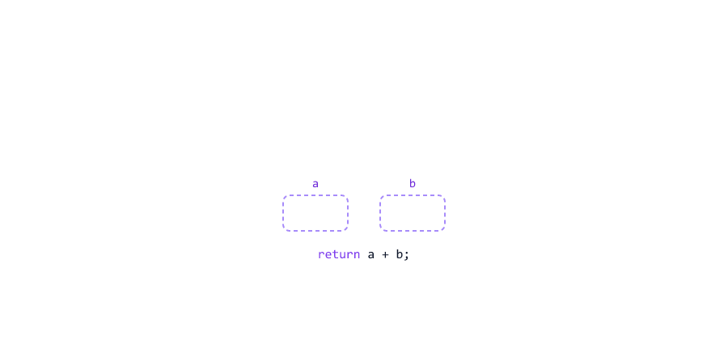
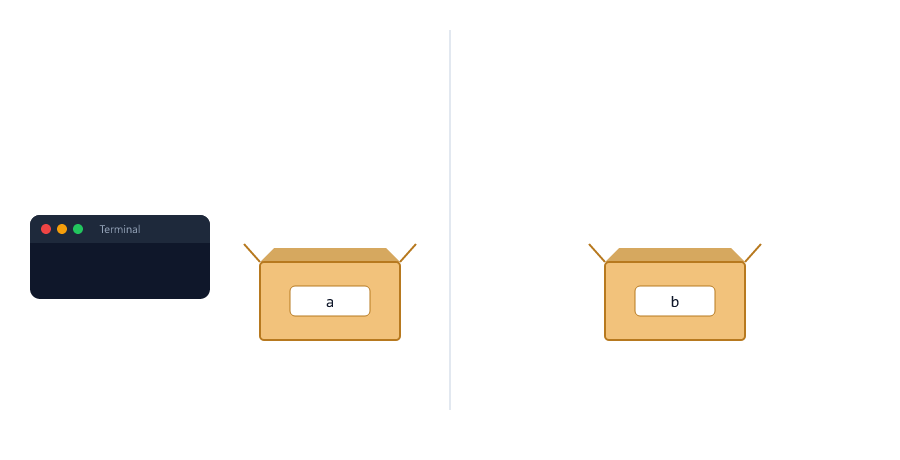
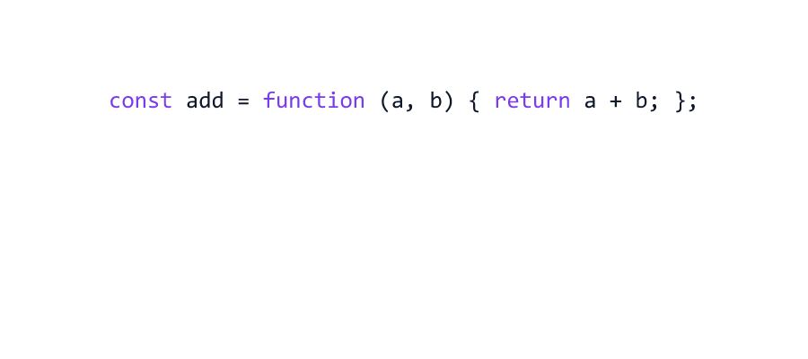
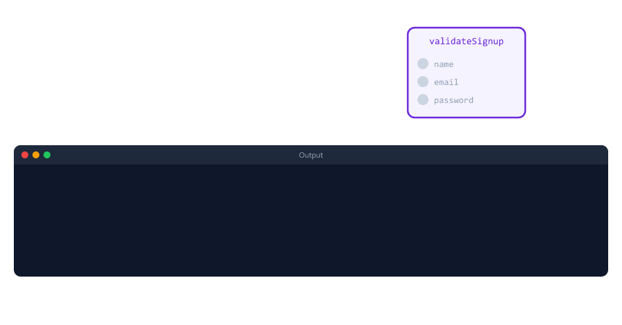

# Functions

> **Session 10 of 25** | Part 2: Building Blocks | [All sessions](README.md#course-outline)

## Table of Contents
- [What is a Function?](#what-is-a-function)
- [Declaring and Calling a Function](#declaring-and-calling-a-function)
- [Parameters and Arguments](#parameters-and-arguments)
- [Returning a Value](#returning-a-value)
- [return vs console.log](#return-vs-consolelog)
- [return Stops the Function](#return-stops-the-function)
- [Early Return Instead of Nested if](#early-return-instead-of-nested-if)
- [Missing and Extra Arguments](#missing-and-extra-arguments)
- [Default Parameters](#default-parameters)
- [Function Expressions](#function-expressions)
- [Arrow Functions](#arrow-functions)
- [Calling a Function Before Its Line](#calling-a-function-before-its-line)
- [Which Kind of Function Should I Use?](#which-kind-of-function-should-i-use)
- [Variables Inside a Function](#variables-inside-a-function)
- [Functions Calling Functions](#functions-calling-functions)
- [Reading Function Names in an Error](#reading-function-names-in-an-error)
- [Naming Functions](#naming-functions)
- [Pure Functions](#pure-functions)
- [Recursion: A Function That Calls Itself](#recursion-a-function-that-calls-itself)
- [Mini Example 1: Checkout with Small Functions](#mini-example-1-checkout-with-small-functions)
- [Mini Example 2: Sign-up Validation](#mini-example-2-sign-up-validation)
- [Beginner Mistakes](#beginner-mistakes)
- [Practice Exercises](#practice-exercises)
- [Interview Questions](#interview-questions)

---

## What is a Function?

A **function** is a named block of code that does one job. You write it once, and run it whenever you need that job done.

Without a function, the same lines get copied again and again

without-function.js

```javascript
// Welcome message for Riya
console.log("-----------------------");
console.log("Welcome, Riya!");
console.log("Your account is ready.");

// Welcome message for Aman: the same three lines, copied
console.log("-----------------------");
console.log("Welcome, Aman!");
console.log("Your account is ready.");
```

With a function, the lines are written once and given a name

with-function.js

```javascript
function sendWelcome(name) {
  console.log("-----------------------");
  console.log(`Welcome, ${name}!`);
  console.log("Your account is ready.");
}

sendWelcome("Riya");
sendWelcome("Aman");
```

Both print

```text
-----------------------
Welcome, Riya!
Your account is ready.
-----------------------
Welcome, Aman!
Your account is ready.
```


Think of a function as a small machine: you put something in, it does its work, and it can give something back.

| Without functions                           | With functions                                        |
| ------------------------------------------- | ----------------------------------------------------- |
| The same lines copied in many places        | Written once, used by name                            |
| A change means finding and fixing every copy | A change happens in one place                        |
| One long file, read top to bottom           | Small named pieces: `validateEmail`, `calculateGst`   |

Backend code is built from functions. Every route you write in the Node.js course is a function, and every Node.js module (`fs`, `path`, `http`) is a box full of functions.

---

## Declaring and Calling a Function

say-hello.js

```javascript
function sayHello() {
  console.log("Hello from the server!");
}

console.log("Before the calls");
sayHello();
sayHello();
console.log("After the calls");
```

Output

```text
Before the calls
Hello from the server!
Hello from the server!
After the calls
```

| Part        | In the example  | Meaning                                                 |
| ----------- | --------------- | ------------------------------------------------------- |
| `function`  | `function`      | The keyword that starts a function                      |
| Name        | `sayHello`      | The name you use to run it. Start with a verb           |
| `()`        | `()`            | The list of inputs (parameters). Empty here             |
| `{ }`       | `{ ... }`       | The **body**: the code that runs every time             |
| Call        | `sayHello();`   | The name plus `()`. Runs the body **now**               |

Writing the function only **defines** it. Nothing runs until you **call** it. A call jumps into the body, runs it from top to bottom, and then comes back to the line after the call.


---

## Parameters and Arguments

A function becomes useful when it can work with different values each time

greet-user.js

```javascript
function greetUser(name) {
  console.log(`Hello, ${name}!`);
}

greetUser("Riya");
greetUser("Aman");
```

Output

```text
Hello, Riya!
Hello, Aman!
```

| Word          | Where                                  | Example                                      |
| ------------- | -------------------------------------- | -------------------------------------------- |
| **Parameter** | In the definition: an empty slot       | `name` in `function greetUser(name)`         |
| **Argument**  | In the call: the real value            | `"Riya"` in `greetUser("Riya")`              |

A parameter is a variable that lives inside the function. On every call, it gets the value of the argument. Memory trick: **P**arameter = **P**laceholder, **A**rgument = **A**ctual value.

A function can take several parameters, separated by commas

log-request.js

```javascript
function logRequest(method, url, statusCode) {
  console.log(`${method} ${url} ${statusCode}`);
}

logRequest("GET", "/api/products", 200);
logRequest("POST", "/api/orders", 201);
logRequest("GET", "/api/users/99", 404);
```

Output

```text
GET /api/products 200
POST /api/orders 201
GET /api/users/99 404
```

Arguments are matched by **position**: the first argument goes into the first parameter, the second into the second, and so on. The names do not matter, and JavaScript does not check them

wrong-order.js

```javascript
function logRequest(method, url, statusCode) {
  console.log(`${method} ${url} ${statusCode}`);
}

logRequest(200, "GET", "/api/products");   // wrong order
```

Output

```text
200 GET /api/products
```


Keeping the order right is your job. With more than three or four parameters it becomes easy to mix them up. Session 13 shows how to pass one object with named values instead.

---

## Returning a Value

`return` sends a value **back** to the place where the function was called

add.js

```javascript
function add(a, b) {
  return a + b;
}

const total = add(250, 120);

console.log(total);
console.log(add(10, 5) * 2);
console.log(add(add(1, 2), 3));
```

Output

```text
370
30
6
```

When the function returns, the call is **replaced** by the returned value. You can store it, print it, or use it in a bigger calculation

| Code                  | Becomes                                         |
| --------------------- | ----------------------------------------------- |
| `add(250, 120)`       | `370`                                           |
| `add(10, 5) * 2`      | `15 * 2`, which is `30`                         |
| `add(add(1, 2), 3)`   | The inner call runs first: `add(3, 3)`, which is `6` |



A real use: money helpers from Session 09, written once and used many times

gst.js

```javascript
function calculateGst(amountPaise) {
  return Math.round(amountPaise * 0.18);
}

function formatRupees(paise) {
  return `Rs ${(paise / 100).toFixed(2)}`;
}

const price = 49900;
const gst = calculateGst(price);

console.log(`Price: ${formatRupees(price)}`);
console.log(`GST:   ${formatRupees(gst)}`);
console.log(`Total: ${formatRupees(price + gst)}`);
```

Output

```text
Price: Rs 499.00
GST:   Rs 89.82
Total: Rs 588.82
```

The Node.js course does the same in Session 07: a small `toGB(bytes)` function turns memory sizes into gigabytes.

A function without `return` gives back `undefined`

no-return.js

```javascript
function logMessage(message) {
  console.log(message);
}

const result = logMessage("Server started");
console.log(result);
```

Output

```text
Server started
undefined
```

---

## return vs console.log

This is the most common confusion with functions. Both functions below "show 10", but only one gives 10 back

log-vs-return.js

```javascript
function doubleAndPrint(n) {
  console.log(n * 2);
}

function doubleAndReturn(n) {
  return n * 2;
}

const a = doubleAndPrint(5);
const b = doubleAndReturn(5);

console.log("a is", a);
console.log("b is", b);
console.log(b + 1);
```

Output

```text
10
a is undefined
b is 10
11
```



|                         | `console.log(x)`                     | `return x`                                |
| ----------------------- | ------------------------------------ | ----------------------------------------- |
| Who gets the value      | A person reading the terminal        | The code that called the function         |
| Can the code use it?    | No                                   | Yes: store it, add to it, send it         |
| The call gives back     | `undefined` (if there is no `return`) | `x`                                      |

On a server, functions mostly **return** values. The value is then sent to the user as a response, saved in the database, or written to a log. `console.log` is for you while you develop.

---

## return Stops the Function

The function ends at the first `return` it reaches. Lines after it do not run

delivery-fee.js

```javascript
function getDeliveryFee(orderTotal) {
  if (orderTotal >= 500) {
    return 0;
  }
  console.log("Small order, adding a fee");
  return 40;
}

console.log(getDeliveryFee(800));
console.log(getDeliveryFee(300));
```

Output

```text
0
Small order, adding a fee
40
```

For 800, `return 0` ends the function, so the message is never printed. No `else` is needed.

`return` also stops loops, even two nested loops. In Session 07, `break` could stop only the inner loop

free-slot.js

```javascript
// In a real app, this would ask the database
function isBooked(day, hour) {
  return day < 2 || (day === 2 && hour < 10);
}

function findFirstFreeSlot() {
  for (let day = 1; day <= 3; day++) {
    for (let hour = 9; hour <= 11; hour++) {
      if (!isBooked(day, hour)) {
        return `Day ${day} at ${hour}:00`;   // stops both loops AND the function
      }
    }
  }
  return "No free slot";
}

console.log(findFirstFreeSlot());
```

Output

```text
Day 2 at 10:00
```

`isBooked()` returns `true` or `false`, so it can be used directly inside an `if`. The last `return "No free slot"` runs only when the loops finish without finding anything, like the `-1` search pattern from Session 07.

---

## Early Return Instead of Nested if

Session 06 showed that checking the **problems first** is easier to read than nesting. With functions and `return`, it gets even cleaner.

Nested: the "Login OK" case is buried three levels deep

login-nested.js

```javascript
function checkLogin(email, password, isBlocked) {
  if (email !== "") {
    if (password.length >= 8) {
      if (!isBlocked) {
        return "Login OK";
      } else {
        return "Account blocked";
      }
    } else {
      return "Password too short";
    }
  } else {
    return "Email is required";
  }
}

console.log(checkLogin("riya@example.com", "secret123", false));
```

Early return: each problem is checked and sent back at once. The happy case sits at the end, with no nesting

login-early-return.js

```javascript
function checkLogin(email, password, isBlocked) {
  if (email === "") {
    return "Email is required";
  }
  if (password.length < 8) {
    return "Password too short";
  }
  if (isBlocked) {
    return "Account blocked";
  }

  return "Login OK";
}

console.log(checkLogin("", "secret123", false));
console.log(checkLogin("riya@example.com", "123", false));
console.log(checkLogin("riya@example.com", "secret123", true));
console.log(checkLogin("riya@example.com", "secret123", false));
```

Output

```text
Email is required
Password too short
Account blocked
Login OK
```


The checks at the top are called **guard clauses**. You will see this shape in almost every route of the Node.js course, for example `if (!student) { return res.status(404)... }` in Session 15: refuse early, then do the real work.

---

## Missing and Extra Arguments

JavaScript does not complain when a call has too few or too many arguments

missing-extra.js

```javascript
function greetUser(name, city) {
  console.log(`Hello ${name} from ${city}`);
}

greetUser("Riya", "Pune");
greetUser("Aman");                     // city is missing
greetUser("Sara", "Delhi", "Mumbai");  // one value too many
```

Output

```text
Hello Riya from Pune
Hello Aman from undefined
Hello Sara from Delhi
```

| Situation              | What happens                                      |
| ---------------------- | ------------------------------------------------- |
| Missing argument       | The parameter is `undefined`                      |
| Extra argument         | It is ignored                                     |

A missing number is worse than a strange message. It quietly turns a calculation into `NaN` (Session 09)

missing-nan.js

```javascript
function lineTotal(price, quantity) {
  return price * quantity;
}

console.log(lineTotal(250, 2));
console.log(lineTotal(250));   // quantity is undefined
```

Output

```text
500
NaN
```

---

## Default Parameters

A **default parameter** is the value a parameter gets when its argument is missing. Write it with `=` in the brackets

default-quantity.js

```javascript
function lineTotal(price, quantity = 1) {
  return price * quantity;
}

console.log(lineTotal(250, 2));
console.log(lineTotal(250));
```

Output

```text
500
250
```

Defaults fit settings that usually have the same value, like pagination (Session 09)

default-page.js

```javascript
function describePage(page = 1, limit = 10) {
  return `page ${page}, ${limit} per page`;
}

console.log(describePage(3, 20));
console.log(describePage(3));
console.log(describePage());
console.log(describePage(undefined, 50));
```

Output

```text
page 3, 20 per page
page 3, 10 per page
page 1, 10 per page
page 1, 50 per page
```

To skip the first argument and give the second, pass `undefined` in its place.


A default is used **only when the value is `undefined`**. `0`, `null`, `""` and `false` are real values, so they are kept

default-only-undefined.js

```javascript
function getDiscount(percent = 10) {
  return percent;
}

console.log(getDiscount());            // missing: uses 10
console.log(getDiscount(undefined));   // undefined: uses 10
console.log(getDiscount(0));           // 0 is a real value
console.log(getDiscount(null));        // null is a real value
```

Output

```text
10
10
0
null
```

This is better than the `||` trick from Session 04, which also replaces `0`

default-vs-or.js

```javascript
function withOr(quantity) {
  quantity = quantity || 1;
  return quantity;
}

function withDefault(quantity = 1) {
  return quantity;
}

console.log(withOr(0));        // 0 is falsy, so || replaces it
console.log(withDefault(0));   // a default only replaces undefined
```

Output

```text
1
0
```

---

## Function Expressions

So far every function was a **function declaration**: a line that starts with `function`. A function can also be stored in a variable. This is a **function expression**

expression.js

```javascript
const calculateTax = function (amount) {
  return Math.round(amount * 0.18);
};

console.log(calculateTax(1000));
console.log(typeof calculateTax);
console.log(calculateTax);
```

Output

```text
180
function
[Function: calculateTax]
```

The function has no name of its own after `function`. It is called by the variable's name. Note the `;` after the `}`: the whole thing is one `const` statement.

In JavaScript, a function is a **value**, just like a number or a string. You can copy it into another variable

function-value.js

```javascript
function formatRupees(paise) {
  return `Rs ${(paise / 100).toFixed(2)}`;
}

const showPrice = formatRupees;   // no (): copy the function, do not call it

console.log(showPrice(49900));
console.log(formatRupees(49900));
```

Output

```text
Rs 499.00
Rs 499.00
```

| Code                  | Meaning                                           |
| --------------------- | ------------------------------------------------- |
| `formatRupees`        | The function itself (the machine)                 |
| `formatRupees(49900)` | Run the function now and use its returned value   |

Because functions are values, you can also pass one into another function. That is the big idea of the next lesson, Session 11.

---

## Arrow Functions

An **arrow function** is a shorter way to write a function expression. Here is the same function written four ways

add-four-ways.js

```javascript
function addDeclaration(a, b) {
  return a + b;
}

const addExpression = function (a, b) {
  return a + b;
};

const addArrow = (a, b) => {
  return a + b;
};

const addShort = (a, b) => a + b;

console.log(addDeclaration(2, 3), addExpression(2, 3), addArrow(2, 3), addShort(2, 3));
```

Output

```text
5 5 5 5
```

To turn a function expression into an arrow function, remove the word `function` and put `=>` after the brackets. When the body is just `return something;`, you can drop the `{ }` and the `return` too: the value is returned automatically (an **implicit return**).



| Situation          | Arrow function                         | Note                                         |
| ------------------ | -------------------------------------- | -------------------------------------------- |
| No parameters      | `() => "api-server-1"`                 | Empty brackets are required                  |
| One parameter      | `(age) => age >= 18`                   | The brackets are optional, but this course always writes them, like the Node.js course |
| Several parameters | `(price, quantity) => price * quantity` | Brackets are required                       |
| One expression     | `(a, b) => a + b`                      | No `{ }`, no `return`: returned automatically |
| Several lines      | `(a, b) => { ... return ...; }`        | With `{ }` you must write `return`           |

arrow-forms.js

```javascript
const getServerName = () => "api-server-1";
const toPaise = (rupees) => Math.round(rupees * 100);
const isAdult = (age) => age >= 18;
const formatOrderId = (id) => `ORD-${String(id).padStart(5, "0")}`;
const lineTotal = (price, quantity) => {
  const total = price * quantity;
  return total;
};

console.log(getServerName());
console.log(toPaise(1.15));
console.log(isAdult(17));
console.log(formatOrderId(42));
console.log(lineTotal(250, 3));
```

Output

```text
api-server-1
115
false
ORD-00042
750
```

You will see arrow functions everywhere in the Node.js course. A route is written as `(req, res) => { ... }`, an arrow function with two parameters (Session 12), and middleware is `(req, res, next) => { ... }` (Session 14). Arrow functions also handle `this` differently from normal functions; that is explained in Session 17.

---

## Calling a Function Before Its Line

A function declaration can be called **before** the line where it is written

hoist-declaration.js

```javascript
console.log(add(2, 3));   // called BEFORE the function's line

function add(a, b) {
  return a + b;
}
```

Output

```text
5
```

Before running a file, JavaScript finds every function declaration and sets it up first. This is called **hoisting** (Session 16 explains it in detail).

A function stored in a `const` is different. It is created only when its line runs

hoist-arrow.js

```javascript
console.log(multiply(2, 3));   // called BEFORE the line

const multiply = (a, b) => a * b;
```

Output

```text
D:\js-practice\hoist-arrow.js:1
console.log(multiply(2, 3));   // called BEFORE the line
            ^

ReferenceError: Cannot access 'multiply' before initialization
```

This is the same error as using any `const` variable before its line (Session 02).


In practice this rarely matters: most Node.js files define their functions near the top and call them further down.

---

## Which Kind of Function Should I Use?

| Kind                     | Syntax                              | Call before its line? | Typical use                                    |
| ------------------------ | ----------------------------------- | --------------------- | ---------------------------------------------- |
| Function declaration     | `function name(a) { ... }`          | Yes                   | Named helpers: `validateEmail`, `calculateGst` |
| Function expression      | `const name = function (a) { ... };` | No                   | Older code; you will still read it             |
| Arrow function           | `const name = (a) => ...;`          | No                    | Short helpers, and functions passed into other functions (Session 11) |

A simple rule that matches the Node.js course: use **function declarations** for the main named functions of a file, and **arrow functions** for short one-liners and for functions you pass into others, like `(req, res) => { ... }`.

---

## Variables Inside a Function

Variables created inside a function (and its parameters) exist **only inside that function**

local-variable.js

```javascript
function calculateTotal(price, quantity) {
  const total = price * quantity;
  return total;
}

console.log(calculateTotal(250, 2));
console.log(total);
```

Output

```text
500
D:\js-practice\local-variable.js:7
console.log(total);
            ^

ReferenceError: total is not defined
```

To use a value outside, `return` it. The function's body is a block, like the `if` blocks in Session 06.

A function **can** read variables from outside

outer-variable.js

```javascript
const GST_RATE = 0.18;

function addGst(amount) {
  const gst = Math.round(amount * GST_RATE);   // reads GST_RATE from outside
  return amount + gst;
}

console.log(addGst(1000));
```

Output

```text
1180
```


Every call starts with **fresh** variables. The function does not remember anything from the last call

fresh-variables.js

```javascript
function countVisit() {
  let visits = 0;
  visits++;
  return visits;
}

console.log(countVisit());
console.log(countVisit());
console.log(countVisit());
```

Output

```text
1
1
1
```

To keep a count between calls, the variable must live outside the function

outer-counter.js

```javascript
let visits = 0;

function countVisit() {
  visits++;
  return visits;
}

console.log(countVisit());
console.log(countVisit());
console.log(countVisit());
```

Output

```text
1
2
3
```

This works, but any code in the file can change `visits`. Session 16 shows a safer way to keep a private counter (closures).

If a variable inside has the same name as one outside, the inside one is used, and the outside one is not changed

same-name.js

```javascript
const name = "outside";

function showName() {
  const name = "inside";
  console.log(name);
}

showName();
console.log(name);
```

Output

```text
inside
outside
```

This is legal, but confusing to read. Prefer different names. All the scope rules are explained in Session 16.

---

## Functions Calling Functions

Big jobs are built from small functions. A function can call other functions

calling-functions.js

```javascript
function toPaise(rupees) {
  return Math.round(rupees * 100);
}

function addGst(paise) {
  return paise + Math.round(paise * 0.18);
}

function formatRupees(paise) {
  return `Rs ${(paise / 100).toFixed(2)}`;
}

function priceWithGst(rupees) {
  const paise = toPaise(rupees);
  const withGst = addGst(paise);
  return formatRupees(withGst);
}

console.log(priceWithGst(499.5));
console.log(priceWithGst(1499));
```

Output

```text
Rs 589.41
Rs 1768.82
```

JavaScript keeps a list of the functions that are running right now. It is called the **call stack** (Node.js course, Session 03). A call puts a function on top of the stack. A `return` takes it off, and the function below continues where it stopped.

| Step                                 | Call stack (top first)       |
| ------------------------------------ | ---------------------------- |
| `priceWithGst(499.5)` is called      | priceWithGst                 |
| It calls `toPaise(499.5)`            | toPaise, priceWithGst        |
| `toPaise` returns `49950`            | priceWithGst                 |
| It calls `addGst(49950)`             | addGst, priceWithGst         |
| `addGst` returns `58941`             | priceWithGst                 |
| It calls `formatRupees(58941)`       | formatRupees, priceWithGst   |
| `formatRupees` returns `"Rs 589.41"` | priceWithGst                 |
| `priceWithGst` returns `"Rs 589.41"` | (empty: back to `console.log`) |


---

## Reading Function Names in an Error

When an error happens inside a function, Node.js prints the call stack at that moment. It tells you **which function broke** and **who called it**

stack-trace.js

```javascript
function formatName(name) {
  return name.toUpperCase();
}

function createWelcome(name) {
  return `Welcome, ${formatName(name)}!`;
}

console.log(createWelcome("riya"));
console.log(createWelcome());
```

Output (shortened)

```text
Welcome, RIYA!
D:\js-practice\stack-trace.js:2
  return name.toUpperCase();
              ^

TypeError: Cannot read properties of undefined (reading 'toUpperCase')
    at formatName (D:\js-practice\stack-trace.js:2:15)
    at createWelcome (D:\js-practice\stack-trace.js:6:22)
    at Object.<anonymous> (D:\js-practice\stack-trace.js:10:13)
    at Module._compile (node:internal/modules/cjs/loader:1872:14)
    ...
```

Read the `at` lines from the top

| Line                                       | Meaning                                                    |
| ------------------------------------------ | ---------------------------------------------------------- |
| `at formatName (...stack-trace.js:2:15)`   | The error happened in `formatName`, line 2                 |
| `at createWelcome (...stack-trace.js:6:22)` | `createWelcome` called it, from line 6                    |
| `at Object.<anonymous> (...:10:13)`        | The top level of your file called that, from line 10       |
| `at Module._compile (node:internal/...)`   | Node.js's own code. Skip these lines                       |

The bug: `createWelcome()` was called without a name, so `name` was `undefined`, and `undefined` has no `toUpperCase()`. In a real server the stack is longer, but the rule is the same: find the first line that points to **your** file. Good function names make these lines easy to understand. Session 18 shows how to catch errors so the server does not stop.

---

## Naming Functions

A variable name is a **noun** (what it holds). A function name is a **verb** (what it does)

| Starts with              | Gives back                  | Examples                                     |
| ------------------------ | --------------------------- | -------------------------------------------- |
| `get`, `find`            | A value                     | `getDeliveryFee`, `findFirstFreeSlot`        |
| `calculate`              | A number                    | `calculateGst`, `calculateTotal`             |
| `format`                 | Text for display            | `formatRupees`, `formatOrderId`              |
| `is`, `has`, `can`       | `true` or `false`           | `isAdult`, `isBooked`, `isValidEmail`        |
| `validate`, `check`      | A problem, or OK            | `validateSignup`, `checkLogin`               |
| `send`, `log`, `save`    | Usually nothing: it does an action | `sendWelcome`, `logRequest`           |

| Unclear          | Clear                     |
| ---------------- | ------------------------- |
| `calc(a, b)`     | `calculateGst(amount)`    |
| `check(x)`       | `isValidEmail(email)`     |
| `doStuff(name)`  | `sendWelcome(name)`       |
| `data()`         | `getServerName()`         |

Keep **one job per function**. If the honest name needs "and" (`validateAndSaveAndEmailUser`), split it into three functions.

---

## Pure Functions

A **pure function** gives the same result for the same inputs, and changes nothing outside itself

pure.js

```javascript
// Pure: the answer depends only on the inputs, nothing outside changes
function calculateDiscount(totalPaise, percent) {
  return Math.round(totalPaise * percent / 100);
}

console.log(calculateDiscount(100000, 10));
console.log(calculateDiscount(100000, 10));
```

Output

```text
10000
10000
```

not-pure.js

```javascript
// Not pure: reads AND changes a variable outside the function
let cartTotal = 100000;

function applyDiscount(percent) {
  cartTotal = cartTotal - Math.round(cartTotal * percent / 100);
  return cartTotal;
}

console.log(applyDiscount(10));
console.log(applyDiscount(10));   // same call, different answer
```

Output

```text
90000
81000
```

The second call gave a different answer, because the first call changed `cartTotal`. If two parts of a server call `applyDiscount()`, the customer gets two discounts.

Pure functions are easy to understand and easy to test (Node.js course, Session 28). A server cannot be 100% pure, because it must save to the database and send responses. A good habit: keep calculations, checks and formatting in pure functions, and do the saving and sending in a few clear places.

---

## Recursion: A Function That Calls Itself

A function can call **itself**. This is called **recursion**

countdown.js

```javascript
function countdown(n) {
  if (n === 0) {
    console.log("Server starting!");
    return;
  }
  console.log(n);
  countdown(n - 1);
}

countdown(3);
```

Output

```text
3
2
1
Server starting!
```

A recursive function always has two parts

| Part               | In `countdown`                     | Job                                     |
| ------------------ | ---------------------------------- | --------------------------------------- |
| **Base case**      | `if (n === 0) { ... return; }`     | Stops the calls                         |
| **Recursive case** | `countdown(n - 1);`                | Calls itself with a **smaller** problem |

A classic example: factorial. `5!` means `5 x 4 x 3 x 2 x 1`

factorial.js

```javascript
function factorial(n) {
  if (n <= 1) {
    return 1;                    // base case: stop here
  }
  return n * factorial(n - 1);   // the function calls itself
}

console.log(factorial(5));
```

Output

```text
120
```

Each call waits on the call stack until the call below it returns

| Call           | Waits for          | Returns         |
| -------------- | ------------------ | --------------- |
| `factorial(5)` | `5 * factorial(4)` | `5 * 24 = 120`  |
| `factorial(4)` | `4 * factorial(3)` | `4 * 6 = 24`    |
| `factorial(3)` | `3 * factorial(2)` | `3 * 2 = 6`     |
| `factorial(2)` | `2 * factorial(1)` | `2 * 1 = 2`     |
| `factorial(1)` | nothing: base case | `1`             |


Most things you can do with recursion, you can also do with a loop

sum-loop-recursion.js

```javascript
function sumWithLoop(n) {
  let total = 0;
  for (let i = 1; i <= n; i++) {
    total += i;
  }
  return total;
}

function sumWithRecursion(n) {
  if (n === 0) {
    return 0;
  }
  return n + sumWithRecursion(n - 1);
}

console.log(sumWithLoop(100));
console.log(sumWithRecursion(100));
```

Output

```text
5050
5050
```

Without a base case, the function calls itself until the call stack is full

no-base-case.js

```javascript
function countForever(n) {
  return countForever(n + 1);   // no base case: it never stops
}

countForever(1);
```

Output

```text
D:\js-practice\no-base-case.js:2
  return countForever(n + 1);   // no base case: it never stops
  ^

RangeError: Maximum call stack size exceeded
```

On our computer, Node.js stopped after about 10,000 calls. For simple counting, a loop is easier and has no limit. Recursion is the natural choice for data with **levels inside levels**: folders inside folders, or comments with replies that have replies.

---

## Mini Example 1: Checkout with Small Functions

The cart from Session 09, rebuilt from small named functions. All money is in paise

checkout.js

```javascript
// Checkout: every step is a small function (all money in paise)
function lineTotal(pricePaise, quantity = 1) {
  return pricePaise * quantity;
}

function percentOf(amountPaise, percent) {
  return Math.round(amountPaise * percent / 100);
}

function formatRupees(paise) {
  return `Rs ${(paise / 100).toFixed(2)}`;
}

function printLine(label, paise) {
  console.log(label.padEnd(10) + formatRupees(paise).padStart(12));
}

const subtotal = lineTotal(149900) + lineTotal(49950, 2);
const discount = percentOf(subtotal, 10);
const gst = percentOf(subtotal - discount, 18);
const total = subtotal - discount + gst;

printLine("Subtotal", subtotal);
printLine("Discount", discount);
printLine("GST", gst);
printLine("Total", total);
```

Run

```bash
node checkout.js
```

Output

```text
Subtotal    Rs 2498.00
Discount     Rs 249.80
GST          Rs 404.68
Total       Rs 2652.88
```

| Function                          | Its one job                                          |
| --------------------------------- | ---------------------------------------------------- |
| `lineTotal(pricePaise, quantity = 1)` | Price x quantity. Quantity is 1 if it is missing |
| `percentOf(amountPaise, percent)` | A percentage, rounded to whole paise                 |
| `formatRupees(paise)`             | Paise to text: `49950` becomes `"Rs 499.50"`         |
| `printLine(label, paise)`         | One receipt line with the amounts lined up (Session 08) |

The totals are the same as in Session 09, but now every rule has a name and lives in one place. To show amounts as `INR 2652.88`, you change only `formatRupees()`. The first three functions are pure, so they are easy to test.

---

## Mini Example 2: Sign-up Validation

A sign-up handler that cleans the input, checks it with small functions, and answers with a status code (Node.js course, Sessions 15 and 22)

signup.js

```javascript
function isValidEmail(email) {
  return /^\S+@\S+\.\S+$/.test(email);
}

// Returns the first problem it finds, or "" when everything is fine
function validateSignup(name, email, password) {
  if (name.trim() === "") {
    return "Name is required";
  }
  if (!isValidEmail(email)) {
    return "A valid email is required";
  }
  if (password.length < 8) {
    return "Password must be at least 8 characters";
  }
  return "";
}

function handleSignup(name, email, password) {
  const cleanName = name.trim();
  const cleanEmail = email.trim().toLowerCase();

  const error = validateSignup(cleanName, cleanEmail, password);
  if (error !== "") {
    return `400 Bad Request: ${error}`;
  }

  return `201 Created: welcome, ${cleanName} (${cleanEmail})`;
}

console.log(handleSignup("  Riya ", "Riya@Example.com ", "secret123"));
console.log(handleSignup("   ", "riya@example.com", "secret123"));
console.log(handleSignup("Aman", "aman-at-example.com", "secret123"));
console.log(handleSignup("Sara", "sara@example.com", "123"));
```

Run

```bash
node signup.js
```

Output

```text
201 Created: welcome, Riya (riya@example.com)
400 Bad Request: Name is required
400 Bad Request: A valid email is required
400 Bad Request: Password must be at least 8 characters
```



| Function          | Job                                                  | Pattern used                         |
| ----------------- | ---------------------------------------------------- | ------------------------------------ |
| `isValidEmail`    | `true` or `false` for one email                      | `is...` name, regex from Session 08  |
| `validateSignup`  | The first problem as text, or `""`                   | Early return (guard clauses)         |
| `handleSignup`    | Clean the input, validate, build the answer          | Calls the other functions            |

In the Node.js course, `handleSignup` becomes a route handler (`register` in Session 22), and `400` and `201` are sent as real HTTP status codes. The course's `validateStudent()` (Session 15) collects **all** problems in a list instead of only the first one. Lists are arrays (Session 12).

---

## Beginner Mistakes

### Mistake 1: Forgetting the () when calling

**Incorrect**

```javascript
function getServerName() {
  return "api-server-1";
}

console.log(getServerName);
console.log(`Server: ${getServerName}`);
console.log(`Server: ${getServerName()}`);
```

```text
[Function: getServerName]
Server: function getServerName() {
  return "api-server-1";
}
Server: api-server-1
```

Without `()`, you get the function itself, not its result. Inside a template literal, the function's whole source code is printed. **Correct:** `getServerName()`.

### Mistake 2: Using console.log instead of return

**Incorrect**

```javascript
function getDeliveryFee(orderTotal) {
  if (orderTotal >= 500) {
    console.log(0);
  } else {
    console.log(40);
  }
}

const fee = getDeliveryFee(300);
console.log(300 + fee);
```

```text
40
NaN
```

The function printed `40` but returned `undefined`, and `300 + undefined` is `NaN`. **Correct:** `return 0;` and `return 40;` (see [return vs console.log](#return-vs-consolelog)).

### Mistake 3: Code after return

**Incorrect**

```javascript
function saveUser(name) {
  return `Saved ${name}`;
  console.log("User saved, sending email...");   // never runs
}

console.log(saveUser("Riya"));
```

```text
Saved Riya
```

The email line never runs and there is no error. **Correct:** put everything the function must do **before** the `return`.

### Mistake 4: Arrow function with { } but no return

**Incorrect**

```javascript
const double = (n) => {
  n * 2;
};

const doubleFixed = (n) => n * 2;

console.log(double(5));
console.log(doubleFixed(5));
```

```text
undefined
10
```

With `{ }`, an arrow function returns only what you `return`. **Correct:** drop the braces for one expression, or write `return n * 2;`.

### Mistake 5: return on its own line

**Incorrect**

```javascript
function getGreeting(name) {
  return
    `Hello, ${name}!`;
}

console.log(getGreeting("Riya"));
```

```text
undefined
```

JavaScript ends the statement right after a `return` that is alone on its line, so the function returns `undefined`. **Correct:** start the value on the same line as `return`.

### Mistake 6: Calling an arrow function before its line

**Incorrect:** calling `multiply(2, 3)` above `const multiply = ...` throws `ReferenceError: Cannot access 'multiply' before initialization`.

**Correct:** define `const` functions before you use them (see [Calling a Function Before Its Line](#calling-a-function-before-its-line)).

### Mistake 7: Arguments in the wrong order

**Incorrect:** `logRequest(200, "GET", "/api/products")` logs `200 GET /api/products`. JavaScript matches arguments by position and does not warn you.

**Correct:** follow the order of the parameters. When a function needs many values, pass one object with named values (Session 13).

### Mistake 8: Expecting a default for "" or null

**Incorrect**

```javascript
// Values from a URL are text. An empty ?page= gives "", not undefined
function describePage(page = 1, limit = 10) {
  return `page ${page}, ${limit} per page`;
}

console.log(describePage("", ""));
```

```text
page ,  per page
```

Defaults replace only `undefined`. **Correct:** convert and check values from the URL first, for example `parseInt(pageText, 10) || 1` (Session 09).

### Mistake 9: Expecting a function to change the caller's variable

**Incorrect**

```javascript
function addBonus(points) {
  points = points + 100;   // changes only the function's own copy
}

let userPoints = 50;
addBonus(userPoints);
console.log(userPoints);
```

```text
50
```

The parameter gets a **copy** of the number (Session 02), so the outside variable does not change. **Correct:** return the new value and store it

```javascript
function addBonus(points) {
  return points + 100;
}

let userPoints = 50;
userPoints = addBonus(userPoints);
console.log(userPoints);
```

```text
150
```

Objects behave differently: they are shared, not copied (Session 15).

### Mistake 10: A function and a variable with the same name

**Incorrect**

```javascript
function total(price, quantity) {
  return price * quantity;
}

const total = total(250, 2);
```

```text
D:\js-practice\m-same-name.js:5
const total = total(250, 2);
      ^

SyntaxError: Identifier 'total' has already been declared
```

**Correct:** name the function with a verb and the result with a noun: `const total = calculateTotal(250, 2);`

### Mistake 11: Recursion without a base case

**Incorrect:** a function that always calls itself fills the call stack and crashes with `RangeError: Maximum call stack size exceeded`.

**Correct:** start every recursive function with a base case that returns without calling itself, and make every call work on a smaller problem (see [Recursion](#recursion-a-function-that-calls-itself)).

---

## Practice Exercises

### Exercise 1

Write `isEven(n)` that returns `true` or `false`. Test it with `4`, `7` and `0`. Then write it again as an arrow function without `{ }`.

### Exercise 2

Write `formatOrderId(id)` that returns `ORD-00042` for `42` and `ORD-12345` for `12345`. Use `padStart()` (Session 08).

### Exercise 3

Write `formatDuration(totalMinutes)` that returns `2h 05m` for `125` and `0h 59m` for `59` (Session 09). Call it three times and print the results.

### Exercise 4

Write `getShippingFee(orderTotalPaise)` with early returns: orders of `99900` paise or more ship free, orders of `50000` or more pay `2900`, and smaller orders pay `4900`. Test it with `120000`, `60000` and `20000`.

### Exercise 5

Write `maskEmail(email)` that turns `riya@example.com` into `r***@example.com`. Use `indexOf("@")`, `slice()` and `repeat()` (Session 08).

### Exercise 6

Turn the clamp from Session 09 into a function: `getLimit(limitText, fallback = 10, max = 100)`. `"25"` gives `25`, `"500"` gives `100`, and `"abc"` gives `10`.

### Exercise 7

Write `countVowels(text)` with a `for...of` loop (Session 07) that counts a, e, i, o and u in upper or lower case. `countVowels("Hello server")` returns `4`.

### Exercise 8

Write a recursive function `power(base, exponent)` that returns `base` multiplied by itself `exponent` times. The base case is `exponent === 0`, which returns `1`. Check that `power(2, 10)` equals `2 ** 10` (`1024`).

---

## Interview Questions

### What is a function, and why do we use functions?

A named block of code that does one job. It lets you write code once and reuse it, fix it in one place, and build big programs from small, readable pieces.

### What is the difference between a parameter and an argument?

A parameter is the variable listed in the function's definition, like `name` in `function greet(name)`. An argument is the actual value passed in the call, like `"Riya"` in `greet("Riya")`.

### What does a function return if it has no return statement?

`undefined`. A `return;` with no value also returns `undefined`.

### What is the difference between a function declaration and a function expression?

A declaration starts with `function name() { }` and is hoisted, so it can be called before its line. An expression stores a function in a variable, `const name = function () { };`, and can be used only after that line runs.

### What is function hoisting?

Before running the code, JavaScript sets up all function declarations, so they can be called above the line where they are written. Functions stored in `const` or `let` are not available before their line and throw a `ReferenceError`.

### How are arrow functions different from regular functions?

They are shorter, and with a single expression they return it automatically (implicit return). They do not have their own `this` (Session 17). Like other function expressions, they cannot be called before their line.

### What happens if you pass fewer or more arguments than there are parameters?

Missing parameters are `undefined`. Extra arguments are ignored. JavaScript does not throw an error in either case.

### When is a default parameter value used?

Only when the argument is `undefined`, either missing or passed as `undefined`. `0`, `null`, `""` and `false` are kept.

### What is the difference between return and console.log?

`console.log` shows a value on the terminal for a person to read. `return` gives the value back to the code that called the function, so the code can store and use it.

### What is a pure function?

A function that always returns the same result for the same inputs and changes nothing outside itself (no outside variables, files, database or console). Pure functions are easy to test and reason about.

### What is recursion, and why does it need a base case?

Recursion is a function calling itself with a smaller problem. The base case is the condition where it stops calling itself. Without it, the calls never end and the program crashes with `RangeError: Maximum call stack size exceeded`.

### What is the call stack?

The list of functions that are running right now. Calling a function puts it on top; returning takes it off. An error message shows the call stack, so you can see which function failed and which functions called it.

### What does "functions are first-class" mean in JavaScript?

Functions are values, like numbers and strings. They can be stored in variables, passed into other functions and returned from functions. Callbacks (Session 11) and closures (Session 16) are built on this.

---

| Previous | All sessions | Next |
| :--- | :---: | ---: |
| [09. Numbers and Math](09-numbers-and-math.md) | [Course outline](README.md#course-outline) | [11. Callbacks and Higher-Order Functions](11-callbacks-and-higher-order-functions.md) |
