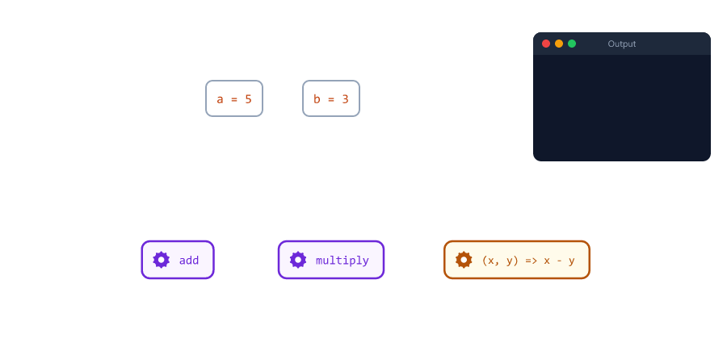
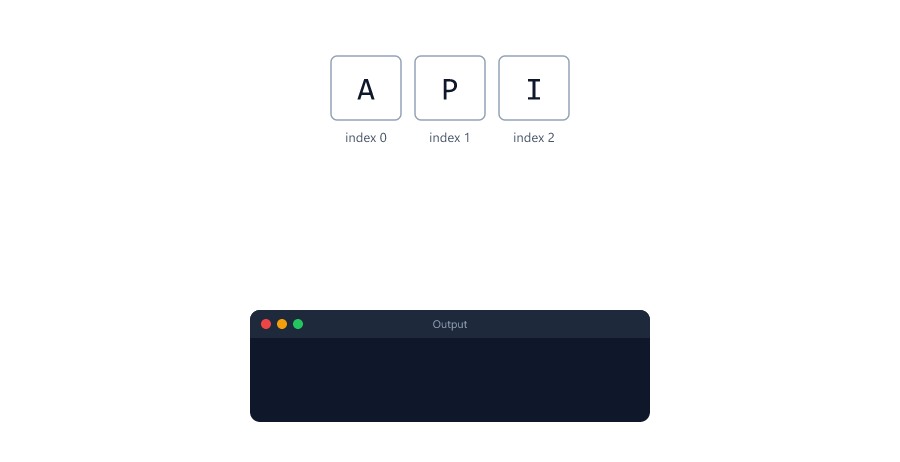
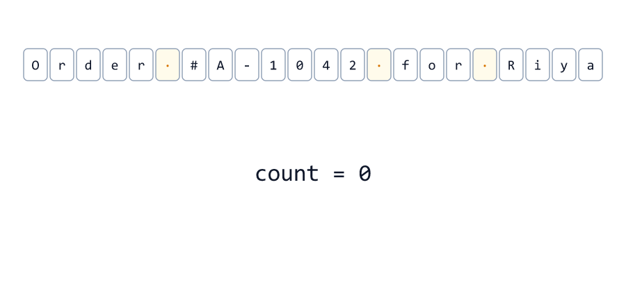
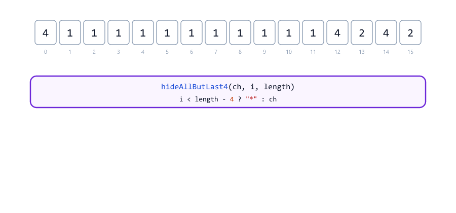
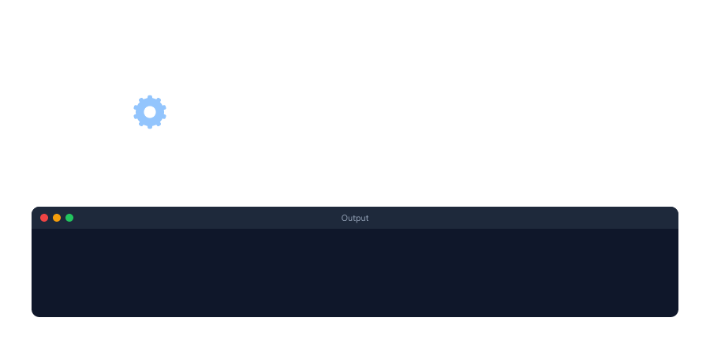
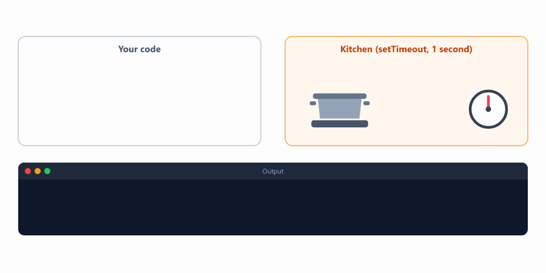
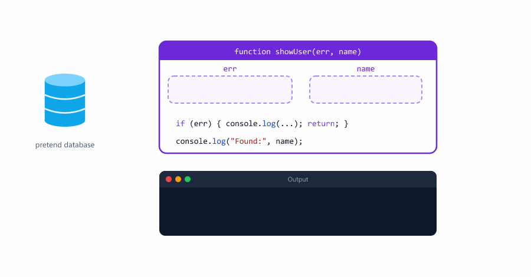
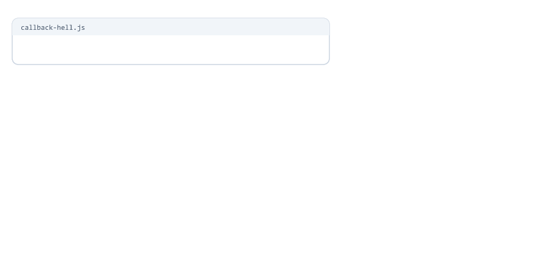
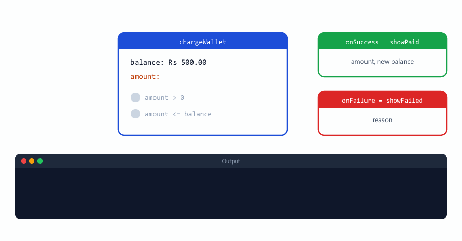
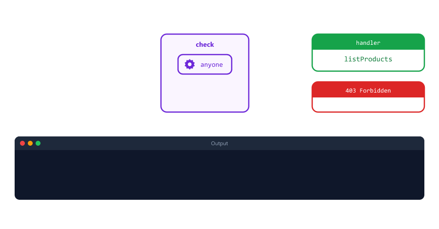

# Callbacks and Higher-Order Functions

> **Session 11 of 25** | Part 2: Building Blocks | [All sessions](README.md#course-outline)

## Table of Contents
- [What is a Callback?](#what-is-a-callback)
- [Pass the Function, Do Not Call It](#pass-the-function-do-not-call-it)
- [Callbacks Receive Values](#callbacks-receive-values)
- [Named or Inline Callbacks?](#named-or-inline-callbacks)
- [A Loop That Calls a Callback](#a-loop-that-calls-a-callback)
- [Callbacks That Answer Yes or No](#callbacks-that-answer-yes-or-no)
- [Callbacks That Change Each Character](#callbacks-that-change-each-character)
- [What is a Higher-Order Function?](#what-is-a-higher-order-function)
- [Functions That Return Functions](#functions-that-return-functions)
- [Synchronous Callbacks](#synchronous-callbacks)
- [Callbacks That Run Later](#callbacks-that-run-later)
- [Error-First Callbacks](#error-first-callbacks)
- [Callback Hell](#callback-hell)
- [Callbacks You Will Meet in Node.js](#callbacks-you-will-meet-in-nodejs)
- [Mini Example 1: Payment with Two Callbacks](#mini-example-1-payment-with-two-callbacks)
- [Mini Example 2: Route Guard with a Function Factory](#mini-example-2-route-guard-with-a-function-factory)
- [Beginner Mistakes](#beginner-mistakes)
- [Practice Exercises](#practice-exercises)
- [Interview Questions](#interview-questions)

---

## What is a Callback?

In Session 10 you saw that a function is a **value**, like a number or a string. So you can pass a function **into another function**, just like any other argument.

A **callback** is a function that you pass into another function, so that the other function can call it ("call it back") when it is ready.

callback-basic.js

```javascript
function greet(name, callback) {
  console.log(`Hello, ${name}!`);
  callback();   // run the function we were given
}

function sayDone() {
  console.log("Greeting finished");
}

greet("Riya", sayDone);   // pass the function: no ()
```

Output

```text
Hello, Riya!
Greeting finished
```


| Word           | In the example | Meaning                                              |
| -------------- | -------------- | ---------------------------------------------------- |
| Callback       | `sayDone`      | The function that is passed in                       |
| The other function | `greet`    | Takes the callback and decides **when** to call it   |
| `callback()`   | inside `greet` | The moment the callback runs                         |

Real life: at a busy restaurant you leave your phone number and say "call me back when my table is ready". Your number is the callback. You do not decide when it rings; the restaurant does.

Most of the time, the callback is written directly in the call, as an arrow function (Session 10)

callback-inline.js

```javascript
function greet(name, callback) {
  console.log(`Hello, ${name}!`);
  callback();
}

greet("Aman", () => {
  console.log("Greeting finished");
});
```

Output

```text
Hello, Aman!
Greeting finished
```

This is exactly the shape of every route in the Node.js course: `app.get("/", (req, res) => { ... })`. The arrow function is a callback, and Express calls it when a request arrives.

---

## Pass the Function, Do Not Call It

This is the most common callback mistake. Compare `sayDone` and `sayDone()`

pass-vs-call.js

```javascript
function runTask(taskName, callback) {
  console.log(`Running ${taskName}...`);
  callback();
}

function sayDone() {
  console.log("Done!");
}

runTask("backup", sayDone);     // pass the function
runTask("backup", sayDone());   // calls sayDone NOW and passes its result
```

Output

```text
Running backup...
Done!
Done!
Running backup...
D:\js-practice\pass-vs-call.js:3
  callback();
  ^

TypeError: callback is not a function
```


| You write             | What `runTask` receives                                   |
| --------------------- | --------------------------------------------------------- |
| `runTask("backup", sayDone)`   | The function itself. `runTask` calls it later    |
| `runTask("backup", sayDone())` | `sayDone` runs **first**, and its return value (`undefined`) is passed |

In the second call, `Done!` is printed **before** `Running backup...`, and then `undefined()` crashes. Without `()`, you hand over the function. With `()`, you hand over its result.

---

## Callbacks Receive Values

The function that calls the callback can give it arguments. The callback decides what to do with them

calculate.js

```javascript
function calculate(a, b, operation) {
  return operation(a, b);
}

function add(x, y) {
  return x + y;
}

function multiply(x, y) {
  return x * y;
}

console.log(calculate(5, 3, add));
console.log(calculate(5, 3, multiply));
console.log(calculate(5, 3, (x, y) => x - y));
```

Output

```text
8
15
2
```

`calculate()` never changes. Only the callback changes, and with it the result.



A backend example: the checkout from Session 06 used a `switch` for coupons. With callbacks, the checkout does not need to know any coupon rules

discount-rules.js

```javascript
// The checkout does not know the coupon rules. It asks the callback.
function finalPrice(pricePaise, discountRule) {
  const discount = discountRule(pricePaise);
  return pricePaise - discount;
}

const noCoupon = () => 0;
const save10 = (price) => Math.round(price * 0.1);
const flat50 = (price) => (price >= 50000 ? 5000 : 0);

console.log(finalPrice(80000, noCoupon));
console.log(finalPrice(80000, save10));
console.log(finalPrice(80000, flat50));
console.log(finalPrice(30000, flat50));
```

Output

```text
80000
72000
75000
30000
```

| Callback   | Rule                                        | For Rs 800 (80000 paise) |
| ---------- | ------------------------------------------- | ------------------------ |
| `noCoupon` | No discount. It ignores the price it gets   | `80000`                  |
| `save10`   | 10% off                                     | `72000`                  |
| `flat50`   | Rs 50 off orders of Rs 500 or more          | `75000`                  |

A new coupon is just a new small function. `finalPrice()` stays the same.

---

## Named or Inline Callbacks?

| Named callback (`add`, `save10`)                    | Inline callback (`(x, y) => x - y`)        |
| --------------------------------------------------- | ------------------------------------------ |
| Can be used in many places                          | Used once, right where it is written       |
| Its name explains what it does                      | Short: good for one-line jobs              |
| Shows up by name in error messages (Session 10)     | Shows up as `<anonymous>` in error messages |

A simple rule: write short one-time callbacks inline. Give a callback a name when it is longer than a few lines or used more than once.

---

## A Loop That Calls a Callback

A function can call the callback many times, for example once in every round of a loop

repeat.js

```javascript
function repeat(times, action) {
  for (let i = 1; i <= times; i++) {
    action(i);
  }
}

repeat(3, (round) => {
  console.log(`Sending reminder ${round}`);
});
```

Output

```text
Sending reminder 1
Sending reminder 2
Sending reminder 3
```

The loop is written once, inside `repeat()`. The work done in each round comes from the callback.

The same idea for the characters of a string (Session 07)

for-each-char.js

```javascript
function forEachChar(text, callback) {
  for (let i = 0; i < text.length; i++) {
    callback(text[i], i);
  }
}

forEachChar("API", (ch, index) => {
  console.log(`${index}: ${ch}`);
});
```

Output

```text
0: A
1: P
2: I
```



Lists of values (arrays, Session 12) have a built-in method that works exactly like this, called `forEach`. After this lesson, you already know how it works inside.

---

## Callbacks That Answer Yes or No

A callback that returns `true` or `false` is called a **test** (or a **predicate**). The function asks it a question about every character

count-where.js

```javascript
function countWhere(text, test) {
  let count = 0;
  for (const ch of text) {
    if (test(ch)) {
      count++;
    }
  }
  return count;
}

const isDigit = (ch) => ch >= "0" && ch <= "9";
const isUpperCase = (ch) => ch >= "A" && ch <= "Z";
const isSpace = (ch) => ch === " ";

const note = "Order #A-1042 for Riya";

console.log(countWhere(note, isDigit));
console.log(countWhere(note, isUpperCase));
console.log(countWhere(note, isSpace));
```

Output

```text
4
3
3
```



The counting loop is written once. To count something else, pass another test. The digit check `ch >= "0" && ch <= "9"` is the one from Session 07.

Keep only the characters that pass the test

keep-where.js

```javascript
function keepWhere(text, test) {
  let result = "";
  for (const ch of text) {
    if (test(ch)) {
      result += ch;
    }
  }
  return result;
}

const isDigit = (ch) => ch >= "0" && ch <= "9";

console.log(keepWhere("+91 98765-43210", isDigit));
console.log(keepWhere("Order #A-1042", isDigit));
```

Output

```text
919876543210
1042
```

This is how a server cleans a phone number typed with spaces and dashes. For arrays, the built-in version is called `filter` (Session 12).

---

## Callbacks That Change Each Character

The callback can also return a **new value** for each character. The function collects the results

transform-chars.js

```javascript
function transformChars(text, change) {
  let result = "";
  for (let i = 0; i < text.length; i++) {
    result += change(text[i], i, text.length);
  }
  return result;
}

const card = "4111111111114242";
const hideAllButLast4 = (ch, i, length) => (i < length - 4 ? "*" : ch);

console.log(transformChars(card, hideAllButLast4));
console.log(transformChars("server down", (ch) => ch.toUpperCase()));
console.log(transformChars("New Year Sale", (ch) => (ch === " " ? "-" : ch.toLowerCase())));
```

Output

```text
************4242
SERVER DOWN
new-year-sale
```



`transformChars()` passes three values to the callback: the character, its index and the length of the text. A callback can use all of them (like `hideAllButLast4`) or only the first one (like the two inline arrows). Extra arguments are ignored (Session 10). For arrays, the built-in version is called `map` (Session 12).

| Your function     | What the callback does        | The array method (Session 12) |
| ----------------- | ----------------------------- | ----------------------------- |
| `forEachChar`     | Does something with each item | `forEach`                     |
| `keepWhere`       | Says yes or no for each item  | `filter`                      |
| `transformChars`  | Returns a new value for each item | `map`                     |

---

## What is a Higher-Order Function?

A **higher-order function** is a function that does at least one of these two things

| It...                       | Examples from this lesson                          |
| --------------------------- | -------------------------------------------------- |
| **takes** a function as an argument | `greet`, `calculate`, `repeat`, `countWhere`, `transformChars` |
| **returns** a function      | `createLogger`, `makeDiscount` (next section)      |

The function that is passed in is the **callback**. The function that takes it is the **higher-order function**. "Higher-order" only means "works with other functions", like a manager who gives work to others.


This is possible because functions are values in JavaScript (Session 10). Languages where functions are values are said to have **first-class functions**.

---

## Functions That Return Functions

A function can build a new function and return it. This is often called a **function factory**

create-logger.js

```javascript
function createLogger(prefix) {
  return (message) => {
    console.log(`[${prefix}] ${message}`);
  };
}

const dbLog = createLogger("DB");
const authLog = createLogger("AUTH");

dbLog("Connected");
authLog("Login failed for riya@example.com");
dbLog("Query took 12 ms");
```

Output

```text
[DB] Connected
[AUTH] Login failed for riya@example.com
[DB] Query took 12 ms
```



`createLogger("DB")` runs once and returns a new function, which is stored in `dbLog`. Every call to `dbLog()` prints with the `DB` prefix. Real servers label their logs like this, so you can see which part of the app wrote each line (Node.js course, Session 26).

The same idea with prices

make-discount.js

```javascript
function makeDiscount(percent) {
  return function (pricePaise) {
    return pricePaise - Math.round(pricePaise * percent / 100);
  };
}

const festivalSale = makeDiscount(20);
const memberPrice = makeDiscount(5);

console.log(festivalSale(100000));
console.log(memberPrice(100000));
console.log(typeof festivalSale);
```

Output

```text
80000
95000
function
```

How does `festivalSale` still know `percent` is `20`, after `makeDiscount()` has finished? The returned function **remembers** the variables of the function that created it. This is called a **closure**, and it is explained in Session 16. The Node.js course uses a factory like this for middleware: `requireRole("admin")` returns a function that checks the user's role (Session 14).

---

## Synchronous Callbacks

Every callback so far was called **right away**, while the other function was still running. These are **synchronous** callbacks

sync-callback.js

```javascript
function runNow(callback) {
  console.log("1. runNow starts");
  callback();
  console.log("3. runNow ends");
}

runNow(() => {
  console.log("2. The callback runs");
});

console.log("4. After runNow");
```

Output

```text
1. runNow starts
2. The callback runs
3. runNow ends
4. After runNow
```

The lines print in order, 1 to 4. `runNow()` waits for the callback to finish before it goes on.

---

## Callbacks That Run Later

Some callbacks are called **later**: when a timer ends, a file has been read, or a database answers. These are **asynchronous** callbacks.

Node.js has a built-in function `setTimeout(callback, milliseconds)`. It calls the callback after the given time (1000 ms = 1 second)

set-timeout.js

```javascript
console.log("1. Before setTimeout");

setTimeout(() => {
  console.log("3. One second later");
}, 1000);

console.log("2. After setTimeout");
```

Output

```text
1. Before setTimeout
2. After setTimeout
3. One second later
```

`setTimeout()` does **not** wait. It hands the callback to Node.js and returns at once, so line 2 prints before line 3. The program stays open until the timer has finished. Timers are covered in Session 22, and how Node.js runs callbacks later (the event loop) in Session 23.

The restaurant from the Node.js course, Session 03

order-food.js

```javascript
function orderFood(dish, callback) {
  setTimeout(() => {
    callback(`${dish} is ready`);
  }, 1000);
}

orderFood("Pizza", (message) => {
  console.log(message);
});

console.log("Order placed. Waiting...");
```

Output

```text
Order placed. Waiting...
Pizza is ready
```



Cooking takes a second, but the program does not stand still. A server works the same way: while one request waits for the database, Node.js handles other requests.

| Synchronous callback                     | Asynchronous callback                          |
| ---------------------------------------- | ---------------------------------------------- |
| Called right away, during the call       | Called later, after the call has returned      |
| `calculate`, `countWhere`, `repeat`      | `setTimeout`, reading files, database queries  |
| The next line waits for it               | The next line runs first                       |

---

## Error-First Callbacks

A slow task can fail: the file is missing, the user does not exist. Node.js uses one rule for async callbacks

```text
The first parameter of the callback is the error. The second is the result.
```

find-user.js

```javascript
// A pretend database: only user 1 exists, and answers take half a second
function findUser(id, callback) {
  setTimeout(() => {
    if (id === 1) {
      callback(null, "Riya");
    } else {
      callback(`User ${id} not found`, null);
    }
  }, 500);
}

function showUser(err, name) {
  if (err) {
    console.log("Error:", err);
    return;
  }
  console.log("Found:", name);
}

findUser(1, showUser);
findUser(99, showUser);
```

Output

```text
Found: Riya
Error: User 99 not found
```

| Parameter | When it worked   | When it failed      |
| --------- | ---------------- | ------------------- |
| `err`     | `null`           | What went wrong     |
| `name`    | The result       | `null`              |



Always check `err` **first**, and `return` after handling it. The Node.js course reads files with exactly this shape: `fs.readFile("student.txt", "utf8", (err, data) => { ... })` (Session 05). In real Node.js code, `err` is an `Error` object instead of text (Session 18).

---

## Callback Hell

When tasks must happen one after another, each next step goes **inside** the callback of the step before

callback-hell.js

```javascript
function step(message, callback) {
  setTimeout(() => {
    console.log(message);
    callback();
  }, 500);
}

step("Order taken", () => {
  step("Food cooked", () => {
    step("Food packed", () => {
      step("Food delivered", () => {
        console.log("Customer is happy");
      });
    });
  });
});
```

Output (one line every half second)

```text
Order taken
Food cooked
Food packed
Food delivered
Customer is happy
```



The code moves further to the right with every step. This shape is called **callback hell** (or the pyramid of doom). It is hard to read, and every level needs its own error check.

| Fix                         | Where                     |
| --------------------------- | ------------------------- |
| Promises                    | Session 24                |
| `async` / `await`           | Session 25                |

With `async` and `await`, the same steps are written top to bottom, one line each. That is how the Node.js course writes most of its code.

---

## Callbacks You Will Meet in Node.js

You will write callbacks every day as a backend developer

| Code                                              | The callback          | When it is called                      |
| ------------------------------------------------- | --------------------- | -------------------------------------- |
| `setTimeout(callback, 1000)`                      | `callback`            | After 1 second (Session 22)            |
| `fs.readFile("student.txt", "utf8", (err, data) => { ... })` | `(err, data) => { ... }` | When the file has been read (Node.js course, Session 05) |
| `emitter.on("login", () => { ... })`              | `() => { ... }`       | Every time the event happens (Node.js course, Session 08) |
| `http.createServer((req, res) => { ... })`        | `(req, res) => { ... }` | For every request (Node.js course, Session 09) |
| `app.get("/api/products", (req, res) => { ... })` | `(req, res) => { ... }` | For every GET request to that path (Node.js course, Session 12) |
| `prices.map((price) => price * 2)`                | `(price) => price * 2` | For every item of a list (Session 12) |

In each one, **you** write what should happen, and Node.js (or Express, or the array) decides **when** to call it.

---

## Mini Example 1: Payment with Two Callbacks

A function can take two callbacks: one for success and one for failure. The wallet decides what happened; the caller decides what to do about it

payment.js

```javascript
function formatRupees(paise) {
  return `Rs ${(paise / 100).toFixed(2)}`;
}

// The wallet decides WHAT happened. The callbacks decide what to DO about it.
function chargeWallet(balancePaise, amountPaise, onSuccess, onFailure) {
  if (amountPaise <= 0) {
    onFailure("the amount must be more than 0");
    return;
  }
  if (amountPaise > balancePaise) {
    onFailure(`not enough balance (${formatRupees(balancePaise)})`);
    return;
  }
  onSuccess(amountPaise, balancePaise - amountPaise);
}

function showPaid(amountPaise, newBalancePaise) {
  console.log(`Paid ${formatRupees(amountPaise)}. New balance: ${formatRupees(newBalancePaise)}`);
}

function showFailed(reason) {
  console.log(`Payment failed: ${reason}`);
}

chargeWallet(50000, 19900, showPaid, showFailed);
chargeWallet(50000, 99900, showPaid, showFailed);
chargeWallet(50000, 0, showPaid, showFailed);
```

Run

```bash
node payment.js
```

Output

```text
Paid Rs 199.00. New balance: Rs 301.00
Payment failed: not enough balance (Rs 500.00)
Payment failed: the amount must be more than 0
```



| Part              | Job                                                          |
| ----------------- | ------------------------------------------------------------ |
| `chargeWallet`    | Checks the amount and the balance (early returns, Session 10) |
| `onSuccess`       | Called with the amount and the new balance                   |
| `onFailure`       | Called with the reason                                       |
| `return` after `onFailure` | Makes sure only **one** callback runs              |

The same `chargeWallet()` could send a JSON response, write a log or send an email. Only the callbacks would change.

---

## Mini Example 2: Route Guard with a Function Factory

Express routes take a path and callbacks. Some callbacks check the user first, and only then is the real handler called (Node.js course, Session 14). Here is a small version without Express

route-guard.js

```javascript
// A factory: returns a check function for one role
function requireRole(role) {
  return (userRole) => userRole === role;
}

const anyone = () => true;
const adminOnly = requireRole("admin");

// Runs the handler only if the check says yes
function handleRequest(path, userRole, check, handler) {
  if (!check(userRole)) {
    console.log(`403 Forbidden: ${userRole} cannot open ${path}`);
    return;
  }
  handler(path);
}

const listProducts = (path) => console.log(`200 OK: product list (${path})`);
const listUsers = (path) => console.log(`200 OK: user list (${path})`);

handleRequest("/api/products", "viewer", anyone, listProducts);
handleRequest("/api/admin/users", "viewer", adminOnly, listUsers);
handleRequest("/api/admin/users", "admin", adminOnly, listUsers);
```

Run

```bash
node route-guard.js
```

Output

```text
200 OK: product list (/api/products)
403 Forbidden: viewer cannot open /api/admin/users
200 OK: user list (/api/admin/users)
```



| Function         | Kind                                    |
| ---------------- | --------------------------------------- |
| `requireRole`    | Returns a function (a factory)          |
| `adminOnly`, `anyone` | Tests: return `true` or `false`    |
| `handleRequest`  | Takes two callbacks: a check and a handler |
| `listProducts`, `listUsers` | Handlers: do the real work   |

In Express, the same idea looks like `app.get("/admin", requireRole("admin"), (req, res) => { ... })`. In the Node.js course, `requireRole("admin")` returns a middleware function, and the role comes from the logged-in user. Session 22 there calls it `authorize("admin")`.

---

## Beginner Mistakes

### Mistake 1: Calling the callback instead of passing it

**Incorrect:** `runTask("backup", sayDone())` runs `sayDone` immediately and passes `undefined`, which crashes with `TypeError: callback is not a function`.

**Correct:** `runTask("backup", sayDone)`, without `()` (see [Pass the Function, Do Not Call It](#pass-the-function-do-not-call-it)).

### Mistake 2: Forgetting to call the callback

**Incorrect**

```javascript
function orderFood(dish, callback) {
  console.log(`Cooking ${dish}...`);
  // forgot to call: callback(`${dish} is ready`);
}

orderFood("Pizza", (message) => {
  console.log(message);
});
```

```text
Cooking Pizza...
```

No error, but the customer never hears that the food is ready. In Express, a route that never sends a response leaves the user's request hanging until it times out. **Correct:** call the callback on every path through the function.

### Mistake 3: No return after the error callback

**Incorrect**

```javascript
function findUser(id, callback) {
  if (id !== 1) {
    callback(`User ${id} not found`, null);   // no return here!
  }
  callback(null, "Riya");
}

findUser(99, (err, name) => {
  if (err) {
    console.log("Error:", err);
    return;
  }
  console.log("Found:", name);
});
```

```text
Error: User 99 not found
Found: Riya
```

The callback ran **twice**: first with the error, then with a user that does not exist. In Express, this causes the error "Cannot set headers after they are sent to the client". **Correct:** `return callback(...)`, or `return;` on the next line.

### Mistake 4: Not checking err first

**Incorrect**

```javascript
findUser(99, (err, name) => {
  console.log(`Welcome, ${name.toUpperCase()}!`);   // err is never checked
});
```

```text
D:\js-practice\m-no-err-check.js:12
  console.log(`Welcome, ${name.toUpperCase()}!`);   // err is never checked
                               ^

TypeError: Cannot read properties of null (reading 'toUpperCase')
```

When the task fails, the result is `null`. **Correct:** start every error-first callback with `if (err) { ...; return; }`.

### Mistake 5: Swapping err and result

**Incorrect**

```javascript
findUser(99, (name, err) => {   // the error comes FIRST, not second
  console.log("Found:", name);
});
```

```text
Found: User 99 not found
```

Parameters are matched by position, not by name (Session 10), so `name` got the error. **Correct:** `(err, name) => { ... }`.

### Mistake 6: Using a result before the callback has run

**Incorrect**

```javascript
let status = "waiting";

setTimeout(() => {
  status = "ready";
}, 1000);

console.log("Status:", status);
```

```text
Status: waiting
```

The last line runs before the timer's callback. **Correct:** use the result **inside** the callback (or with `await`, Session 25).

### Mistake 7: Expecting setTimeout(..., 0) to run right away

**Incorrect**

```javascript
setTimeout(() => {
  console.log("Timer with 0 ms");
}, 0);

console.log("Next line");
```

```text
Next line
Timer with 0 ms
```

`0` means "as soon as possible", not "now". The current code always finishes first (Session 23).

### Mistake 8: return inside a callback

**Incorrect**

```javascript
function hasDigit(text) {
  forEachChar(text, (ch) => {
    if (ch >= "0" && ch <= "9") {
      return true;   // leaves only the callback, not hasDigit
    }
  });
  return false;
}

console.log(hasDigit("order42"));
```

```text
false
```

`return` leaves the function it is written in: the callback. `hasDigit()` goes on and returns `false`. **Correct:** use a normal loop when you need to stop early

```javascript
function hasDigit(text) {
  for (const ch of text) {
    if (ch >= "0" && ch <= "9") {
      return true;
    }
  }
  return false;
}

console.log(hasDigit("order42"));
```

```text
true
```

The same trap exists with the array method `forEach` (Session 12).

### Mistake 9: A test callback with { } but no return

**Incorrect**

```javascript
console.log(countWhere("banana", (ch) => { ch === "a"; }));
console.log(countWhere("banana", (ch) => ch === "a"));
```

```text
0
3
```

With `{ }`, the arrow function returns `undefined`, which is falsy, so nothing is counted (Session 10). **Correct:** drop the braces, or write `return ch === "a";`.

### Mistake 10: Nesting callback after callback

**Incorrect:** five steps written as five nested callbacks (see [Callback Hell](#callback-hell)).

**Correct:** for now, keep each step a small named function. From Session 24, use Promises, and from Session 25, `async` and `await`.

---

## Practice Exercises

### Exercise 1

Write `runTwice(callback)` that calls the callback two times. Pass it an arrow function that prints `Ping`. Then pass it a named function `sayPong`.

### Exercise 2

Use the `calculate(a, b, operation)` function from this lesson with three inline arrow functions: subtraction, division and power (`**`, Session 04). Calculate with `2` and `10`.

### Exercise 3

Use `countWhere()` with a test `isVowel` that is `true` for a, e, i, o and u in lower or upper case. Count the vowels in `"Hello from the server"`.

### Exercise 4

Use `keepWhere()` to keep only the letters of `"Order 42 for Aman"` (no digits and no spaces). The result is `OrderforAman`.

### Exercise 5

Write a factory `makeMultiplier(factor)` that returns a function. Create `double` and `triple` with it and print `double(21)` and `triple(5)`.

### Exercise 6

Change `createLogger(prefix)` so that it takes a second parameter `level` with the default value `"INFO"` (Session 10). `createLogger("API")("Started")` prints `[API] [INFO] Started`, and `createLogger("API", "WARN")("Slow request")` prints `[API] [WARN] Slow request`.

### Exercise 7

Write `checkStock(item, quantity, inStock, onAvailable, onSoldOut)`. If `quantity` is not more than `inStock`, call `onAvailable(item, quantity)`; otherwise call `onSoldOut(item)`. Make sure only one callback runs.

### Exercise 8

Write `downloadFile(fileName, callback)` that uses `setTimeout` to wait one second, then calls an error-first callback: an error when the name does not end with `".pdf"` (Session 08), otherwise `` `Downloaded ${fileName}` ``. Call it for `"report.pdf"` and `"photo.exe"`, and print `Done.` right after the two calls. Predict the order of the three lines before running it.

---

## Interview Questions

### What is a callback function?

A function passed as an argument into another function, which calls it at the right time. For example, `setTimeout(() => console.log("hi"), 1000)` passes an arrow function that Node.js calls after one second.

### What is a higher-order function?

A function that takes a function as an argument, returns a function, or both. Examples: `setTimeout`, the array methods `map`, `filter` and `forEach`, and factories like `createLogger(prefix)`.

### What is the difference between passing fn and fn()?

`fn` passes the function itself, so the other function can call it later. `fn()` calls it immediately and passes its return value, which is often `undefined`, and then causes `TypeError: callback is not a function`.

### What is the difference between a synchronous and an asynchronous callback?

A synchronous callback is called right away, before the other function returns (like `countWhere`). An asynchronous callback is called later, after the current code has finished (like `setTimeout` or `fs.readFile`), so the lines after the call run first.

### What is an error-first callback?

Node.js's convention for async callbacks: the first parameter is the error (`null` when everything worked), and the second is the result, as in `(err, data) => { ... }`. Always check `err` first.

### Why should you return after calling a callback with an error?

Otherwise the function goes on and may call the callback a second time, with a result. In Express, this causes "Cannot set headers after they are sent to the client".

### What is callback hell, and how do you avoid it?

Callbacks nested inside callbacks for steps that must happen in order, so the code grows to the right like a pyramid. It is avoided with small named functions, Promises and `async`/`await`.

### Does setTimeout pause the program?

No. It schedules the callback and returns at once. The next lines run first, and the callback runs when the time is up and the current code has finished. Even `setTimeout(fn, 0)` runs after the current code.

### What is a function factory?

A function that creates and returns a new function, set up with the values you pass in, like `createLogger("DB")` or `requireRole("admin")`.

### How does a returned function remember the values of the function that created it?

Through a closure: a function keeps access to the variables of the place where it was created, even after that outer function has finished (Session 16).

### Who decides when a callback runs?

The function that receives it. You hand over control: you decide **what** happens, it decides **when** and **with which arguments**. This is why a buggy function can call a callback zero times or twice.

### Can a callback be called more than once?

Yes. `repeat`, `forEachChar` and array methods like `forEach` call it once per item, and an event listener (`emitter.on`) is called every time the event happens. For one-time tasks, like a database query, it must be called exactly once.

### What are first-class functions?

Functions that can be treated like any other value: stored in variables, passed as arguments and returned from functions. JavaScript has them, and that is why callbacks and higher-order functions work.

---

| Previous | All sessions | Next |
| :--- | :---: | ---: |
| [10. Functions](10-functions.md) | [Course outline](README.md#course-outline) | [12. Arrays and Array Methods](12-arrays-and-array-methods.md) |
