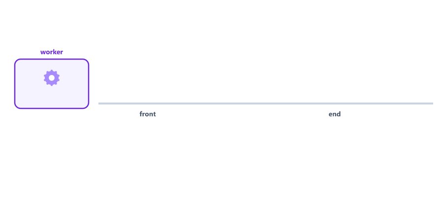
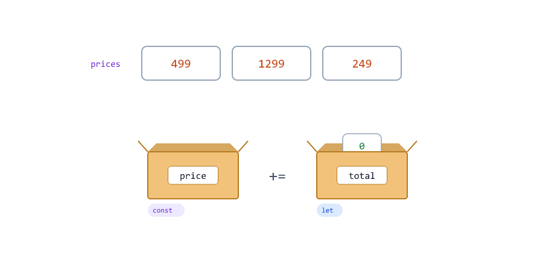
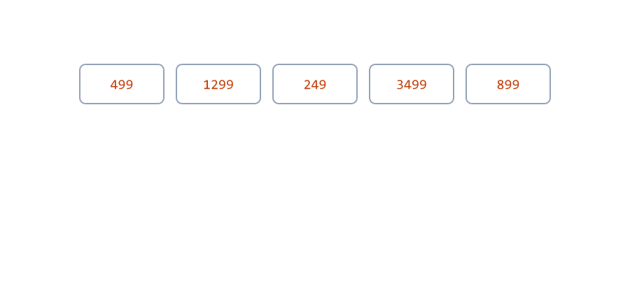
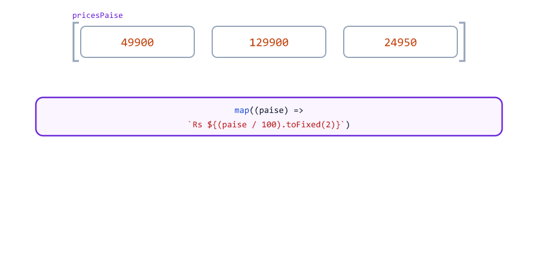
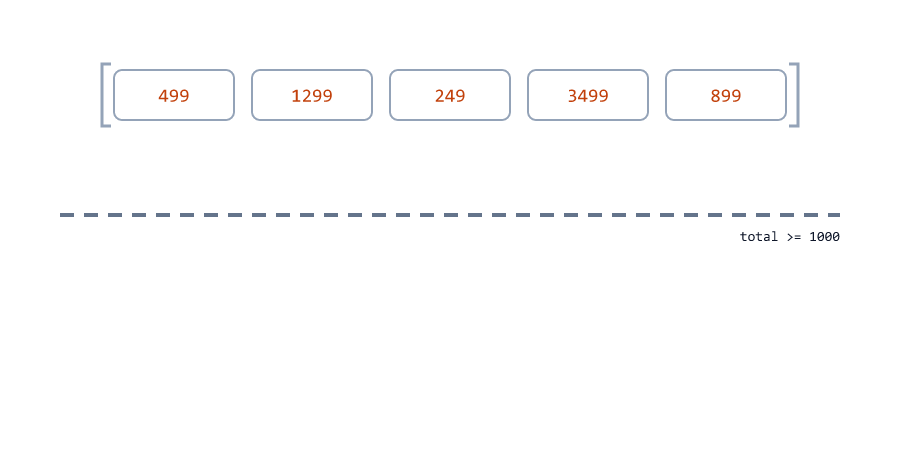
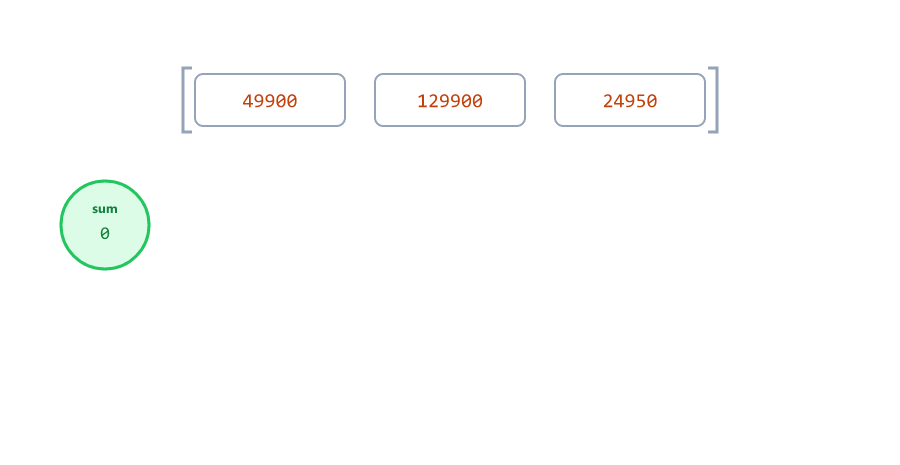
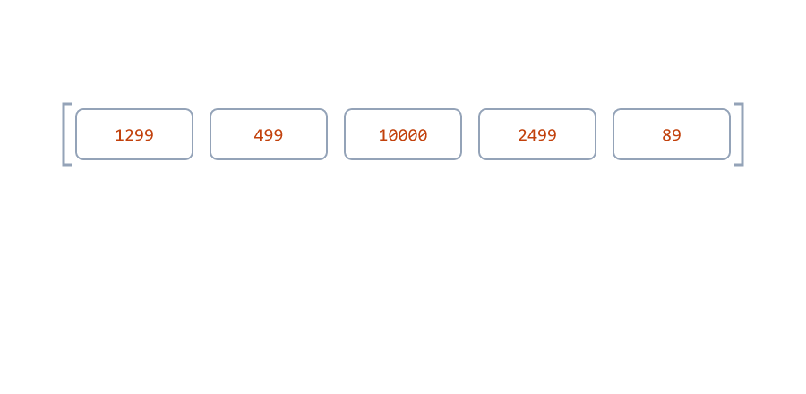
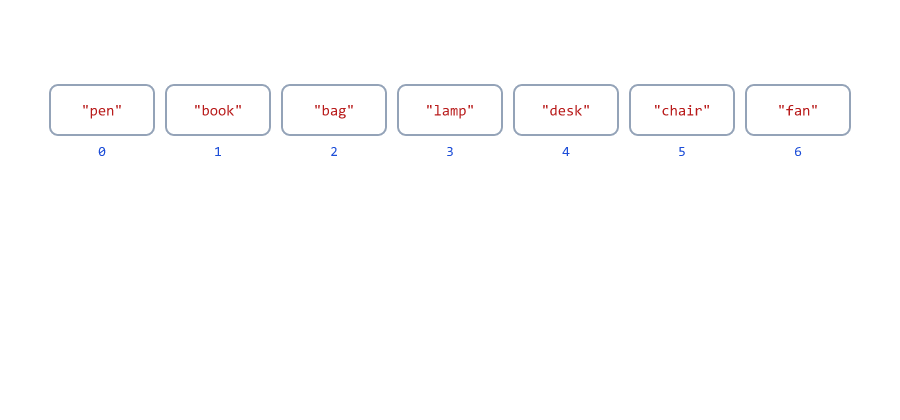
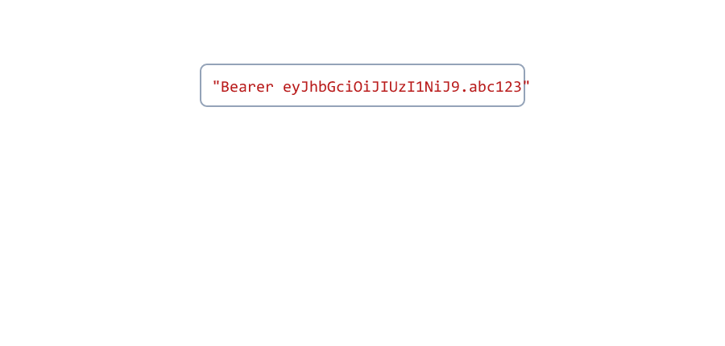
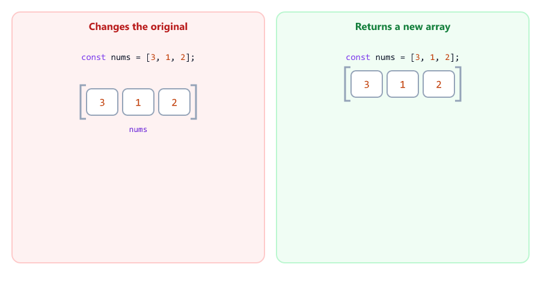

# Arrays and Array Methods

## Table of Contents
- [What is an Array?](#what-is-an-array)
- [Creating an Array](#creating-an-array)
- [Reading Items by Index](#reading-items-by-index)
- [Changing an Item](#changing-an-item)
- [const Arrays Can Still Change](#const-arrays-can-still-change)
- [Adding and Removing at the Ends](#adding-and-removing-at-the-ends)
- [splice: Remove or Insert in the Middle](#splice-remove-or-insert-in-the-middle)
- [Looping Over an Array](#looping-over-an-array)
- [Searching an Array](#searching-an-array)
- [map: Change Every Item](#map-change-every-item)
- [filter: Keep Some Items](#filter-keep-some-items)
- [reduce: Combine Into One Value](#reduce-combine-into-one-value)
- [Chaining Methods](#chaining-methods)
- [Sorting Numbers Correctly](#sorting-numbers-correctly)
- [slice, concat and join](#slice-concat-and-join)
- [split: From String to Array](#split-from-string-to-array)
- [Methods That Change the Array](#methods-that-change-the-array)
- [Arrays Are Shared, Not Copied](#arrays-are-shared-not-copied)
- [Mini Example 1: Daily Order Report](#mini-example-1-daily-order-report)
- [Mini Example 2: Cleaning an Invite List](#mini-example-2-cleaning-an-invite-list)
- [Beginner Mistakes](#beginner-mistakes)
- [Practice Exercises](#practice-exercises)
- [Interview Questions](#interview-questions)

---

## What is an Array?

An **array** is a list of values, kept in order, inside one variable.

why-arrays.js

```javascript
// Without an array: one variable per order
const order1 = 1299;
const order2 = 499;
const order3 = 2499;
console.log(order1 + order2 + order3);

// With an array: one variable holds the whole list
const orders = [1299, 499, 2499];
console.log(orders);
console.log(orders.length);
```

Output

```text
4297
[ 1299, 499, 2499 ]
3
```

With three variables, a fourth order means a fourth variable and a change to the sum. An array can hold 3 orders or 3,000, and the same code works for all of them.

A server works with lists all the time

| List                                  | Example                                        |
| ------------------------------------- | ---------------------------------------------- |
| Results of a database query           | All products in a category                     |
| Data in a JSON request or response    | `"tags": ["node", "express"]` (Session 19)      |
| Settings                              | Allowed roles, blocked email addresses         |
| Work to do                            | A queue of emails to send                      |

In this session the items are numbers and strings. Lists of objects, like `[{ name: "Riya", age: 25 }, ...]`, come in Session 13, and everything you learn here works for them too.

---

## Creating an Array

Write the items between square brackets `[ ]`, separated by commas

create.js

```javascript
const emails = ["riya@example.com", "aman@example.com"];
const statusCodes = [200, 201, 404];
const flags = [true, false, true];
const empty = [];

console.log(emails);
console.log(statusCodes);
console.log(flags);
console.log(empty, empty.length);
console.log(typeof emails);
console.log(Array.isArray(emails));
```

Output

```text
[ 'riya@example.com', 'aman@example.com' ]
[ 200, 201, 404 ]
[ true, false, true ]
[] 0
object
true
```

| Detail                       | Meaning                                                          |
| ---------------------------- | ---------------------------------------------------------------- |
| `'riya@example.com'`         | Node.js prints strings inside arrays with single quotes (Session 03) |
| `typeof emails` is `"object"` | Arrays are a special kind of object                             |
| `Array.isArray(emails)`      | The right way to check for an array (Session 03)                 |

An array can mix types (`[1, "two", true]`), but real code keeps one kind of value per array: a list of prices, a list of emails.

---

## Reading Items by Index

Every item has a position number, its **index**. Like the characters of a string (Session 08), counting starts at **0**

indexes.js

```javascript
const channels = ["email", "sms", "push"];

console.log(channels[0]);
console.log(channels[2]);
console.log(channels[channels.length - 1]);
console.log(channels.at(-1));
console.log(channels[5]);
```

Output

```text
email
push
push
push
undefined
```


| Code                  | Gives                                         |
| --------------------- | --------------------------------------------- |
| `arr[0]`              | The first item                                |
| `arr[arr.length - 1]` | The last item                                 |
| `arr.at(-1)`          | The last item (negative counts from the end)  |
| `arr[99]`             | `undefined`: there is no item there, and no error |

---

## Changing an Item

Assign to an index to replace that item

change.js

```javascript
const statuses = ["pending", "pending", "pending"];

statuses[1] = "shipped";
console.log(statuses);
```

Output

```text
[ 'pending', 'shipped', 'pending' ]
```

Strings cannot be changed this way (Session 08), but arrays can.

---

## const Arrays Can Still Change

`const` means the variable always points to the **same array**. What is inside the array can still change

const-array.js

```javascript
const cart = ["keyboard"];

cart.push("mouse");         // allowed: changes what is inside the array
console.log(cart);

cart = ["monitor"];         // not allowed: a new array for a const
```

Output

```text
[ 'keyboard', 'mouse' ]
D:\js-practice\const-array.js:6
cart = ["monitor"];         // not allowed: a new array for a const
     ^

TypeError: Assignment to constant variable.
```

Think of the `const` box from Session 02: the label is glued to one array, but the items in it can be added, removed and replaced. This is why most arrays are created with `const`.

---

## Adding and Removing at the Ends

| Method         | What it does                  | Returns                 |
| -------------- | ----------------------------- | ----------------------- |
| `push(item)`   | Adds to the **end**           | The new length          |
| `pop()`        | Removes from the **end**      | The removed item        |
| `unshift(item)` | Adds to the **start**        | The new length          |
| `shift()`      | Removes from the **start**    | The removed item        |

push-pop.js

```javascript
const recentSearches = ["laptop", "mouse"];

const newLength = recentSearches.push("keyboard");   // add to the end
console.log(recentSearches, newLength);

const last = recentSearches.pop();                    // remove from the end
console.log(last, recentSearches);
```

Output

```text
[ 'laptop', 'mouse', 'keyboard' ] 3
keyboard [ 'laptop', 'mouse' ]
```

A real backend use: a **job queue**. New jobs join at the end, and a worker takes the oldest one from the front

queue.js

```javascript
// A job queue: new jobs join at the end, the worker takes from the front
const jobs = ["send-email", "resize-image"];

jobs.push("create-invoice");
console.log(jobs);

const next = jobs.shift();
console.log(`Working on: ${next}`);
console.log(jobs);

jobs.unshift("urgent-refund");   // jumps the queue
console.log(jobs);
```

Output

```text
[ 'send-email', 'resize-image', 'create-invoice' ]
Working on: send-email
[ 'resize-image', 'create-invoice' ]
[ 'urgent-refund', 'resize-image', 'create-invoice' ]
```



---

## splice: Remove or Insert in the Middle

`splice(start, deleteCount, ...newItems)` changes the array at any position

splice.js

```javascript
const cart = ["keyboard", "mouse", "cable", "monitor"];

const removed = cart.splice(1, 1);   // at index 1, remove 1 item
console.log(removed);
console.log(cart);

cart.splice(2, 0, "webcam");         // at index 2, remove 0 items, insert "webcam"
console.log(cart);
```

Output

```text
[ 'mouse' ]
[ 'keyboard', 'cable', 'monitor' ]
[ 'keyboard', 'cable', 'webcam', 'monitor' ]
```


`splice()` returns the removed items as an array. The Node.js course deletes a student with exactly this: find the position, then `students.splice(index, 1)` (Session 11).

---

## Looping Over an Array

Three ways to visit every item

loop-for.js

```javascript
const prices = [499, 1299, 249];

for (let i = 0; i < prices.length; i++) {
  console.log(`Item ${i + 1}: Rs ${prices[i]}`);
}
```

Output

```text
Item 1: Rs 499
Item 2: Rs 1299
Item 3: Rs 249
```

loop-for-of.js

```javascript
const prices = [499, 1299, 249];
let total = 0;

for (const price of prices) {
  total += price;
}

console.log(`Total: Rs ${total}`);
```

Output

```text
Total: Rs 2047
```



for-each.js

```javascript
const emails = ["riya@example.com", "aman@example.com"];

emails.forEach((email, index) => {
  console.log(`${index + 1}. Sending welcome email to ${email}`);
});
```

Output

```text
1. Sending welcome email to riya@example.com
2. Sending welcome email to aman@example.com
```

`forEach` is the array version of the `forEachChar` you wrote in Session 11: it calls your callback with each item and its index.

| Loop                          | Use it when                                     | `break` works? |
| ----------------------------- | ----------------------------------------------- | -------------- |
| `for (const item of arr)`     | You need each item. The usual choice            | Yes            |
| `for (let i = 0; ...)`        | You need the index, or a step other than 1      | Yes            |
| `arr.forEach((item, i) => ...)` | You like the callback style                   | No: it always visits every item |

---

## Searching an Array

includes-indexof.js

```javascript
const allowedRoles = ["admin", "editor"];
const blockedEmails = ["spam@example.com", "bot@example.com"];

console.log(allowedRoles.includes("editor"));
console.log(allowedRoles.includes("viewer"));
console.log(blockedEmails.indexOf("bot@example.com"));
console.log(blockedEmails.indexOf("riya@example.com"));
```

Output

```text
true
false
1
-1
```

To search with a **condition** instead of an exact value, pass a callback (a test, Session 11)

find.js

```javascript
const orderTotals = [499, 1299, 249, 3499, 899];

const firstBig = orderTotals.find((total) => total > 1000);
const firstHuge = orderTotals.find((total) => total > 10000);
const bigIndex = orderTotals.findIndex((total) => total > 1000);

console.log(firstBig);
console.log(firstHuge);
console.log(bigIndex);
```

Output

```text
1299
undefined
1
```



some-every.js

```javascript
const stock = [12, 0, 5, 8];

console.log(stock.some((quantity) => quantity === 0));   // is anything sold out?
console.log(stock.every((quantity) => quantity > 0));    // is everything in stock?
```

Output

```text
true
false
```

| Method                | Asks                                  | Returns                         |
| --------------------- | ------------------------------------- | ------------------------------- |
| `includes(value)`     | Is this exact value in the list?      | `true` / `false`                |
| `indexOf(value)`      | Where is this exact value?            | The index, or `-1`              |
| `find(test)`          | Which is the first item that passes?  | The item, or `undefined`        |
| `findIndex(test)`     | Where is the first item that passes?  | The index, or `-1`              |
| `some(test)`          | Does **at least one** item pass?      | `true` / `false`                |
| `every(test)`         | Do **all** items pass?                | `true` / `false`                |

`find`, `findIndex` and `some` stop at the first match. The Node.js course uses `students.find((s) => s.id === id)` to get one student by id (Session 11), and returns 404 when the result is `undefined`.

---

## map: Change Every Item

`map` calls your callback for every item and builds a **new array** from what it returns. Session 11's `transformChars` did the same for strings

map.js

```javascript
const pricesPaise = [49900, 129900, 24950];

const labels = pricesPaise.map((paise) => `Rs ${(paise / 100).toFixed(2)}`);

console.log(labels);
console.log(pricesPaise);   // the original is not changed
```

Output

```text
[ 'Rs 499.00', 'Rs 1299.00', 'Rs 249.50' ]
[ 49900, 129900, 24950 ]
```



The callback also gets the index

map-index.js

```javascript
const steps = ["Order taken", "Food cooked", "Delivered"];

const numbered = steps.map((step, index) => `${index + 1}. ${step}`);

console.log(numbered);
```

Output

```text
[ '1. Order taken', '2. Food cooked', '3. Delivered' ]
```

The new array always has the **same length** as the original. In the Node.js course, `map` adds a `createdAt` date to every student before saving (Session 18) and turns validation errors into a list of messages (Session 19).

---

## filter: Keep Some Items

`filter` calls your test for every item and keeps the items that pass, in a **new array**

filter.js

```javascript
const orderTotals = [499, 1299, 249, 3499, 899];

const bigOrders = orderTotals.filter((total) => total >= 1000);
const smallOrders = orderTotals.filter((total) => total < 1000);

console.log(bigOrders);
console.log(smallOrders);
console.log(orderTotals.filter((total) => total > 10000));
```

Output

```text
[ 1299, 3499 ]
[ 499, 249, 899 ]
[]
```



When nothing passes, you get an **empty array** `[]`, not `undefined`. Session 11's `keepWhere` was the string version of `filter`.

| Method   | Returns                                    | Length                    |
| -------- | ------------------------------------------ | ------------------------- |
| `map`    | A new array with a new value for each item | Same as the original      |
| `filter` | A new array with only the passing items    | Same or shorter           |
| `find`   | One item (or `undefined`)                  | Not an array              |

---

## reduce: Combine Into One Value

`reduce` walks through the array and carries one value along, often a running total. The second argument is the starting value

reduce.js

```javascript
const cartPaise = [49900, 129900, 24950];

const total = cartPaise.reduce((sum, price) => sum + price, 0);

console.log(total);
```

Output

```text
204750
```

| Round | `sum` (carried) | `price` | Returns `sum + price` |
| ----- | --------------- | ------- | --------------------- |
| 1     | `0` (the start) | `49900`  | `49900`              |
| 2     | `49900`         | `129900` | `179800`             |
| 3     | `179800`        | `24950`  | `204750`             |



This is the running-total pattern from Session 07, written as one line. `reduce` can carry other things too, like the largest value so far

reduce-max.js

```javascript
const responseTimesMs = [120, 45, 300, 80];

const slowest = responseTimesMs.reduce((max, ms) => Math.max(max, ms), 0);
const average = responseTimesMs.reduce((sum, ms) => sum + ms, 0) / responseTimesMs.length;

console.log(`Slowest: ${slowest} ms`);
console.log(`Average: ${average} ms`);
```

Output

```text
Slowest: 300 ms
Average: 136.25 ms
```

Session 14 shows a shorter way to get the largest number: `Math.max(...responseTimesMs)`.

---

## Chaining Methods

`map` and `filter` return arrays, so you can call the next method on the result, like the string chains in Session 08

chain.js

```javascript
const orderTotals = [499, 1299, 249, 3499, 899];

const bigOrderRevenue = orderTotals
  .filter((total) => total >= 1000)
  .reduce((sum, total) => sum + total, 0);

const labels = orderTotals
  .filter((total) => total >= 1000)
  .map((total) => `Rs ${total}`)
  .join(" + ");

console.log(bigOrderRevenue);
console.log(labels);
```

Output

```text
4798
Rs 1299 + Rs 3499
```

Read a chain top to bottom: keep the big orders, then add them up. Put each method on its own line, starting with the `.`.

---

## Sorting Numbers Correctly

`sort()` without a callback sorts items **as text**, even when they are numbers

sort-bug.js

```javascript
const prices = [1299, 499, 10000, 2499, 89];

prices.sort();
console.log(prices);
```

Output

```text
[ 10000, 1299, 2499, 499, 89 ]
```

`10000` comes first because, as text, `"1"` comes before `"4"` and `"8"`, like words in a dictionary. This is the same problem as `"10" < "9"` in Session 04.

To sort numbers, pass a **compare function**

sort-numbers.js

```javascript
const prices = [1299, 499, 10000, 2499, 89];

prices.sort((a, b) => a - b);   // low to high
console.log(prices);

prices.sort((a, b) => b - a);   // high to low
console.log(prices);
```

Output

```text
[ 89, 499, 1299, 2499, 10000 ]
[ 10000, 2499, 1299, 499, 89 ]
```



| `compare(a, b)` returns | Meaning                     |
| ----------------------- | --------------------------- |
| A negative number       | `a` comes first             |
| A positive number       | `b` comes first             |
| `0`                     | Keep their order            |

`a - b` is negative when `a` is smaller, so small numbers come first.

`sort()` **changes the original array**. `toSorted()` returns a sorted copy and leaves the original alone. For text, `localeCompare` sorts like a dictionary, ignoring upper and lower case

to-sorted.js

```javascript
const names = ["riya", "Aman", "sara", "Zoya"];

console.log(names.toSorted());
console.log(names.toSorted((a, b) => a.localeCompare(b)));
console.log(names);   // toSorted did not change it
```

Output

```text
[ 'Aman', 'Zoya', 'riya', 'sara' ]
[ 'Aman', 'riya', 'sara', 'Zoya' ]
[ 'riya', 'Aman', 'sara', 'Zoya' ]
```

Without `localeCompare`, all capital letters come before all small letters (`"Zoya"` before `"riya"`), as in Session 04. `toSorted()` is new (Node.js 20 and later). In older code you will see `arr.slice().sort(...)`, which does the same.

---

## slice, concat and join

`slice(start, end)` copies a part of the array, from `start` up to (not including) `end`, like `slice` for strings in Session 08

slice-join.js

```javascript
const recentOrders = ["ORD-105", "ORD-104", "ORD-103", "ORD-102", "ORD-101"];

const latestThree = recentOrders.slice(0, 3);
console.log(latestThree);
console.log(recentOrders.length);   // slice does not change the original

console.log(latestThree.join(", "));
console.log(latestThree.join(" | "));
console.log(latestThree.join());
```

Output

```text
[ 'ORD-105', 'ORD-104', 'ORD-103' ]
5
ORD-105, ORD-104, ORD-103
ORD-105 | ORD-104 | ORD-103
ORD-105,ORD-104,ORD-103
```

`join(separator)` glues all items into one string. Without a separator, it uses a comma.

`slice` is how a list is split into pages. It uses the `skip` from Session 09

paginate.js

```javascript
const products = ["pen", "book", "bag", "lamp", "desk", "chair", "fan"];
const page = 2;
const limit = 3;

const skip = (page - 1) * limit;
const pageItems = products.slice(skip, skip + limit);

console.log(pageItems);
console.log(`Page ${page} of ${Math.ceil(products.length / limit)}`);
```

Output

```text
[ 'lamp', 'desk', 'chair' ]
Page 2 of 3
```



With a database, the same `skip` and `limit` are sent in the query instead (Node.js course, Session 20).

`concat` joins two arrays into a new one

concat.js

```javascript
const morningOrders = ["ORD-1", "ORD-2"];
const eveningOrders = ["ORD-3", "ORD-4"];

const allOrders = morningOrders.concat(eveningOrders);

console.log(allOrders);
console.log(morningOrders);
```

Output

```text
[ 'ORD-1', 'ORD-2', 'ORD-3', 'ORD-4' ]
[ 'ORD-1', 'ORD-2' ]
```

Session 14 shows the modern way to do this: `[...morningOrders, ...eveningOrders]`.

---

## split: From String to Array

`split(separator)` is a **string** method. It cuts a string at every separator and returns the pieces as an array. `join` does the opposite

split.js

```javascript
const header = "Bearer eyJhbGciOiJIUzI1NiJ9.abc123";
const parts = header.split(" ");

console.log(parts);
console.log(parts[1]);

const tags = "node, express, mongodb".split(", ");
console.log(tags);

const csvLine = "1042,Riya,1299,paid";
console.log(csvLine.split(","));
```

Output

```text
[ 'Bearer', 'eyJhbGciOiJIUzI1NiJ9.abc123' ]
eyJhbGciOiJIUzI1NiJ9.abc123
[ 'node', 'express', 'mongodb' ]
[ '1042', 'Riya', '1299', 'paid' ]
```



`header.split(" ")[1]` is exactly how the Node.js course reads the token from the `Authorization` header (Session 22). In Session 08 you did the same with `startsWith` and `slice`. Note that the pieces of the CSV line are all **strings**, even `"1299"`: convert them with `Number()` (Session 05).

split and join together

split-join.js

```javascript
const title = "Learn Node.js in 30 Days";

const slug = title.toLowerCase().split(" ").join("-");

console.log(slug);
console.log("a-b-c".split("-"));
console.log("hello".split(""));
```

Output

```text
learn-node.js-in-30-days
[ 'a', 'b', 'c' ]
[ 'h', 'e', 'l', 'l', 'o' ]
```

`split("")` cuts between every character.

---

## Methods That Change the Array

Some methods change the original array. Others leave it alone and return something new. Mixing them up causes real bugs

| Changes the original (mutates)                 | Returns something new, original untouched                   |
| ---------------------------------------------- | ----------------------------------------------------------- |
| `push`, `pop`, `shift`, `unshift`              | `map`, `filter`, `slice`, `concat`                          |
| `splice`                                       | `join` (a string), `reduce` (one value)                     |
| `sort`, `reverse`                              | `toSorted`, `toReversed`                                    |
| `arr[i] = value`                               | `find`, `findIndex`, `includes`, `indexOf`, `some`, `every` |



A good habit: when other code also uses the array (for example a list that came from the database), use the methods on the right.

---

## Arrays Are Shared, Not Copied

Numbers and strings are copied when you assign them (Session 02). Arrays are **not**. Both variables point to the **same** array

shared.js

```javascript
const original = ["keyboard", "mouse"];
const sameList = original;          // NOT a copy: both names point to one array

sameList.push("cable");
console.log(original);

const realCopy = original.slice();  // a new array with the same items
realCopy.push("monitor");
console.log(original);
console.log(realCopy);
```

Output

```text
[ 'keyboard', 'mouse', 'cable' ]
[ 'keyboard', 'mouse', 'cable' ]
[ 'keyboard', 'mouse', 'cable', 'monitor' ]
```

`slice()` with no arguments copies the whole array. Copies, and the difference between shallow and deep copies, are explained in Session 15.

---

## Mini Example 1: Daily Order Report

A report built from one array of order amounts in paise (Session 09)

report.js

```javascript
// Today's paid orders, in paise
const ordersPaise = [129900, 49900, 249900, 89900, 19900, 159900];

const formatRupees = (paise) => `Rs ${(paise / 100).toFixed(2)}`;

const count = ordersPaise.length;
const revenue = ordersPaise.reduce((sum, paise) => sum + paise, 0);
const average = Math.round(revenue / count);
const largest = ordersPaise.reduce((max, paise) => Math.max(max, paise), 0);
const bigOrders = ordersPaise.filter((paise) => paise >= 100000);
const top3 = ordersPaise.toSorted((a, b) => b - a).slice(0, 3);

console.log(`Orders:   ${count}`);
console.log(`Revenue:  ${formatRupees(revenue)}`);
console.log(`Average:  ${formatRupees(average)}`);
console.log(`Largest:  ${formatRupees(largest)}`);
console.log(`Rs 1000+: ${bigOrders.length} orders`);
console.log(`Top 3:    ${top3.map(formatRupees).join(", ")}`);
```

Run

```bash
node report.js
```

Output

```text
Orders:   6
Revenue:  Rs 6994.00
Average:  Rs 1165.67
Largest:  Rs 2499.00
Rs 1000+: 3 orders
Top 3:    Rs 2499.00, Rs 1599.00, Rs 1299.00
```

| Line              | Methods used                                        |
| ----------------- | --------------------------------------------------- |
| Revenue           | `reduce` with a start of `0`                        |
| Average           | `reduce`, `length` and `Math.round` (whole paise)   |
| Largest           | `reduce` with `Math.max`                            |
| Rs 1000+          | `filter` and `length`                               |
| Top 3             | `toSorted` (high to low), `slice(0, 3)`, `map`, `join` |

`top3.map(formatRupees)` passes a named function as the callback (Session 11). `ordersPaise` itself is never changed, so other code can still use it.

---

## Mini Example 2: Cleaning an Invite List

An "Invite your team" box lets a user type emails separated by commas. The server must clean the text before sending any emails

invite.js

```javascript
// Emails typed into an "Invite your team" box, separated by commas
const input = " Riya@Example.com, aman@example.com,, sara@example , riya@example.com ,ZOYA@example.com";

const isValidEmail = (email) => /^\S+@\S+\.\S+$/.test(email);

const emails = input
  .split(",")
  .map((email) => email.trim().toLowerCase())
  .filter((email) => email !== "");

const valid = emails.filter(isValidEmail);
const invalid = emails.filter((email) => !isValidEmail(email));
const unique = valid.filter((email, index) => valid.indexOf(email) === index);

console.log("Invalid:", invalid);
console.log("To invite:", unique);
console.log(`Sending ${unique.length} invites`);
```

Run

```bash
node invite.js
```

Output

```text
Invalid: [ 'sara@example' ]
To invite: [ 'riya@example.com', 'aman@example.com', 'zoya@example.com' ]
Sending 3 invites
```


| Step                                | Result                                                     |
| ----------------------------------- | ---------------------------------------------------------- |
| `split(",")`                        | 6 pieces, one of them empty (from `,,`), with spaces      |
| `map(... trim().toLowerCase())`     | Clean, lowercase emails (Session 08)                       |
| `filter((email) => email !== "")`   | The empty piece is gone: 5 emails                          |
| `filter(isValidEmail)`              | The regex from Session 08 keeps 4 valid emails             |
| `valid.indexOf(email) === index`    | Keeps an email only at its **first** position: no duplicates |

The duplicate trick works because `indexOf` always finds the first copy. The second `riya@example.com` is at index 2, but `indexOf` says 0, so it is dropped. Session 20 shows an easier way with `Set`.

---

## Beginner Mistakes

### Mistake 1: Sorting numbers without a compare function

**Incorrect:** `[1299, 499, 10000, 2499, 89].sort()` gives `[ 10000, 1299, 2499, 499, 89 ]`, sorted as text.

**Correct:** `sort((a, b) => a - b)` (see [Sorting Numbers Correctly](#sorting-numbers-correctly)).

### Mistake 2: Forgetting that sort changes the original

**Incorrect**

```javascript
const prices = [1299, 499, 2499];

const sorted = prices.sort((a, b) => a - b);
console.log(sorted);
console.log(prices);   // the original was sorted too
```

```text
[ 499, 1299, 2499 ]
[ 499, 1299, 2499 ]
```

**Correct:** `prices.toSorted((a, b) => a - b)` when the original order must stay.

### Mistake 3: Using filter as a yes/no check

**Incorrect**

```javascript
const orderTotals = [499, 249];

if (orderTotals.filter((total) => total > 1000)) {
  console.log("We have big orders!");   // printed, but there are none
}

console.log(orderTotals.filter((total) => total > 1000));
console.log(orderTotals.some((total) => total > 1000));
```

```text
We have big orders!
[]
false
```

`filter` returns an array, and every array is truthy, even an empty one (Session 05). **Correct:** `some(...)`, or check `filter(...).length > 0`.

### Mistake 4: map with { } and no return

**Incorrect**

```javascript
const prices = [100, 200];

const withTax = prices.map((price) => {
  price * 1.18;
});

console.log(withTax);
```

```text
[ undefined, undefined ]
```

With `{ }`, the callback must `return` (Session 10). **Correct:** `prices.map((price) => price * 1.18)`.

### Mistake 5: Using the result of forEach

**Incorrect**

```javascript
const prices = [100, 200];

const doubled = prices.forEach((price) => price * 2);
console.log(doubled);

const doubledRight = prices.map((price) => price * 2);
console.log(doubledRight);
```

```text
undefined
[ 200, 400 ]
```

`forEach` always returns `undefined`. **Correct:** `map` when you want a new array.

### Mistake 6: Using the result of find without checking it

**Incorrect**

```javascript
const orderTotals = [499, 1299, 249];

const huge = orderTotals.find((total) => total > 10000);
console.log(huge.toFixed(2));
```

```text
D:\js-practice\m-find-undefined.js:4
console.log(huge.toFixed(2));
                 ^

TypeError: Cannot read properties of undefined (reading 'toFixed')
```

**Correct:** check first: `if (huge === undefined) { ... }`. In an API, that is where you send `404 Not Found`.

### Mistake 7: Comparing arrays with ===

**Incorrect**

```javascript
console.log([1, 2] === [1, 2]);

const a = [1, 2];
const b = a;
console.log(a === b);
console.log(a.join() === [1, 2].join());
```

```text
false
true
true
```

`===` checks whether both sides are the **same array**, not whether they hold the same items (Session 04). **Correct:** compare the items, for example with `join()` for simple lists.

### Mistake 8: reduce on an empty array without a start value

**Incorrect**

```javascript
const todaysOrders = [];

const total = todaysOrders.reduce((sum, paise) => sum + paise);
```

```text
D:\js-practice\m-reduce-empty.js:3
const total = todaysOrders.reduce((sum, paise) => sum + paise);
                           ^

TypeError: Reduce of empty array with no initial value
```

On a day with no orders, the report crashes. **Correct:** always give a start value

```javascript
const todaysOrders = [];

const total = todaysOrders.reduce((sum, paise) => sum + paise, 0);
console.log(total);
```

```text
0
```

### Mistake 9: Assigning far past the end

**Incorrect**

```javascript
const statuses = ["pending", "shipped"];

statuses[5] = "lost";   // far past the end
console.log(statuses);
console.log(statuses.length);
```

```text
[ 'pending', 'shipped', <3 empty items>, 'lost' ]
6
```

The array now has three **holes**. **Correct:** use `push()` to add at the end.

### Mistake 10: for...in on an array

**Incorrect**

```javascript
const prices = [499, 1299];

for (const i in prices) {
  console.log(i + 1);   // i is "0", then "1": text, not numbers
}
```

```text
01
11
```

`for...in` gives the indexes as **strings**, so `+` joins them (Session 04). It is meant for objects (Session 13). **Correct:** `for (const price of prices)`, or a normal `for` loop when you need the index.

### Mistake 11: Thinking b = a makes a copy

**Incorrect:** `const sameList = original;` and then changing `sameList` also changes `original` (see [Arrays Are Shared, Not Copied](#arrays-are-shared-not-copied)).

**Correct:** `original.slice()` for a copy (more in Session 15).

---

## Practice Exercises

### Exercise 1

Create `const cart = ["pen", "book", "bag"];`. Add `"lamp"` at the end, remove the first item, and print the cart and its length. Then remove `"book"` with `indexOf` and `splice`.

### Exercise 2

`const scores = [72, 95, 58, 88, 64];` Use `filter` to keep the scores of 60 or more, `map` to add 5 bonus points (but never more than 100, with `Math.min`), and `reduce` to get the average.

### Exercise 3

Sort `[1200, 99, 4500, 350]` from low to high and from high to low with `toSorted`. Print the original array at the end to check that it did not change.

### Exercise 4

The first line of an HTTP request is `"GET /api/products?page=2 HTTP/1.1"`. Use `split(" ")` to print the method and the path. Then split the path at `"?"` to get `/api/products` and `page=2`.

### Exercise 5

Write `paginate(items, page, limit)` that returns the items of one page with `slice`. Test it with `["a", "b", "c", "d", "e", "f", "g", "h", "i", "j"]`, limit 3, and pages 1 to 5. Page 4 has one item and page 5 is empty.

### Exercise 6

`const statusCodes = [200, 200, 404, 500, 201, 404, 200];` Count the error responses (400 or more) with `filter` and `length`. Use `some` to check whether there was any server error (500 or more), and `every` to check whether all responses were below 600.

### Exercise 7

Remove the duplicates from `["node", "js", "node", "api", "js"]` with `filter` and `indexOf`, sort the result alphabetically, and print it with `join(", ")`.

### Exercise 8

Write `countWords(text)` that returns the number of words in a sentence. Use `split(" ")` and `filter` to ignore the empty pieces that extra spaces create. `countWords("  Node.js   is  fast ")` returns `3`.

---

## Interview Questions

### What is an array?

An ordered list of values in one variable. Items are read by their index, starting at 0, and `length` gives the number of items. Arrays can grow and shrink, and their items can be changed.

### How do you add and remove items at the start and the end?

`push` adds to the end and `pop` removes from the end. `unshift` adds to the start and `shift` removes from the start. `push` and `unshift` return the new length; `pop` and `shift` return the removed item.

### What is the difference between map, filter and forEach?

`map` returns a new array with one new value per item. `filter` returns a new array with only the items that pass a test. `forEach` only runs a callback for each item and returns `undefined`.

### What does reduce do, and why give it a start value?

It walks through the array and carries one value along, like a running total, and returns that value at the end. The start value is used for the first round. Without it, an empty array throws `TypeError: Reduce of empty array with no initial value`.

### Why does [10, 9, 1].sort() give [1, 10, 9]?

Without a compare function, `sort` turns items into strings and sorts them letter by letter, so `"10"` comes before `"9"`. Use `sort((a, b) => a - b)` for numbers.

### Does sort change the original array?

Yes. `sort` and `reverse` change the array in place. `toSorted` and `toReversed` return a new array and keep the original.

### What is the difference between slice and splice?

`slice(start, end)` returns a copy of part of the array and does not change it. `splice(start, count, ...items)` changes the array: it removes items and can insert new ones, and returns the removed items.

### What is the difference between find and filter?

`find` returns the first item that passes the test (or `undefined`) and stops there. `filter` checks every item and returns an array of all passing items (or `[]`).

### What is the difference between some and every?

`some` returns `true` if at least one item passes the test. `every` returns `true` only if all items pass. `some` on an empty array is `false`; `every` on an empty array is `true`.

### How do you check whether a value is an array?

`Array.isArray(value)`. `typeof` returns `"object"` for arrays, so it cannot tell them apart from other objects.

### Why can you push to an array declared with const?

`const` only stops the variable from pointing to a different array. The array itself can still be changed: items can be added, removed and replaced.

### How do you turn a string into an array and back?

`split(separator)` turns a string into an array of pieces, and `join(separator)` turns an array into one string. For example, `"a,b,c".split(",")` is `["a", "b", "c"]`.

### How do you remove duplicates from an array?

`arr.filter((item, index) => arr.indexOf(item) === index)` keeps each value only at its first position. A shorter way with `Set` is shown in Session 20.
