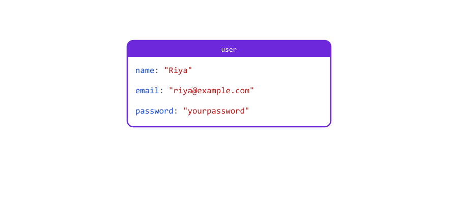
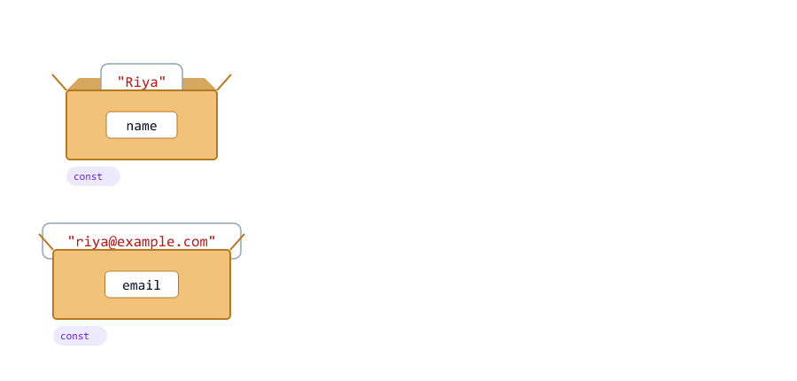
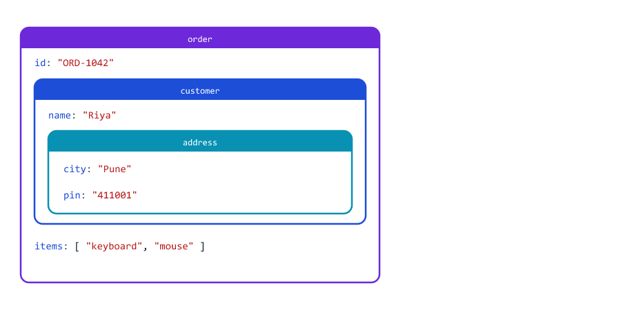
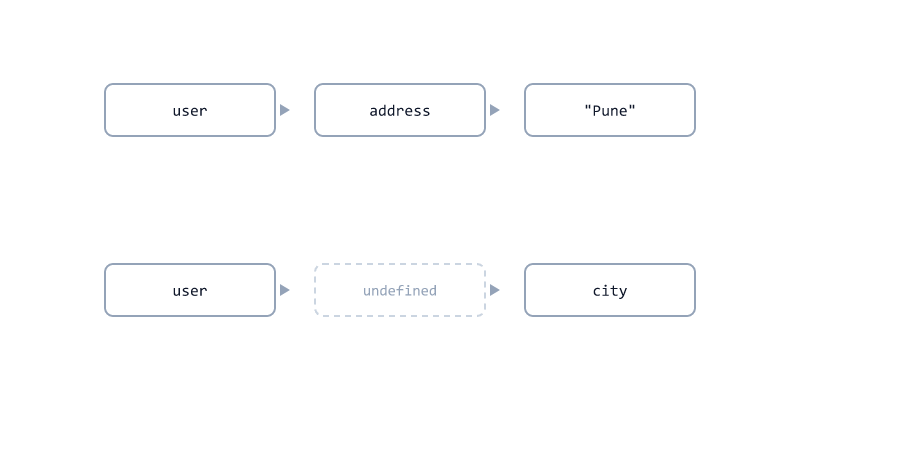
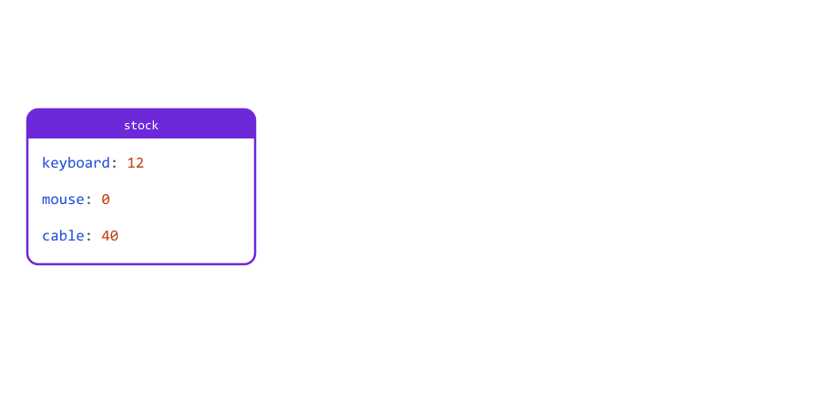
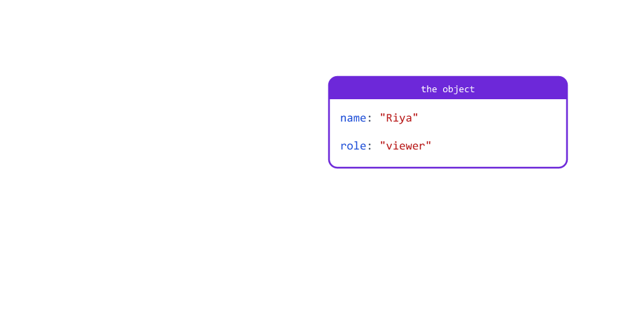
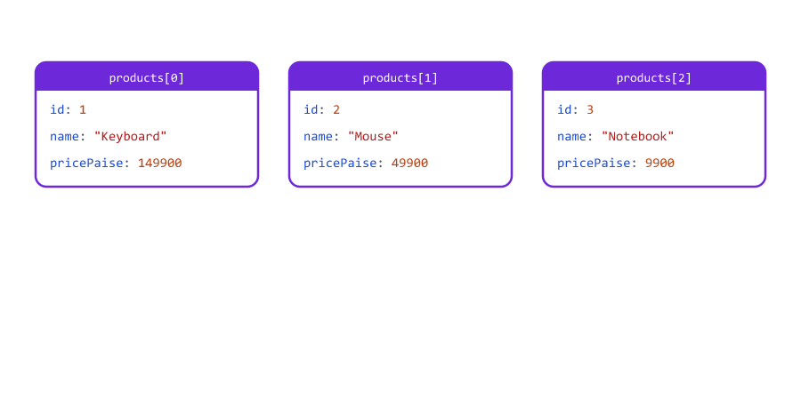
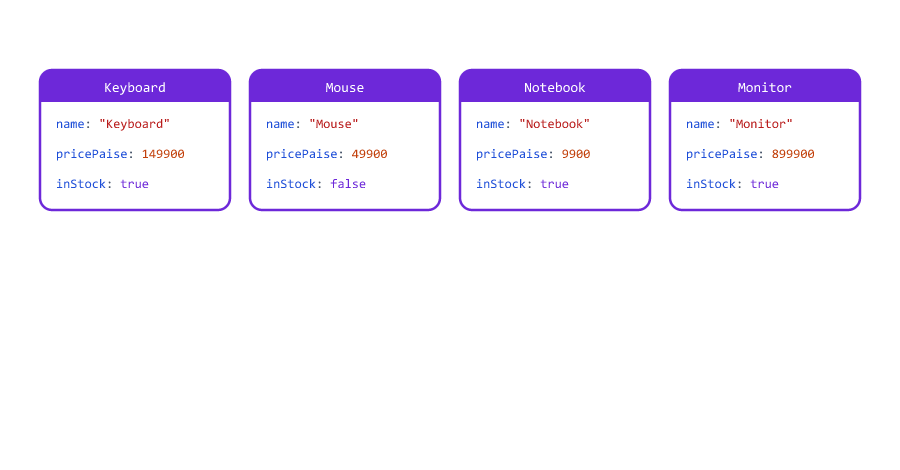
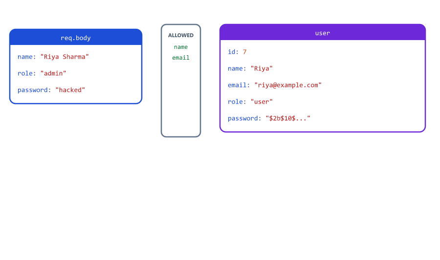

# Objects

## Table of Contents
- [What is an Object?](#what-is-an-object)
- [Creating an Object](#creating-an-object)
- [Reading Properties: Dot and Brackets](#reading-properties-dot-and-brackets)
- [Keys with Dashes Need Quotes](#keys-with-dashes-need-quotes)
- [Adding, Changing and Deleting Properties](#adding-changing-and-deleting-properties)
- [Property Names from a Variable](#property-names-from-a-variable)
- [Checking if a Property Exists](#checking-if-a-property-exists)
- [Shorthand Properties](#shorthand-properties)
- [Nested Objects](#nested-objects)
- [Optional Chaining with ?.](#optional-chaining-with-)
- [Methods: Functions Inside Objects](#methods-functions-inside-objects)
- [Looping Over an Object](#looping-over-an-object)
- [Objects Are Shared, Not Copied](#objects-are-shared-not-copied)
- [Comparing Objects by Their Contents](#comparing-objects-by-their-contents)
- [const Objects Can Still Change](#const-objects-can-still-change)
- [Arrays of Objects](#arrays-of-objects)
- [Passing One Options Object](#passing-one-options-object)
- [Formatting Money with Options](#formatting-money-with-options)
- [Mini Example 1: Product Catalogue Endpoint](#mini-example-1-product-catalogue-endpoint)
- [Mini Example 2: Safe User Update](#mini-example-2-safe-user-update)
- [Beginner Mistakes](#beginner-mistakes)
- [Practice Exercises](#practice-exercises)
- [Interview Questions](#interview-questions)

---

## What is an Object?

An **object** keeps related values together, and gives each value a **name**.

why-objects.js

```javascript
// An array: you must remember what each position means
const userArray = ["Riya", "riya@example.com", 25, "admin"];
console.log(userArray[2]);   // is this the age? the id?

// An object: every value has a name
const user = {
  name: "Riya",
  email: "riya@example.com",
  age: 25,
  role: "admin",
};
console.log(user.age);
console.log(user);
```

Output

```text
25
25
{ name: 'Riya', email: 'riya@example.com', age: 25, role: 'admin' }
```


| Array                                  | Object                                          |
| -------------------------------------- | ----------------------------------------------- |
| A **list** of similar values           | One **thing** with named values                 |
| Read by position: `orders[0]`          | Read by name: `user.email`                      |
| Order matters                          | You do not think about the order                |
| A list of prices, a list of users      | One user, one product, one order                |

A backend is full of objects: a user from the database, the JSON body of a request (`req.body`), the settings in `.env` (`process.env`), and the response you send with `res.json({ ... })`. You have used objects since Session 01 without noticing: `console` is an object, and `log` is one of its functions.

---

## Creating an Object

Write the properties between curly braces `{ }`. Each property is a **key** (its name), a colon, and a **value**

create-object.js

```javascript
const product = {
  id: 101,
  name: "Wireless Mouse",
  pricePaise: 49900,
  inStock: true,
  tags: ["electronics", "accessories"],
};

console.log(product);
console.log(typeof product);
console.log(Array.isArray(product));
```

Output

```text
{
  id: 101,
  name: 'Wireless Mouse',
  pricePaise: 49900,
  inStock: true,
  tags: [ 'electronics', 'accessories' ]
}
object
false
```

| Part              | Example           | Rule                                                  |
| ----------------- | ----------------- | ----------------------------------------------------- |
| Key               | `pricePaise`      | A name, usually camelCase (Session 02)                |
| Value             | `49900`           | Any value: number, string, boolean, array, object     |
| `,` between properties | `inStock: true,` | The comma after the last one is allowed, and common |

Node.js prints short objects on one line and longer ones on several lines. Strings are printed with single quotes (Session 03). `typeof` says `"object"` for both objects and arrays, so use `Array.isArray()` to tell them apart (Session 12).

---

## Reading Properties: Dot and Brackets

There are two ways to read a property

read-props.js

```javascript
const user = { name: "Riya", email: "riya@example.com", age: 25 };

console.log(user.name);
console.log(user["email"]);

const field = "age";
console.log(user[field]);

console.log(user.phone);
```

Output

```text
Riya
riya@example.com
25
undefined
```


| Syntax          | Use it when                                              |
| --------------- | -------------------------------------------------------- |
| `user.name`     | You know the name when you write the code. The usual way |
| `user["name"]`  | The name has dashes or spaces (next section)             |
| `user[field]`   | The name is **in a variable**                            |

A property that does not exist gives `undefined`, not an error, just like an index past the end of an array (Session 12).

---

## Keys with Dashes Need Quotes

HTTP headers have names like `content-type`. A key with a dash or a space must be written in quotes, and read with brackets

quoted-keys.js

```javascript
const headers = {
  "content-type": "application/json",
  "x-request-id": "req-7f3a",
  host: "localhost:3000",
};

console.log(headers["content-type"]);
console.log(headers["x-request-id"]);
console.log(headers.host);
```

Output

```text
application/json
req-7f3a
localhost:3000
```

In Express, you will read headers exactly like this: `req.headers["content-type"]`. The [Beginner Mistakes](#mistake-2-reading-a-key-with-a-dash-using-a-dot) show what happens with a dot.

---

## Adding, Changing and Deleting Properties

Objects can change after they are created

crud-object.js

```javascript
const user = { name: "Riya", email: "riya@example.com", password: "yourpassword" };

user.role = "admin";            // add a new property
user.email = "riya@test.com";   // change an existing one
delete user.password;           // remove one

console.log(user);
```

Output

```text
{ name: 'Riya', email: 'riya@test.com', role: 'admin' }
```



| Code                       | What happens                                       |
| -------------------------- | -------------------------------------------------- |
| `user.role = "admin"`      | No `role` yet, so a new property is **added**      |
| `user.email = "..."`       | `email` exists, so its value is **replaced**       |
| `delete user.password`     | The property is **removed** completely             |

Assigning works the same for new and existing keys. A typo like `user.emial = "..."` silently creates a new property instead of changing `email`.

---

## Property Names from a Variable

When the property name is in a variable, use brackets to set it too

computed-key.js

```javascript
const field = "city";
const value = "Pune";

const update = {};
update[field] = value;           // bracket notation with a variable

const sameUpdate = { [field]: value };   // [ ] inside { } does the same

console.log(update);
console.log(sameUpdate);
```

Output

```text
{ city: 'Pune' }
{ city: 'Pune' }
```

`{ [field]: value }` is called a **computed property name**: the key is worked out from the variable. The Node.js course builds a database sort this way: `sort[field] = 1` (Session 18).

---

## Checking if a Property Exists

has-property.js

```javascript
const body = { name: "Riya", email: "riya@example.com", discount: 0 };

console.log("email" in body);
console.log("phone" in body);
console.log(Object.hasOwn(body, "discount"));
console.log(body.phone === undefined);
```

Output

```text
true
false
true
true
```

| Check                        | Gives `true` when                                       |
| ---------------------------- | ------------------------------------------------------- |
| `"email" in body`            | The object has a property with that name                |
| `Object.hasOwn(body, "email")` | The same, but only for properties written in the object itself |
| `body.phone === undefined`   | The property is missing (or set to `undefined`)         |

Do **not** check with `if (body.discount)`: a discount of `0` is falsy (Session 05), so it looks missing. See [Mistake 3](#mistake-3-checking-a-property-with-if-objkey).

---

## Shorthand Properties

When a variable has the same name as the key, write it once

shorthand.js

```javascript
const name = "Riya";
const email = "riya@example.com";

const longWay = { name: name, email: email };
const shortWay = { name, email };   // same result

console.log(longWay);
console.log(shortWay);
```

Output

```text
{ name: 'Riya', email: 'riya@example.com' }
{ name: 'Riya', email: 'riya@example.com' }
```



You will see this everywhere in Node.js code: `module.exports = { add, subtract }` exports two functions (Node.js course, Session 04), and `res.json({ success: true, user })` sends a variable called `user`.

---

## Nested Objects

A value can be another object or an array. Follow the path with more dots

nested.js

```javascript
const order = {
  id: "ORD-1042",
  customer: {
    name: "Riya",
    address: {
      city: "Pune",
      pin: "411001",
    },
  },
  items: ["keyboard", "mouse"],
};

console.log(order.customer.name);
console.log(order.customer.address.city);
console.log(order.items[1]);
console.log(order.items.length);
```

Output

```text
Riya
Pune
mouse
2
```



Read `order.customer.address.city` from left to right: in `order`, take `customer`; in that, take `address`; in that, take `city`. JSON data from APIs is nested like this all the time (Session 19).

---

## Optional Chaining with ?.

If one step of the path is missing, the next dot crashes

no-optional-chaining.js

```javascript
const user = { name: "Aman" };   // no address

console.log(user.address.city);
```

Output

```text
D:\js-practice\no-optional-chaining.js:3
console.log(user.address.city);
                         ^

TypeError: Cannot read properties of undefined (reading 'city')
```

`user.address` is `undefined`, and `undefined` has no properties. `?.` stops early and gives `undefined` instead of crashing

optional-chaining.js

```javascript
const userWithAddress = { name: "Riya", address: { city: "Pune" } };
const userWithoutAddress = { name: "Aman" };

console.log(userWithAddress.address?.city);
console.log(userWithoutAddress.address?.city);
console.log(userWithoutAddress.address?.city ?? "City not given");
```

Output

```text
Pune
undefined
City not given
```



| Code                        | When `address` is missing          |
| --------------------------- | ---------------------------------- |
| `user.address.city`         | Crash: `TypeError`                 |
| `user.address?.city`        | `undefined`                        |
| `user.address?.city ?? "-"` | `"-"`: a default with `??` (Session 04) |

Use `?.` for data that may really be missing, like optional fields in a request. Do not put it everywhere: if a value **must** exist, a clear error is better than a silent `undefined`.

---

## Methods: Functions Inside Objects

A property can hold a function. A function stored in an object is called a **method**

methods.js

```javascript
// An object can group related functions. A function inside an object is a method.
const money = {
  toPaise(rupees) {
    return Math.round(rupees * 100);
  },
  format(paise) {
    return `Rs ${(paise / 100).toFixed(2)}`;
  },
};

const price = money.toPaise(499.5);
console.log(price);
console.log(money.format(price));
console.log(typeof money.format);
```

Output

```text
49950
Rs 499.50
function
```

`toPaise(rupees) { ... }` is a short way to write `toPaise: function (rupees) { ... }`. You call a method with a dot and `()`, like the ones you already know: `console.log()`, `Math.round()`, `"text".toUpperCase()`.

Grouping functions in an object is exactly what a Node.js module does: `module.exports = { toPaise, format }`, then `money.format(...)` in another file (Session 21). A method that works with the object's **own** data (like a `cart.total()` that adds up the cart's items) uses the keyword `this`, which is explained in Session 17.

---

## Looping Over an Object

Objects are not lists, but you can still get their keys and values as arrays

object-keys.js

```javascript
const stock = { keyboard: 12, mouse: 0, cable: 40 };

console.log(Object.keys(stock));
console.log(Object.values(stock));
console.log(Object.entries(stock));
console.log(Object.keys(stock).length);
```

Output

```text
[ 'keyboard', 'mouse', 'cable' ]
[ 12, 0, 40 ]
[ [ 'keyboard', 12 ], [ 'mouse', 0 ], [ 'cable', 40 ] ]
3
```



`for...in` goes through the keys directly (Session 07 promised this one)

for-in.js

```javascript
const stock = { keyboard: 12, mouse: 0, cable: 40 };

for (const item in stock) {
  console.log(`${item}: ${stock[item]}`);
}
```

Output

```text
keyboard: 12
mouse: 0
cable: 40
```

The key is in a variable (`item`), so read the value with brackets: `stock[item]`. Because `Object.keys()` and `Object.values()` give arrays, all the array methods from Session 12 work on them

object-loops.js

```javascript
const stock = { keyboard: 12, mouse: 0, cable: 40 };

const totalUnits = Object.values(stock).reduce((sum, qty) => sum + qty, 0);
const soldOut = Object.keys(stock).filter((item) => stock[item] === 0);

console.log(totalUnits);
console.log(soldOut);
```

Output

```text
52
[ 'mouse' ]
```

| Loop                                  | Gives                      |
| ------------------------------------- | -------------------------- |
| `for (const key in obj)`              | The keys, one by one       |
| `Object.keys(obj)`                    | An array of keys           |
| `Object.values(obj)`                  | An array of values         |
| `Object.entries(obj)`                 | An array of `[key, value]` pairs |
| `for (const x of obj)`                | An error: objects are not lists. See [Mistake 4](#mistake-4-forof-on-an-object) |

---

## Objects Are Shared, Not Copied

Like arrays (Session 12), an object is **not** copied when you assign it. Both variables point to the same object

shared.js

```javascript
const user = { name: "Riya", role: "viewer" };
const sameUser = user;      // not a copy: both point to one object

sameUser.role = "admin";

console.log(user.role);
console.log(user === sameUser);
```

Output

```text
admin
true
```



This is the object behaviour from Session 03. It also happens when you pass an object to a function: the function gets the same object, so it can change it (unlike numbers and strings, Session 10). Session 15 shows how to make real copies.

---

## Comparing Objects by Their Contents

Session 04 showed that two objects with the same contents are not `===`. Here is how to compare what is inside

compare-objects.js

```javascript
const a = { name: "Riya", age: 25 };
const b = { name: "Riya", age: 25 };

console.log(a === b);   // two different objects

function sameContent(first, second) {
  const keys = Object.keys(first);
  if (keys.length !== Object.keys(second).length) {
    return false;
  }
  return keys.every((key) => first[key] === second[key]);
}

console.log(sameContent(a, b));
console.log(sameContent(a, { name: "Riya", age: 26 }));
```

Output

```text
false
true
false
```

`sameContent()` checks that both objects have the same number of keys, and that every key has the same value (`every`, Session 12). It only compares one level: nested objects inside would again be compared with `===`. In real code you usually compare one field that identifies the thing, like `a.id === b.id`.

---

## const Objects Can Still Change

`const` keeps the variable pointing to the same object, but the properties can change (like `const` arrays, Session 12). To lock an object, freeze it

const-object.js

```javascript
const config = { port: 3000, env: "development" };

config.port = 8080;       // allowed: changes a property
console.log(config);

const frozen = Object.freeze({ port: 3000 });
frozen.port = 8080;       // ignored: the object is frozen
console.log(frozen.port);
```

Output

```text
{ port: 8080, env: 'development' }
3000
```

`Object.freeze()` is useful for settings that must never change while the server runs. Changing a frozen object is silently ignored (in strict mode it throws a `TypeError` instead).

---

## Arrays of Objects

The most common shape of data on a server is an **array of objects**: a list of products, users or orders. Session 12 promised this

array-of-objects.js

```javascript
const products = [
  { id: 1, name: "Keyboard", category: "electronics", pricePaise: 149900, inStock: true },
  { id: 2, name: "Mouse", category: "electronics", pricePaise: 49900, inStock: false },
  { id: 3, name: "Notebook", category: "stationery", pricePaise: 9900, inStock: true },
  { id: 4, name: "Monitor", category: "electronics", pricePaise: 899900, inStock: true },
];

console.log(products.length);
console.log(products[0].name);
console.log(products[3].pricePaise);
```

Output

```text
4
Keyboard
899900
```

`products[0].name`: take item `0` of the array, then its `name`.

Getting one item by its id, with `find` (Session 12)

find-by-id.js

```javascript
const products = [
  { id: 1, name: "Keyboard", pricePaise: 149900 },
  { id: 2, name: "Mouse", pricePaise: 49900 },
  { id: 3, name: "Notebook", pricePaise: 9900 },
];

function getProduct(id) {
  const product = products.find((p) => p.id === id);
  if (product === undefined) {
    return `404 Not Found: product ${id}`;
  }
  return `200 OK: ${product.name}`;
}

console.log(getProduct(2));
console.log(getProduct(9));
```

Output

```text
200 OK: Mouse
404 Not Found: product 9
```



This is the `GET /students/:id` route of the Node.js course (Session 11): `students.find((s) => s.id === id)`, then `404` when nothing is found.

All the other array methods work the same way. The callback now gets a whole object, and you read its properties

array-methods-objects.js

```javascript
const products = [
  { id: 1, name: "Keyboard", category: "electronics", pricePaise: 149900, inStock: true },
  { id: 2, name: "Mouse", category: "electronics", pricePaise: 49900, inStock: false },
  { id: 3, name: "Notebook", category: "stationery", pricePaise: 9900, inStock: true },
  { id: 4, name: "Monitor", category: "electronics", pricePaise: 899900, inStock: true },
];

const available = products.filter((p) => p.inStock);
const names = available.map((p) => p.name);
const stockValue = available.reduce((sum, p) => sum + p.pricePaise, 0);
const cheapestFirst = products.toSorted((a, b) => a.pricePaise - b.pricePaise);

console.log(names);
console.log(stockValue);
console.log(cheapestFirst.map((p) => p.name));
console.log(products.some((p) => p.category === "stationery"));
```

Output

```text
[ 'Keyboard', 'Notebook', 'Monitor' ]
1059700
[ 'Notebook', 'Mouse', 'Keyboard', 'Monitor' ]
true
```



| Task                                 | Code                                               |
| ------------------------------------ | -------------------------------------------------- |
| Only products in stock               | `filter((p) => p.inStock)`                         |
| Just the names                       | `map((p) => p.name)`                               |
| Total value                          | `reduce((sum, p) => sum + p.pricePaise, 0)`        |
| Cheapest first                       | `toSorted((a, b) => a.pricePaise - b.pricePaise)`  |
| Is there any stationery?             | `some((p) => p.category === "stationery")`         |

To sort objects, the compare function compares one **property** of `a` and `b`. Without a compare function, `sort()` cannot sort objects at all (see [Mistake 10](#mistake-10-sorting-objects-without-a-compare-function)).

---

## Passing One Options Object

Session 10 warned that many positional arguments are easy to mix up. Pass one object with named values instead

options-object.js

```javascript
// Positional arguments: what is true? what is false?
function createUserOld(name, email, role, isActive, sendWelcome) {
  return `${name} (${email}) role=${role} active=${isActive} welcome=${sendWelcome}`;
}

console.log(createUserOld("Riya", "riya@example.com", "admin", true, false));

// One options object: every value has a name, and the order does not matter
function createUser(options) {
  const role = options.role ?? "user";
  const isActive = options.isActive ?? true;
  return `${options.name} (${options.email}) role=${role} active=${isActive}`;
}

console.log(createUser({ name: "Riya", email: "riya@example.com", role: "admin" }));
console.log(createUser({ email: "aman@example.com", name: "Aman", isActive: false }));
```

Output

```text
Riya (riya@example.com) role=admin active=true welcome=false
Riya (riya@example.com) role=admin active=true
Aman (aman@example.com) role=user active=false
```


| Positional arguments                         | One options object                              |
| -------------------------------------------- | ----------------------------------------------- |
| `createUserOld("Riya", "...", "admin", true, false)` | `createUser({ name: "Riya", role: "admin" })` |
| You must remember the order                  | Any order: the names say what each value is     |
| `true, false` means nothing when you read it | `isActive: false` is clear                      |
| Skipping a value means passing `undefined`   | Just leave the property out                     |

`options.role ?? "user"` gives a default when the property is missing (Session 04). Session 14 shows a shorter way to unpack an options object. You already use options objects in Node.js: `res.status(404).json({ message })`, `fs.readFile(file, { encoding: "utf8" })`, and Mongoose options like `{ runValidators: true }` (Node.js course, Session 20).

---

## Formatting Money with Options

Session 09 used `toLocaleString()` for big numbers. Its second argument is an **options object**

locale-options.js

```javascript
const amount = 1299.5;

console.log(amount.toLocaleString("en-IN"));
console.log(amount.toLocaleString("en-IN", { minimumFractionDigits: 2 }));
console.log(amount.toLocaleString("en-US", { style: "currency", currency: "USD" }));
console.log((1234567).toLocaleString("en-IN", { maximumFractionDigits: 0 }));
```

Output

```text
1,299.5
1,299.50
$1,299.50
12,34,567
```

| Option                        | Meaning                                         |
| ----------------------------- | ----------------------------------------------- |
| `minimumFractionDigits: 2`    | Always show at least 2 decimals: `1,299.50`     |
| `maximumFractionDigits: 0`    | Round to a whole number                         |
| `style: "currency"` with `currency: "USD"` | Add the currency symbol: `$1,299.50` |

For rupees, use `currency: "INR"`

locale-inr.js

```javascript
console.log((1299.5).toLocaleString("en-IN", { style: "currency", currency: "INR" }));
```

Output

```text
₹1,299.50
```

The rupee sign `₹` is not ASCII. Older Windows terminals may show it as `?` or garbage, which is why this course prints `Rs` in the terminal. In a JSON response or a web page, `₹` works fine.

---

## Mini Example 1: Product Catalogue Endpoint

`GET /api/products?category=electronics&inStock=true&sort=price` returns a filtered, sorted list. The query string becomes an object (in Express, `req.query`), and all its values are strings (Session 05)

catalogue.js

```javascript
const products = [
  { id: 1, name: "Keyboard", category: "electronics", pricePaise: 149900, inStock: true },
  { id: 2, name: "Mouse", category: "electronics", pricePaise: 49900, inStock: false },
  { id: 3, name: "Notebook", category: "stationery", pricePaise: 9900, inStock: true },
  { id: 4, name: "Monitor", category: "electronics", pricePaise: 899900, inStock: true },
  { id: 5, name: "Webcam", category: "electronics", pricePaise: 299900, inStock: true },
];

// GET /api/products?category=electronics&inStock=true&sort=price
function listProducts(query) {
  let result = products;

  if (query.category !== undefined) {
    result = result.filter((p) => p.category === query.category);
  }
  if (query.inStock === "true") {
    result = result.filter((p) => p.inStock);
  }
  if (query.sort === "price") {
    result = result.toSorted((a, b) => a.pricePaise - b.pricePaise);
  }

  return {
    count: result.length,
    data: result.map((p) => ({ id: p.id, name: p.name, price: `Rs ${p.pricePaise / 100}` })),
  };
}

console.log(listProducts({ category: "electronics", inStock: "true", sort: "price" }));
console.log(listProducts({ category: "toys" }));
```

Run

```bash
node catalogue.js
```

Output

```text
{
  count: 3,
  data: [
    { id: 1, name: 'Keyboard', price: 'Rs 1499' },
    { id: 5, name: 'Webcam', price: 'Rs 2999' },
    { id: 4, name: 'Monitor', price: 'Rs 8999' }
  ]
}
{ count: 0, data: [] }
```


| Step                                      | Why                                                     |
| ----------------------------------------- | ------------------------------------------------------- |
| `let result = products`                   | Start with everything; each filter makes it smaller     |
| `query.inStock === "true"`                | Query values are text, so compare with `"true"` (Session 05) |
| `toSorted`                                | Never change the original `products` list               |
| `map((p) => ({ ... }))`                   | Send only the fields the client needs. The `( )` around `{ }` is required (see [Mistake 7](#mistake-7-returning-an-object-from-an-arrow-function-without--)) |
| `{ count, data }` style response          | The same shape the Node.js course sends (Session 15)    |

---

## Mini Example 2: Safe User Update

`PATCH /api/users/7` lets a user change their profile. A client can send **anything** in the body, including `role: "admin"`. The server must copy only the fields it allows, and must never send the password back (Node.js course, Sessions 15, 20 and 22)

update-user.js

```javascript
const user = {
  id: 7,
  name: "Riya",
  email: "riya@example.com",
  role: "user",
  password: "$2b$10$hashedPasswordHere",
};

// Fields a client may change with PATCH /api/users/7
const ALLOWED_FIELDS = ["name", "email"];

function applyUpdate(target, body) {
  for (const key of ALLOWED_FIELDS) {
    if (body[key] !== undefined) {
      target[key] = body[key];
    }
  }
}

// Never send the password back
function publicUser(u) {
  return { id: u.id, name: u.name, email: u.email, role: u.role };
}

const body = { name: "Riya Sharma", role: "admin", password: "hacked" };
applyUpdate(user, body);

console.log(publicUser(user));
console.log(user.role);
```

Run

```bash
node update-user.js
```

Output

```text
{ id: 7, name: 'Riya Sharma', email: 'riya@example.com', role: 'user' }
user
```



| Part                          | Job                                                          |
| ----------------------------- | ------------------------------------------------------------ |
| `ALLOWED_FIELDS`              | The only keys a client may change                            |
| `body[key]` with a variable   | Bracket notation, because the key is in `key`                |
| `!== undefined`               | Only copy fields the client actually sent                    |
| `applyUpdate(user, body)`     | Changes `user` itself, because objects are shared            |
| `publicUser(u)`               | Builds a **new** object with only safe fields                |

The `role: "admin"` and `password: "hacked"` in the body were ignored. This is how the Node.js course's `pickFields()` (Session 20) and `publicUser()` (Session 22) protect real APIs.

---

## Beginner Mistakes

### Mistake 1: A dot with a variable

**Incorrect**

```javascript
const user = { name: "Riya", email: "riya@example.com" };
const field = "email";

console.log(user.field);   // looks for a property called "field"
console.log(user[field]);  // uses the value of the variable
```

```text
undefined
riya@example.com
```

`user.field` means "the property named `field`". **Correct:** `user[field]` when the name is in a variable.

### Mistake 2: Reading a key with a dash using a dot

**Incorrect**

```javascript
const headers = { "content-type": "application/json" };

console.log(headers.content-type);
```

```text
D:\js-practice\m-dash-key.js:3
console.log(headers.content-type);
                            ^

ReferenceError: type is not defined
```

JavaScript reads it as `headers.content` minus a variable called `type`. **Correct:** `headers["content-type"]`.

### Mistake 3: Checking a property with if (obj.key)

**Incorrect**

```javascript
const coupon = { code: "WELCOME", discount: 0 };

if (coupon.discount) {
  console.log("Has a discount field");
} else {
  console.log("No discount field?");   // wrong: the field exists, its value is 0
}

console.log("discount" in coupon);
```

```text
No discount field?
true
```

`0`, `""` and `false` are falsy (Session 05). **Correct:** `"discount" in coupon`, or `coupon.discount !== undefined`.

### Mistake 4: for...of on an object

**Incorrect**

```javascript
const stock = { keyboard: 12, mouse: 0 };

for (const item of stock) {
  console.log(item);
}
```

```text
D:\js-practice\m-for-of-object.js:3
for (const item of stock) {
                   ^

TypeError: stock is not iterable
```

**Correct:** `for (const item in stock)`, or `for (const item of Object.keys(stock))`.

### Mistake 5: Crashing on a missing nested object

**Incorrect:** `user.address.city` when `address` is missing throws `TypeError: Cannot read properties of undefined (reading 'city')`.

**Correct:** `user.address?.city` when the address is optional (see [Optional Chaining with ?.](#optional-chaining-with-)).

### Mistake 6: Thinking = makes a copy

**Incorrect:** `const sameUser = user;` and then changing `sameUser` also changes `user` (see [Objects Are Shared, Not Copied](#objects-are-shared-not-copied)).

**Correct:** build a new object, or copy it (Session 15).

### Mistake 7: Returning an object from an arrow function without ( )

**Incorrect**

```javascript
const makeUser = (name) => { name: name };
const makeUserFixed = (name) => ({ name: name });

console.log(makeUser("Riya"));
console.log(makeUserFixed("Riya"));
```

```text
undefined
{ name: 'Riya' }
```

After `=>`, JavaScript reads `{` as the start of a function body, not an object. **Correct:** wrap the object in brackets: `=> ({ ... })`. The Node.js course points this out in Session 18.

### Mistake 8: Joining an object with +

**Incorrect**

```javascript
const user = { name: "Riya" };

console.log("User: " + user);
console.log("User:", user);
```

```text
User: [object Object]
User: { name: 'Riya' }
```

`+` turns the object into the text `[object Object]` (Session 08). **Correct:** pass it as a separate argument to `console.log`, or print one property: `user.name`.

### Mistake 9: Deep objects printed as [Object]

**Surprise**

```javascript
const response = { data: { user: { address: { city: "Pune" } } } };

console.log(response);
console.dir(response, { depth: null });
```

```text
{ data: { user: { address: [Object] } } }
{
  data: { user: { address: { city: 'Pune' } } }
}
```

The data is fine. `console.log` only prints 2 levels deep, and shows `[Object]` below that. **Correct:** `console.dir(value, { depth: null })` when debugging, or `JSON.stringify` (Session 19).

### Mistake 10: Sorting objects without a compare function

**Incorrect**

```javascript
const products = [
  { name: "Monitor", pricePaise: 899900 },
  { name: "Notebook", pricePaise: 9900 },
];

products.sort();   // no compare function
console.log(products.map((p) => p.name));

products.sort((a, b) => a.pricePaise - b.pricePaise);
console.log(products.map((p) => p.name));
```

```text
[ 'Monitor', 'Notebook' ]
[ 'Notebook', 'Monitor' ]
```

Without a compare function, every object becomes the same text `[object Object]`, so nothing moves. **Correct:** compare a property: `(a, b) => a.pricePaise - b.pricePaise`.

### Mistake 11: Sending the whole user object

**Incorrect:** `res.json(user)` sends every field, including the password hash and the role internals.

**Correct:** build a response with only safe fields, like `publicUser()` in [Mini Example 2](#mini-example-2-safe-user-update).

---

## Practice Exercises

### Exercise 1

Create a `book` object with `title`, `author`, `pricePaise` and `inStock`. Print the title with a dot and the author with brackets. Then add `pages`, change the price, delete `inStock`, and print the object.

### Exercise 2

Write `describe(product)` that returns `"Keyboard: Rs 1499.00 (in stock)"` or `"Mouse: Rs 499.00 (sold out)"`, using the product's `name`, `pricePaise` and `inStock` properties.

### Exercise 3

`const scores = { riya: 88, aman: 72, sara: 95 };` Print every student and score with `for...in`. Then use `Object.values()` and `reduce` to get the average, and `Object.keys()` with `filter` to list the students with 80 or more.

### Exercise 4

`const settings = { theme: { color: "dark" } };` Print `settings.theme.color`, then use `?.` and `??` to print `settings.language?.code` with the default `"en"`.

### Exercise 5

With the `products` array from [Arrays of Objects](#arrays-of-objects): get the names of all electronics, the most expensive product (with `reduce`), and the products sorted by name (with `localeCompare`, Session 12).

### Exercise 6

Write `countBy(items, key)` that counts how many items have each value of a property. `countBy(products, "category")` returns `{ electronics: 3, stationery: 1 }`. Hint: start with `{}` and use `counts[value] = (counts[value] ?? 0) + 1`.

### Exercise 7

Write `formatPrice(paise, options)` with an options object: `options.currency` (default `"INR"`) and `options.decimals` (default `2`). Use `toLocaleString("en-IN", { style: "currency", currency: ..., minimumFractionDigits: ..., maximumFractionDigits: ... })`.

### Exercise 8

Extend [Mini Example 2](#mini-example-2-safe-user-update): before applying the update, return an error message when the body contains a key that is **not** allowed (use `Object.keys(body)` and `filter`), for example `400 Bad Request: role, password cannot be changed`.

---

## Interview Questions

### What is an object in JavaScript?

A collection of key-value pairs: named properties that can hold any value, including functions (methods), arrays and other objects. Objects describe one thing, such as a user or a product.

### What is the difference between dot notation and bracket notation?

Dot notation (`user.name`) uses a fixed name written in the code. Bracket notation (`user["name"]`, `user[key]`) takes a string, so it works with names in variables and with names that contain dashes or spaces.

### What do you get when you read a property that does not exist?

`undefined`, with no error. Reading a property **of** `undefined` (like `user.address.city` without an address) throws a `TypeError`.

### What is optional chaining?

The `?.` operator. It stops and returns `undefined` when the value before it is `null` or `undefined`, instead of throwing. It is often combined with `??` for a default value.

### How do you check whether an object has a property?

`"key" in obj` or `Object.hasOwn(obj, "key")`. Checking `obj.key !== undefined` also works when properties are never set to `undefined`. Do not use `if (obj.key)`, because values like `0` and `""` are falsy.

### How do you loop over an object?

With `for (const key in obj)`, or by getting arrays with `Object.keys`, `Object.values` or `Object.entries` and using `for...of` or array methods on them. `for...of` does not work on a plain object directly.

### What is the difference between Object.keys, Object.values and Object.entries?

`keys` returns an array of property names, `values` an array of values, and `entries` an array of `[key, value]` pairs.

### Are objects copied when you assign them to another variable?

No. Both variables point to the same object, so a change through one is seen through the other. The same happens when an object is passed to a function.

### Why is { a: 1 } === { a: 1 } false?

`===` on objects checks whether both sides are the same object in memory, not whether they have the same contents. Two separate objects are never `===`, even with equal properties.

### What are shorthand properties and computed property names?

Shorthand: `{ name }` means `{ name: name }`. Computed: `{ [key]: value }` uses the value of the variable `key` as the property name.

### Why do you need ( ) to return an object from an arrow function?

Because `{` right after `=>` starts the function body. `() => ({ a: 1 })` returns an object, while `() => { a: 1 }` returns `undefined`.

### Why use an options object instead of many parameters?

Each value is named, so calls are easy to read; the order does not matter; and optional values can simply be left out and given defaults.

### Can you change a const object?

Yes, its properties can be added, changed and deleted. `const` only prevents assigning a different object to the variable. `Object.freeze()` stops changes to the object's properties.
