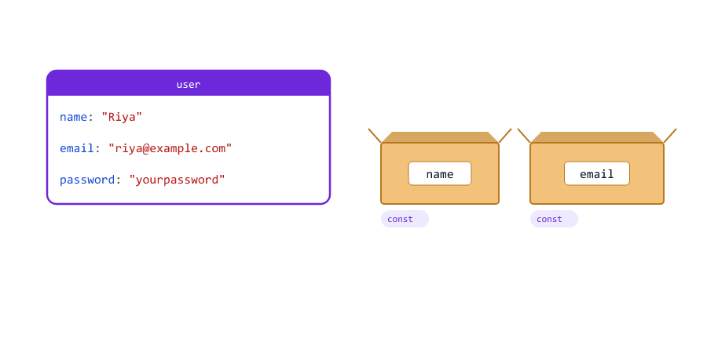
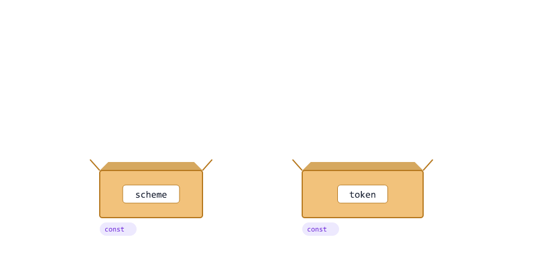
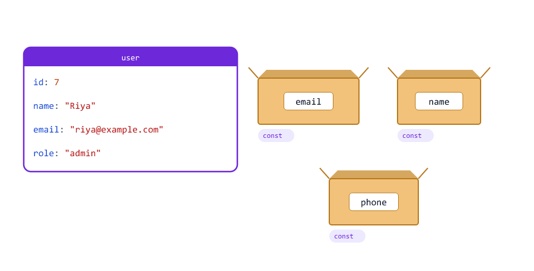
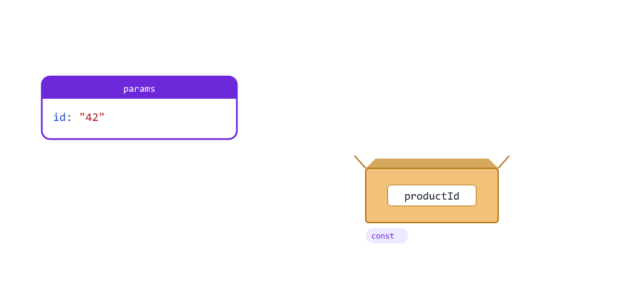
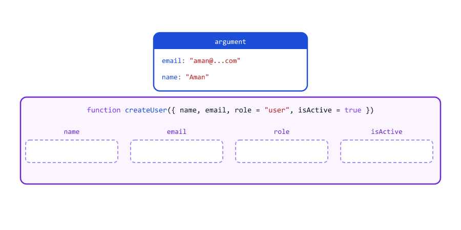
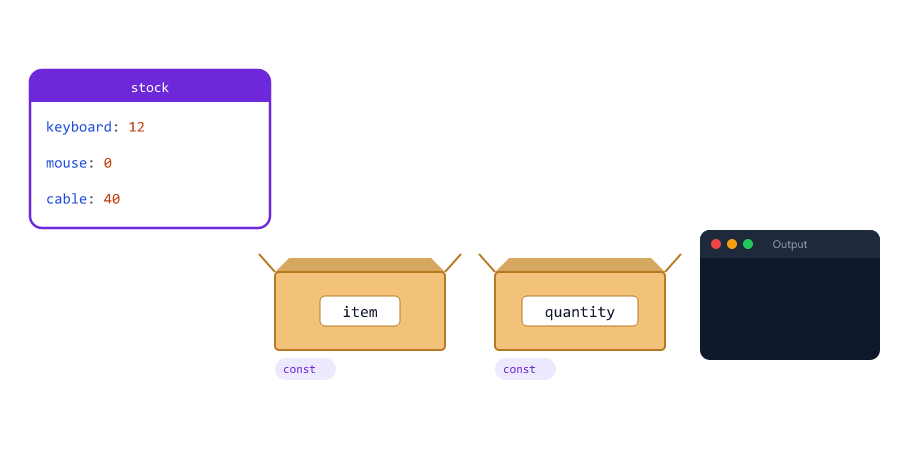
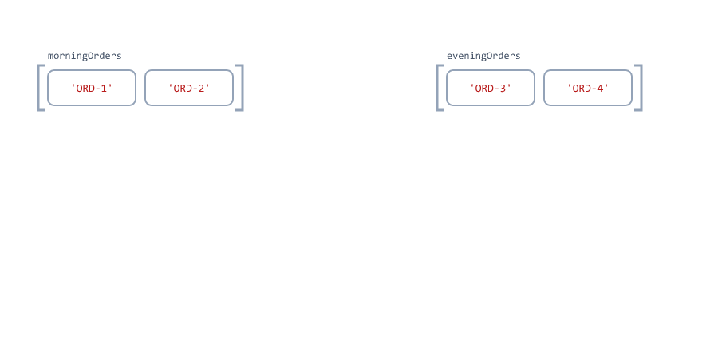
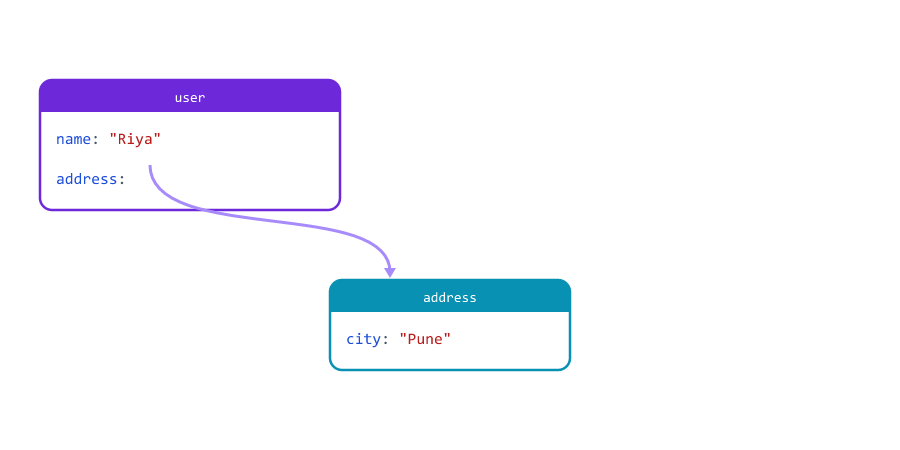
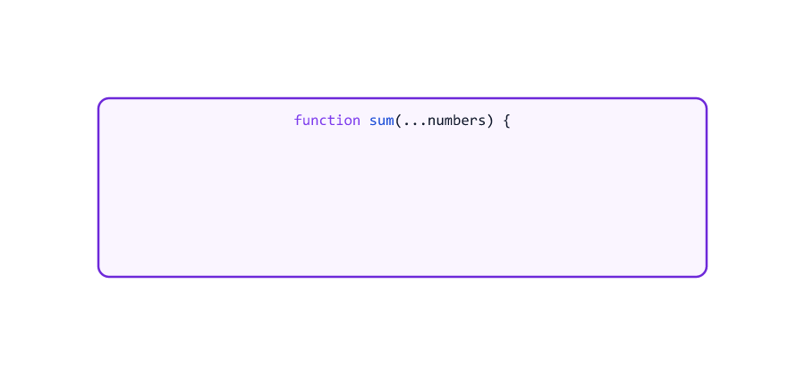
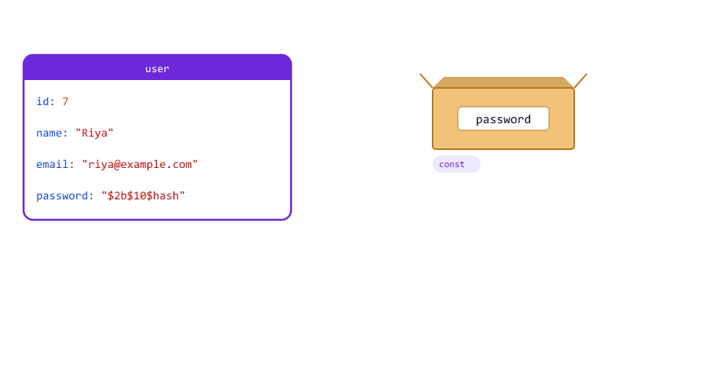

# Destructuring, Spread and Rest

> **Session 14 of 25** | Part 2: Building Blocks | [All sessions](README.md#course-outline)

## Table of Contents
- [What Are Destructuring, Spread and Rest?](#what-are-destructuring-spread-and-rest)
- [Array Destructuring](#array-destructuring)
- [Skipping Items and Default Values](#skipping-items-and-default-values)
- [Swapping Two Variables](#swapping-two-variables)
- [Object Destructuring](#object-destructuring)
- [Renaming and Default Values](#renaming-and-default-values)
- [Nested Destructuring](#nested-destructuring)
- [Destructuring Function Parameters](#destructuring-function-parameters)
- [Destructuring in Loops and Callbacks](#destructuring-in-loops-and-callbacks)
- [Spread with Arrays](#spread-with-arrays)
- [Spread into Function Calls](#spread-into-function-calls)
- [Spread with Objects](#spread-with-objects)
- [Merging Objects: The Last One Wins](#merging-objects-the-last-one-wins)
- [Spread Makes Shallow Copies](#spread-makes-shallow-copies)
- [Rest Parameters](#rest-parameters)
- [Rest in Destructuring](#rest-in-destructuring)
- [Spread or Rest? How to Tell](#spread-or-rest-how-to-tell)
- [Mini Example 1: A Route Handler with Destructuring](#mini-example-1-a-route-handler-with-destructuring)
- [Mini Example 2: Updating a Cart Without Changing It](#mini-example-2-updating-a-cart-without-changing-it)
- [Beginner Mistakes](#beginner-mistakes)
- [Practice Exercises](#practice-exercises)
- [Interview Questions](#interview-questions)

---

## What Are Destructuring, Spread and Rest?

Three short ways to move values in and out of arrays and objects. You will see them on almost every line of a Node.js project

overview.js

```javascript
const user = { name: "Riya", email: "riya@example.com", password: "yourpassword" };
const prices = [499, 1299, 249];

const { name, email } = user;                 // destructuring: unpack into variables
const allPrices = [...prices, 899];            // spread: expand items out
const { password, ...publicUser } = user;      // rest: collect what is left

console.log(name, email);
console.log(allPrices);
console.log(publicUser);
```

Output

```text
Riya riya@example.com
[ 499, 1299, 249, 899 ]
{ name: 'Riya', email: 'riya@example.com' }
```



| Feature           | Syntax                     | Job                                          |
| ----------------- | -------------------------- | -------------------------------------------- |
| **Destructuring** | `const { a, b } = obj`     | Take values **out** into separate variables  |
| **Spread**        | `...arr`, `...obj`         | **Expand** the items or properties           |
| **Rest**          | `...others`                | **Collect** the remaining items into one     |

Spread and rest use the same three dots `...` for opposite jobs. [Spread or Rest? How to Tell](#spread-or-rest-how-to-tell) shows how to tell them apart.

---

## Array Destructuring

Square brackets on the **left** of `=` take the items of an array, by position

array-destructure.js

```javascript
const header = "Bearer eyJhbGciOiJIUzI1NiJ9.abc123";

// Without destructuring
const parts = header.split(" ");
const schemeOld = parts[0];
const tokenOld = parts[1];
console.log(schemeOld, tokenOld);

// With destructuring
const [scheme, token] = header.split(" ");
console.log(scheme, token);
```

Output

```text
Bearer eyJhbGciOiJIUzI1NiJ9.abc123
Bearer eyJhbGciOiJIUzI1NiJ9.abc123
```



`const [scheme, token] = ...` means: the first item goes into `scheme`, the second into `token`. It is the `header.split(" ")[1]` from Session 12, written so that each part has a name.

---

## Skipping Items and Default Values

array-destructure-more.js

```javascript
const steps = ["Order taken", "Food cooked", "Delivered"];

const [first, , third] = steps;            // skip the second item
console.log(first, "|", third);

const [a, b, c, d] = steps;                // more names than items
console.log(d);

const [method = "GET", path = "/"] = ["POST"];   // defaults for missing items
console.log(method, path);
```

Output

```text
Order taken | Delivered
undefined
POST /
```

| Pattern                  | Meaning                                              |
| ------------------------ | ---------------------------------------------------- |
| `[first, , third]`       | An empty place skips an item                         |
| `[a, b, c, d]` with 3 items | `d` is `undefined`: no error                      |
| `[method = "GET"]`       | A default, used when the item is missing (`undefined`) |

Defaults work like default parameters (Session 10): only for `undefined`.

---

## Swapping Two Variables

swap.js

```javascript
let primary = "db-1";
let backup = "db-2";

[primary, backup] = [backup, primary];   // swap without a temporary variable

console.log(primary, backup);
```

Output

```text
db-2 db-1
```

The right side builds a new array `["db-2", "db-1"]`, and the left side unpacks it back into the two variables. Note that there is no `const` or `let`: the variables already exist.

---

## Object Destructuring

Curly braces on the **left** of `=` take properties of an object, **by name**

object-destructure.js

```javascript
const user = { id: 7, name: "Riya", email: "riya@example.com", role: "admin" };

// Without destructuring
const nameOld = user.name;
const emailOld = user.email;
console.log(nameOld, emailOld);

// With destructuring: the names must match the keys, the order does not matter
const { email, name, phone } = user;
console.log(name, email, phone);
```

Output

```text
Riya riya@example.com
Riya riya@example.com undefined
```



| Array destructuring `[ ]`        | Object destructuring `{ }`               |
| -------------------------------- | ---------------------------------------- |
| Matches by **position**          | Matches by **name**                      |
| You choose any variable names    | Variable names must match the keys (or be renamed) |
| Order matters                    | Order does not matter                    |

You have seen this in the Node.js course: `const { add } = require("./math")` (Session 04), and `const { name, age, course } = req.body` (Session 12).

---

## Renaming and Default Values

rename-default.js

```javascript
const params = { id: "42" };
const query = { page: "2" };

const { id: productId } = params;                     // rename: take id, call it productId
const { page = "1", limit = "10", sort = "name" } = query;   // defaults for missing keys

console.log(productId);
console.log(page, limit, sort);
```

Output

```text
42
2 10 name
```



| Pattern              | Meaning                                                 |
| -------------------- | ------------------------------------------------------- |
| `{ id: productId }`  | Read `id`, store it in a variable called `productId`    |
| `{ limit = "10" }`   | Use `"10"` when `limit` is missing                      |
| `{ id: productId = "0" }` | Both: rename, with a default                       |

Renaming is useful when two objects have the same key, like `req.params.id` and `user.id`. The colon means "rename", not "type": `{ name: string }` creates a variable called `string` (see [Mistake 4](#mistake-4-thinking-the-colon-keeps-the-old-name)).

Defaults apply only when the value is `undefined`, not `null`

default-only-undefined.js

```javascript
const settings = { role: null, theme: undefined };

const { role = "user", theme = "light" } = settings;

console.log(role);    // null is a real value: no default
console.log(theme);   // undefined: the default is used
```

Output

```text
null
light
```

---

## Nested Destructuring

Patterns can follow the shape of nested objects and arrays

nested-destructure.js

```javascript
const order = {
  id: "ORD-1042",
  customer: { name: "Riya", address: { city: "Pune" } },
  items: ["keyboard", "mouse"],
};

const { id, customer: { name, address: { city } }, items: [firstItem] } = order;

console.log(id, name, city, firstItem);
```

Output

```text
ORD-1042 Riya Pune keyboard
```

`customer: { name, ... }` means "go into `customer`, and take `name` from there". Only the last names (`id`, `name`, `city`, `firstItem`) become variables; `customer` and `address` do not.

Use nesting sparingly. One level is easy to read; three levels are not. And if `customer` were missing, this line would crash, just like `order.customer.name` (Session 13).

---

## Destructuring Function Parameters

Session 13 passed one options object and read `options.role`. Destructure it right in the parameter list instead

params-destructure.js

```javascript
// Session 13 version: function createUser(options) { ... options.role ?? "user" ... }
function createUser({ name, email, role = "user", isActive = true }) {
  return `${name} (${email}) role=${role} active=${isActive}`;
}

console.log(createUser({ name: "Riya", email: "riya@example.com", role: "admin" }));
console.log(createUser({ email: "aman@example.com", name: "Aman" }));
```

Output

```text
Riya (riya@example.com) role=admin active=true
Aman (aman@example.com) role=user active=true
```



The first line of the function now lists every option and its default. To allow calling the function with **no** argument at all, give the whole object a default of `{}`

params-default-object.js

```javascript
function paginate({ page = 1, limit = 10 } = {}) {
  return `skip ${(page - 1) * limit}, limit ${limit}`;
}

console.log(paginate({ page: 3 }));
console.log(paginate());   // no argument at all: the = {} default is used
```

Output

```text
skip 20, limit 10
skip 0, limit 10
```

Without `= {}`, `paginate()` would try to destructure `undefined` and crash (see [Mistake 1](#mistake-1-destructuring-undefined)).

---

## Destructuring in Loops and Callbacks

Callback parameters can be destructured too. This is very common with arrays of objects (Session 13)

callback-destructure.js

```javascript
const products = [
  { name: "Keyboard", pricePaise: 149900, inStock: true },
  { name: "Mouse", pricePaise: 49900, inStock: false },
];

const labels = products.map(({ name, pricePaise }) => `${name}: Rs ${pricePaise / 100}`);
const available = products.filter(({ inStock }) => inStock);

console.log(labels);
console.log(available.length);
```

Output

```text
[ 'Keyboard: Rs 1499', 'Mouse: Rs 499' ]
1
```

`({ name, pricePaise }) =>` replaces `(p) => p.name ... p.pricePaise`.

`Object.entries()` (Session 13) gives `[key, value]` pairs, and array destructuring unpacks each pair

entries-loop.js

```javascript
const stock = { keyboard: 12, mouse: 0, cable: 40 };

for (const [item, quantity] of Object.entries(stock)) {
  console.log(`${item}: ${quantity}`);
}
```

Output

```text
keyboard: 12
mouse: 0
cable: 40
```



This is the cleanest way to loop over an object when you need both the key and the value.

---

## Spread with Arrays

`...array` inside `[ ]` pours the items out into the new array

spread-array.js

```javascript
const morningOrders = ["ORD-1", "ORD-2"];
const eveningOrders = ["ORD-3", "ORD-4"];

const allOrders = [...morningOrders, ...eveningOrders];
const withUrgent = ["ORD-0", ...morningOrders, "ORD-9"];
const copy = [...morningOrders];

console.log(allOrders);
console.log(withUrgent);
console.log(copy, copy === morningOrders);
```

Output

```text
[ 'ORD-1', 'ORD-2', 'ORD-3', 'ORD-4' ]
[ 'ORD-0', 'ORD-1', 'ORD-2', 'ORD-9' ]
[ 'ORD-1', 'ORD-2' ] false
```



| Code                        | Same as (Session 12)              |
| --------------------------- | --------------------------------- |
| `[...a, ...b]`              | `a.concat(b)`                     |
| `[...a]`                    | `a.slice()`: a new array          |
| `[...a, item]`              | A copy with `item` at the end, without changing `a` (unlike `push`) |

The Node.js course sorts a copy this way, so the original list keeps its order: `[...students].sort(...)` (Session 13).

---

## Spread into Function Calls

`...` inside a function call turns an array into separate arguments. Session 12 promised this one

spread-math.js

```javascript
const responseTimesMs = [120, 45, 300, 80];

console.log(Math.max(responseTimesMs));      // one argument: an array
console.log(Math.max(...responseTimesMs));   // four arguments: 120, 45, 300, 80
console.log(Math.min(...responseTimesMs));
console.log([..."API"]);
```

Output

```text
NaN
300
45
[ 'A', 'P', 'I' ]
```

`Math.max()` expects separate numbers (Session 09), not an array. `...responseTimesMs` turns the call into `Math.max(120, 45, 300, 80)`. Spreading a string gives its characters.

---

## Spread with Objects

`...object` inside `{ }` copies all the properties into the new object

spread-object.js

```javascript
const user = { name: "Riya", role: "viewer" };

const copy = { ...user };
const promoted = { ...user, role: "admin" };   // copy, then change role

console.log(copy, copy === user);
console.log(promoted);
console.log(user);   // the original is unchanged
```

Output

```text
{ name: 'Riya', role: 'viewer' } false
{ name: 'Riya', role: 'admin' }
{ name: 'Riya', role: 'viewer' }
```


`{ ...user, role: "admin" }` is the standard way to get a **changed copy**: everything from `user`, then `role` replaced. The original stays the same. In Session 13, `b = a` shared one object. Spread creates a new one.

---

## Merging Objects: The Last One Wins

When the same key appears more than once, the **last** value wins. So put the defaults first

merge-defaults.js

```javascript
const DEFAULTS = { port: 3000, logLevel: "info", retries: 3 };
const userOptions = { port: 8080, logLevel: "debug" };

const config = { ...DEFAULTS, ...userOptions };     // later values win
const wrongOrder = { ...userOptions, ...DEFAULTS };

console.log(config);
console.log(wrongOrder);
```

Output

```text
{ port: 8080, logLevel: 'debug', retries: 3 }
{ port: 3000, logLevel: 'info', retries: 3 }
```


The Node.js course updates a student exactly like this (Session 11): old fields first, then the new fields, and finally the original `id`, so a client cannot change it

update-record.js

```javascript
// Like the Node.js course, Session 11: old fields, then new fields, then keep the id
const student = { id: 2, name: "Aman", age: 21, course: "Node.js" };
const updatedData = { age: 22, id: 999 };

const updated = { ...student, ...updatedData, id: student.id };

console.log(updated);
```

Output

```text
{ id: 2, name: 'Aman', age: 22, course: 'Node.js' }
```

The client tried to change the `id` to `999`, but `id: student.id` comes last and wins.

---

## Spread Makes Shallow Copies

Spread copies the **top level** only. A nested object is still shared between the original and the copy

shallow.js

```javascript
const user = { name: "Riya", address: { city: "Pune" } };

const copy = { ...user };
copy.name = "Aman";               // top level: only the copy changes
copy.address.city = "Delhi";      // nested: BOTH change, the address is shared

console.log(user.name, user.address.city);
console.log(copy.name, copy.address.city);
```

Output

```text
Riya Delhi
Aman Delhi
```



The copy got its **own** `name`, but `address` points to the **same** object as before (Session 13). This is called a **shallow copy**. Session 15 explains it in detail, and shows how to make a deep copy.

---

## Rest Parameters

`...name` as the **last parameter** collects all the remaining arguments into an array

rest-params.js

```javascript
function sum(...numbers) {
  return numbers.reduce((total, n) => total + n, 0);
}

console.log(sum(1, 2));
console.log(sum(499, 1299, 249, 899));
console.log(sum());
```

Output

```text
3
2946
0
```



`numbers` is a real array, so all the array methods work. With no arguments, it is an empty array, and `reduce` with a start value gives `0` (Session 12).

Normal parameters can come first. The rest parameter takes whatever is left

rest-log.js

```javascript
function log(level, ...messages) {
  console.log(`[${level.toUpperCase()}]`, messages.join(" "));
}

log("info", "Server", "started", "on", "port", 3000);
log("error", "Database", "connection", "failed");
```

Output

```text
[INFO] Server started on port 3000
[ERROR] Database connection failed
```

`console.log()` itself works like this: it takes any number of arguments.

---

## Rest in Destructuring

In a destructuring pattern, `...rest` collects everything that was not taken by name

rest-destructure.js

```javascript
const queue = ["send-email", "resize-image", "create-invoice"];
const [next, ...waiting] = queue;
console.log(next);
console.log(waiting);

const user = { id: 7, name: "Riya", email: "riya@example.com", password: "$2b$10$hash" };
const { password, ...safeUser } = user;
console.log(safeUser);
```

Output

```text
send-email
[ 'resize-image', 'create-invoice' ]
{ id: 7, name: 'Riya', email: 'riya@example.com' }
```



`const { password, ...safeUser } = user` is a short way to **remove** a field without changing `user`. It does the job of `publicUser()` from Session 13 in one line.

---

## Spread or Rest? How to Tell

Both are `...`. The **place** decides

| Where the `...` is                         | It is      | It does                     | Example                          |
| ------------------------------------------ | ---------- | --------------------------- | -------------------------------- |
| In a function **call**                     | Spread     | Array to separate arguments | `Math.max(...prices)`            |
| Inside `[ ]` or `{ }` on the **right** of `=` | Spread  | Copies items or properties out | `[...a, ...b]`, `{ ...user }` |
| In a function's **parameter list**         | Rest       | Collects arguments into an array | `function sum(...numbers)`  |
| In a pattern on the **left** of `=`        | Rest       | Collects the leftovers      | `const { password, ...safe } = user` |

A simple way to remember: **spread** spreads things **out**, **rest** gathers **the rest**.

---

## Mini Example 1: A Route Handler with Destructuring

In Express, a route handler gets a request object with `body`, `params`, `query` and more. Destructuring takes exactly what the handler needs. Here the request is a plain object

order-handler.js

```javascript
// A route handler gets one object; take what you need from it
function createOrder({ body = {}, user }) {
  const { productId, quantity = 1, coupon = null, ...unknown } = body;

  const unknownKeys = Object.keys(unknown);
  if (unknownKeys.length > 0) {
    return { status: 400, message: `Unknown fields: ${unknownKeys.join(", ")}` };
  }
  if (productId === undefined) {
    return { status: 400, message: "productId is required" };
  }

  const order = { productId, quantity, coupon, userId: user.id };
  return { status: 201, data: { id: "ORD-1043", ...order } };
}

const user = { id: 7, name: "Riya" };

console.log(createOrder({ body: { productId: 3, quantity: 2 }, user }));
console.log(createOrder({ body: { productId: 3, price: 1 }, user }));
console.log(createOrder({ user }));
```

Run

```bash
node order-handler.js
```

Output

```text
{
  status: 201,
  data: {
    id: 'ORD-1043',
    productId: 3,
    quantity: 2,
    coupon: null,
    userId: 7
  }
}
{ status: 400, message: 'Unknown fields: price' }
{ status: 400, message: 'productId is required' }
```

| Part                                   | Feature                                          |
| -------------------------------------- | ------------------------------------------------ |
| `({ body = {}, user })`                | Parameter destructuring, with a default for a missing body |
| `quantity = 1, coupon = null`          | Defaults for optional fields                     |
| `...unknown`                           | Rest: every field the client sent that we did not ask for |
| `{ productId, quantity, coupon, userId: user.id }` | Shorthand properties (Session 13)    |
| `{ id: "ORD-1043", ...order }`         | Spread: the new id plus all the order fields     |

The second request tried to send its own `price`. A client must never decide the price, so the server refuses unknown fields. The third request had no body at all, and `body = {}` kept it from crashing.

---

## Mini Example 2: Updating a Cart Without Changing It

Functions that return a **new** object instead of changing the one they get are easier to trust: the old cart is still there if something goes wrong, and no other code is surprised by a change. Spread makes this short

cart.js

```javascript
const cart = { userId: 7, items: [{ name: "Keyboard", qty: 1 }] };

// Each function returns a NEW cart and never changes the one it gets
function addItem(cart, item) {
  return { ...cart, items: [...cart.items, item] };
}

function changeQty(cart, name, qty) {
  return {
    ...cart,
    items: cart.items.map((item) => (item.name === name ? { ...item, qty } : item)),
  };
}

function removeItem(cart, name) {
  return { ...cart, items: cart.items.filter((item) => item.name !== name) };
}

const cart2 = addItem(cart, { name: "Mouse", qty: 1 });
const cart3 = changeQty(cart2, "Mouse", 3);
const cart4 = removeItem(cart3, "Keyboard");

console.log(cart.items);
console.log(cart3.items);
console.log(cart4.items);
```

Run

```bash
node cart.js
```

Output

```text
[ { name: 'Keyboard', qty: 1 } ]
[ { name: 'Keyboard', qty: 1 }, { name: 'Mouse', qty: 3 } ]
[ { name: 'Mouse', qty: 3 } ]
```


| Function      | New cart built with                                           |
| ------------- | ------------------------------------------------------------- |
| `addItem`     | `[...cart.items, item]`: a new array with one more item       |
| `changeQty`   | `map`, and `{ ...item, qty }` for the one item that changes   |
| `removeItem`  | `filter`: a new array without the item                        |

The first `cart` was never changed, so you can still read it. The pure functions from Session 10 work the same way: they return new values instead of changing old ones.

---

## Beginner Mistakes

### Mistake 1: Destructuring undefined

**Incorrect**

```javascript
const req = {};   // no body: for example, express.json() was not added

const { name, email } = req.body;
```

```text
D:\js-practice\m-undefined-body.js:3
const { name, email } = req.body;
        ^

TypeError: Cannot destructure property 'name' of 'req.body' as it is undefined.
```

**Correct:** give a fallback object, exactly as the Node.js course does (Session 12)

```javascript
const req = {};

const { name, email } = req.body || {};
console.log(name, email);
```

```text
undefined undefined
```

### Mistake 2: Starting a line with { to destructure into existing variables

**Incorrect**

```javascript
const user = { name: "Riya" };
let name;

{ name } = user;
```

```text
D:\js-practice\m-braces-start.js:4
{ name } = user;
         ^

SyntaxError: Unexpected token '='
```

A line that starts with `{` is read as a block (Session 06), not an object. **Correct:** wrap the whole assignment in brackets

```javascript
const user = { name: "Riya" };
let name;

({ name } = user);
console.log(name);
```

```text
Riya
```

### Mistake 3: Default values for null

**Incorrect**

```javascript
const body = { role: null };

const { role = "user" } = body;
console.log(role);
```

```text
null
```

Defaults are used only for `undefined`. **Correct:** when `null` is possible, use `??` afterwards: `const role = body.role ?? "user";` (Session 04).

### Mistake 4: Thinking the colon keeps the old name

**Incorrect**

```javascript
const user = { name: "Riya" };

const { name: userName } = user;   // creates userName, NOT name
console.log(userName);
console.log(name);
```

```text
Riya
D:\js-practice\m-rename.js:5
console.log(name);
            ^

ReferenceError: name is not defined
```

`{ name: userName }` creates only `userName`. The colon renames; it is not a type, as it would be in TypeScript.

### Mistake 5: Merging in the wrong order

**Incorrect**

```javascript
const DEFAULTS = { logLevel: "info" };
const options = { logLevel: "debug" };

console.log({ ...options, ...DEFAULTS });   // defaults overwrite the user's choice
console.log({ ...DEFAULTS, ...options });   // correct
```

```text
{ logLevel: 'info' }
{ logLevel: 'debug' }
```

The last value wins. **Correct:** defaults first, then the user's values.

### Mistake 6: Expecting spread to copy nested objects

**Incorrect:** `const copy = { ...user }; copy.address.city = "Delhi";` also changes `user.address.city` (see [Spread Makes Shallow Copies](#spread-makes-shallow-copies)).

**Correct:** copy the nested object too: `{ ...user, address: { ...user.address } }`, or make a deep copy (Session 15).

### Mistake 7: A rest parameter that is not last

**Incorrect**

```javascript
function log(...messages, level) {
  console.log(level, messages);
}
```

```text
D:\js-practice\m-rest-last.js:1
function log(...messages, level) {
                        ^

SyntaxError: Rest parameter must be last formal parameter
```

Rest takes **everything** that is left, so nothing can come after it. **Correct:** `function log(level, ...messages)`.

### Mistake 8: Spreading an object into an array

**Incorrect**

```javascript
const user = { name: "Riya" };

const list = [...user];
```

```text
D:\js-practice\m-spread-object-into-array.js:3
const list = [...user];
                 ^

TypeError: user is not iterable
```

Only lists (arrays, strings) can be spread into `[ ]` or a function call. **Correct:** `{ ...user }` for an object, or `Object.values(user)` for an array of its values (Session 13).

### Mistake 9: Math.max(...[]) on an empty list

**Surprise**

```javascript
const todaysTimes = [];

console.log(Math.max(...todaysTimes));
```

```text
-Infinity
```

With no arguments, `Math.max()` gives `-Infinity` (Session 09). **Correct:** check `length` first, or use `reduce` with a start value (Session 12). Very large arrays (hundreds of thousands of items) can also be too big to spread into a call; use `reduce` for those.

### Mistake 10: Destructuring too deep

**Incorrect:** `const { data: { user: { profile: { address: { city } } } } } = response;` is hard to read, and crashes if any level is missing.

**Correct:** destructure one or two levels, and use `?.` for parts that may be missing: `const city = response.data?.user?.profile?.address?.city;` (Session 13).

---

## Practice Exercises

### Exercise 1

`const line = "1042,Riya,1299,paid";` Use `split(",")` and array destructuring to create `orderId`, `customer`, `amount` and `status`. Convert `amount` to a number (Session 05).

### Exercise 2

`const product = { id: 3, title: "Notebook", pricePaise: 9900 };` Destructure `title` into a variable called `name`, `pricePaise` into `price`, and `stock` with a default of `0`. Print all three.

### Exercise 3

Rewrite this function with parameter destructuring and defaults: `function sendEmail(options) { const to = options.to; const subject = options.subject ?? "Hello"; const html = options.html ?? false; ... }`. Make it work when called with no argument.

### Exercise 4

`const scores = { riya: 88, aman: 72, sara: 95 };` Loop with `for (const [student, score] of Object.entries(scores))` and print only the students with 80 or more.

### Exercise 5

Write `average(...numbers)` with a rest parameter. `average(10, 20, 30)` is `20`, and `average()` returns `0` instead of `NaN`.

### Exercise 6

`const DEFAULTS = { page: 1, limit: 10, sort: "name" };` Write `buildQuery(options = {})` that merges the defaults with the options, then clamps `limit` between 1 and 100 (Session 09). `buildQuery({ limit: 500 })` gives `{ page: 1, limit: 100, sort: "name" }`.

### Exercise 7

`const user = { id: 1, name: "Riya", password: "x", resetToken: "y", email: "riya@example.com" };` Use rest destructuring to make `safeUser` without `password` and `resetToken`. Check that `user` still has both.

### Exercise 8

Add a function `clearCart(cart)` to [Mini Example 2](#mini-example-2-updating-a-cart-without-changing-it) that returns a new cart with an empty `items` array, and a function `totalQty(cart)` that adds up all the quantities. Check that the original cart is not changed.

---

## Interview Questions

### What is destructuring?

A short syntax to unpack values from arrays (by position) or properties from objects (by name) into separate variables, for example `const [a, b] = arr` and `const { name } = user`.

### What is the difference between array and object destructuring?

Array destructuring matches by position and lets you choose any variable names. Object destructuring matches by property name, so the variables are named after the keys unless you rename them.

### How do you rename a variable and give a default while destructuring?

`const { id: productId = 0 } = params;` reads `id`, stores it in `productId`, and uses `0` when `id` is `undefined`.

### When are destructuring defaults used?

Only when the value is `undefined` (missing). A `null` value is kept, just like with default parameters.

### What happens when you destructure undefined or null?

It throws a `TypeError`, for example `Cannot destructure property 'name' of 'req.body' as it is undefined`. Use a fallback like `req.body || {}`, or a default `= {}` in parameters.

### What is the spread operator?

`...` used where values are expected: in a function call it turns an array into separate arguments; in an array or object literal it copies the items or properties into the new one.

### What is the rest parameter?

`...name` as the last parameter of a function. It collects all remaining arguments into a real array. Only one rest parameter is allowed, and it must be last.

### What is the difference between spread and rest?

They look the same. Spread expands values out (in calls and literals); rest collects values into one array or object (in parameter lists and destructuring patterns).

### How do you merge two objects, and which value wins?

`{ ...a, ...b }`. When both have the same key, the later one (`b`) wins. Put defaults first and overrides after.

### Does spread make a deep copy?

No, a shallow copy. Top-level properties are copied, but nested objects and arrays are still shared with the original.

### How do you remove a property without changing the original object?

With rest destructuring: `const { password, ...safeUser } = user;` creates `safeUser` with every property except `password`.

### How do you swap two variables?

`[a, b] = [b, a];` using array destructuring.

### Why is Math.max(arr) NaN, but Math.max(...arr) works?

`Math.max` expects separate numbers. Passing the array gives it one non-number argument. Spread turns the array into separate arguments.

---

| Previous | All sessions | Next |
| :--- | :---: | ---: |
| [13. Objects](13-objects.md) | [Course outline](README.md#course-outline) | [15. Shallow and Deep Copy](15-shallow-and-deep-copy.md) |
