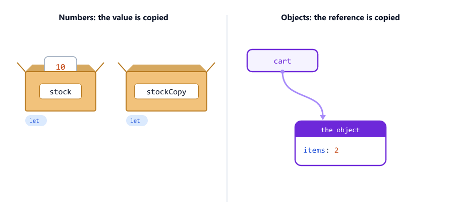
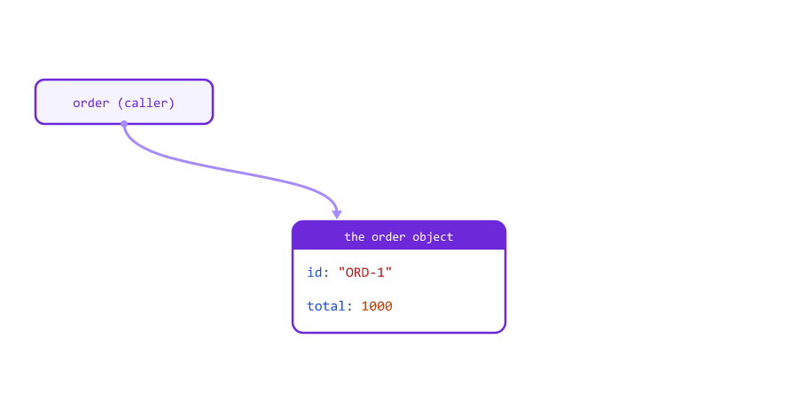
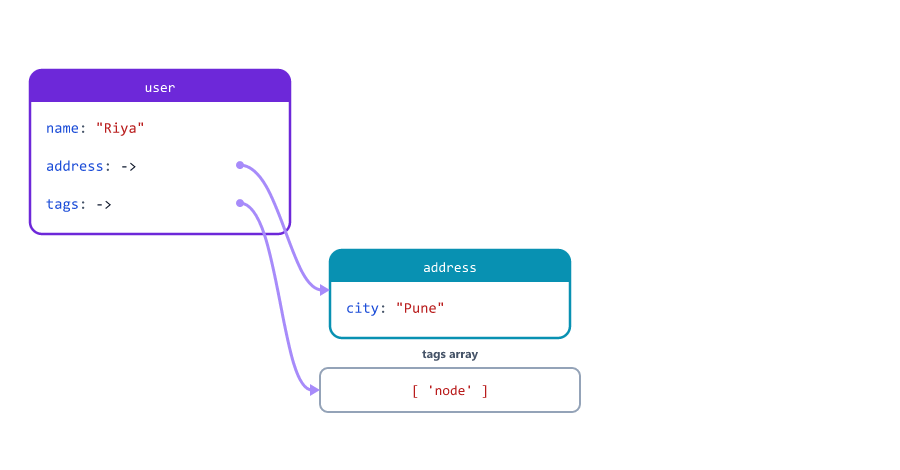
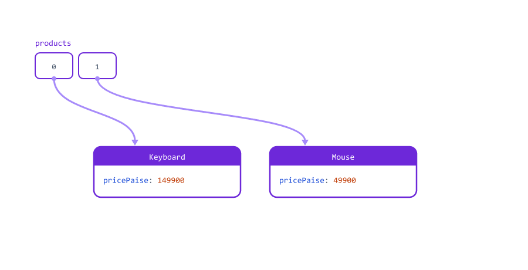
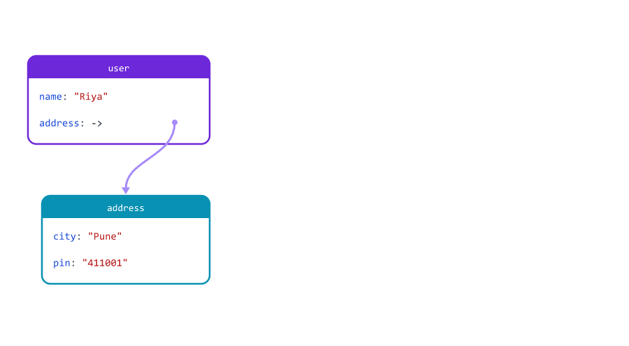
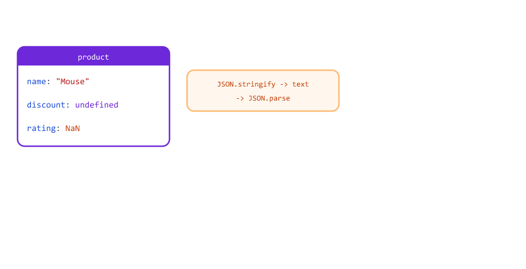
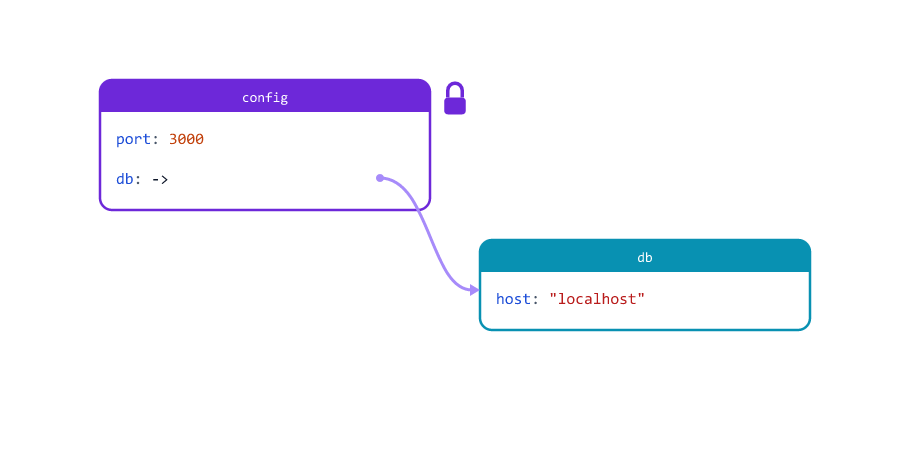
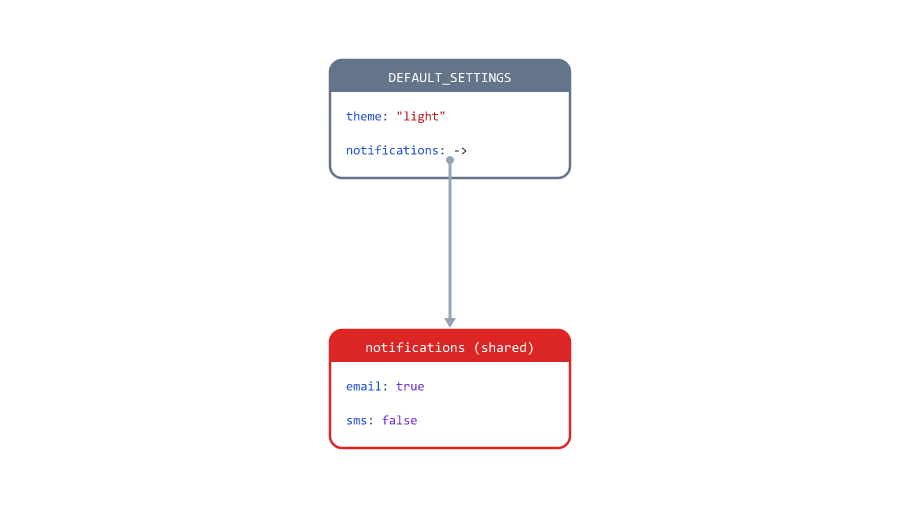
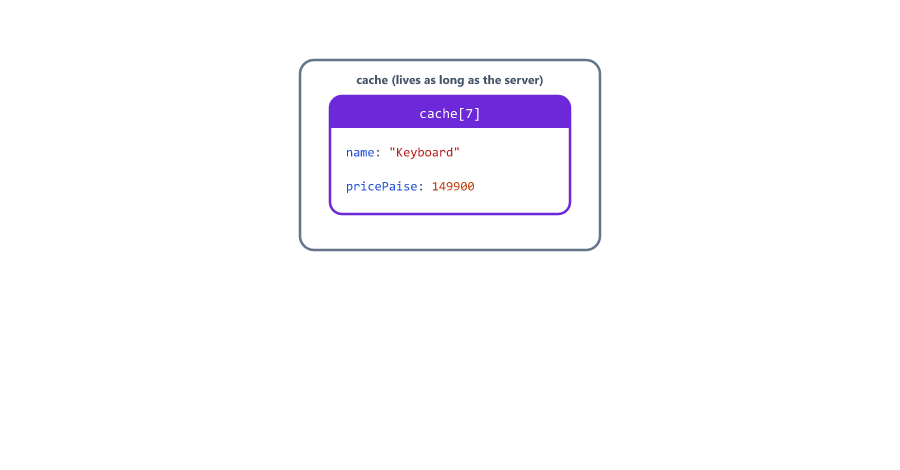

# Shallow and Deep Copy

## Table of Contents
- [Values and References](#values-and-references)
- [Functions Get the Same Object](#functions-get-the-same-object)
- [What is a Shallow Copy?](#what-is-a-shallow-copy)
- [Where Shallow Copies Break](#where-shallow-copies-break)
- [Arrays of Objects Are Shared Too](#arrays-of-objects-are-shared-too)
- [Copy Every Level You Change](#copy-every-level-you-change)
- [Deep Copy with structuredClone](#deep-copy-with-structuredclone)
- [What structuredClone Cannot Copy](#what-structuredclone-cannot-copy)
- [The Old Way: JSON.parse(JSON.stringify())](#the-old-way-jsonparsejsonstringify)
- [Object.freeze Is Shallow Too](#objectfreeze-is-shallow-too)
- [Which Copy Should I Use?](#which-copy-should-i-use)
- [Mini Example 1: Default Settings That Leak](#mini-example-1-default-settings-that-leak)
- [Mini Example 2: A Cache That Hands Out Copies](#mini-example-2-a-cache-that-hands-out-copies)
- [Beginner Mistakes](#beginner-mistakes)
- [Practice Exercises](#practice-exercises)
- [Interview Questions](#interview-questions)

---

## Values and References

Session 02 showed that `let b = a` copies a number. Sessions 12 and 13 showed that it does **not** copy an array or an object. Here is the reason

value-vs-reference.js

```javascript
// Numbers and strings: the value itself is copied
let stock = 10;
let stockCopy = stock;
stockCopy = 0;
console.log(stock, stockCopy);

// Objects and arrays: only a reference (an arrow to the object) is copied
const cart = { items: 2 };
const cartCopy = cart;
cartCopy.items = 0;
console.log(cart.items, cartCopy.items);
```

Output

```text
10 0
0 0
```



| Kind of value                                    | A variable holds          | `b = a` gives            |
| ------------------------------------------------ | ------------------------- | ------------------------ |
| Primitive: number, string, boolean, null, undefined (Session 03) | The value itself | A real copy        |
| Object, array (and function)                     | A **reference**: where the object lives in memory | A second arrow to the **same** object |

A reference is like the address of a house. Copying the address does not build a second house: both addresses lead to the same one.

So **assigning never copies an object**. To get a real copy, you must create a new object. The rest of this session is about how deep that copy goes.

---

## Functions Get the Same Object

Passing an object to a function also passes the reference. A function can change the caller's object without anybody noticing

function-mutates.js

```javascript
// This function changes the object it receives
function applyDiscount(order) {
  order.total = order.total - 100;
  return order;
}

const order = { id: "ORD-1", total: 1000 };
const discounted = applyDiscount(order);

console.log(discounted.total);
console.log(order.total);           // the caller's order changed too
console.log(order === discounted);  // the same object
```

Output

```text
900
900
true
```



If the server calls `applyDiscount(order)` twice, the customer gets 200 off. Return a new object instead (a pure function, Session 10)

function-pure.js

```javascript
// This one returns a new object and leaves the original alone
function applyDiscount(order) {
  return { ...order, total: order.total - 100 };
}

const order = { id: "ORD-1", total: 1000 };
const discounted = applyDiscount(order);

console.log(discounted.total);
console.log(order.total);
```

Output

```text
900
1000
```

---

## What is a Shallow Copy?

A **shallow copy** is a new object (or array) with the same top-level values. These all make one

shallow-ways.js

```javascript
const user = { name: "Riya", role: "viewer" };
const tags = ["node", "api"];

const userCopy1 = { ...user };
const userCopy2 = Object.assign({}, user);
const tagsCopy1 = [...tags];
const tagsCopy2 = tags.slice();

userCopy1.role = "admin";
tagsCopy1.push("express");

console.log(user, userCopy1, userCopy2);
console.log(tags, tagsCopy1, tagsCopy2);
```

Output

```text
{ name: 'Riya', role: 'viewer' } { name: 'Riya', role: 'admin' } { name: 'Riya', role: 'viewer' }
[ 'node', 'api' ] [ 'node', 'api', 'express' ] [ 'node', 'api' ]
```

| Shallow copy of   | Ways                                                |
| ----------------- | --------------------------------------------------- |
| An object         | `{ ...obj }` (Session 14), `Object.assign({}, obj)` |
| An array          | `[...arr]` (Session 14), `arr.slice()` (Session 12) |

`Object.assign(target, source)` copies the properties of `source` into `target`. With an empty `{}` as the target, it does the same as spread. You will see it in older code.

For **flat** data (numbers and strings only), a shallow copy is all you need.

---

## Where Shallow Copies Break

"Shallow" means only the **first level** is new. Objects and arrays **inside** are not copied: the new object gets references to the same ones

shallow-nested.js

```javascript
const user = {
  name: "Riya",
  address: { city: "Pune" },
  tags: ["node"],
};

const copy = { ...user };

copy.name = "Aman";              // level 1: only the copy changes
copy.address.city = "Delhi";     // level 2: shared with user
copy.tags.push("express");       // level 2: shared with user

console.log(user);
console.log(copy.address === user.address, copy.tags === user.tags);
```

Output

```text
{
  name: 'Riya',
  address: { city: 'Delhi' },
  tags: [ 'node', 'express' ]
}
true true
```



| Changed through the copy  | Level | Original changed? |
| ------------------------- | ----- | ----------------- |
| `copy.name`               | 1     | No                |
| `copy.address.city`       | 2     | **Yes**           |
| `copy.tags.push(...)`     | 2     | **Yes**           |

Session 14 showed the same with spread. This is not a bug in JavaScript: it is exactly what "shallow" means.

---

## Arrays of Objects Are Shared Too

A list of products is an array of objects (Session 13). Copying the **array** does not copy the **products** in it

array-of-objects.js

```javascript
const products = [
  { name: "Keyboard", pricePaise: 149900 },
  { name: "Mouse", pricePaise: 49900 },
];

const saleList = [...products];      // a new array, but the SAME product objects
saleList[0].pricePaise = 99900;      // changes the product inside products too
saleList.push({ name: "Cable", pricePaise: 19900 });   // only the new array grows

console.log(products);
console.log(products.length, saleList.length);
```

Output

```text
[
  { name: 'Keyboard', pricePaise: 99900 },
  { name: 'Mouse', pricePaise: 49900 }
]
2 3
```



The new array has its own **slots**, so `push` only affects `saleList`. But both arrays point to the same two product objects. The same is true for `filter`, `slice`, `toSorted` and `map((p) => p)`: new array, same objects.

---

## Copy Every Level You Change

You often do not need a full copy. Copy only the levels you are going to change, with spread at each level

nested-spread.js

```javascript
const user = { name: "Riya", address: { city: "Pune", pin: "411001" } };

// Copy every level you change
const moved = { ...user, address: { ...user.address, city: "Delhi" } };

console.log(user.address.city);
console.log(moved.address);
console.log(moved.address === user.address);
```

Output

```text
Pune
{ city: 'Delhi', pin: '411001' }
false
```



For an array of objects, copy each object inside `map`

copy-items.js

```javascript
const products = [
  { name: "Keyboard", pricePaise: 149900 },
  { name: "Mouse", pricePaise: 49900 },
];

// A new array AND a new object for every item
const saleList = products.map((p) => ({ ...p, pricePaise: Math.round(p.pricePaise * 0.9) }));

console.log(saleList);
console.log(products[0].pricePaise);
```

Output

```text
[
  { name: 'Keyboard', pricePaise: 134910 },
  { name: 'Mouse', pricePaise: 44910 }
]
149900
```


This is how the Node.js course adds a field to every student before saving: `students.map((s) => ({ ...s, createdAt: new Date() }))` (Session 18). It is also how the cart in Session 14 stayed unchanged.

---

## Deep Copy with structuredClone

A **deep copy** copies **every** level: the object, the objects inside it, the arrays inside those, and so on. Node.js (version 17 and later) has a built-in function for it: `structuredClone()`

structured-clone.js

```javascript
const order = {
  id: "ORD-1042",
  customer: { name: "Riya", address: { city: "Pune" } },
  items: [{ name: "Keyboard", qty: 1 }],
};

const copy = structuredClone(order);

copy.customer.address.city = "Delhi";
copy.items[0].qty = 5;
copy.items.push({ name: "Mouse", qty: 1 });

console.log(order.customer.address.city, order.items);
console.log(copy.customer.address.city, copy.items);
console.log(copy.items[0] === order.items[0]);
```

Output

```text
Pune [ { name: 'Keyboard', qty: 1 } ]
Delhi [ { name: 'Keyboard', qty: 5 }, { name: 'Mouse', qty: 1 } ]
false
```


After `structuredClone`, the copy and the original share **nothing**. Change anything in one; the other stays the same.

| Copy             | Level 1  | Level 2 and deeper |
| ---------------- | -------- | ------------------ |
| `b = a`          | Shared   | Shared             |
| Shallow (`{ ...a }`) | New  | **Shared**         |
| Deep (`structuredClone(a)`) | New | New         |

---

## What structuredClone Cannot Copy

`structuredClone` copies data: objects, arrays, strings, numbers, booleans, `null`, `undefined`, and also dates, `Map` and `Set` (Sessions 19 and 20). It **cannot** copy functions

clone-function-error.js

```javascript
const product = {
  name: "Keyboard",
  pricePaise: 149900,
  format(paise) {
    return "Rs " + (paise / 100).toFixed(2);
  },
};

const copy = structuredClone(product);
```

Output

```text
node:internal/worker/js_transferable:127
  const serializedData = nativeStructuredClone(value, idlOptions);
                         ^

DOMException [DataCloneError]: format(paise) {
    return "Rs " + (paise / 100).toFixed(2);
  } could not be cloned.
```

The first lines point inside Node.js itself; the important line is the last one: `DataCloneError`, the method `format` could not be cloned. Copy data, not functions: keep functions in separate helper objects or modules (Session 21). Objects made from classes (Session 17) are copied as plain objects and lose their methods.

---

## The Old Way: JSON.parse(JSON.stringify())

Before `structuredClone` existed, the usual trick was to turn the object into JSON text and back (JSON is explained in Session 19)

json-copy.js

```javascript
const product = { name: "Mouse", stock: 0, discount: undefined, rating: NaN, tags: ["usb"] };

const copy = JSON.parse(JSON.stringify(product));

console.log(copy);
console.log(copy.tags === product.tags);
```

Output

```text
{ name: 'Mouse', stock: 0, rating: null, tags: [ 'usb' ] }
false
```

It is a deep copy (`tags` is a new array), but some values are **changed on the way**: `discount: undefined` disappeared, and `NaN` became `null`. Functions disappear too, and dates turn into strings (Session 19).

clone-vs-json.js

```javascript
const product = { name: "Mouse", discount: undefined, rating: NaN };

console.log(structuredClone(product));
console.log(JSON.parse(JSON.stringify(product)));
```

Output

```text
{ name: 'Mouse', discount: undefined, rating: NaN }
{ name: 'Mouse', rating: null }
```



| Value               | `structuredClone`  | `JSON.parse(JSON.stringify())` |
| ------------------- | ------------------ | ------------------------------ |
| `undefined`         | Kept               | Property removed               |
| `NaN`, `Infinity`   | Kept               | Become `null`                  |
| Dates (Session 19)  | Kept as dates      | Become strings                 |
| Functions           | Error              | Silently removed               |

Use `structuredClone` in new code. You will still meet the JSON trick in older projects and answers online.

---

## Object.freeze Is Shallow Too

`Object.freeze()` (Session 13) locks the first level only

freeze-shallow.js

```javascript
const config = Object.freeze({
  port: 3000,
  db: { host: "localhost", name: "shop" },
});

config.port = 8080;          // ignored: the top level is frozen
config.db.host = "hacked";   // works: the nested object is NOT frozen

console.log(config.port, config.db.host);
console.log(Object.isFrozen(config), Object.isFrozen(config.db));
```

Output

```text
3000 hacked
true false
```



To freeze every level, freeze each nested object too. A short recursive function (Session 10) does it

deep-freeze.js

```javascript
// Freeze an object and every object inside it (recursion, Session 10)
function deepFreeze(obj) {
  for (const value of Object.values(obj)) {
    if (typeof value === "object" && value !== null) {
      deepFreeze(value);
    }
  }
  return Object.freeze(obj);
}

const config = deepFreeze({ port: 3000, db: { host: "localhost" } });
config.db.host = "hacked";

console.log(config.db.host, Object.isFrozen(config.db));
```

Output

```text
localhost true
```

`typeof value === "object" && value !== null` finds the nested objects and arrays (`typeof null` is also `"object"`, Session 03). The function calls itself for each one, then freezes the object.

---

## Which Copy Should I Use?


| Situation                                              | Use                                            |
| ------------------------------------------------------ | ---------------------------------------------- |
| You only **read** the data                             | No copy at all                                 |
| Flat object or array, you change the top level         | `{ ...obj }`, `[...arr]`                       |
| You change one nested part                             | Spread each level: `{ ...u, address: { ...u.address, city } }` |
| Array of objects, you change the items                 | `arr.map((x) => ({ ...x, ... }))`              |
| You need a fully separate copy of nested data          | `structuredClone(obj)`                         |
| The object contains functions                          | Copy the data parts yourself                   |

Deep copies take time and memory for big objects. On a server that handles many requests, copy only what you are going to change.

---

## Mini Example 1: Default Settings That Leak

A server creates settings for each new user from one shared `DEFAULT_SETTINGS` object. A shallow copy causes a real bug: one user's choice changes the defaults for **everyone**

defaults-bug.js

```javascript
const DEFAULT_SETTINGS = { theme: "light", notifications: { email: true, sms: false } };

function createSettings(changes) {
  const settings = { ...DEFAULT_SETTINGS };   // shallow copy: notifications is shared!
  settings.theme = changes.theme ?? settings.theme;
  settings.notifications.sms = changes.sms ?? settings.notifications.sms;
  return settings;
}

const riya = createSettings({ theme: "dark", sms: true });
const aman = createSettings({});   // Aman asked for nothing

console.log("Riya:", riya);
console.log("Aman:", aman);
console.log("Defaults:", DEFAULT_SETTINGS);
```

Output

```text
Riya: { theme: 'dark', notifications: { email: true, sms: true } }
Aman: { theme: 'light', notifications: { email: true, sms: true } }
Defaults: { theme: 'light', notifications: { email: true, sms: true } }
```

Riya turned SMS on. Aman never asked for SMS, but gets text messages too, and so will every user created later. The server keeps running, so the broken defaults stay until it restarts.

The fix: a deep copy for each user

defaults-fixed.js

```javascript
const DEFAULT_SETTINGS = { theme: "light", notifications: { email: true, sms: false } };

function createSettings(changes) {
  const settings = structuredClone(DEFAULT_SETTINGS);   // every level is new
  settings.theme = changes.theme ?? settings.theme;
  settings.notifications.sms = changes.sms ?? settings.notifications.sms;
  return settings;
}

const riya = createSettings({ theme: "dark", sms: true });
const aman = createSettings({});

console.log("Riya:", riya);
console.log("Aman:", aman);
console.log("Defaults:", DEFAULT_SETTINGS);
```

Run

```bash
node defaults-fixed.js
```

Output

```text
Riya: { theme: 'dark', notifications: { email: true, sms: true } }
Aman: { theme: 'light', notifications: { email: true, sms: false } }
Defaults: { theme: 'light', notifications: { email: true, sms: false } }
```



| Version        | `notifications` of each user          | Result                          |
| -------------- | ------------------------------------- | ------------------------------- |
| `{ ...DEFAULT_SETTINGS }` | The **same** object as the defaults | One change affects everyone |
| `structuredClone(DEFAULT_SETTINGS)` | A new object per user   | Each user has their own         |

Bugs like this are hard to find, because each request looks fine on its own. They only show up when requests run one after another on a long-running server.

---

## Mini Example 2: A Cache That Hands Out Copies

Servers often keep data they read a lot in memory, called a **cache**, so they do not ask the database every time. If the cache hands out its own objects, any caller can break it

cache.js

```javascript
// A tiny in-memory cache, like a server keeps for data it reads often
const cache = {
  7: { id: 7, name: "Keyboard", pricePaise: 149900, tags: ["usb"] },
};

function getProductUnsafe(id) {
  return cache[id];                   // hands out the cached object itself
}

function getProduct(id) {
  return structuredClone(cache[id]);  // hands out a deep copy
}

// One request formats a price for display and changes the object it got
const safe = getProduct(7);
safe.pricePaise = "Rs 1499.00";
console.log(cache[7].pricePaise);

const unsafe = getProductUnsafe(7);
unsafe.pricePaise = "Rs 1499.00";
console.log(cache[7].pricePaise);   // the cache is now broken for everyone
```

Run

```bash
node cache.js
```

Output

```text
149900
Rs 1499.00
```



After the unsafe call, `cache[7].pricePaise` is the text `"Rs 1499.00"`. Every later request that does math with it gets `NaN` (Session 09). `getProduct()` hands out a deep copy, so callers can do anything with their copy.

| Function             | Returns          | Can a caller break the cache? |
| -------------------- | ---------------- | ----------------------------- |
| `getProductUnsafe`   | The cached object | Yes                          |
| `getProduct`         | A deep copy      | No                            |

The rule: shared data that lives as long as the server (settings, caches, lists in memory) must never be changed by one request. Copy it, or freeze it.

---

## Beginner Mistakes

### Mistake 1: Thinking = makes a copy

**Incorrect:** `const cartCopy = cart;` and then changing `cartCopy` (see [Values and References](#values-and-references)).

**Correct:** create a new object: `{ ...cart }` or `structuredClone(cart)`.

### Mistake 2: Using spread for nested data you will change

**Incorrect:** `const copy = { ...user }; copy.address.city = "Delhi";` also changes `user` (see [Where Shallow Copies Break](#where-shallow-copies-break)).

**Correct:** `{ ...user, address: { ...user.address, city: "Delhi" } }`, or `structuredClone(user)`.

### Mistake 3: A copy of a copy is still shallow

**Incorrect**

```javascript
const user = { name: "Riya", address: { city: "Pune" } };

const copy1 = { ...user };
const copy2 = { ...copy1 };   // a copy of a shallow copy is still shallow

copy2.address.city = "Delhi";
console.log(user.address.city);
```

```text
Delhi
```

All three objects share one `address`. Copying more times does not make it deeper.

### Mistake 4: Changing items inside map

**Incorrect**

```javascript
const products = [{ name: "Mouse", pricePaise: 49900 }];

const onSale = products.map((p) => {
  p.pricePaise = 39900;   // changes the original object!
  return p;
});

console.log(products[0].pricePaise);
console.log(onSale[0] === products[0]);
```

```text
39900
true
```

`map` gives a new array, but `p` is the original object. **Correct:** return a new object: `products.map((p) => ({ ...p, pricePaise: 39900 }))`.

### Mistake 5: Sorting a shared array

**Incorrect**

```javascript
const products = [
  { name: "Monitor", pricePaise: 899900 },
  { name: "Mouse", pricePaise: 49900 },
];

const cheapest = products.sort((a, b) => a.pricePaise - b.pricePaise)[0];

console.log(cheapest.name);
console.log(products[0].name);   // the shared list was re-ordered
```

```text
Mouse
Mouse
```

`sort` changes the array itself (Session 12), so every other part of the server now sees the list in a new order. **Correct:** `toSorted()` or `[...products].sort(...)`.

### Mistake 6: Using the JSON trick on data with undefined, NaN or dates

**Incorrect:** `JSON.parse(JSON.stringify(product))` silently removes `undefined` values and functions, and turns `NaN` into `null` and dates into strings (see [The Old Way](#the-old-way-jsonparsejsonstringify)).

**Correct:** `structuredClone(product)`.

### Mistake 7: structuredClone on an object with methods

**Incorrect:** `structuredClone(product)` when `product` has a method throws `DataCloneError: ... could not be cloned` (see [What structuredClone Cannot Copy](#what-structuredclone-cannot-copy)).

**Correct:** keep data and functions apart, and copy only the data.

### Mistake 8: Trusting Object.freeze for nested settings

**Incorrect:** `Object.freeze(config)` and expecting `config.db.host` to be locked (see [Object.freeze Is Shallow Too](#objectfreeze-is-shallow-too)).

**Correct:** freeze every level with a `deepFreeze` function.

### Mistake 9: A function that quietly changes its argument

**Incorrect:** `function applyDiscount(order) { order.total -= 100; return order; }` changes the caller's object (see [Functions Get the Same Object](#functions-get-the-same-object)).

**Correct:** return a new object: `return { ...order, total: order.total - 100 };`. If a function really must change its argument, say so in its name, like `markOrderAsPaid(order)`.

### Mistake 10: Deep copying everything, every time

**Incorrect:** calling `structuredClone` on a large list for every request "just to be safe", even when the data is only read.

**Correct:** reading never needs a copy. Copy only what you change, and only as deep as you change it.

---

## Practice Exercises

### Exercise 1

`const a = { count: 1 }; const b = a; const c = { ...a };` Change `b.count` to 2 and `c.count` to 3. Before running it, write down what `a.count`, `b.count` and `c.count` will print.

### Exercise 2

`const order = { id: 1, customer: { name: "Riya" }, items: ["pen"] };` Make a shallow copy, change the customer's name and push an item through the copy, and print `order`. Then repeat with `structuredClone` and compare.

### Exercise 3

Write `renameCustomer(order, newName)` that returns a new order with the new customer name, using spread at each level, without changing the original. Check with `===` that `items` is still shared (it was not changed, so sharing it is fine).

### Exercise 4

`const users = [{ name: "Riya", active: true }, { name: "Aman", active: true }];` Write `deactivate(users, name)` that returns a new array where only that user has `active: false`. The original array and its objects must not change.

### Exercise 5

Make an object with `undefined`, `NaN`, `Infinity` and a nested array. Copy it with `structuredClone` and with `JSON.parse(JSON.stringify())`, print both, and list the differences.

### Exercise 6

Freeze `const limits = { maxUpload: 10, roles: { admin: 100, user: 10 } }` with `Object.freeze`, try to change `limits.roles.user`, and print it. Then use `deepFreeze` from this lesson and try again.

### Exercise 7

Rewrite the buggy `createSettings` from [Mini Example 1](#mini-example-1-default-settings-that-leak) **without** `structuredClone`, using spread at each level only.

### Exercise 8

Add a function `updateCachedProduct(id, changes)` to [Mini Example 2](#mini-example-2-a-cache-that-hands-out-copies) that is the **only** place allowed to change the cache. It should replace `cache[id]` with `{ ...cache[id], ...changes }` and return a deep copy of the new product.

---

## Interview Questions

### What is the difference between a primitive and a reference value?

A primitive (number, string, boolean, `null`, `undefined`) is copied by value: `b = a` makes an independent copy. Objects, arrays and functions are reference values: a variable holds a reference, and `b = a` copies only the reference, so both point to the same object.

### What is a shallow copy?

A new object or array whose top-level values are copied, but whose nested objects and arrays are still shared with the original. Spread, `Object.assign` and `slice` make shallow copies.

### What is a deep copy?

A copy where every level is new: nested objects and arrays are copied too, so the copy and the original share nothing.

### How do you make a deep copy in modern JavaScript?

`structuredClone(value)`, built into Node.js 17+ and modern browsers. It handles nested objects, arrays, dates, `Map` and `Set`, but throws on functions.

### What is wrong with JSON.parse(JSON.stringify(obj))?

It removes `undefined` values and functions, turns `NaN` and `Infinity` into `null`, and turns dates into strings. It also fails on circular references. It works only for plain JSON-safe data.

### Does [...arr] copy the objects inside an array?

No. It creates a new array, but the items are references to the same objects. Changing `copy[0].price` changes the original item. Copy each item with `map((x) => ({ ...x }))` or use `structuredClone`.

### Is Object.freeze deep?

No. It freezes only the first level. Nested objects can still be changed unless they are frozen too.

### Why can a function change the object you pass to it?

The function receives a reference to the same object, not a copy. Changes through the parameter are changes to the caller's object.

### When is a shallow copy enough?

When the object is flat (only primitives), or when you change only top-level properties and never change the nested objects through the copy.

### What is an immutable update?

Changing data by creating a new version instead of modifying the old one, for example `{ ...user, address: { ...user.address, city: "Delhi" } }`. Only the parts on the changed path are copied; the rest is shared safely.

### Why are shallow copies dangerous for shared server data?

Data such as defaults, caches and in-memory lists live as long as the server. If one request changes a nested part through a shallow copy, every later request sees the change.

### Does structuredClone copy functions or class methods?

No. Functions throw a `DataCloneError`, and objects made from classes are copied as plain objects without their methods.

### Is copying expensive?

A shallow copy is cheap. A deep copy visits every nested value, which takes time and memory for big objects. Copy only what you change, as deep as you change it.
