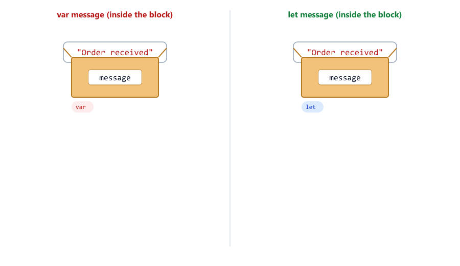
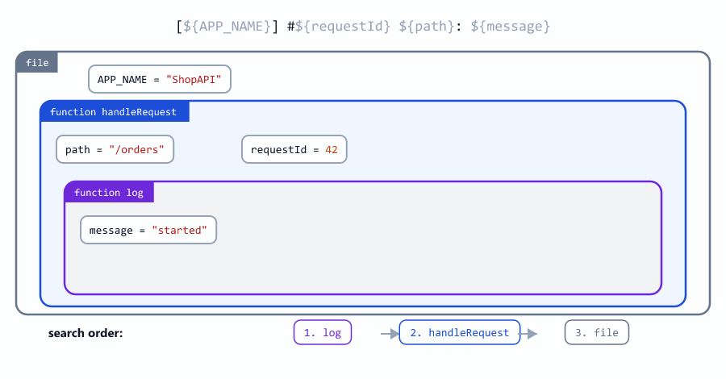
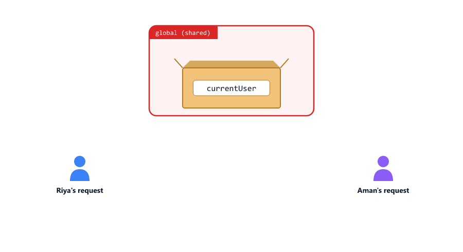
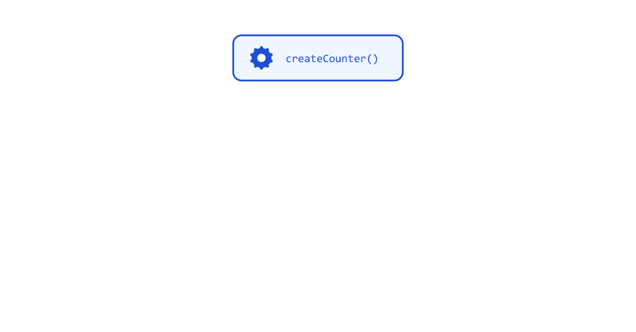
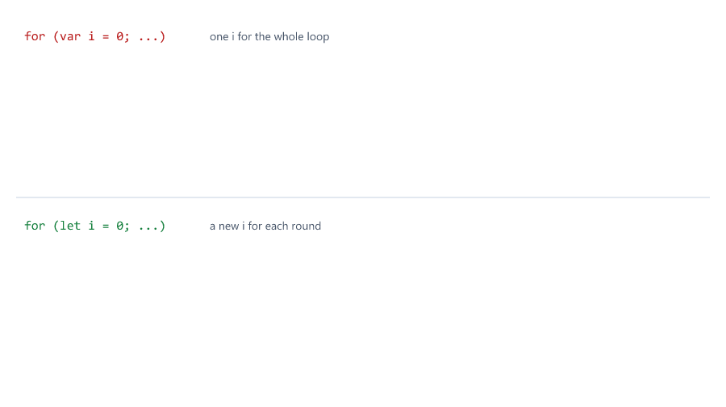

# Scope, Hoisting and Closures

## Table of Contents
- [What is Scope?](#what-is-scope)
- [Top-Level Scope in a Node.js File](#top-level-scope-in-a-nodejs-file)
- [Block Scope](#block-scope)
- [var Ignores Blocks](#var-ignores-blocks)
- [The Scope Chain](#the-scope-chain)
- [Scope Is Decided Where Code Is Written](#scope-is-decided-where-code-is-written)
- [Shadowing](#shadowing)
- [Forgetting let Creates a Global](#forgetting-let-creates-a-global)
- [Hoisting](#hoisting)
- [The Temporal Dead Zone](#the-temporal-dead-zone)
- [What is a Closure?](#what-is-a-closure)
- [Each Call Makes a New Closure](#each-call-makes-a-new-closure)
- [Private Data with Closures](#private-data-with-closures)
- [Closures in Loops: var vs let](#closures-in-loops-var-vs-let)
- [IIFE: Run a Function Right Away](#iife-run-a-function-right-away)
- [Closures in Node.js Code](#closures-in-nodejs-code)
- [Closures Keep Memory Alive](#closures-keep-memory-alive)
- [Mini Example 1: A Login Rate Limiter](#mini-example-1-a-login-rate-limiter)
- [Mini Example 2: Remembering Slow Results](#mini-example-2-remembering-slow-results)
- [Beginner Mistakes](#beginner-mistakes)
- [Practice Exercises](#practice-exercises)
- [Interview Questions](#interview-questions)

---

## What is Scope?

Sessions 06, 07 and 10 showed that a variable created inside `{ }` cannot be used outside it. The part of the code where a variable can be used is called its **scope**

scope-intro.js

```javascript
const APP_NAME = "ShopAPI";           // file scope: the whole file can use it

function handleOrder(orderId) {
  const status = "paid";              // function scope: only inside handleOrder

  if (status === "paid") {
    const message = `${APP_NAME}: order ${orderId} is ${status}`;   // block scope
    console.log(message);
  }

  console.log(APP_NAME, orderId, status);
}

handleOrder(101);
console.log(APP_NAME);
console.log(typeof status, typeof message);
```

Output

```text
ShopAPI: order 101 is paid
ShopAPI 101 paid
ShopAPI
undefined undefined
```

`typeof` on a name that does not exist gives `"undefined"` (Session 03), so the last line shows that `status` and `message` do not exist outside their scopes.


| Scope              | Created by                                       | In this example        | Can be used                |
| ------------------ | ------------------------------------------------ | ---------------------- | -------------------------- |
| File (top level)   | The file itself                                  | `APP_NAME`             | Everywhere in this file    |
| Function           | Every function                                   | `orderId`, `status`    | Only inside `handleOrder`  |
| Block              | The `{ }` of `if`, `for`, `while`, or a plain `{ }` | `message`           | Only inside that `if` block |

Think of scopes as rooms inside rooms, with windows that only look **out**. Two rules cover almost everything:

1. Inner code can use outer variables.
2. Outer code cannot use inner variables.

---

## Top-Level Scope in a Node.js File

A variable at the top of a file, outside every function and block, can be used by every function in that file

global-scope.js

```javascript
let requestCount = 0;   // top level: every function in this file can use it

function countRequest() {
  requestCount++;
}

function report() {
  console.log(`Requests so far: ${requestCount}`);
}

countRequest();
countRequest();
report();
```

Output

```text
Requests so far: 2
```

You may read that top-level variables are **global**. In Node.js they are not: the top level belongs only to **the file**. Another file cannot see `requestCount` unless you export it (Session 21; Node.js course, Session 04: Module Scope). You will see why in [Node.js wraps every file in a function](#nodejs-wraps-every-file-in-a-function).

The things that really are global live on an object called `globalThis`. Everything you have used without creating it, like `console`, `setTimeout` (Session 11) and `structuredClone` (Session 15), is there

global-this.js

```javascript
let requestCount = 0;

console.log(typeof globalThis.console);
console.log(typeof globalThis.setTimeout);
console.log(typeof globalThis.structuredClone);
console.log(typeof globalThis.requestCount);
```

Output

```text
object
function
function
undefined
```

`requestCount` is not on `globalThis`: it belongs to the file. That is good news, because two files can each have a `requestCount` without breaking each other.

Keep top-level variables few. Settings (`PORT`, `APP_NAME`) and shared data (like the `students` array and `nextId` in the Node.js course, Session 11) belong there. Everything else should live inside the function that uses it.

---

## Block Scope

`let` and `const` belong to the nearest `{ }` block: an `if`, a loop, or even a plain `{ }`

block-scope.js

```javascript
const orderTotal = 1200;

if (orderTotal >= 1000) {
  const discount = 100;
  console.log(`Discount: ${discount}`);
}

for (let i = 1; i <= 2; i++) {
  const line = `Item ${i}`;
  console.log(line);
}

{
  const temp = "a plain block works too";
  console.log(temp);
}

console.log(typeof discount, typeof line, typeof i, typeof temp);
```

Output

```text
Discount: 100
Item 1
Item 2
a plain block works too
undefined undefined undefined undefined
```

The loop variable `i` belongs to the loop. When the blocks end, `discount`, `line`, `i` and `temp` are all gone. Plain `{ }` blocks are legal but rare; you will mostly meet blocks through `if`, loops and functions.

Small scopes are good: a variable that exists only where it is needed cannot be changed by mistake somewhere else.

---

## var Ignores Blocks

Session 02 listed three problems with `var` and promised to show the third one here: `var` does not belong to blocks, only to functions

var-leaks.js

```javascript
const role = "admin";

if (role === "admin") {
  var canDelete = true;
  let canEdit = true;
}

console.log(canDelete);
console.log(typeof canEdit);

for (var i = 0; i < 3; i++) {
  // the loop body
}
console.log(i);

function setup() {
  var secret = "abc123";
}
setup();
console.log(typeof secret);
```

Output

```text
true
undefined
3
undefined
```

| Keyword          | Belongs to                           | Visible after an `if` or loop block? | Visible outside the function? |
| ---------------- | ------------------------------------ | ------------------------------------ | ----------------------------- |
| `let`, `const`   | The nearest block `{ }`              | No                                   | No                            |
| `var`            | The nearest function (or the file)   | **Yes**                              | No                            |

So `var` is **function-scoped**, while `let` and `const` are **block-scoped**.

This causes real bugs. A `var` inside a block is not a new variable, so it silently overwrites the outer one

var-overwrite.js

```javascript
var message = "Order received";

const items = 3;
if (items > 0) {
  var message = `Packing ${items} items`;   // NOT a new variable: the same message
}

console.log(message);
```

Output

```text
Packing 3 items
```

The "Order received" message is lost. With `let`, the inner `message` is a new variable that lives only in the block

let-no-overwrite.js

```javascript
let message = "Order received";

const items = 3;
if (items > 0) {
  let message = `Packing ${items} items`;   // a new variable, only inside the block
  console.log(message);
}

console.log(message);
```

Output

```text
Packing 3 items
Order received
```



This is why modern code (and the Node.js course) uses only `let` and `const`. You still need to understand `var`, because older code and many interview questions use it.

---

## The Scope Chain

Functions can be written inside other functions. When code uses a name, JavaScript looks for it in the current scope first, then in the scope around it, then the next one out, up to the file

scope-chain.js

```javascript
const APP_NAME = "ShopAPI";

function handleRequest(path) {
  const requestId = 42;

  function log(message) {
    console.log(`[${APP_NAME}] #${requestId} ${path}: ${message}`);
  }

  log("started");
  log("finished");
}

handleRequest("/orders");
```

Output

```text
[ShopAPI] #42 /orders: started
[ShopAPI] #42 /orders: finished
```

Where `log` finds each name

| Name         | In `log`          | In `handleRequest`  | In the file  |
| ------------ | ----------------- | ------------------- | ------------ |
| `message`    | Found (parameter) |                     |              |
| `requestId`  | Not here          | Found               |              |
| `path`       | Not here          | Found (parameter)   |              |
| `APP_NAME`   | Not here          | Not here            | Found        |



This path from inner to outer scopes is called the **scope chain**. The search always goes **outward**, never inward: `handleRequest` cannot use `message`, because `message` lives in `log`. If a name is not found anywhere on the chain, you get `ReferenceError: ... is not defined`.

---

## Scope Is Decided Where Code Is Written

The outer variables a function can see depend on **where the function is written**, not on where it is called

lexical-scope.js

```javascript
const label = "file";

function showLabel() {
  console.log(label);
}

function run() {
  const label = "run";
  showLabel();          // called from inside run...
}

run();
```

Output

```text
file
```

`showLabel` is called from inside `run`, but it was written at the top of the file. Its scope chain is `showLabel`, then the file. The `label` inside `run` is not on that chain.

This rule is called **lexical scope** ("lexical" means "about where the code is written"). It is the key to closures, later in this session. It also explains a common mistake: a helper function cannot see the variables of the function that calls it (see [Mistake 4](#mistake-4-expecting-a-helper-to-see-the-callers-variables)). Pass them as arguments instead.

---

## Shadowing

When an inner scope creates a variable with the same name as an outer one, the inner one **shadows** (hides) the outer one

shadowing.js

```javascript
const discount = 10;

function checkout(total) {
  const discount = 50;            // a new variable that hides the outer one
  return total - discount;
}

console.log(checkout(500));
console.log(discount);
```

Output

```text
450
10
```

Inside `checkout`, `discount` means the inner one (50). The outer `discount` is not changed, but `checkout` can no longer reach it by that name. Parameters shadow too: a parameter called `price` hides an outer `price`.

Shadowing is legal, but it makes code harder to read, and it causes one confusing error (see [The Temporal Dead Zone](#the-temporal-dead-zone)). Prefer different names, like `couponDiscount` and `memberDiscount`.

---

## Forgetting let Creates a Global

Assigning to a name that was never declared does **not** give an error. JavaScript quietly creates a global variable

accidental-global.js

```javascript
function handleLogin(name) {
  currentUser = name;             // no let or const!
  return `Welcome, ${currentUser}`;
}

console.log(handleLogin("Riya"));
console.log(currentUser);         // it leaked out of the function
```

Output

```text
Welcome, Riya
Riya
```

`currentUser` should have lived inside `handleLogin`. Instead it is now global, shared by the whole program. A server handles many users at the same time, so a shared variable like this can show one user's data to another user: one request sets it to "Riya", and another request changes it to "Aman" before the first one has finished.



The fix is to always use `let` or `const`. To make JavaScript catch the mistake for you, put `"use strict";` as the very first line of the file

strict.js

```javascript
"use strict";

function handleLogin(name) {
  currentUser = name;
  return `Welcome, ${currentUser}`;
}

console.log(handleLogin("Riya"));
```

Output

```text
D:\js-practice\strict.js:4
  currentUser = name;
              ^

ReferenceError: currentUser is not defined
```

**Strict mode** turns several silent mistakes into errors. For example, changing a frozen object (Session 15) is silently ignored in normal mode, but in strict mode it throws `TypeError: Cannot assign to read only property`. Normal Node.js files that use `require` are not strict unless you add the line. Files that use `import`/`export` (ES modules, Session 21) and classes (Session 17) are always strict.

---

## Hoisting

Before a file runs, JavaScript reads through it and sets up every variable and function declaration first. Only then does it run the code, line by line. This setting up early is called **hoisting**, as if the declarations were lifted to the top. Session 10 showed it for functions. Each kind of declaration is set up differently.

A `var` is set up with the value `undefined`

var-hoisting.js

```javascript
console.log(city);
var city = "Pune";
console.log(city);
```

Output

```text
undefined
Pune
```

JavaScript treats the file as if it were written like this

what-js-sees.js

```javascript
var city;              // 1. the declaration moves up, with the value undefined
console.log(city);
city = "Pune";         // 2. the value is given on the original line
console.log(city);
```

Output

```text
undefined
Pune
```

Only the declaration moves up; the value stays on its own line. This is the "you get `undefined` instead of a clear error" problem from Session 02.

A function stored in a `var` is `undefined` too, so calling it early does not say "not defined", but "not a function"

var-function-expression.js

```javascript
sendEmail("riya@example.com");

var sendEmail = function (to) {
  console.log(`Email sent to ${to}`);
};
```

Output

```text
D:\js-practice\var-function-expression.js:1
sendEmail("riya@example.com");
^

TypeError: sendEmail is not a function
```


| Declaration                    | Set up before the code runs as | Using it before its line gives                              |
| ------------------------------ | ------------------------------ | ----------------------------------------------------------- |
| `function name() { }`          | The whole function             | It works (Session 10)                                       |
| `var x = 5`                    | `undefined`                    | `undefined`, no error (a hidden bug)                        |
| `let x = 5`, `const x = 5`     | Exists, but locked             | `ReferenceError: Cannot access 'x' before initialization`   |
| `const fn = () => { }`         | Same as `const`                | `ReferenceError: Cannot access 'fn' before initialization`  |
| `var fn = function () { }`     | Same as `var`: `undefined`     | `TypeError: fn is not a function`                           |
| `class User { }` (Session 17)  | Same as `let`                  | `ReferenceError`                                            |

A simple habit makes hoisting stop mattering: use `let` and `const`, declare variables before you use them, and put helper functions near the top of the file.

---

## The Temporal Dead Zone

`let` and `const` are hoisted too, but they stay **locked** until their line runs. The time from the start of their scope until their line runs is called the **temporal dead zone** (TDZ). Session 02 promised to explain why it exists.

First, the proof that `let` is hoisted

tdz-shadow.js

```javascript
let total = 500;

function addShipping() {
  console.log(total);    // which total?
  let total = 50;
  return total;
}

addShipping();
```

Output

```text
D:\js-practice\tdz-shadow.js:4
  console.log(total);    // which total?
              ^

ReferenceError: Cannot access 'total' before initialization
```

If the inner `let total` did not exist until its own line, `console.log(total)` would find the outer `total` and print 500. Instead, JavaScript knows from the first line of `addShipping` that this function has its own `total`. That `total` is in its dead zone until `let total = 50;` runs.


"Temporal" means "about time". The dead zone depends on **when** code runs, not on where it is written. A function written above a `const` can use it, if the function is called after the `const` line has run

tdz-time.js

```javascript
function showLimit() {
  console.log(`Limit: ${LIMIT}`);
}

const LIMIT = 10;
showLimit();
```

Output

```text
Limit: 10
```

Called before the `const` line, the same function fails

tdz-time-early.js

```javascript
function showLimit() {
  console.log(`Limit: ${LIMIT}`);
}

showLimit();
const LIMIT = 10;
```

Output

```text
D:\js-practice\tdz-time-early.js:2
  console.log(`Limit: ${LIMIT}`);
                        ^

ReferenceError: Cannot access 'LIMIT' before initialization
```

Why does the TDZ exist?

- With `var`, using a variable too early gives `undefined`, and the program keeps running with a wrong value. The TDZ turns that hidden bug into a clear error, at the exact line.
- A `const` must have one value forever. If it were `undefined` first and `10` later, it would have had two values.

---

## What is a Closure?

Session 10 showed that each call of a function gets **fresh** variables, which are thrown away when the call ends (`countVisit()` printed 1, 1, 1). Session 11 showed a function factory, `makeDiscount(20)`, whose returned function still knew `percent` after `makeDiscount` had finished. Here is how that works

closure-counter.js

```javascript
function createCounter() {
  let count = 0;

  return function () {
    count++;
    return count;
  };
}

const nextVisit = createCounter();

console.log(nextVisit());
console.log(nextVisit());
console.log(nextVisit());
console.log(typeof count);
```

Output

```text
1
2
3
undefined
```

Step by step

| Step                           | What happens                                                              |
| ------------------------------ | ------------------------------------------------------------------------- |
| `createCounter()` runs         | A new `count` is created, set to 0                                        |
| It returns the inner function  | The inner function uses `count`, so it keeps a link to it                 |
| `createCounter` has finished   | Normally `count` would be thrown away. The inner function still needs it, so JavaScript keeps it |
| `nextVisit()`                  | Runs the inner function: `count` becomes 1                                |
| `nextVisit()` again            | The **same** `count` becomes 2, then 3                                    |
| `typeof count` outside         | `"undefined"`: no code outside can reach `count`                          |

A **closure** is a function together with the outer variables it remembers. Think of a backpack: when the inner function leaves `createCounter`, it carries `count` with it, and opens the backpack every time it runs.


This is lexical scope again: the inner function was written inside `createCounter`, so its scope chain includes `createCounter`'s variables, for as long as the function exists.

Compare it with the counter from Session 10 that kept `visits` at the top of the file. There, any code in the file could do `visits = 0` or `visits = -5`. Here, the only way to change `count` is to call `nextVisit()`.

---

## Each Call Makes a New Closure

Every call to `createCounter()` creates a new `count`, so each returned function has its own backpack

separate-counters.js

```javascript
function createCounter() {
  let count = 0;

  return function () {
    count++;
    return count;
  };
}

const orderCounter = createCounter();
const invoiceCounter = createCounter();

orderCounter();
orderCounter();
console.log(orderCounter());
console.log(invoiceCounter());
```

Output

```text
3
1
```



`orderCounter` was called three times and `invoiceCounter` only once. They share nothing. This is why `makeDiscount(20)` and `makeDiscount(5)` in Session 11 could live side by side without mixing up their `percent`.

---

## Private Data with Closures

A factory can return **several** functions that share the same variables. Return them in an object (Session 13), and you get an object with private data

wallet.js

```javascript
function createWallet(ownerName) {
  let balancePaise = 0;           // private: only the functions below can see it

  function deposit(amount) {
    if (amount <= 0) {
      return "Amount must be positive";
    }
    balancePaise += amount;
    return `Deposited ${amount}`;
  }

  function withdraw(amount) {
    if (amount > balancePaise) {
      return "Not enough balance";
    }
    balancePaise -= amount;
    return `Withdrew ${amount}`;
  }

  function getBalance() {
    return `${ownerName}: ${balancePaise} paise`;
  }

  return { deposit, withdraw, getBalance };
}

const wallet = createWallet("Riya");

console.log(wallet.deposit(50000));
console.log(wallet.withdraw(80000));
console.log(wallet.withdraw(20000));
console.log(wallet.getBalance());

console.log(wallet.balancePaise);
wallet.balancePaise = 99999999;   // only adds a new property to the object
console.log(wallet.getBalance());
```

Output

```text
Deposited 50000
Not enough balance
Withdrew 20000
Riya: 30000 paise
undefined
Riya: 30000 paise
```

- All three functions were created in the same call, so they share **one** `balancePaise`. A deposit is seen by `withdraw` and `getBalance`.
- The balance can only change through `deposit` and `withdraw`, and both check the rules first. Nobody can make the balance negative.
- `wallet.balancePaise` is `undefined`: the balance is a variable in the closure, not a property of the object. Setting `wallet.balancePaise` only adds a new, unused property; the real balance is still 30000.


A closure keeps a link to the **variable itself**, not a copy of its value. If the variable changes, every function that remembers it sees the new value (see [Mistake 7](#mistake-7-expecting-a-closure-to-remember-an-old-value)).

Session 17 shows another way to build objects with private data: classes with `#private` fields. Closures were the main way before classes existed, and you will still see them a lot in Node.js code.

---

## Closures in Loops: var vs let

This classic interview question combines closures, `var` and `setTimeout` (Session 11)

loop-var.js

```javascript
const emails = ["riya@example.com", "aman@example.com", "sara@example.com"];

for (var i = 0; i < emails.length; i++) {
  setTimeout(() => {
    console.log(`#${i}: sent to ${emails[i]}`);
  }, 100);
}
```

Output

```text
#3: sent to undefined
#3: sent to undefined
#3: sent to undefined
```

The three callbacks run after 100 ms, when the loop has long finished, and they read `i` at that moment.

- `var i` belongs to the whole file, not to the loop, so there is only **one** `i`. All three callbacks remember the same `i`, which is 3 after the loop, and `emails[3]` does not exist.
- `let i` is special in a `for` loop: each round of the loop gets its **own** `i`. Each callback remembers a different one.

loop-let.js

```javascript
const emails = ["riya@example.com", "aman@example.com", "sara@example.com"];

for (let i = 0; i < emails.length; i++) {
  setTimeout(() => {
    console.log(`#${i}: sent to ${emails[i]}`);
  }, 100);
}
```

Output

```text
#0: sent to riya@example.com
#1: sent to aman@example.com
#2: sent to sara@example.com
```



`forEach` (Session 12) avoids the problem too, because each call of the callback gets its own `email` and `i` parameters

loop-foreach.js

```javascript
const emails = ["riya@example.com", "aman@example.com", "sara@example.com"];

emails.forEach((email, i) => {
  setTimeout(() => {
    console.log(`#${i}: sent to ${email}`);
  }, 100);
});
```

Output

```text
#0: sent to riya@example.com
#1: sent to aman@example.com
#2: sent to sara@example.com
```

---

## IIFE: Run a Function Right Away

An **IIFE** (Immediately Invoked Function Expression, said "iffy") is a function that is called right where it is created

iife.js

```javascript
(function () {
  const startedAt = "09:00";
  console.log(`Setup ran at ${startedAt}`);
})();

(() => {
  console.log("An arrow function can run right away too");
})();

console.log(typeof startedAt);
```

Output

```text
Setup ran at 09:00
An arrow function can run right away too
undefined
```

| Part                        | Meaning                                                          |
| --------------------------- | ---------------------------------------------------------------- |
| `(function () { ... })`     | The brackets turn the function into an expression, a value (Session 10) |
| `()` at the end             | Calls it, right away                                             |
| Variables inside            | Private: `startedAt` does not exist outside                      |

Before `let`, `const` and modules existed, `var` leaked everywhere, so programmers wrapped code in an IIFE just to get a private scope. Today you will mostly see an IIFE when a closure is needed only **once**. Here, a single order-id generator, with no factory function left lying around

iife-id.js

```javascript
const nextOrderId = (() => {
  let lastId = 1000;

  return () => {
    lastId++;
    return `ORD-${lastId}`;
  };
})();

console.log(nextOrderId());
console.log(nextOrderId());
```

Output

```text
ORD-1001
ORD-1002
```


In Session 25 you will meet `(async () => { ... })();`, an IIFE used to run `await` code at the top level of a file.

### Node.js wraps every file in a function

Top-level variables in a Node.js file are not global. Here is why: before running a file, Node.js wraps your whole code in a function, like this

```text
(function (exports, require, module, __filename, __dirname) {
  // your file's code goes here
});
```

So your "top-level" variables are really local variables of that function, and other files cannot see them (Node.js course, Session 04). It also explains where `require`, `module` and `__dirname` come from: they are the parameters of this function

module-wrapper.js

```javascript
console.log(typeof require);
console.log(typeof module);
console.log(typeof __dirname);
```

Output

```text
function
object
string
```

This function is called the **module wrapper**. You never created `require`, yet every Node.js file can use it (Session 21; Node.js course, Sessions 04 and 06).

---

## Closures in Node.js Code

You have already used closures without knowing the name. Every function that uses a variable from outside itself remembers it

| Where                                             | Example                                         | What the function remembers                     |
| ------------------------------------------------- | ----------------------------------------------- | ----------------------------------------------- |
| Function factories (Session 11)                   | `makeDiscount(20)`, `createLogger("DB")`        | `percent`, the prefix                           |
| Middleware factories (Node.js course, Session 14) | `requireRole("admin")`                          | The allowed role                                |
| Route handlers (Node.js course, Session 15)       | `app.post("/students", (req, res) => { ... })` | The `students` array and `nextId` at the top of the file |
| Timer callbacks (Session 22)                      | `setTimeout(() => { ... }, 1000)`               | The variables around it, until it runs          |
| Event listeners (Node.js course, Session 08)      | `emitter.on("order", () => { ... })`            | The variables around it, as long as it listens  |

`requireRole("admin")` runs once, when the server starts, and returns the real middleware. That middleware runs on every request, and still knows `"admin"`: that is a closure.

---

## Closures Keep Memory Alive

A closure keeps its variables in memory for as long as the function that remembers them exists. Usually this is exactly what you want: a counter must keep its count.

On a server that runs for weeks, be careful with closures that **keep adding** to an object or array, like a cache or a list of every request seen. They never shrink, so the server uses more and more memory until it crashes. This is called a **memory leak**. Give such stores a size limit, as [Mini Example 2](#mini-example-2-remembering-slow-results) does, or clear them from time to time (timers, Session 22).

---

## Mini Example 1: A Login Rate Limiter

A rate limiter stops one user from trying to log in again and again, for example by guessing passwords. Each user gets 3 tries, and the 4th gets `429 Too Many Requests`. The counts must be remembered between requests and must be private, which is a perfect job for a closure

rate-limiter.js

```javascript
function createRateLimiter(maxRequests) {
  const counts = {};                 // private: user id -> number of requests

  return function (userId) {
    counts[userId] = (counts[userId] ?? 0) + 1;
    return counts[userId] <= maxRequests;
  };
}

const isAllowed = createRateLimiter(3);

function handleLogin(userId) {
  if (!isAllowed(userId)) {
    return `429 Too Many Requests: ${userId}`;
  }
  return `200 OK: login attempt for ${userId}`;
}

console.log(handleLogin("riya"));
console.log(handleLogin("riya"));
console.log(handleLogin("aman"));
console.log(handleLogin("riya"));
console.log(handleLogin("riya"));
console.log(handleLogin("aman"));
```

Output

```text
200 OK: login attempt for riya
200 OK: login attempt for riya
200 OK: login attempt for aman
200 OK: login attempt for riya
429 Too Many Requests: riya
200 OK: login attempt for aman
```


| Part                               | Job                                                                |
| ---------------------------------- | ------------------------------------------------------------------ |
| `createRateLimiter(3)`             | Runs **once**, when the server starts; creates a private `counts` object |
| The returned function `isAllowed`  | Runs on every request; remembers `counts` and `maxRequests`        |
| `counts[userId] ?? 0`              | The first request from a user starts from 0 (Session 04)           |
| `handleLogin`                      | Answers 429 when the limit is passed                               |

Riya and Aman have separate counts in the same `counts` object, so Aman is not blocked by Riya's attempts. No other code can reset or change `counts`.

Real rate limiters also reset the counts every minute, with a timer (Session 22). The Node.js course uses the `express-rate-limit` package, which does all of this, with the same limit of 3 (Session 14). The limiter must be created **once**, outside the request handler (see [Mistake 8](#mistake-8-creating-the-closure-inside-the-request-handler)).

---

## Mini Example 2: Remembering Slow Results

Looking up a shipping cost in a courier database is slow. If 1000 customers from the same pincode check out, there is no need to ask the database 1000 times. A closure can remember the answers

shipping-cache.js

```javascript
let lookups = 0;

function getShippingCost(pincode) {
  lookups++;
  console.log(`  (looking up ${pincode} in the courier database...)`);
  return pincode.startsWith("4") ? 40 : 70;
}

function remember(slowFunction, maxSize) {
  const saved = {};
  let savedCount = 0;

  return function (key) {
    if (key in saved) {
      return saved[key];
    }
    const result = slowFunction(key);
    if (savedCount < maxSize) {
      saved[key] = result;
      savedCount++;
    }
    return result;
  };
}

const shippingCost = remember(getShippingCost, 100);

console.log(`411001: Rs ${shippingCost("411001")}`);
console.log(`411001: Rs ${shippingCost("411001")}`);
console.log(`110001: Rs ${shippingCost("110001")}`);
console.log(`411001: Rs ${shippingCost("411001")}`);
console.log(`Database lookups: ${lookups}`);
```

Output

```text
  (looking up 411001 in the courier database...)
411001: Rs 40
411001: Rs 40
  (looking up 110001 in the courier database...)
110001: Rs 70
411001: Rs 40
Database lookups: 2
```


- `remember(getShippingCost, 100)` returns a new function that remembers `saved`, `savedCount`, `slowFunction` and `maxSize`.
- The first call for "411001" finds nothing saved, so it calls the slow function and saves the answer.
- Later calls for "411001" return the saved answer at once. `in` checks whether the key exists (Session 13).
- 4 calls, but only 2 database lookups.
- `maxSize` stops the cache from growing forever (see [Closures Keep Memory Alive](#closures-keep-memory-alive)).

Remembering the result of a function for the same input is called **memoization**. Use it only for functions that always return the same result for the same input. Session 20 shows `Map`, a better store for caches like this.

---

## Beginner Mistakes

### Mistake 1: Using var and expecting block scope

**Incorrect:** `var message` inside an `if` block overwrites the outer `message` (see [var Ignores Blocks](#var-ignores-blocks)).

**Correct:** use `let` or `const`; they belong to the block.

### Mistake 2: A var loop variable inside a callback

**Incorrect:** `for (var i = 0; ...)` with a `setTimeout` inside prints the last value of `i` every time (see [Closures in Loops](#closures-in-loops-var-vs-let)).

**Correct:** `for (let i = 0; ...)`, or `forEach`.

### Mistake 3: Forgetting let or const

**Incorrect:** `currentUser = name;` inside a function creates a global variable, shared by every request (see [Forgetting let Creates a Global](#forgetting-let-creates-a-global)).

**Correct:** `const currentUser = name;`. Add `"use strict";` at the top of the file, so the mistake becomes an error.

### Mistake 4: Expecting a helper to see the caller's variables

**Incorrect**

```javascript
function logOrder() {
  console.log(`Order ${orderId} saved`);
}

function saveOrder() {
  const orderId = 7;
  logOrder();
}

saveOrder();
```

```text
ReferenceError: orderId is not defined
```

`logOrder` was written at the top level, so it looks there, not inside `saveOrder` (see [Scope Is Decided Where Code Is Written](#scope-is-decided-where-code-is-written)). **Correct:** pass the value as an argument: `function logOrder(orderId) { ... }` and `logOrder(orderId);`.

### Mistake 5: Using the outer variable while declaring an inner one with the same name

**Incorrect**

```javascript
let total = 500;

if (total > 0) {
  let total = total + 50;
  console.log(total);
}
```

```text
ReferenceError: Cannot access 'total' before initialization
```

The inner `let total` shadows the outer one in the whole block, so the `total` on the right side is the inner one, still in its dead zone. **Correct:** use a new name: `const totalWithShipping = total + 50;`.

### Mistake 6: Calling a var function before its line

**Incorrect:** `sendEmail(...)` above `var sendEmail = function (to) { ... };` gives `TypeError: sendEmail is not a function` (see [Hoisting](#hoisting)).

**Correct:** call a function only after its line, or use a function declaration, which is fully hoisted. With `const` instead of `var`, an early call at least gives a clear error.

### Mistake 7: Expecting a closure to remember an old value

**Incorrect**

```javascript
let status = "pending";

setTimeout(() => {
  console.log(`Order is ${status}`);
}, 100);

status = "shipped";
```

```text
Order is shipped
```

The callback remembers the variable `status`, not the value it had when the callback was created. By the time the callback runs, `status` is "shipped". **Correct:** if you need the value from that moment, copy it into a `const` first, `const statusNow = status;`, and use `statusNow` in the callback.

### Mistake 8: Creating the closure inside the request handler

**Incorrect**

```javascript
function handleLogin(userId) {
  const isAllowed = createRateLimiter(3);   // a NEW limiter on every request!
  if (!isAllowed(userId)) {
    return `429 Too Many Requests: ${userId}`;
  }
  return `200 OK: login attempt for ${userId}`;
}

console.log(handleLogin("riya"));
console.log(handleLogin("riya"));
console.log(handleLogin("riya"));
console.log(handleLogin("riya"));
```

```text
200 OK: login attempt for riya
200 OK: login attempt for riya
200 OK: login attempt for riya
200 OK: login attempt for riya
```

Each request creates a new limiter with a new, empty `counts`, so nobody is ever blocked. **Correct:** create the limiter once, outside the handler, as in [Mini Example 1](#mini-example-1-a-login-rate-limiter). The Node.js course does the same: `const limiter = rateLimit({ ... })` runs once, and `app.use("/api", limiter)` uses it on every request (Session 14).

### Mistake 9: Expecting the object to hold the private variable

**Incorrect:** using `wallet.balancePaise` to read or change the balance. It is `undefined`, and setting it changes nothing (see [Private Data with Closures](#private-data-with-closures)).

**Correct:** read and change private data only through the returned functions, like `getBalance()`.

### Mistake 10: A line starting with ( after a line without a semicolon

**Incorrect**

```javascript
const total = 500
(function () {
  console.log("Setup done");
})();
```

```text
TypeError: 500 is not a function
```

Without the `;`, JavaScript reads the two lines as `500(function () { ... })`, which tries to call 500. **Correct:** end every statement with `;`, as this course does.

### Mistake 11: A closure cache that never stops growing

**Incorrect:** saving every result in a closure on a long-running server, with no limit.

**Correct:** limit the size (see [Mini Example 2](#mini-example-2-remembering-slow-results)), or clear old entries from time to time.

---

## Practice Exercises

### Exercise 1

Before running it, predict what this prints: `let a = 1; var b = 2; if (a > 0) { let a = 10; var b = 20; } console.log(a, b);`. Then run it and explain each value.

### Exercise 2

Create an empty array `tasks`. In a `for (var i = 0; i < 3; i++)` loop, push `() => i` into it. After the loop, print `tasks.map((task) => task())`. Then change `var` to `let` and compare. Explain the difference in one sentence.

### Exercise 3

Write `createCounter(start, step)` that returns an object with three functions: `next()`, `reset()` and `current()`. For `createCounter(10, 5)`, `next()` gives 15, then 20, and `reset()` sets it back to 10.

### Exercise 4

Write `createIdGenerator(prefix)` that returns ids like `INV-0001`, `INV-0002` (use `padStart`, Session 08). Make one generator for `"INV"` and one for `"ORD"`, and show that they count separately.

### Exercise 5

Write `once(fn)`: it returns a function that calls `fn` only the first time and returns that first result on every later call. Test it with a `connectToDatabase()` function that prints "Connecting..." and returns "connected". Calling it three times must print "Connecting..." only once.

### Exercise 6

Change `createRateLimiter` from [Mini Example 1](#mini-example-1-a-login-rate-limiter) to return `{ isAllowed, remaining }`, where `remaining(userId)` returns how many tries the user has left. Print it after each login attempt.

### Exercise 7

Add `"use strict";` to the top of `accidental-global.js` and run it. Fix the error. Then add a `handleLogout()` function that also forgets `let`, and check that strict mode catches it too.

### Exercise 8

Predict, then run: `console.log(typeof greet, typeof sayHi, typeof city);` written above `function greet() {}`, `var sayHi = () => {};` and `var city = "Pune";`. Then change both `var` to `let` and predict again.

---

## Interview Questions

### What is scope in JavaScript?

Scope is the part of the code where a variable can be used. There is the top-level scope (in Node.js, the file), function scope and block scope. Inner scopes can use outer variables; outer scopes cannot use inner ones.

### What is the difference between the scope of var, let and const?

`var` is function-scoped: it ignores `if` and loop blocks, so it is visible in the whole function. `let` and `const` are block-scoped: they exist only inside the nearest `{ }`. `var` is also hoisted with the value `undefined`, while `let` and `const` stay in the temporal dead zone until their line runs.

### What is the scope chain?

When code uses a name, JavaScript looks for it in the current scope, then in each outer scope in turn, up to the top level. The first match wins. If nothing matches, it throws `ReferenceError: x is not defined`. The search only goes outward.

### What is lexical scope?

A function's outer scopes are decided by where the function is written in the code, not by where it is called. A function written at the top of a file cannot see the local variables of a function that calls it.

### What is hoisting?

Before running code, JavaScript sets up all the declarations in each scope. Function declarations are set up completely, so they can be called before their line. `var` variables are set up with `undefined`. `let`, `const` and `class` are set up, but stay uninitialized until their line runs.

### Are let and const hoisted?

Yes. They are known from the start of their scope, but cannot be used until their line runs. Proof: with an outer `let total = 500`, a function whose first line is `console.log(total)` and second line is `let total = 50` throws "Cannot access 'total' before initialization" instead of printing 500.

### What is the temporal dead zone?

The time between the start of a scope and the line that declares a `let`, `const` or `class` in it. Using the variable during that time throws a `ReferenceError`. Even `typeof x`, which is safe for names that do not exist at all, throws in the TDZ. It exists to turn use-before-assignment bugs into clear errors and to stop a `const` from having two values.

### What is a closure?

A function together with the variables of the scopes around the place where it was created. The function can keep using those variables even after the outer function has returned. Every JavaScript function is a closure, but the word matters most when a function is returned or passed somewhere else and still uses outer variables.

### How do closures make private variables?

A factory function declares a variable and returns functions that use it. Code outside cannot reach the variable; it can only call the returned functions, which check the rules before changing it. Example: `createWallet` returning `deposit`, `withdraw` and `getBalance`.

### Why does a for loop with var and setTimeout print the same number every time?

`var` creates one variable for the whole function or file, so all the callbacks remember the same `i`. They run after the loop has finished, when `i` has its final value. With `let`, each round of the loop gets its own `i`, so each callback remembers a different value.

### What is an IIFE and why was it used?

An Immediately Invoked Function Expression: `(function () { ... })();`. It runs once, right away, and its variables are private. Before `let`, `const` and modules, it was the main way to stop `var` variables from leaking into the global scope. Today it is used for one-time setup, for creating a single closure, and as `(async () => { ... })();` to run async code at the top level.

### What happens if you assign to a variable that was never declared?

In normal (sloppy) mode, JavaScript silently creates a global variable, which can leak data between requests on a server. In strict mode (`"use strict";`, ES modules and classes), it throws `ReferenceError: x is not defined`.

### Why are top-level variables in a Node.js file not global?

Node.js wraps every CommonJS file in a function, `(function (exports, require, module, __filename, __dirname) { ... })`, before running it. Top-level variables are local variables of that function. This module wrapper is also why `require` and `__dirname` are available in every file.

### Can closures cause memory leaks?

Yes. A closure keeps its variables alive as long as the function exists. If a long-lived closure keeps adding to an object or array (a cache, a list of requests), memory grows until the server crashes. Limit the size, remove old entries, or let the function go when it is no longer needed.
