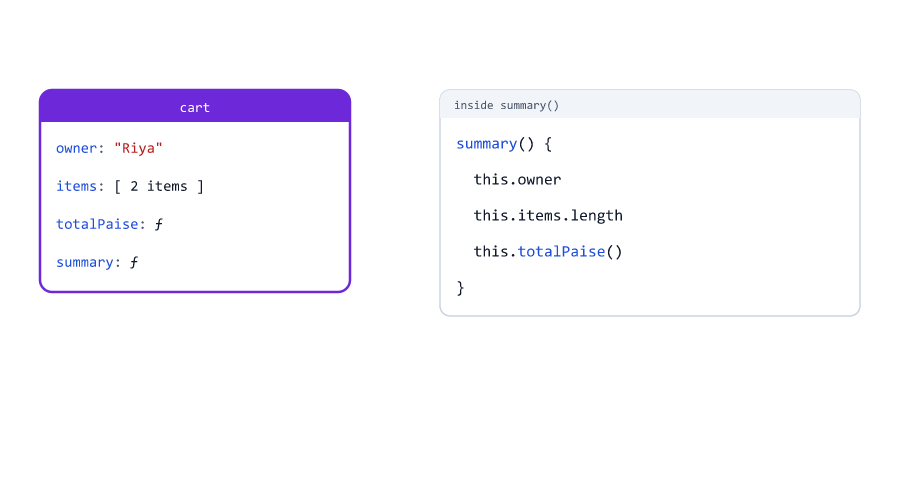
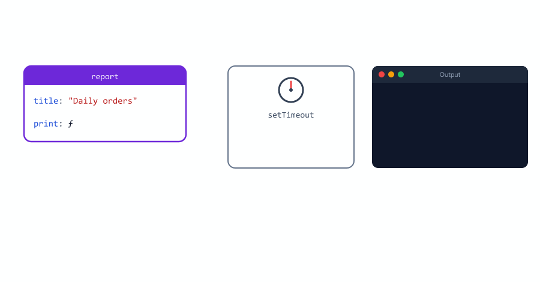
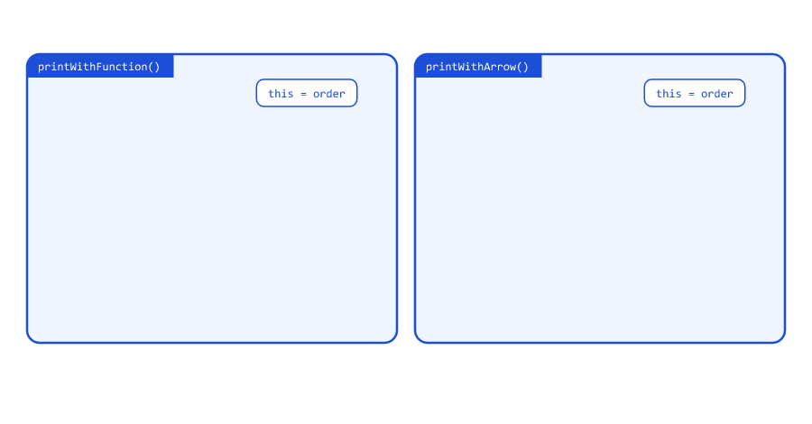
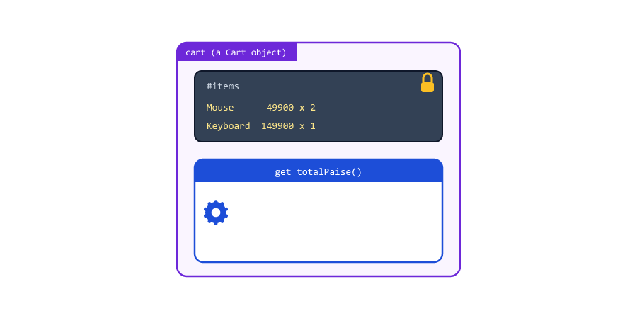
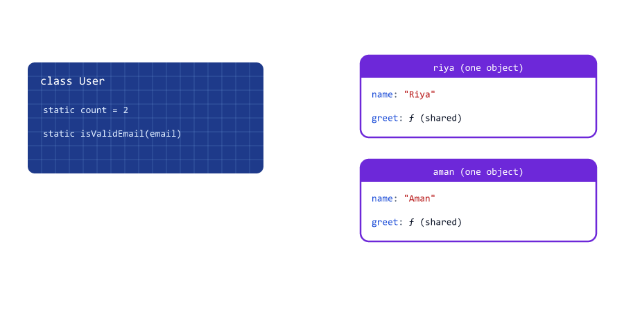
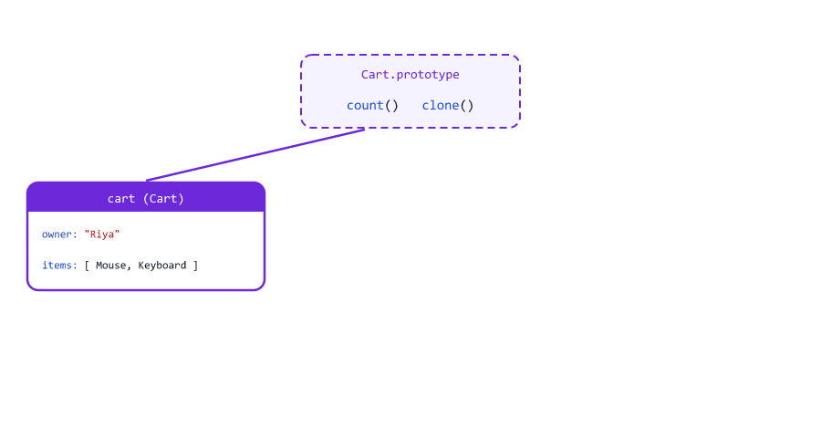
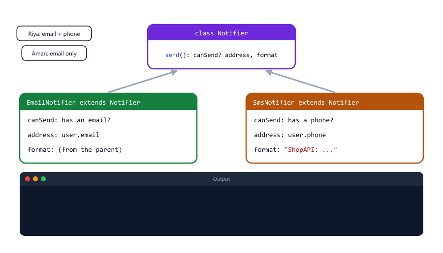

# this, Constructors and Classes

> **Session 17 of 25** | Part 2: Building Blocks | [All sessions](README.md#course-outline)

## Table of Contents
- [What is this?](#what-is-this)
- [this Is Decided When the Function Is Called](#this-is-decided-when-the-function-is-called)
- [Losing this](#losing-this)
- [Arrow Functions Have No Own this](#arrow-functions-have-no-own-this)
- [Constructor Functions and new](#constructor-functions-and-new)
- [Classes](#classes)
- [Methods Are Shared Between Objects](#methods-are-shared-between-objects)
- [Class Fields](#class-fields)
- [Private Fields](#private-fields)
- [Getters and Setters](#getters-and-setters)
- [Static Methods and Properties](#static-methods-and-properties)
- [Inheritance with extends and super](#inheritance-with-extends-and-super)
- [instanceof](#instanceof)
- [Classes Cannot Be Used Before Their Line](#classes-cannot-be-used-before-their-line)
- [Copying an Object Made from a Class](#copying-an-object-made-from-a-class)
- [Class, Object or Factory Function?](#class-object-or-factory-function)
- [Mini Example 1: A User Store](#mini-example-1-a-user-store)
- [Mini Example 2: Notification Senders](#mini-example-2-notification-senders)
- [Beginner Mistakes](#beginner-mistakes)
- [Practice Exercises](#practice-exercises)
- [Interview Questions](#interview-questions)

---

## What is this?

Session 13 promised a `cart.total()` method that works with the cart's **own** data. Inside a method, the keyword `this` means "the object this method was called on"

this-method.js

```javascript
const cart = {
  owner: "Riya",
  items: [
    { name: "Mouse", pricePaise: 49900, qty: 2 },
    { name: "Keyboard", pricePaise: 149900, qty: 1 },
  ],

  totalPaise() {
    return this.items.reduce((sum, item) => sum + item.pricePaise * item.qty, 0);
  },

  summary() {
    return `${this.owner}: ${this.items.length} items, Rs ${this.totalPaise() / 100}`;
  },
};

console.log(cart.totalPaise());
console.log(cart.summary());
```

Output

```text
249700
Riya: 2 items, Rs 2497
```

`cart.summary()` is called on `cart`, so inside `summary`, `this` is `cart`: `this.owner` is `cart.owner`, and `this.totalPaise()` calls another method of the same object.



Why not just write `cart.owner` inside the method? Because then the method only works for that one variable. With `this`, the same method works for **any** object it is called on, which is what makes classes possible, later in this session.

---

## this Is Decided When the Function Is Called

`this` is not fixed when a function is written. It is decided **each time the function is called**, by what is in front of the dot

this-shared.js

```javascript
function describe() {
  return `${this.name} costs Rs ${this.pricePaise / 100}`;
}

const mouse = { name: "Mouse", pricePaise: 49900, describe };
const keyboard = { name: "Keyboard", pricePaise: 149900, describe };

console.log(mouse.describe());
console.log(keyboard.describe());
```

Output

```text
Mouse costs Rs 499
Keyboard costs Rs 1499
```

There is only one `describe` function (shorthand from Session 13 puts it in both objects). Called as `mouse.describe()`, `this` is `mouse`; called as `keyboard.describe()`, `this` is `keyboard`.

| How the function is called          | `this` is                                                    |
| ----------------------------------- | ------------------------------------------------------------ |
| `cart.summary()`                    | `cart`, the object before the dot                            |
| `new Product(...)`                  | The new object being created (see [Constructor Functions](#constructor-functions-and-new)) |
| `print()`, with no object           | `undefined` in classes and strict mode (Session 16); the global object in normal files |
| An arrow function                   | The `this` of the code around it (see [Arrow Functions](#arrow-functions-have-no-own-this)) |
| `fn.bind(obj)`                      | Always `obj`                                                 |

---

## Losing this

The rule "the object before the dot" has a surprising side: if there is **no** dot when the function runs, there is no object

this-lost.js

```javascript
const report = {
  title: "Daily orders",
  print() {
    console.log(`Report: ${this.title}`);
  },
};

report.print();               // this = report

const print = report.print;   // copies only the function, not the object
print();                      // this = no object
```

Output

```text
Report: Daily orders
Report: undefined
```

`const print = report.print` copies only the function. The function does not remember which object it came from, so `print()` runs with no object, and `this.title` is `undefined`.

This happens all the time when a method is passed as a **callback** (Session 11): the other function receives only the function, and calls it without your object

this-callback.js

```javascript
const report = {
  title: "Daily orders",
  print() {
    console.log(`Report: ${this.title}`);
  },
};

setTimeout(report.print, 100);                // passes only the function
setTimeout(() => report.print(), 200);        // calls it on report
setTimeout(report.print.bind(report), 300);   // a copy with this fixed to report
```

Output

```text
Report: undefined
Report: Daily orders
Report: Daily orders
```



| Fix                              | How it works                                                     |
| -------------------------------- | ---------------------------------------------------------------- |
| `() => report.print()`           | Pass an arrow function that calls the method **with** the dot. The simplest fix |
| `report.print.bind(report)`      | `bind` makes a copy of the function whose `this` is always `report` |

In Express, the same bug appears as `app.get("/orders", orderController.list)` when `list` uses `this`: every request crashes. In a class (strict mode) the result is not `undefined`, but an error (see [Mistake 3](#mistake-3-passing-a-method-as-a-callback)).

---

## Arrow Functions Have No Own this

Session 10 said arrow functions do not have their own `this`. An arrow function uses the `this` of the code **around** it, like any other outside variable (Session 16). That makes arrow functions bad methods

arrow-method.js

```javascript
const shop = {
  name: "ShopAPI",

  normalGreet() {
    return `Welcome to ${this.name}`;
  },

  arrowGreet: () => {
    return `Welcome to ${this.name}`;
  },
};

console.log(shop.normalGreet());
console.log(shop.arrowGreet());
```

Output

```text
Welcome to ShopAPI
Welcome to undefined
```

`arrowGreet` was written at the top level of the file, so its `this` is the file's `this` (in a Node.js file, an empty object), not `shop`.

But inside a method, the same rule makes arrow functions the **right** choice for callbacks

arrow-inside-method.js

```javascript
const order = {
  id: "ORD-1001",
  items: ["Mouse", "Keyboard"],

  printWithFunction() {
    this.items.forEach(function (item) {
      console.log(`${this.id}: ${item}`);   // a normal function gets its own this
    });
  },

  printWithArrow() {
    this.items.forEach((item) => {
      console.log(`${this.id}: ${item}`);   // an arrow uses the method's this
    });
  },
};

order.printWithFunction();
order.printWithArrow();
```

Output

```text
undefined: Mouse
undefined: Keyboard
ORD-1001: Mouse
ORD-1001: Keyboard
```



| Use                                    | Write it as                   |
| -------------------------------------- | ----------------------------- |
| A method of an object or class         | A normal method: `print() { ... }` |
| A callback inside a method             | An arrow function: `(item) => { ... }` |

The Node.js course follows this rule: Mongoose methods that use `this` are written with `function () { ... }`, never as arrow functions (Node.js course, Sessions 21 and 22).

---

## Constructor Functions and new

Sessions 12 and 13 built many objects of the same shape by hand. Before classes existed, JavaScript used a **constructor function** for that: a normal function, called with `new`

constructor-function.js

```javascript
function Product(name, pricePaise) {
  this.name = name;
  this.pricePaise = pricePaise;
}

const mouse = new Product("Mouse", 49900);
const keyboard = new Product("Keyboard", 149900);

console.log(mouse);
console.log(keyboard.name);
```

Output

```text
Product { name: 'Mouse', pricePaise: 49900 }
Keyboard
```

What `new Product("Mouse", 49900)` does

| Step | What happens                                            |
| ---- | ------------------------------------------------------- |
| 1    | Creates a new, empty object `{}`                        |
| 2    | Runs `Product` with `this` set to that new object       |
| 3    | The function adds properties: `this.name = name`, ...   |
| 4    | Returns the new object, which is stored in `mouse`      |


Constructor names start with a capital letter (PascalCase, Session 02), so you know to call them with `new`. You will use `new` with built-in constructors all the time

| Code                                | Creates                      | Where                                |
| ----------------------------------- | ---------------------------- | ------------------------------------ |
| `new Date()`                        | A date                       | Session 19                           |
| `new Map()`, `new Set()`            | A map, a set                 | Session 20                           |
| `new Promise(...)`                  | A promise                    | Session 24                           |
| `new URL(req.url, ...)`             | A parsed URL                 | Node.js course, Session 09           |
| `new MongoClient(uri)`, `new ObjectId(id)` | A database client, an id | Node.js course, Session 17      |

Without `new`, a constructor function is just a normal call: `this` is the global object, the properties land there, and the function returns `undefined` (see [Mistake 2](#mistake-2-forgetting-new-with-a-constructor-function)). Classes fix this.

---

## Classes

A **class** is the modern way to write a constructor. It keeps the data setup and the methods together, in one block

class-basic.js

```javascript
class User {
  constructor(name, email) {
    this.name = name;
    this.email = email;
  }

  greet() {
    return `Hi ${this.name}!`;
  }
}

const riya = new User("Riya", "riya@example.com");
const aman = new User("Aman", "aman@example.com");

console.log(riya);
console.log(aman.greet());
console.log(typeof User);
```

Output

```text
User { name: 'Riya', email: 'riya@example.com' }
Hi Aman!
function
```

| Part                       | Meaning                                                           |
| -------------------------- | ----------------------------------------------------------------- |
| `class User { }`           | A blueprint for user objects. Name in PascalCase                  |
| `constructor(name, email)` | Runs once for every `new User(...)`, to set up the new object     |
| `this.name = name`         | Stores data on the new object (`this` is the new object)          |
| `greet() { }`              | A method every user object can use. No `function` keyword, no commas |
| `new User(...)`            | Creates one object from the blueprint. Each one is an **instance** |


`typeof User` is `"function"`: a class is a nicer way to write a constructor function, not a new kind of value. Calling a class without `new` is an error, not a silent bug (see [Mistake 1](#mistake-1-forgetting-new-with-a-class)). The Node.js course creates objects from classes with `new` too: `new Student({ ... })` with Mongoose (Session 19).

---

## Methods Are Shared Between Objects

Class methods are not copied into every object. They are stored **once**, and every instance uses the same function

methods-shared.js

```javascript
class User {
  constructor(name) {
    this.name = name;
  }

  greet() {
    return `Hi ${this.name}!`;
  }
}

function OldUser(name) {
  this.name = name;
  this.greet = function () {
    return `Hi ${this.name}!`;
  };
}

const a = new User("Riya");
const b = new User("Aman");
console.log(a.greet === b.greet);
console.log(a.greet === User.prototype.greet);
console.log(Object.keys(a));

const c = new OldUser("Riya");
const d = new OldUser("Aman");
console.log(c.greet === d.greet);
console.log(Object.keys(c));
```

Output

```text
true
true
[ 'name' ]
false
[ 'name', 'greet' ]
```

Every class has a hidden object, `User.prototype`, that holds its methods. When you call `a.greet()`, JavaScript first looks for `greet` on `a` itself. It is not there (`Object.keys(a)` shows only `name`), so JavaScript looks on `User.prototype` and finds it. This lookup is called the **prototype chain**.


`OldUser` creates a new `greet` function inside every object. With 10,000 users in memory, that is 10,000 copies of the same function. Classes avoid this automatically.

---

## Class Fields

Properties that every new object starts with can be written directly in the class body, as **fields**

class-fields.js

```javascript
class Order {
  status = "pending";        // a field: every new order starts with these
  items = [];

  constructor(customer) {
    this.customer = customer;
  }

  addItem(name) {
    this.items.push(name);
  }
}

const first = new Order("Riya");
const second = new Order("Aman");
first.addItem("Mouse");

console.log(first);
console.log(second);
```

Output

```text
Order { status: 'pending', items: [ 'Mouse' ], customer: 'Riya' }
Order { status: 'pending', items: [], customer: 'Aman' }
```

Fields are set up for **each** new object, before the constructor runs. So `first` and `second` get two different `items` arrays: adding to one does not change the other (the shared-array bug from Session 15 cannot happen here). Unlike methods, fields are data, so every object gets its own.

---

## Private Fields

Session 16 kept a wallet balance private with a closure. Classes have a built-in way: a field whose name starts with `#` is **private**, and only code inside the class can use it

private-fields.js

```javascript
class Wallet {
  #balancePaise = 0;           // private: only code inside the class can use it

  constructor(ownerName) {
    this.ownerName = ownerName;
  }

  deposit(amount) {
    if (amount <= 0) {
      return "Amount must be positive";
    }
    this.#balancePaise += amount;
    return `Deposited ${amount}`;
  }

  withdraw(amount) {
    if (amount > this.#balancePaise) {
      return "Not enough balance";
    }
    this.#balancePaise -= amount;
    return `Withdrew ${amount}`;
  }

  getBalance() {
    return `${this.ownerName}: ${this.#balancePaise} paise`;
  }
}

const wallet = new Wallet("Riya");

console.log(wallet.deposit(50000));
console.log(wallet.withdraw(80000));
console.log(wallet.withdraw(20000));
console.log(wallet.getBalance());
console.log(wallet);
console.log(wallet.balancePaise);
```

Output

```text
Deposited 50000
Not enough balance
Withdrew 20000
Riya: 30000 paise
Wallet { ownerName: 'Riya' }
undefined
```

The output is the same as the closure version in Session 16. `console.log(wallet)` does not even show the balance, and `wallet.balancePaise` (without `#`) is a different, non-existent property.

Trying to read the private field from outside the class does not run at all

private-outside.js

```javascript
class Wallet {
  #balancePaise = 0;
}

const wallet = new Wallet();
console.log(wallet.#balancePaise);
```

Output

```text
D:\js-practice\private-outside.js:6
console.log(wallet.#balancePaise);
                  ^

SyntaxError: Private field '#balancePaise' must be declared in an enclosing class
```


It is a `SyntaxError`, so JavaScript refuses the whole file before running a single line. Use private fields for data that other code must not touch: balances, password hashes, internal lists and counters.

---

## Getters and Setters

A **getter** is a method that is read like a property, without `()`. Use it for values that are worked out from other data

getters.js

```javascript
class Cart {
  #items = [];

  add(name, pricePaise, qty) {
    this.#items.push({ name, pricePaise, qty });
  }

  get count() {
    return this.#items.length;
  }

  get totalPaise() {
    return this.#items.reduce((sum, item) => sum + item.pricePaise * item.qty, 0);
  }
}

const cart = new Cart();
cart.add("Mouse", 49900, 2);
cart.add("Keyboard", 149900, 1);

console.log(cart.count);          // no (): a getter is read like a property
console.log(cart.totalPaise);
cart.totalPaise = 0;              // there is no setter, so this is ignored
console.log(cart.totalPaise);
```

Output

```text
2
249700
249700
```



The total is always correct, because it is calculated each time from the items. It cannot get out of date the way a stored `total` property could, and outside code cannot overwrite it.

A **setter** runs when a property is assigned. Use it to clean or check a value on the way in

setter.js

```javascript
class Customer {
  #email = "";

  set email(value) {
    this.#email = value.trim().toLowerCase();
  }

  get email() {
    return this.#email;
  }
}

const customer = new Customer();
customer.email = "  Riya@Example.COM ";
console.log(customer.email);
```

Output

```text
riya@example.com
```

`customer.email = "..."` looks like a normal assignment, but it runs the setter, which trims and lowercases the email (Session 08) before storing it in the private field.

---

## Static Methods and Properties

A **static** method or property belongs to the class itself, not to each object. You call it on the class

static.js

```javascript
class User {
  static count = 0;

  constructor(name, email) {
    this.name = name;
    this.email = email;
    User.count++;
  }

  static isValidEmail(email) {
    return /^\S+@\S+\.\S+$/.test(email);
  }
}

const users = [
  new User("Riya", "riya@example.com"),
  new User("Aman", "aman@example.com"),
];

console.log(User.isValidEmail("riya@example.com"));
console.log(User.isValidEmail("riya@"));
console.log(User.count);
console.log(users[0].isValidEmail);
```

Output

```text
true
false
2
undefined
```

| Kind              | Written as                 | Called on         | Example                         |
| ----------------- | -------------------------- | ----------------- | ------------------------------- |
| Instance method   | `greet() { }`              | One object        | `riya.greet()`                  |
| Static method     | `static isValidEmail() { }` | The class        | `User.isValidEmail(email)`      |
| Static property   | `static count = 0;`        | The class         | `User.count`                    |

Static methods are for jobs that do not need one particular object, like checking an email before any user exists (the regular expression is the one from Session 08). `users[0].isValidEmail` is `undefined`: objects do not get static methods.



Mongoose models in the Node.js course work exactly like this. `Student.find()` and `Student.findById(id)` are called on the model, while `student.save()` and `john.getSummary()` are called on one student, where `this` is that student (Node.js course, Sessions 19 and 21).

---

## Inheritance with extends and super

A class can **extend** another class: it gets everything the other class has, and can add or change things

extends.js

```javascript
class User {
  constructor(name, email) {
    this.name = name;
    this.email = email;
  }

  describe() {
    return `${this.name} <${this.email}>`;
  }

  canDelete() {
    return false;
  }
}

class Admin extends User {
  constructor(name, email, permissions) {
    super(name, email);             // run User's constructor first
    this.permissions = permissions;
  }

  canDelete() {                     // replaces User's version
    return true;
  }

  describe() {
    return `${super.describe()} [admin: ${this.permissions.join(", ")}]`;
  }
}

const riya = new User("Riya", "riya@example.com");
const sara = new Admin("Sara", "sara@example.com", ["users", "orders"]);

console.log(riya.describe(), riya.canDelete());
console.log(sara.describe(), sara.canDelete());
console.log(sara);
```

Output

```text
Riya <riya@example.com> false
Sara <sara@example.com> [admin: users, orders] true
Admin {
  name: 'Sara',
  email: 'sara@example.com',
  permissions: [ 'users', 'orders' ]
}
```

| Code                         | Meaning                                                              |
| ---------------------------- | -------------------------------------------------------------------- |
| `class Admin extends User`   | Admin is a User with extras. User is the **parent**, Admin the **child** |
| `super(name, email)`         | Runs the parent's constructor, which sets `name` and `email`. Must come before `this` |
| `canDelete() { }` in Admin   | **Overrides** (replaces) the parent's method for admins             |
| `super.describe()`           | Calls the parent's version from inside the child's version          |


You have seen `extends` in the Node.js course: `class Shop extends EventEmitter` gets `on` and `emit` (Session 08), and `class AppError extends Error` adds a `statusCode` to errors (Session 24). Session 18 of this course builds that error class.

Keep inheritance shallow: one level (`Admin extends User`) is common, while long chains of classes become hard to follow.

---

## instanceof

`instanceof` checks whether an object was made from a class, or from a child of it

instanceof.js

```javascript
class User {}
class Admin extends User {}

const riya = new User();
const sara = new Admin();

console.log(sara instanceof Admin);
console.log(sara instanceof User);
console.log(riya instanceof Admin);
console.log([1, 2] instanceof Array);
```

Output

```text
true
true
false
true
```

An admin is also a user, but a user is not an admin. `class User {}` is a complete class: with no constructor, JavaScript adds an empty one for you. Error handlers use `instanceof` to decide how to answer: `if (err instanceof AppError)` (Node.js course, Session 24; Session 18).

---

## Classes Cannot Be Used Before Their Line

Session 16 said classes are hoisted like `let`: they exist, but stay locked until their line runs

class-tdz.js

```javascript
const riya = new User("Riya");

class User {
  constructor(name) {
    this.name = name;
  }
}
```

Output

```text
D:\js-practice\class-tdz.js:1
const riya = new User("Riya");
             ^

ReferenceError: Cannot access 'User' before initialization
```

Function declarations can be called before their line (Session 10); classes cannot. Write a class before the code that uses it. In real projects each class usually lives in its own file and is loaded with `require` at the top (Session 21; `utils/AppError.js` in Node.js course, Session 24).

---

## Copying an Object Made from a Class

Session 15 warned that objects made from classes lose their methods when copied with `structuredClone`

clone-class.js

```javascript
class Cart {
  constructor(owner, items) {
    this.owner = owner;
    this.items = items;
  }

  count() {
    return this.items.length;
  }
}

const cart = new Cart("Riya", ["Mouse", "Keyboard"]);
const copy = structuredClone(cart);

console.log(copy);
console.log(copy instanceof Cart);
console.log(typeof copy.count);
```

Output

```text
{ owner: 'Riya', items: [ 'Mouse', 'Keyboard' ] }
false
undefined
```

`structuredClone` copies only the object's own data. The methods live on `Cart.prototype`, not in the object, so the copy is a plain object: no `Cart` label, no `count()`. Private fields are not copied either.

To copy an instance, let the class make a new one

clone-method.js

```javascript
class Cart {
  constructor(owner, items) {
    this.owner = owner;
    this.items = items;
  }

  count() {
    return this.items.length;
  }

  clone() {
    return new Cart(this.owner, [...this.items]);
  }
}

const cart = new Cart("Riya", ["Mouse", "Keyboard"]);
const copy = cart.clone();
copy.items.push("Monitor");

console.log(copy.count(), cart.count());
console.log(copy instanceof Cart);
```

Output

```text
3 2
true
```



`clone()` calls `new Cart(...)`, so the copy is a real `Cart`, and `[...this.items]` gives it its own array (Session 14). The same thing happens with JSON (Session 19): turning an instance into JSON and back gives a plain object without methods.

---

## Class, Object or Factory Function?

You now know three ways to build objects with data and behaviour

| Way                                   | Example                                 | Good for                                        |
| ------------------------------------- | --------------------------------------- | ----------------------------------------------- |
| Object literal (Session 13)           | `const config = { port: 3000 }`         | One object: settings, a single helper object    |
| Factory function + closure (Session 16) | `createCounter()`, `createRateLimiter(3)` | One or a few objects, private data, functional style |
| Class                                 | `new User(...)`, `new Cart()`           | Many objects of the same kind, inheritance, `instanceof`, `#private` data |

On a Node.js server, you will mostly see classes for:

- Custom errors: `class AppError extends Error` (Session 18).
- Things built on Node.js classes: `class Shop extends EventEmitter` (Node.js course, Session 08).
- Database models: Mongoose models like `Student` (Node.js course, Session 19).
- Services that keep state: a cache, a store, a queue (see [Mini Example 1](#mini-example-1-a-user-store)).

For small helpers (formatting, validation), plain functions in a module are simpler, and that is what the Node.js course uses most (Session 21).

---

## Mini Example 1: A User Store

The Node.js course keeps users in an array with a `nextId` counter at the top of the file (Session 11). Any code in the file can change them. A class can guard them: the array and the counter become private, and request handlers can only use the class's methods

user-store.js

```javascript
class UserStore {
  #users = [];
  #nextId = 1;

  static isValidEmail(email) {
    return /^\S+@\S+\.\S+$/.test(email);
  }

  create({ name, email }) {
    const user = { id: this.#nextId, name, email: email.toLowerCase() };
    this.#nextId++;
    this.#users.push(user);
    return { ...user };             // hand out a copy, not the stored object
  }

  findById(id) {
    const user = this.#users.find((u) => u.id === id);
    return user ? { ...user } : null;
  }

  findByEmail(email) {
    const user = this.#users.find((u) => u.email === email.toLowerCase());
    return user ? { ...user } : null;
  }

  get count() {
    return this.#users.length;
  }
}

const users = new UserStore();     // one store for the whole server

function handleRegister(body) {
  const { name, email = "" } = body;
  if (!name || !UserStore.isValidEmail(email)) {
    return "400 Bad Request: name and a valid email are required";
  }
  if (users.findByEmail(email)) {
    return "409 Conflict: an account with this email already exists";
  }
  const user = users.create({ name, email });
  return `201 Created: user ${user.id} (${user.email})`;
}

function handleGetUser(id) {
  const user = users.findById(id);
  if (!user) {
    return `404 Not Found: user ${id}`;
  }
  return `200 OK: ${user.name} <${user.email}>`;
}

console.log(handleRegister({ name: "Riya", email: "Riya@Example.com" }));
console.log(handleRegister({ name: "Aman", email: "aman@example.com" }));
console.log(handleRegister({ name: "Riya again", email: "riya@example.com" }));
console.log(handleRegister({ name: "Sara" }));
console.log(handleGetUser(2));
console.log(handleGetUser(9));
console.log(`Users stored: ${users.count}`);
```

Output

```text
201 Created: user 1 (riya@example.com)
201 Created: user 2 (aman@example.com)
409 Conflict: an account with this email already exists
400 Bad Request: name and a valid email are required
200 OK: Aman <aman@example.com>
404 Not Found: user 9
Users stored: 2
```


| Part                         | Why                                                                     |
| ---------------------------- | ----------------------------------------------------------------------- |
| `#users`, `#nextId`          | Private: no handler can push a user without an id, or reset the counter |
| `static isValidEmail`        | Checks input before any user exists, so it belongs to the class         |
| `return { ...user }`         | Hands out copies, so a handler that changes a user cannot change the store (Session 15) |
| `get count`                  | Read-only: `users.count = 0` would change nothing                       |
| `email.toLowerCase()`        | `Riya@Example.com` and `riya@example.com` are the same account          |
| `409 Conflict`               | The same status the Node.js course uses for an email that already exists (Session 22) |

In the Node.js course, the database takes the place of this class: `Student.create(...)` and `Student.findById(id)` (Session 19). The shape of the handlers stays the same.

---

## Mini Example 2: Notification Senders

When an order ships, the shop tells the customer by email and by SMS. Each channel sends differently, but the steps are the same: check that the user can be reached, build the text, send. A parent class holds the steps; child classes fill in the details

notifiers.js

```javascript
class Notifier {
  constructor(channel) {
    this.channel = channel;
  }

  canSend(user) {
    return false;                   // each kind of notifier decides this
  }

  format(user, message) {
    return `Hi ${user.name}, ${message}`;
  }

  send(user, message) {
    if (!this.canSend(user)) {
      return `[${this.channel}] skipped ${user.name}`;
    }
    return `[${this.channel}] to ${this.address(user)}: ${this.format(user, message)}`;
  }
}

class EmailNotifier extends Notifier {
  constructor() {
    super("email");
  }

  canSend(user) {
    return Boolean(user.email);
  }

  address(user) {
    return user.email;
  }
}

class SmsNotifier extends Notifier {
  constructor() {
    super("sms");
  }

  canSend(user) {
    return Boolean(user.phone);
  }

  address(user) {
    return user.phone;
  }

  format(user, message) {
    return `ShopAPI: ${message}`;   // SMS: short, no greeting
  }
}

const notifiers = [new EmailNotifier(), new SmsNotifier()];
const users = [
  { name: "Riya", email: "riya@example.com", phone: "9876543210" },
  { name: "Aman", email: "aman@example.com" },
];

for (const user of users) {
  for (const notifier of notifiers) {
    console.log(notifier.send(user, "your order ORD-1001 has shipped"));
  }
}
```

Output

```text
[email] to riya@example.com: Hi Riya, your order ORD-1001 has shipped
[sms] to 9876543210: ShopAPI: your order ORD-1001 has shipped
[email] to aman@example.com: Hi Aman, your order ORD-1001 has shipped
[sms] skipped Aman
```



- `send` is written once, in `Notifier`. Inside it, `this.canSend(user)` calls the version of the object it runs on: email rules for an `EmailNotifier`, SMS rules for an `SmsNotifier`.
- `EmailNotifier` does not override `format`, so it uses the parent's greeting. `SmsNotifier` overrides it with a short text.
- The loop does not care which kind of notifier it has; it calls `send` on each. Treating different classes the same way through shared method names is called **polymorphism**.
- Adding push notifications later means one new class; the loop and `send` do not change.

---

## Beginner Mistakes

### Mistake 1: Forgetting new with a class

**Incorrect**

```javascript
class User {
  constructor(name) {
    this.name = name;
  }
}

const riya = User("Riya");
```

```text
TypeError: Class constructor User cannot be invoked without 'new'
```

**Correct:** `const riya = new User("Riya");`

### Mistake 2: Forgetting new with a constructor function

**Incorrect**

```javascript
function Product(name, pricePaise) {
  this.name = name;
  this.pricePaise = pricePaise;
}

const mouse = Product("Mouse", 49900);   // forgot new

console.log(mouse);
console.log(globalThis.name);
```

```text
undefined
Mouse
```

No error: `mouse` is `undefined`, and `name` became a global variable. **Correct:** `new Product(...)`, or better, use a class, which makes this mistake an error.

### Mistake 3: Passing a method as a callback

**Incorrect**

```javascript
class Report {
  constructor(title) {
    this.title = title;
  }

  print() {
    console.log(`Report: ${this.title}`);
  }
}

const report = new Report("Daily orders");
const print = report.print;
print();
```

```text
TypeError: Cannot read properties of undefined (reading 'title')
```

Class code is strict, so a method called without its object gets `this = undefined`. The same happens with `setTimeout(report.print, 1000)` or `app.get("/orders", controller.list)`. **Correct:** `() => report.print()`, or `report.print.bind(report)` (see [Losing this](#losing-this)).

### Mistake 4: Writing a method as an arrow function

**Incorrect:** `arrowGreet: () => { return this.name; }` in an object. The arrow function has no own `this`, so the result is `undefined` (see [Arrow Functions Have No Own this](#arrow-functions-have-no-own-this)).

**Correct:** a normal method: `greet() { return this.name; }`.

### Mistake 5: A normal function as a callback inside a method

**Incorrect:** `this.items.forEach(function (item) { ... this.id ... })` prints `undefined`, because the inner function has its own `this`.

**Correct:** use an arrow function for the callback: `this.items.forEach((item) => { ... })`.

### Mistake 6: Forgetting this. inside a method

**Incorrect**

```javascript
class User {
  constructor(name) {
    this.name = name;
  }

  greet() {
    return `Hi ${name}!`;        // forgot this.
  }
}

console.log(new User("Riya").greet());
```

```text
ReferenceError: name is not defined
```

`name` was a parameter of the constructor, and it is gone after the constructor ends. The data lives on the object. **Correct:** `this.name`.

### Mistake 7: Using this before super()

**Incorrect**

```javascript
class User {
  constructor(name) {
    this.name = name;
  }
}

class Admin extends User {
  constructor(name) {
    this.role = "admin";
    super(name);
  }
}

const sara = new Admin("Sara");
```

```text
ReferenceError: Must call super constructor in derived class before accessing 'this' or returning from derived constructor
```

In a child class, the object is created by the parent's constructor, so `this` does not exist until `super()` has run. **Correct:** call `super(name)` first, then set `this.role`.

### Mistake 8: Calling a getter with ()

**Incorrect**

```javascript
class Cart {
  #items = ["Mouse"];

  get count() {
    return this.#items.length;
  }
}

const cart = new Cart();
console.log(cart.count());
```

```text
TypeError: cart.count is not a function
```

`cart.count` already ran the getter and gave the number `1`; then `()` tries to call `1`. **Correct:** `cart.count`, without brackets.

### Mistake 9: Commas between class methods

**Incorrect**

```javascript
class User {
  greet() {
    return "Hi";
  },

  bye() {
    return "Bye";
  }
}
```

```text
SyntaxError: Unexpected token ','
```

Methods in an object literal are separated by commas (Session 13); methods in a class are not. **Correct:** remove the comma.

### Mistake 10: Reading a private field from outside

**Incorrect:** `wallet.#balancePaise` outside the class gives `SyntaxError: Private field '#balancePaise' must be declared in an enclosing class`, and the whole file refuses to run (see [Private Fields](#private-fields)).

**Correct:** add a method or a getter for it, like `getBalance()`.

### Mistake 11: Using a class before its line

**Incorrect:** `new User("Riya")` above `class User { ... }` gives `ReferenceError: Cannot access 'User' before initialization` (see [Classes Cannot Be Used Before Their Line](#classes-cannot-be-used-before-their-line)).

**Correct:** write the class first, or load it from its own file at the top with `require` (Session 21).

### Mistake 12: Copying an instance with structuredClone

**Incorrect:** `structuredClone(cart)` and then `copy.count()` gives `TypeError: copy.count is not a function`, because the copy is a plain object (see [Copying an Object Made from a Class](#copying-an-object-made-from-a-class)).

**Correct:** give the class a `clone()` method that returns `new Cart(...)`.

---

## Practice Exercises

### Exercise 1

Write a class `Product` with `name` and `pricePaise`, and a method `priceText()` that returns text like `"Rs 499.00"` (use `toFixed`, Session 09). Make an array of three products and print `products.map((p) => p.priceText())`.

### Exercise 2

Add a getter `isExpensive` to `Product` that is `true` when the price is more than Rs 1000. Use it with `filter` to list only the expensive products. Remember: no `()` after a getter.

### Exercise 3

Rewrite `createCounter` from Session 16 as a class `Counter` with a private `#count`, methods `increment()` and `reset()`, and a getter `value`. Check that `counter.count` and `counter.value = 99` cannot change the real count.

### Exercise 4

Make an object `timer` with a `label` property and a method `done()` that prints `${this.label} finished`. Pass it to `setTimeout(timer.done, 100)` and see the bug. Then fix it twice: once with an arrow function and once with `bind`.

### Exercise 5

Write a class `BankAccount` with a private balance, `deposit` and `withdraw` methods that return messages, and a `static MIN_DEPOSIT = 100` that `deposit` checks. Print `BankAccount.MIN_DEPOSIT`, and check that `account.MIN_DEPOSIT` is `undefined`.

### Exercise 6

Write `class DigitalProduct extends Product` with an extra `downloadUrl`. Override `priceText()` so that it returns the parent's text plus `" (download)"`, using `super.priceText()`. Check `instanceof` for both classes.

### Exercise 7

Add a `deleteById(id)` method to the `UserStore` in [Mini Example 1](#mini-example-1-a-user-store) that returns `true` if a user was removed and `false` if not (use `findIndex` and `splice`, Session 12). Then write `handleDeleteUser(id)` that returns `"204 No Content"` or `"404 Not Found: user <id>"`.

### Exercise 8

Add a `PushNotifier` class to [Mini Example 2](#mini-example-2-notification-senders) that can send only to users with a `deviceToken`, and uses the address text `device <first 6 characters of the token>`. Add it to the `notifiers` array without changing `send` or the loop.

---

## Interview Questions

### What is this in JavaScript?

`this` is a special value inside a function that refers to the object the function was called on. In `cart.summary()`, `this` is `cart`. It lets one method work with the data of whichever object it is called on.

### How is the value of this decided?

By how the function is called, not where it is written: `obj.method()` gives `obj`; `new Fn()` gives the new object; a plain call `fn()` gives `undefined` in strict mode and classes (the global object in sloppy mode); `fn.bind(obj)` always gives `obj`. Arrow functions are the exception: they use the `this` of the surrounding code.

### Why is this lost when you pass a method as a callback, and how do you fix it?

Passing `obj.method` passes only the function, without the object. When the other code calls it, there is no object before the dot, so `this` is `undefined` (or the global object). Fix it by passing an arrow function, `() => obj.method()`, or a bound copy, `obj.method.bind(obj)`.

### Do arrow functions have their own this?

No. An arrow function uses the `this` of the place where it was written. That makes arrow functions bad as object methods, but ideal as callbacks inside methods, like `this.items.forEach((item) => ...)`.

### What does the new keyword do?

It creates a new empty object, calls the constructor with `this` set to that object, links the object to the constructor's prototype (so it can use the class methods), and returns the object (unless the constructor returns a different object).

### What is a class in JavaScript?

A blueprint for creating objects of the same kind, with a `constructor` for setting up data and methods for behaviour. Under the hood it is a constructor function plus a prototype ("syntactic sugar"), so `typeof` a class is `"function"`. Unlike a constructor function, a class must be called with `new` and its code is always strict.

### What is a prototype?

An object that other objects can fall back on for properties they do not have themselves. Class methods are stored on `ClassName.prototype`. When `riya.greet()` is called, JavaScript looks for `greet` on `riya`, does not find it, and finds it on `User.prototype`. This lookup is the prototype chain.

### What is the difference between a method defined in the class body and one assigned in the constructor?

A class-body method is stored once on the prototype and shared by all instances (`a.greet === b.greet` is `true`). A function assigned in the constructor, `this.greet = function () {}`, is created again for every object, which uses more memory.

### What are static methods?

Methods that belong to the class itself, not to its instances: `User.isValidEmail(email)`. They are used for jobs that do not need a particular object, like validation or creating objects. Mongoose's `Student.find()` is an example; `student.save()` is an instance method.

### What are private fields?

Fields whose names start with `#`, like `#balancePaise`. They can only be used by code inside the class body; using them outside is a `SyntaxError`. They do not appear in `console.log` or `Object.keys`. Before private fields, closures were the way to hide data.

### What are getters and setters?

Methods that look like properties. A getter (`get total()`) runs when the property is read, so a value can be calculated each time. A setter (`set email(value)`) runs when the property is assigned, so a value can be cleaned or checked on the way in.

### What do extends and super do?

`class Admin extends User` makes Admin a child of User: admins get all of User's methods and can add or override them. In the child's constructor, `super(...)` runs the parent's constructor and must be called before `this` is used. In a method, `super.method()` calls the parent's version.

### Are classes hoisted?

Yes, but like `let` and `const`: a class is in the temporal dead zone until its line runs, so `new User()` above `class User` throws `ReferenceError: Cannot access 'User' before initialization`. Function declarations, in contrast, can be called before their line.

### When should you use a class instead of a factory function?

Use a class when you create many objects of the same kind, need inheritance or `instanceof`, or work with libraries built on classes (`Error`, `EventEmitter`, Mongoose models). Use a factory function with a closure for one or a few objects, or when you prefer to avoid `this`. Both can keep data private.

---

| Previous | All sessions | Next |
| :--- | :---: | ---: |
| [16. Scope, Hoisting and Closures](16-scope-hoisting-closures.md) | [Course outline](README.md#course-outline) | [18. Error Handling](18-error-handling.md) |
