# Error Handling

> **Session 18 of 25** | Part 3: Real Programs | [All sessions](README.md#course-outline)

## Table of Contents
- [What Happens When an Error Is Thrown](#what-happens-when-an-error-is-thrown)
- [try...catch](#trycatch)
- [The Order Code Runs In](#the-order-code-runs-in)
- [A Real Example: Bad URLs](#a-real-example-bad-urls)
- [The Error Object](#the-error-object)
- [Built-in Error Types](#built-in-error-types)
- [throw: Creating Your Own Errors](#throw-creating-your-own-errors)
- [Errors Travel Up the Call Stack](#errors-travel-up-the-call-stack)
- [finally](#finally)
- [Throw Error Objects, Not Strings](#throw-error-objects-not-strings)
- [Custom Error Classes](#custom-error-classes)
- [Handle What You Know, Rethrow the Rest](#handle-what-you-know-rethrow-the-rest)
- [Expected Errors and Bugs](#expected-errors-and-bugs)
- [try...catch Cannot Catch Errors That Happen Later](#trycatch-cannot-catch-errors-that-happen-later)
- [When to Use try...catch](#when-to-use-trycatch)
- [Mini Example 1: Turning Errors into Responses](#mini-example-1-turning-errors-into-responses)
- [Mini Example 2: Importing a Product List](#mini-example-2-importing-a-product-list)
- [Beginner Mistakes](#beginner-mistakes)
- [Practice Exercises](#practice-exercises)
- [Interview Questions](#interview-questions)

---

## What Happens When an Error Is Thrown

Session 01 showed that an error stops the program, and promised a way to handle errors without stopping. First, the problem

crash.js

```javascript
function getCity(user) {
  return user.address.city;
}

console.log("Request 1:", getCity({ address: { city: "Pune" } }));
console.log("Request 2:", getCity({ name: "Aman" }));
console.log("Request 3: never runs");
```

Output

```text
Request 1: Pune
D:\js-practice\crash.js:2
  return user.address.city;
                      ^

TypeError: Cannot read properties of undefined (reading 'city')
    at getCity (D:\js-practice\crash.js:2:23)
    at Object.<anonymous> (D:\js-practice\crash.js:6:27)
```

The second user has no `address`, so `user.address` is `undefined`, and reading `.city` from `undefined` is an error. When an error happens, JavaScript **throws** it: it stops the current work and looks for code that will handle the error. Nothing here handles it, so Node.js prints it and **ends the whole program**. Request 3 never runs.

On a server, "the whole program" is the server itself. One bad request would cut off every user who is connected (Node.js course, Session 24).

---

## try...catch

Put code that might fail inside `try { }`. If it throws, JavaScript jumps into `catch (error) { }` instead of crashing, and the program goes on after the block

try-catch.js

```javascript
function getCity(user) {
  return user.address.city;
}

const users = [{ address: { city: "Pune" } }, { name: "Aman" }, { address: { city: "Delhi" } }];

for (const user of users) {
  try {
    console.log("City:", getCity(user));
  } catch (error) {
    console.log("Could not read the city:", error.message);
  }
}

console.log("The server is still running");
```

Output

```text
City: Pune
Could not read the city: Cannot read properties of undefined (reading 'city')
City: Delhi
The server is still running
```

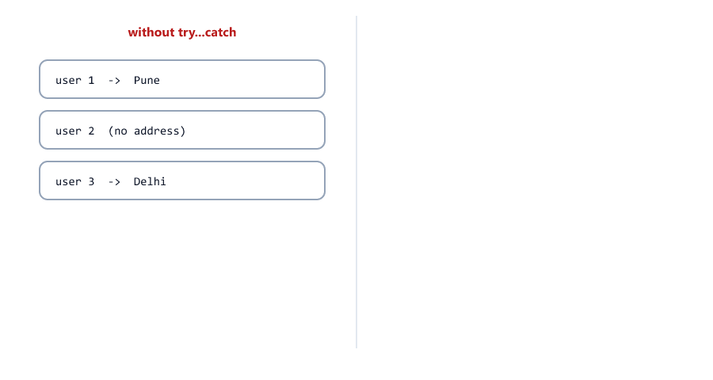

| Part              | Meaning                                                         |
| ----------------- | --------------------------------------------------------------- |
| `try { ... }`     | The code that might throw                                       |
| `catch (error)`   | Runs **only** if something in `try` threw. `error` is what was thrown |
| After the block   | The program carries on, whether there was an error or not       |

For this particular problem, `user.address?.city` (Session 13) is simpler: check for missing data when you can. `try...catch` is for errors you cannot easily check for in advance (see [When to Use try...catch](#when-to-use-trycatch)).

---

## The Order Code Runs In

The moment something throws, the rest of the `try` block is skipped

try-flow.js

```javascript
console.log("1. before try");

try {
  console.log("2. try starts");
  const coupon = null;
  console.log(coupon.percent);          // throws here
  console.log("3. never printed");
} catch (error) {
  console.log("4. catch:", error.name);
}

console.log("5. after try...catch");
```

Output

```text
1. before try
2. try starts
4. catch: TypeError
5. after try...catch
```

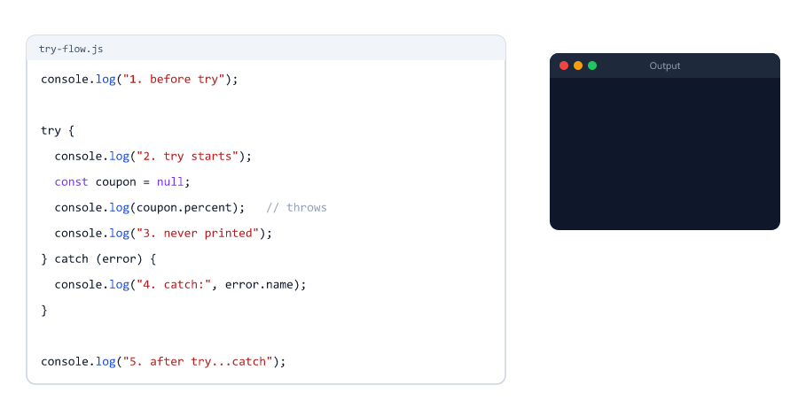

If nothing throws, `catch` is skipped completely. The `try` block is a block like the ones in Session 16: a `const` created inside it does not exist after it (see [Mistake 5](#mistake-5-using-a-variable-from-inside-try-after-the-block)).

---

## A Real Example: Bad URLs

Session 08 used `encodeURIComponent()` to put text safely into a URL. On the server, `decodeURIComponent()` turns it back. But a URL can contain a broken `%` code, and then `decodeURIComponent` throws

decode.js

```javascript
function readSearch(rawQuery) {
  try {
    const text = decodeURIComponent(rawQuery);
    return `200 OK: searching for "${text}"`;
  } catch (error) {
    return `400 Bad Request: ${error.message}`;
  }
}

console.log(readSearch("wireless%20mouse"));
console.log(readSearch("100%25%20cotton"));
console.log(readSearch("100%"));
```

Output

```text
200 OK: searching for "wireless mouse"
200 OK: searching for "100% cotton"
400 Bad Request: URI malformed
```

`%20` is a space and `%25` is a `%` sign, but a `%` at the very end is not a valid code. You cannot check for every broken code with an `if`, so this is a good job for `try...catch`: try it, and answer `400 Bad Request` if it fails. Without the `try`, anyone could stop your server by visiting `/search?q=100%`.

---

## The Error Object

What does `catch` receive? Usually an **error object**, with three useful properties

error-object.js

```javascript
try {
  const order = undefined;
  order.total = 500;
} catch (error) {
  console.log("name:   ", error.name);
  console.log("message:", error.message);
  console.log("stack:  ", error.stack);
}
```

Output

```text
name:    TypeError
message: Cannot set properties of undefined (setting 'total')
stack:   TypeError: Cannot set properties of undefined (setting 'total')
    at Object.<anonymous> (D:\js-practice\error-object.js:3:15)
```

| Property        | What it holds                                      | Who it is for                    |
| --------------- | -------------------------------------------------- | -------------------------------- |
| `error.name`    | The kind of error: `"TypeError"`                   | Your code, to decide what to do  |
| `error.message` | What went wrong, in words                          | Logs, and sometimes the user     |
| `error.stack`   | The name, message, then where it happened: file, line, column and the chain of function calls (Session 10) | The developer only |

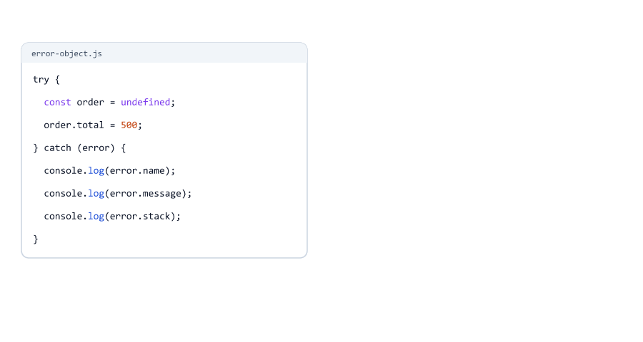

The stack shows your folder names and code, which helps attackers. Log it for yourself; never send it to users (Node.js course, Session 24).

---

## Built-in Error Types

JavaScript has a few kinds of errors built in. You have already met most of them

error-types.js

```javascript
const risky = [
  () => { const user = null; return user.name; },
  () => totalPrice + 1,
  () => decodeURIComponent("100%"),
  () => (12.5).toFixed(200),
  () => "-".repeat(-1),
];

for (const run of risky) {
  try {
    run();
  } catch (error) {
    console.log(`${error.name}: ${error.message}`);
  }
}
```

Output

```text
TypeError: Cannot read properties of null (reading 'name')
ReferenceError: totalPrice is not defined
URIError: URI malformed
RangeError: toFixed() digits argument must be between 0 and 100
RangeError: Invalid count value: -1
```

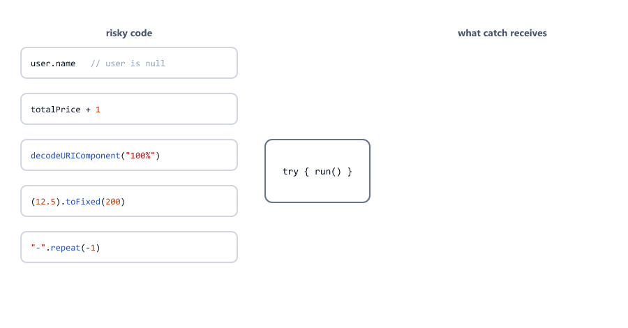

| Error type        | Means                                          | Seen in                                  |
| ----------------- | ---------------------------------------------- | ---------------------------------------- |
| `TypeError`       | A value used the wrong way: reading a property of `null`, calling something that is not a function, changing a `const` | Sessions 02, 10, 13, 17 |
| `ReferenceError`  | A variable that does not exist (or is in its dead zone) | Sessions 01, 16                    |
| `SyntaxError`     | Code (or JSON) that is not written correctly   | Sessions 01, 17; JSON in Session 19      |
| `RangeError`      | A number outside the allowed range             | Session 10 (too much recursion)          |
| `URIError`        | A broken `%` code in `decodeURIComponent`      | This session                             |

A `SyntaxError` in your own code stops the file **before** it runs, so `try...catch` cannot help: fix the code. Session 19 shows the `SyntaxError` you **can** catch: `JSON.parse()` on text that is not valid JSON.

---

## throw: Creating Your Own Errors

You can throw errors yourself, with `throw new Error("message")`. Use it when a function is asked to do something it cannot do

throw-basic.js

```javascript
function parseQuantity(value) {
  const quantity = Number(value);
  if (!Number.isInteger(quantity) || quantity < 1) {
    throw new Error(`Quantity must be a whole number of at least 1, got "${value}"`);
  }
  return quantity;
}

console.log(parseQuantity("3"));

try {
  parseQuantity("2.5");
} catch (error) {
  console.log("Caught:", error.message);
}

parseQuantity("abc");
console.log("never printed");
```

Output

```text
3
Caught: Quantity must be a whole number of at least 1, got "2.5"
D:\js-practice\throw-basic.js:4
    throw new Error(`Quantity must be a whole number of at least 1, got "${value}"`);
    ^

Error: Quantity must be a whole number of at least 1, got "abc"
    at parseQuantity (D:\js-practice\throw-basic.js:4:11)
    at Object.<anonymous> (D:\js-practice\throw-basic.js:17:1)
```

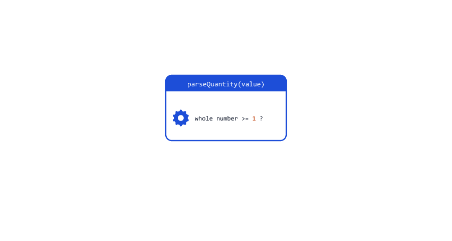

`throw` works like `return` in one way: the function stops at once. But it does not hand a value back to the caller

| `return value`                                   | `throw new Error("...")`                                    |
| ------------------------------------------------ | ----------------------------------------------------------- |
| "Here is the result"                             | "I could not do this"                                       |
| The caller continues with the value              | The caller is skipped too, until some code catches it       |
| The caller can forget to check a special value like `null` or `-1` | Cannot be ignored by accident: uncaught, it stops the program |

Up to now, functions in this course returned text like `"400 Bad Request: ..."` (Sessions 10, 13, 17). That works for small examples. In bigger programs, throwing an error and turning it into a response in **one** place is cleaner, as [Mini Example 1](#mini-example-1-turning-errors-into-responses) shows.

---

## Errors Travel Up the Call Stack

An error thrown deep inside function calls travels up the call stack (Session 10), skipping every function, until it reaches a `try...catch`

call-stack.js

```javascript
function checkStock(product, quantity) {
  if (quantity > product.stock) {
    throw new Error(`Only ${product.stock} ${product.name} left`);
  }
}

function createOrder(product, quantity) {
  checkStock(product, quantity);
  console.log("  order saved");            // skipped when checkStock throws
  return { product: product.name, quantity };
}

function handleOrderRequest(product, quantity) {
  try {
    const order = createOrder(product, quantity);
    return `201 Created: ${order.quantity} x ${order.product}`;
  } catch (error) {
    return `409 Conflict: ${error.message}`;
  }
}

const keyboard = { name: "Keyboard", stock: 2 };

console.log(handleOrderRequest(keyboard, 1));
console.log(handleOrderRequest(keyboard, 5));
```

Output

```text
  order saved
201 Created: 1 x Keyboard
409 Conflict: Only 2 Keyboard left
```


`checkStock` does not need to know about responses, and `createOrder` does not need its own `try`. The error is handled in the one place that knows what to answer.

If **no** function catches it, the error reaches the top and the program stops. The stack trace lists every function the error passed through, from the deepest one up

uncaught.js

```javascript
function checkStock(product, quantity) {
  if (quantity > product.stock) {
    throw new Error(`Only ${product.stock} ${product.name} left`);
  }
}

function createOrder(product, quantity) {
  checkStock(product, quantity);
  return { product: product.name, quantity };
}

const keyboard = { name: "Keyboard", stock: 2 };

createOrder(keyboard, 5);
console.log("never printed");
```

Output

```text
D:\js-practice\uncaught.js:3
    throw new Error(`Only ${product.stock} ${product.name} left`);
    ^

Error: Only 2 Keyboard left
    at checkStock (D:\js-practice\uncaught.js:3:11)
    at createOrder (D:\js-practice\uncaught.js:8:3)
    at Object.<anonymous> (D:\js-practice\uncaught.js:14:1)
```

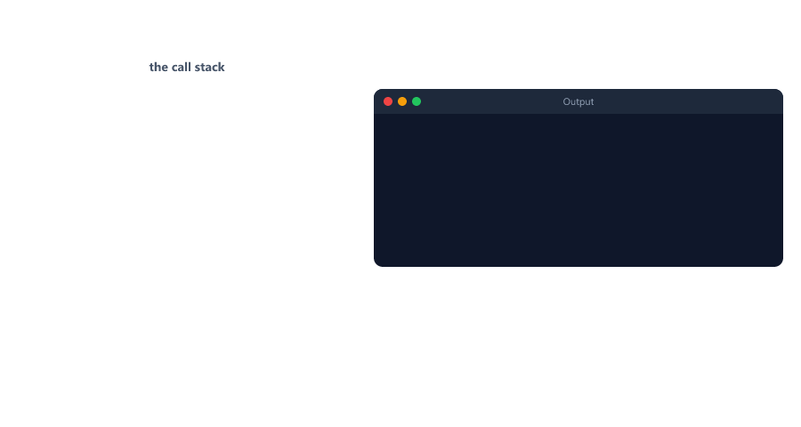

---

## finally

A `finally` block runs **every time**: after `try` finishes normally, after `catch`, and even after a `return`. Use it for clean-up that must happen whatever went wrong

finally.js

```javascript
let busy = false;

function processPayment(amountPaise) {
  busy = true;
  console.log(`Processing ${amountPaise}...`);
  try {
    if (amountPaise <= 0) {
      throw new Error("Amount must be positive");
    }
    return `Paid ${amountPaise}`;
  } finally {
    busy = false;                    // runs after return, and after an error
    console.log("  cleanup: busy is false again");
  }
}

console.log(processPayment(49900));

try {
  processPayment(-5);
} catch (error) {
  console.log("Payment failed:", error.message);
}

console.log("busy:", busy);
```

Output

```text
Processing 49900...
  cleanup: busy is false again
Paid 49900
Processing -5...
  cleanup: busy is false again
Payment failed: Amount must be positive
busy: false
```

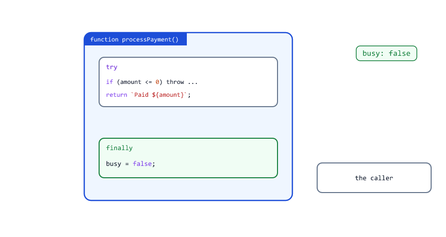

- With `49900`, `return` runs, but `finally` runs **before** the value reaches the caller, so the clean-up line is printed first.
- With `-5`, the function has `try` and `finally` but no `catch`. `finally` runs, and the error keeps travelling up to the caller's `catch`.
- Without `finally`, a failed payment would leave `busy` as `true` forever, and every later payment would think the system is busy.

In the Node.js course, `finally` closes a file or a database connection, whether the work succeeded or not (Node.js course, Sessions 17 and 24).

---

## Throw Error Objects, Not Strings

JavaScript lets you throw any value, even a string. Do not

throw-string.js

```javascript
try {
  throw "Out of stock";
} catch (error) {
  console.log(typeof error, "|", error.name, "|", error.message, "|", error.stack);
}

try {
  throw new Error("Out of stock");
} catch (error) {
  console.log(typeof error, "|", error.name, "|", error.message);
}
```

Output

```text
string | undefined | undefined | undefined
object | Error | Out of stock
```

A thrown string has no `name`, no `message` and no `stack`: you cannot tell what kind of error it is or where it came from. Code that does `error.message` gets `undefined`. Always throw `new Error(...)` or one of its children.

---

## Custom Error Classes

Session 17 promised `class AppError extends Error`. A custom error class gives an error a clear name and extra information, like the HTTP status code a server should answer

app-error.js

```javascript
class AppError extends Error {
  constructor(message, statusCode) {
    super(message);                       // Error sets message and stack
    this.name = "AppError";
    this.statusCode = statusCode;
  }
}

class NotFoundError extends AppError {
  constructor(what) {
    super(`${what} not found`, 404);
    this.name = "NotFoundError";
  }
}

try {
  throw new NotFoundError("Product 42");
} catch (error) {
  console.log(error.name, error.statusCode, error.message);
  console.log(error instanceof NotFoundError, error instanceof AppError, error instanceof Error);
}
```

Output

```text
NotFoundError 404 Product 42 not found
true true true
```


| Line                          | Why                                                             |
| ----------------------------- | --------------------------------------------------------------- |
| `extends Error`               | It is a real error: it has a `stack`, and `instanceof Error` is `true` |
| `super(message)`              | Lets `Error` set `message` and `stack`. Must come first (Session 17) |
| `this.name = "AppError"`      | Logs and stack traces show `AppError: ...` instead of `Error: ...` |
| `this.statusCode = statusCode` | Extra data: the status code the server should answer           |
| `NotFoundError extends AppError` | A more specific error that always uses 404                   |

This is the same `AppError` the Node.js course builds in `utils/AppError.js` (Session 24). It adds a few more lines: `status` (`"fail"` for 4xx, `"error"` for 5xx), `isOperational = true`, and `Error.captureStackTrace(this, this.constructor)`, which keeps the constructor itself out of the stack trace.

---

## Handle What You Know, Rethrow the Rest

A `catch` receives **every** error from its `try`: your own errors, but also bugs. Check the type with `instanceof` (Session 17), handle the errors you expect, and **rethrow** the rest with `throw error`

rethrow.js

```javascript
class ValidationError extends Error {
  constructor(message) {
    super(message);
    this.name = "ValidationError";
  }
}

function saveUser(user) {
  if (!user.email) {
    throw new ValidationError("email is required");
  }
  console.log(`  saved ${user.email.toLowerCase()}`);
}

function handleSignup(user) {
  try {
    saveUser(user);
    return "201 Created";
  } catch (error) {
    if (error instanceof ValidationError) {
      return `400 Bad Request: ${error.message}`;
    }
    throw error;                             // not ours: pass it on
  }
}

console.log(handleSignup({ email: "Riya@Example.com" }));
console.log(handleSignup({ name: "Aman" }));
console.log(handleSignup({ email: 42 }));
```

Output

```text
  saved riya@example.com
201 Created
400 Bad Request: email is required
D:\js-practice\rethrow.js:23
    throw error;                             // not ours: pass it on
    ^

TypeError: user.email.toLowerCase is not a function
    at saveUser (D:\js-practice\rethrow.js:12:37)
    at handleSignup (D:\js-practice\rethrow.js:17:5)
    at Object.<anonymous> (D:\js-practice\rethrow.js:29:13)
```

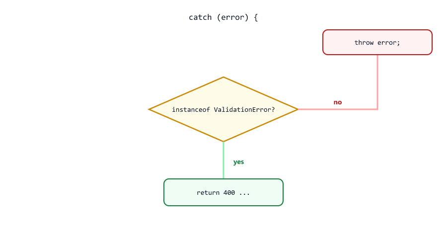

The third request found a real bug: an email that is a number has no `toLowerCase()`. If `catch` had answered `400` for every error, the bug would be hidden behind a message that blames the user (see [Mistake 3](#mistake-3-catching-every-error-as-the-users-fault)). Rethrowing lets it reach the top, where it is logged and fixed. In Express, that top is the error-handling middleware (Node.js course, Session 24).

Check the error's **type** (`instanceof`, or `error.name`), never its message text: messages are for humans and can change, even between Node.js versions.

---

## Expected Errors and Bugs

The Node.js course splits errors into two groups, and this split decides what to do with each one

| Expected (operational) errors                         | Bugs (programming errors)                               |
| ----------------------------------------------------- | ------------------------------------------------------- |
| Problems that will happen, even with perfect code     | Mistakes in the code                                    |
| Invalid input, product not found, out of stock, wrong password, a broken URL, the database is down | `user.name` when `user` is `null`, a typo in a variable name, calling something that is not a function |
| **Handle** them: answer with a clear message and a 4xx code | **Fix** them: answer 500 "Something went wrong", log the details |
| Usually your own `AppError` classes                    | Usually `TypeError` and `ReferenceError`               |

A user should see "Product 9 not found", never "Cannot read properties of undefined (reading 'name')". [Mini Example 1](#mini-example-1-turning-errors-into-responses) builds exactly this split.

---

## try...catch Cannot Catch Errors That Happen Later

`try...catch` only catches errors thrown **while the `try` block is running**. A `setTimeout` callback (Session 11) runs later, after the `try` block has already finished

timer-error.js

```javascript
try {
  setTimeout(() => {
    const order = null;
    console.log(order.id);
  }, 100);
  console.log("try finished");
} catch (error) {
  console.log("caught:", error.message);    // never runs
}

console.log("still running...");
```

Output

```text
try finished
still running...
D:\js-practice\timer-error.js:4
    console.log(order.id);
                      ^

TypeError: Cannot read properties of null (reading 'id')
    at Timeout._onTimeout (D:\js-practice\timer-error.js:4:23)
```

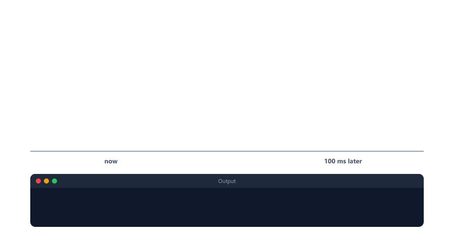

The `try` block only **scheduled** the timer, which did not throw. 100 ms later, when the callback runs, the `try` is long gone. The fix is to put the `try...catch` **inside** the callback

timer-error-fixed.js

```javascript
setTimeout(() => {
  try {
    const order = null;
    console.log(order.id);
  } catch (error) {
    console.log("caught inside the callback:", error.message);
  }
}, 100);

console.log("still running...");
```

Output

```text
still running...
caught inside the callback: Cannot read properties of null (reading 'id')
```

This is why Node.js callbacks pass errors as the first argument instead of throwing (error-first callbacks, Session 11). Promises (Session 24) and `async`/`await` (Session 25) bring `try...catch` back for code that finishes later.

---

## When to Use try...catch

| Situation                                                  | Do this                                                     |
| ---------------------------------------------------------- | ----------------------------------------------------------- |
| Data might be missing (`user.address` may not exist)       | Check it: `?.`, `??`, `if` (Sessions 06, 13)                |
| A function you call might throw and you can do something useful (a default, a 400 answer, try another way) | `try...catch` around that call          |
| Your function cannot do its job                            | `throw new Error(...)` (or your own error class)            |
| Clean-up that must always happen                           | `finally`                                                   |
| You do not know what to do with an error                   | Do not catch it, or rethrow it, so it reaches the top       |

Do not wrap every line in `try...catch`. Catch errors where you can **do something** about them, usually in one place near the top (the request handler), and let the rest of the code simply throw.

---

## Mini Example 1: Turning Errors into Responses

A real server handles errors in one central place. The code that does the work throws specific errors; one function turns **any** error into the right answer. This is what Express error-handling middleware does in the Node.js course (Session 24)

order-errors.js

```javascript
class AppError extends Error {
  constructor(message, statusCode) {
    super(message);
    this.name = "AppError";
    this.statusCode = statusCode;
  }
}

class ValidationError extends AppError {
  constructor(message) {
    super(message, 400);
    this.name = "ValidationError";
  }
}

class NotFoundError extends AppError {
  constructor(what) {
    super(`${what} not found`, 404);
    this.name = "NotFoundError";
  }
}

const products = [
  { id: 1, name: "Mouse", pricePaise: 49900, stock: 5 },
  { id: 2, name: "Keyboard", pricePaise: 149900, stock: 0 },
];

function createOrder(body) {
  const { productId, quantity } = body;
  if (!Number.isInteger(quantity) || quantity < 1) {
    throw new ValidationError("quantity must be a whole number of at least 1");
  }
  const product = products.find((p) => p.id === productId);
  if (!product) {
    throw new NotFoundError(`Product ${productId}`);
  }
  if (product.stock < quantity) {
    throw new AppError(`Not enough ${product.name} in stock (${product.stock} left)`, 409);
  }
  product.stock -= quantity;
  return { product: product.name, quantity, totalPaise: product.pricePaise * quantity };
}

// One place that turns any error into a response, like Express error middleware
function toErrorResponse(error) {
  if (error instanceof AppError) {
    return `${error.statusCode} ${error.name}: ${error.message}`;
  }
  console.log(`  [log] ${error.name}: ${error.message}`);   // a bug: log the details
  return "500 Internal Server Error: Something went wrong";
}

function handleOrder(body) {
  try {
    const order = createOrder(body);
    return `201 Created: ${order.quantity} x ${order.product}, Rs ${order.totalPaise / 100}`;
  } catch (error) {
    return toErrorResponse(error);
  }
}

console.log(handleOrder({ productId: 1, quantity: 2 }));
console.log(handleOrder({ productId: 1, quantity: 0 }));
console.log(handleOrder({ productId: 9, quantity: 1 }));
console.log(handleOrder({ productId: 2, quantity: 1 }));
console.log(handleOrder(null));
```

Output

```text
201 Created: 2 x Mouse, Rs 998
400 ValidationError: quantity must be a whole number of at least 1
404 NotFoundError: Product 9 not found
409 AppError: Not enough Keyboard in stock (0 left)
  [log] TypeError: Cannot destructure property 'productId' of 'body' as it is null.
500 Internal Server Error: Something went wrong
```

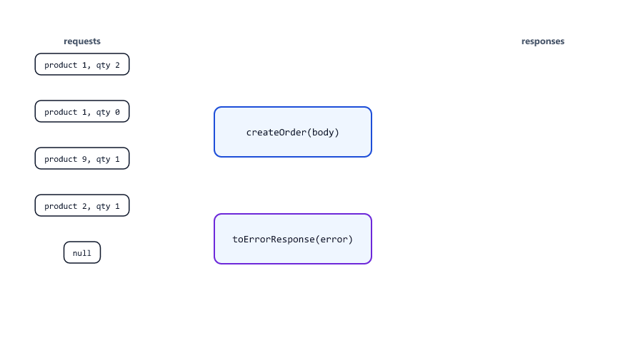

| Part                            | Job                                                                 |
| ------------------------------- | ------------------------------------------------------------------- |
| `createOrder`                   | Does the work. It throws, and does not know anything about responses |
| `ValidationError`, `NotFoundError`, `AppError` | Expected errors, each carrying its own status code    |
| `toErrorResponse`               | The one place that decides answers: `AppError` gives its own code and message; anything else is a bug |
| `handleOrder(null)`             | A bug-like input: the `TypeError` is logged for the developer, and the user only sees "Something went wrong" |

Adding a new kind of error later (for example `class UnauthorizedError extends AppError` with 401) needs no change in `toErrorResponse`.

---

## Mini Example 2: Importing a Product List

A shop owner uploads a product list as text, one product per line, with commas between the values (a CSV file; the Node.js course shows file uploads in Session 25). Some lines are wrong. One bad line must not stop the whole import: catch the error **for each line**, remember it, and go on

import-products.js

```javascript
class ValidationError extends Error {
  constructor(message) {
    super(message);
    this.name = "ValidationError";
  }
}

const csv = `name,price,stock
Mouse,499,20
Keyboard,abc,5
Monitor,8999,-2
,299,10
USB Cable,149,100`;

function parseRow(line) {
  const [name, price, stock] = line.split(",");
  if (!name) {
    throw new ValidationError("name is missing");
  }
  const pricePaise = Math.round(Number(price) * 100);
  if (!Number.isFinite(pricePaise) || pricePaise <= 0) {
    throw new ValidationError(`price "${price}" is not a positive number`);
  }
  const stockCount = Number(stock);
  if (!Number.isInteger(stockCount) || stockCount < 0) {
    throw new ValidationError(`stock "${stock}" must be 0 or more`);
  }
  return { name, pricePaise, stock: stockCount };
}

const imported = [];
const failed = [];
const lines = csv.split("\n").slice(1);      // skip the header line

lines.forEach((line, index) => {
  const lineNumber = index + 2;              // +1 for the header, +1 to count from 1
  try {
    imported.push(parseRow(line));
  } catch (error) {
    if (!(error instanceof ValidationError)) {
      throw error;                           // a bug: stop the import
    }
    failed.push(`line ${lineNumber}: ${error.message}`);
  }
});

console.log(`Imported ${imported.length}:`, imported.map((p) => p.name).join(", "));
console.log(`Failed ${failed.length}:`);
failed.forEach((message) => console.log(`  ${message}`));
```

Output

```text
Imported 2: Mouse, USB Cable
Failed 3:
  line 3: price "abc" is not a positive number
  line 4: stock "-2" must be 0 or more
  line 5: name is missing
```

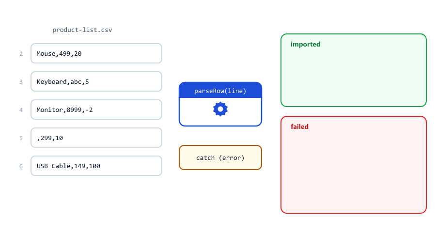

- `split("\n")` and `split(",")` (Session 12) break the text into lines and values; destructuring (Session 14) names the values.
- `parseRow` throws a `ValidationError` for each kind of bad data, with a message the shop owner can understand.
- The `try...catch` is **inside** the loop, so each line gets its own chance. A `try` around the whole loop would stop at line 3.
- Only `ValidationError` is collected. Any other error is a bug in our code, so it is rethrown instead of being reported as "bad data".
- The line numbers count the header, so they match what the shop owner sees in the file.

---

## Beginner Mistakes

### Mistake 1: Throwing a string

**Incorrect:** `throw "Out of stock";`. The caught value has no `name`, `message` or `stack` (see [Throw Error Objects, Not Strings](#throw-error-objects-not-strings)).

**Correct:** `throw new Error("Out of stock");`, or your own error class.

### Mistake 2: An empty catch block

**Incorrect**

```javascript
function applyCoupon(totalPaise, coupon) {
  try {
    return totalPaise - Math.round(totalPaise * coupon.percent / 100);
  } catch (error) {
    // ignore errors
  }
}

console.log(`Total: Rs ${applyCoupon(100000, { percent: 10 }) / 100}`);
console.log(`Total: Rs ${applyCoupon(100000, null) / 100}`);
```

```text
Total: Rs 900
Total: Rs NaN
```

The error was "swallowed": the function quietly returned `undefined`, and the customer saw `Rs NaN`. Nobody knows why. **Correct:** handle the error in a useful way (`return totalPaise;` with no coupon), or at least log it, or do not catch it at all.

### Mistake 3: Catching every error as the user's fault

**Incorrect**

```javascript
function handleAddToCart(body) {
  try {
    const quantity = parseQuantity(body.quantity);
    return `200 OK: added ${quantiy}`;        // a typo: a bug in OUR code
  } catch (error) {
    return "400 Bad Request: invalid quantity";
  }
}

console.log(handleAddToCart({ quantity: "2" }));
```

```text
400 Bad Request: invalid quantity
```

The quantity `"2"` was fine. The real error is `ReferenceError: quantiy is not defined`, a typo in the server code, but the user is told their input is wrong, and the developer never hears about it. **Correct:** catch only the errors you expect (`if (error instanceof ValidationError)`), and rethrow the rest (see [Handle What You Know, Rethrow the Rest](#handle-what-you-know-rethrow-the-rest)).

### Mistake 4: Checking the message text

**Incorrect:** `if (error.message === "URI malformed") { ... }`. Messages are for humans, and they can change in a new Node.js version.

**Correct:** check the type: `error instanceof URIError`, `error instanceof ValidationError`, or `error.name === "URIError"`.

### Mistake 5: Using a variable from inside try after the block

**Incorrect**

```javascript
try {
  const total = 500 * 2;
} catch (error) {
  console.log(error.message);
}

console.log(total);
```

```text
ReferenceError: total is not defined
```

`try { }` is a block, so `const total` lives only inside it (Session 16). **Correct:** declare it before the block with `let total;`, assign it inside `try`, and use it after. The Node.js course reads a login token exactly this way: `let decoded;` before the `try`, then `decoded = jwt.verify(...)` inside it (Session 22).

### Mistake 6: Expecting try...catch to catch a timer error

**Incorrect:** a `try...catch` around `setTimeout(...)`. The callback runs later, outside the `try`, and its error stops the program (see [try...catch Cannot Catch Errors That Happen Later](#trycatch-cannot-catch-errors-that-happen-later)).

**Correct:** put the `try...catch` inside the callback.

### Mistake 7: return inside finally

**Incorrect**

```javascript
function saveOrder() {
  try {
    throw new Error("Database is down");
  } finally {
    return "saved";                // hides the error!
  }
}

console.log(saveOrder());
```

```text
saved
```

A `return` in `finally` replaces whatever happened in `try`, even an error. The order was not saved, but the function says it was. **Correct:** use `finally` only for clean-up, never for `return`.

### Mistake 8: Forgetting to pass the message to super

**Incorrect**

```javascript
class AppError extends Error {
  constructor(message, statusCode) {
    super();                         // forgot to pass the message
    this.statusCode = statusCode;
  }
}

try {
  throw new AppError("Product not found", 404);
} catch (error) {
  console.log(`${error.name}: "${error.message}" (${error.statusCode})`);
}
```

```text
Error: "" (404)
```

The message is empty, and without `this.name` the error is called plain `Error`. **Correct:** `super(message);` and `this.name = "AppError";`.

### Mistake 9: Sending error details to users

**Incorrect:** answering a bug with `500 ${error.message}` or `error.stack`. It shows your code, file paths and sometimes data to strangers.

**Correct:** show your own messages for expected errors; for bugs, log the details and answer only "Something went wrong" (see [Mini Example 1](#mini-example-1-turning-errors-into-responses)).

### Mistake 10: Using try...catch instead of a simple check

**Incorrect:** `try { city = user.address.city; } catch (error) { city = "unknown"; }`. It works, but it also hides real bugs inside the `try`, and it is slower to read.

**Correct:** `const city = user.address?.city ?? "unknown";` (Session 13). Keep `try...catch` for errors you cannot check for in advance.

### Mistake 11: One try around a whole batch

**Incorrect:** a single `try` around the loop in [Mini Example 2](#mini-example-2-importing-a-product-list). The first bad line ends the loop, and the good lines after it are never imported.

**Correct:** put the `try...catch` inside the loop, so each item is handled on its own.

---

## Practice Exercises

### Exercise 1

Write `safeDecode(text)` that returns the decoded text, or `null` if `decodeURIComponent` throws. Test it with `"caf%C3%A9"`, `"50%25"` and `"50%"`.

### Exercise 2

Write `parsePricePaise(text)` that turns `"499.50"` into `49950` and throws an `Error` with a clear message for empty text, non-numbers and negative prices. Run it on an array of five inputs inside a loop with `try...catch`, and print either the result or the message for each.

### Exercise 3

Create `class ValidationError extends Error` with an extra `field` property (`new ValidationError("email", "is required")`). Write `validateSignup({ name, email, password })` that throws for the first problem it finds. Print `error.field` and `error.message` in the `catch`.

### Exercise 4

Write `timed(label, fn)` that prints `"<label> started"`, calls `fn()`, and always prints `"<label> finished"` using `finally`, even if `fn` throws. Check that the error still reaches the caller.

### Exercise 5

Add `class UnauthorizedError extends AppError` (status 401) and `class ConflictError extends AppError` (status 409) to [Mini Example 1](#mini-example-1-turning-errors-into-responses), and use `ConflictError` for the stock check. `toErrorResponse` must not change.

### Exercise 6

Write `retry(fn, attempts)` that calls `fn` and returns its result; if it throws, it tries again, up to `attempts` times, and then throws the last error. Test it with a function that throws on its first two calls and works on the third (count the calls in an outer variable).

### Exercise 7

Extend [Mini Example 2](#mini-example-2-importing-a-product-list): reject duplicate product names (the second "Mouse" fails with `duplicate name "Mouse"`), and print a final line `Import finished: 3 ok, 2 failed`.

### Exercise 8

Take `handleRegister` from Session 17's user store. Change it so that the checks **throw** `ValidationError` (400) and `AppError` (409), and one `toErrorResponse` function builds every error answer, as in [Mini Example 1](#mini-example-1-turning-errors-into-responses).

---

## Interview Questions

### What happens when an error is thrown and nothing catches it?

The current function stops, and the error travels up the call stack, skipping every caller. If no `try...catch` handles it, Node.js prints the error with its stack trace and ends the process. On a server, that cuts off every connected user.

### What does try...catch do?

It runs the code in `try`. If anything in it throws, the rest of `try` is skipped and `catch` runs with the thrown value. After the block, the program continues. If nothing throws, `catch` is skipped.

### When does finally run?

Always: after `try` completes, after `catch` runs, after a `return` in `try` or `catch`, and even when an error is not caught (it runs, then the error continues up). It is used for clean-up like closing files or resetting flags. A `return` inside `finally` overrides everything else, so avoid it.

### What is the difference between throw and return?

`return` ends the function and gives a value to the caller, which continues normally. `throw` ends the function and skips the callers too, until a `try...catch` handles it; uncaught, it stops the program. Use `return` for results, `throw` for "this function could not do its job".

### What properties does an Error object have?

`name` (the kind, like `"TypeError"`), `message` (what went wrong) and `stack` (the name, message and the chain of function calls with file, line and column). Custom errors can add more, like `statusCode`.

### Name the built-in error types.

`Error` (the base), `TypeError` (a value used the wrong way), `ReferenceError` (an unknown variable), `SyntaxError` (invalid code or JSON), `RangeError` (a number out of range), `URIError` (bad URI encoding) and `EvalError` (rarely seen today).

### Why should you throw Error objects instead of strings?

Error objects have a `name`, `message` and `stack`, work with `instanceof`, and can carry extra data. A thrown string has none of these, so code that reads `error.message` gets `undefined` and you cannot see where it came from.

### How do you create a custom error class?

Extend `Error`, call `super(message)` first, set `this.name` to the class name and add any extra properties: `class AppError extends Error { constructor(message, statusCode) { super(message); this.name = "AppError"; this.statusCode = statusCode; } }`. Child classes like `NotFoundError extends AppError` can fill in fixed values.

### What is rethrowing, and why do it?

Inside `catch`, handling only the errors you expect and calling `throw error` for the rest. It prevents bugs from being hidden behind a wrong message, and lets them reach a central handler that logs them.

### What is the difference between operational errors and programming errors?

Operational errors are expected problems (invalid input, not found, a database that is down). You handle them and tell the user with a 4xx message. Programming errors are bugs (reading a property of `null`, typos). You fix them; meanwhile the server answers 500 and logs the details.

### Why can't try...catch catch an error thrown inside a setTimeout callback?

The `try` block only schedules the callback and finishes. The callback runs later, when the `try` is no longer running, so its error has no `catch` to go to. Put the `try...catch` inside the callback, or use error-first callbacks, promises or `async`/`await`.

### Should you show error.message or error.stack to users?

Not for bugs: they reveal code, file paths and sometimes data. Show your own clear messages for expected errors, and for anything else answer a general "Something went wrong" while logging the full error for developers.

### instanceof or error.name: which should you use to check an error?

Both check the type, and both are better than comparing messages. `instanceof` also matches parent classes (`NotFoundError` is an `instanceof AppError`), which is useful for groups of errors. `error.name` is handy when you only have a name to compare, for example in logs.

### Why is an empty catch block dangerous?

It "swallows" the error: the program carries on with missing or wrong data, and nobody learns what went wrong. Always handle the error in a useful way, log it, or let it travel up.

---

| Previous | All sessions | Next |
| :--- | :---: | ---: |
| [17. this, Constructors and Classes](17-this-constructors-classes.md) | [Course outline](README.md#course-outline) | [19. JSON and Dates](19-json-and-dates.md) |
