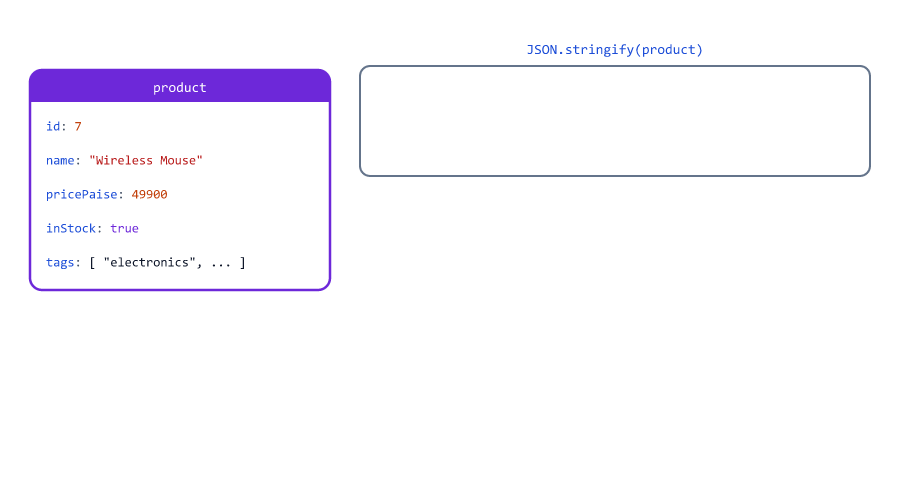
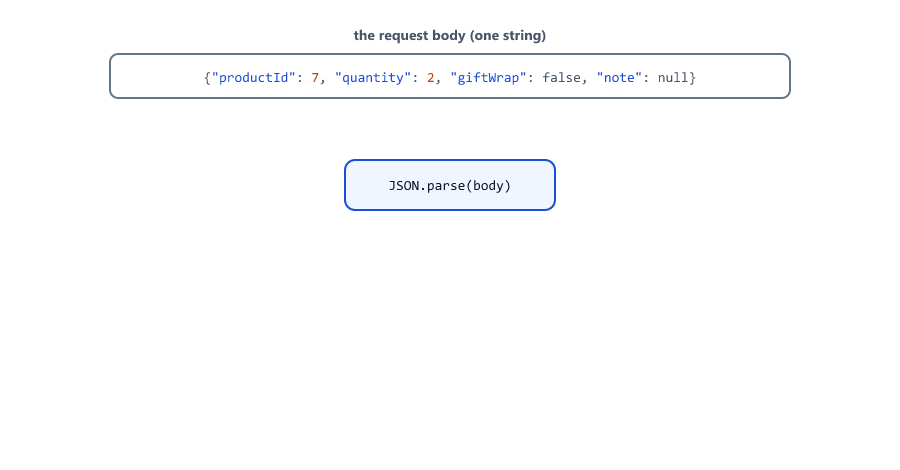
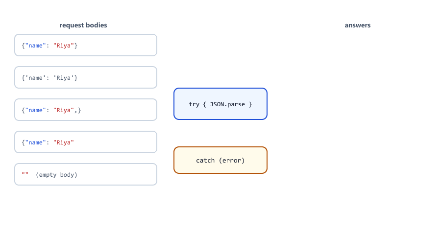
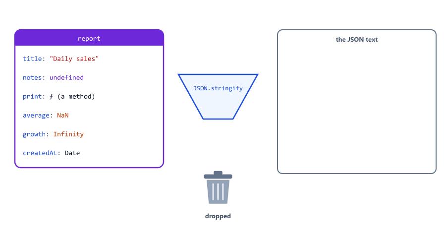
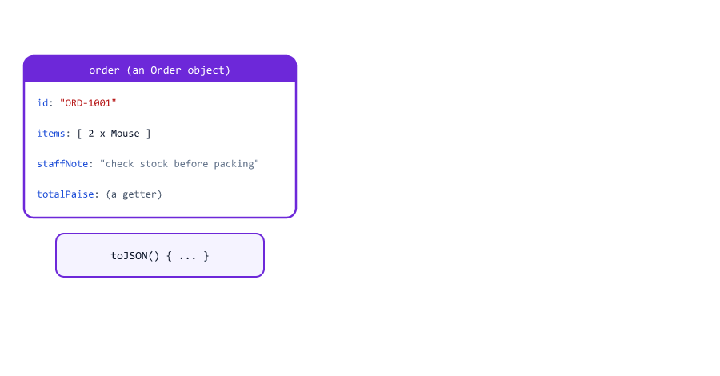
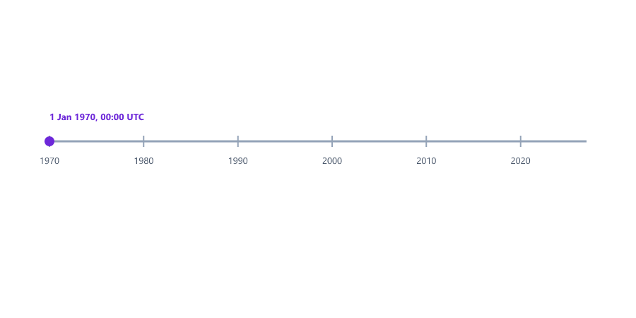
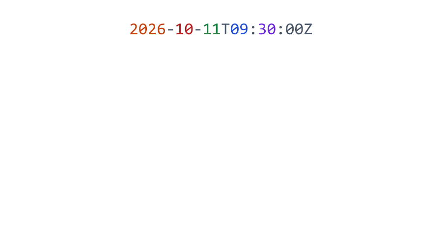
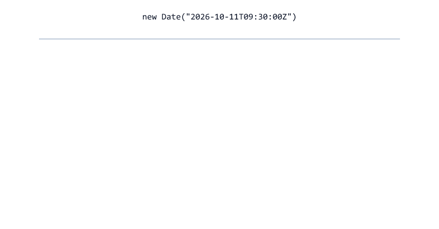
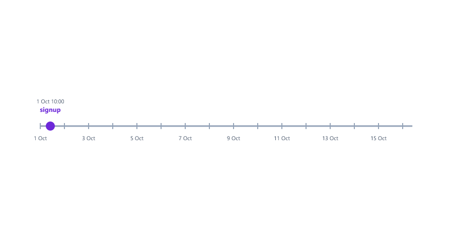

# JSON and Dates

## Table of Contents
- [What is JSON?](#what-is-json)
- [JSON Rules](#json-rules)
- [JSON.stringify: Object to Text](#jsonstringify-object-to-text)
- [Pretty JSON](#pretty-json)
- [JSON.parse: Text to Object](#jsonparse-text-to-object)
- [Invalid JSON Throws a SyntaxError](#invalid-json-throws-a-syntaxerror)
- [What JSON Cannot Hold](#what-json-cannot-hold)
- [Objects Made from Classes](#objects-made-from-classes)
- [Choosing What Is Sent with toJSON](#choosing-what-is-sent-with-tojson)
- [Creating Dates](#creating-dates)
- [The Current Time and Timestamps](#the-current-time-and-timestamps)
- [Reading the Parts of a Date](#reading-the-parts-of-a-date)
- [Time Zones: Store UTC, Show Local](#time-zones-store-utc-show-local)
- [Formatting Dates for People](#formatting-dates-for-people)
- [Dates in JSON](#dates-in-json)
- [Date Math](#date-math)
- [Comparing Dates](#comparing-dates)
- [Invalid Dates](#invalid-dates)
- [Mini Example 1: A JSON Order API](#mini-example-1-a-json-order-api)
- [Mini Example 2: Trial Days Left](#mini-example-2-trial-days-left)
- [Beginner Mistakes](#beginner-mistakes)
- [Practice Exercises](#practice-exercises)
- [Interview Questions](#interview-questions)

---

## What is JSON?

A server and its clients (a phone app, a website, another server) need to send data to each other. Objects live in the memory of one program; they cannot travel over the network. **Text** can. **JSON** (JavaScript Object Notation) is a way to write data as text, and it is the language almost every API speaks.

A product, as JSON text

```json
{
  "id": 7,
  "name": "Wireless Mouse",
  "pricePaise": 49900,
  "inStock": true,
  "tags": ["electronics", "computer"],
  "discount": null
}
```

It looks almost exactly like a JavaScript object (Session 13). That is no accident: JSON was taken from JavaScript's object syntax. But it is **text**, a string, until a program turns it back into an object.


| Where you meet JSON           | Example                                                              |
| ----------------------------- | -------------------------------------------------------------------- |
| API requests and responses    | A phone app sends `{"email": "...", "password": "..."}` to log in    |
| Settings files                | `package.json` in every Node.js project (Node.js course, Session 02) |
| Data files                    | `students.json`, read and written with `fs` (Node.js course, Session 05) |
| Databases                     | MongoDB stores documents that look like JSON (Node.js course, Session 17) |

---

## JSON Rules

JSON is stricter than a JavaScript object

| Rule                                         | JavaScript object             | JSON text                     |
| -------------------------------------------- | ----------------------------- | ----------------------------- |
| Keys                                         | `name: "Riya"` is fine        | Keys **must** have double quotes: `"name": "Riya"` |
| Text values                                  | `'Riya'`, `"Riya"` or `` `Riya` `` | Double quotes only: `"Riya"` |
| A comma after the last item                  | Allowed                       | Not allowed                   |
| Comments                                     | Allowed                       | Not allowed                   |
| Values                                       | Anything                      | Only text, numbers, `true`/`false`, `null`, objects and arrays |

That last row is the list from Session 03. There is no `undefined`, no functions, no `NaN`, and no dates in JSON. See [What JSON Cannot Hold](#what-json-cannot-hold) for what happens to them.

---

## JSON.stringify: Object to Text

`JSON.stringify(value)` turns a value into JSON text

stringify.js

```javascript
const product = {
  id: 7,
  name: "Wireless Mouse",
  pricePaise: 49900,
  inStock: true,
  tags: ["electronics", "computer"],
  discount: null,
};

const text = JSON.stringify(product);

console.log(text);
console.log(typeof text);
console.log(`Product: ${product}`);
console.log(`Product: ${JSON.stringify(product)}`);
```

Output

```text
{"id":7,"name":"Wireless Mouse","pricePaise":49900,"inStock":true,"tags":["electronics","computer"],"discount":null}
string
Product: [object Object]
Product: {"id":7,"name":"Wireless Mouse","pricePaise":49900,"inStock":true,"tags":["electronics","computer"],"discount":null}
```



The result is one string, with no spaces. Session 08 promised this fix: putting an object in a template literal gives `[object Object]`, while `JSON.stringify` shows its content. Before Express, the Node.js course sent every response this way: `res.end(JSON.stringify(products))` (Session 10). Express's `res.json(data)` calls `JSON.stringify` for you (Session 12).

---

## Pretty JSON

`JSON.stringify(value, null, 2)` adds new lines and 2 spaces of indentation. Use it for files people will read, and for printing deep objects

pretty.js

```javascript
const order = {
  id: "ORD-1001",
  customer: { name: "Riya", address: { city: "Pune", geo: { lat: 18.52, lng: 73.85 } } },
  items: [{ name: "Mouse", qty: 2 }],
};

console.log(order);
console.log(JSON.stringify(order, null, 2));
```

Output

```text
{
  id: 'ORD-1001',
  customer: { name: 'Riya', address: { city: 'Pune', geo: [Object] } },
  items: [ { name: 'Mouse', qty: 2 } ]
}
{
  "id": "ORD-1001",
  "customer": {
    "name": "Riya",
    "address": {
      "city": "Pune",
      "geo": {
        "lat": 18.52,
        "lng": 73.85
      }
    }
  },
  "items": [
    {
      "name": "Mouse",
      "qty": 2
    }
  ]
}
```

`console.log` stops at 2 levels and shows `[Object]` (Session 13 promised a fix). `JSON.stringify(..., null, 2)` prints every level. The middle argument (`null` here) is rarely needed; the `2` is the number of spaces. The Node.js course saves files exactly like this: `fs.writeFileSync("students.json", JSON.stringify(students, null, 2))` (Session 05).

Send **compact** JSON over the network (it is smaller), and pretty JSON to files and logs that people read.

---

## JSON.parse: Text to Object

`JSON.parse(text)` does the opposite: it reads JSON text and builds the object

parse.js

```javascript
// The text a client sent in a POST request body
const body = '{"productId": 7, "quantity": 2, "giftWrap": false, "note": null}';

const data = JSON.parse(body);

console.log(data);
console.log(data.quantity * 2);
console.log(typeof data.giftWrap);
```

Output

```text
{ productId: 7, quantity: 2, giftWrap: false, note: null }
4
boolean
```



The values come back with their real types: `quantity` is the number `2`, so `data.quantity * 2` is `4`. This is different from a URL query or a form field, where everything arrives as text (Session 05). In the Node.js course, a raw server reads a POST body with `JSON.parse(body)` (Session 11); in Express, `app.use(express.json())` does it and puts the result in `req.body` (Session 12).

| Method                       | From                    | To                       |
| ---------------------------- | ----------------------- | ------------------------ |
| `JSON.stringify(value)`      | Object, array, value    | JSON text (a string)     |
| `JSON.parse(text)`           | JSON text (a string)    | Object, array, value     |

---

## Invalid JSON Throws a SyntaxError

Session 18 promised a `SyntaxError` you **can** catch. Clients send broken JSON all the time, and `JSON.parse` throws on it

parse-errors.js

```javascript
const bodies = [
  '{"name": "Riya"}',
  "{'name': 'Riya'}",
  '{"name": "Riya",}',
  '{"name": "Riya"',
  "",
];

for (const body of bodies) {
  try {
    const data = JSON.parse(body);
    console.log(`200 OK: hello ${data.name}`);
  } catch (error) {
    console.log(`400 Invalid JSON (${error.name}: ${error.message})`);
  }
}
```

Output

```text
200 OK: hello Riya
400 Invalid JSON (SyntaxError: Expected property name or '}' in JSON at position 1 (line 1 column 2))
400 Invalid JSON (SyntaxError: Expected double-quoted property name in JSON at position 16 (line 1 column 17))
400 Invalid JSON (SyntaxError: Expected ',' or '}' after property value in JSON at position 15 (line 1 column 16))
400 Invalid JSON (SyntaxError: Unexpected end of JSON input)
```



| Body                    | Problem                                     |
| ----------------------- | ------------------------------------------- |
| `{'name': 'Riya'}`      | Single quotes                               |
| `{"name": "Riya",}`     | A comma after the last item                 |
| `{"name": "Riya"`       | The closing `}` is missing                  |
| `""` (empty)            | No JSON at all                              |

Without the `try...catch`, one broken request would stop the server. This is exactly what the Node.js course does: `try { data = JSON.parse(body); } catch (err) { ... 400 "Invalid JSON" }` (Session 11). The error message is for you; send the client a short "Invalid JSON".

---

## What JSON Cannot Hold

JSON has no place for some JavaScript values. `JSON.stringify` does not throw for them; it quietly changes or drops them

stringify-drops.js

```javascript
const report = {
  title: "Daily sales",
  notes: undefined,
  print() {
    return this.title;
  },
  average: 0 / 0,
  growth: 1 / 0,
  createdAt: new Date("2026-10-11T09:30:00Z"),
  values: [10, undefined, NaN],
};

console.log(JSON.stringify(report, null, 2));
```

Output

```text
{
  "title": "Daily sales",
  "average": null,
  "growth": null,
  "createdAt": "2026-10-11T09:30:00.000Z",
  "values": [
    10,
    null,
    null
  ]
}
```



| Value                        | In an object                | In an array              |
| ---------------------------- | --------------------------- | ------------------------ |
| `undefined`                  | The key disappears          | Becomes `null`           |
| A function (method)          | The key disappears          | Becomes `null`           |
| `NaN`, `Infinity`            | Becomes `null` (Session 09) | Becomes `null`           |
| A `Date`                     | Becomes ISO text: `"2026-10-11T09:30:00.000Z"` | Same      |
| `Map`, `Set` (Session 20)    | Becomes `{}`, the data is lost | Same                  |

This is why `JSON.parse(JSON.stringify(obj))` is a poor deep copy (Session 15): the copy comes back changed. If a key you expected is missing in a response, check whether its value was `undefined`. Use `null` for "empty on purpose" (Session 03): `null` survives JSON.

---

## Objects Made from Classes

Session 17 said that an object made from a class loses its methods when it goes through JSON

stringify-class.js

```javascript
class User {
  #passwordHash = "$2b$10$yourhashhere";

  constructor(name, email) {
    this.name = name;
    this.email = email;
  }

  greet() {
    return `Hi ${this.name}`;
  }
}

const riya = new User("Riya", "riya@example.com");
const text = JSON.stringify(riya);
const back = JSON.parse(text);

console.log(text);
console.log(back instanceof User, typeof back.greet);
```

Output

```text
{"name":"Riya","email":"riya@example.com"}
false undefined
```

- Only the object's own public data is written. The method `greet` lives on `User.prototype`, so it is not part of the text.
- The private field `#passwordHash` is never included. That is another good reason for private fields.
- `JSON.parse` gives back a plain object: not a `User`, and with no `greet`. To get a real `User` again, call `new User(back.name, back.email)`.

---

## Choosing What Is Sent with toJSON

If an object has a method called `toJSON()`, `JSON.stringify` uses what that method returns instead of the object itself. A class can decide exactly what goes into its JSON

to-json.js

```javascript
class Order {
  constructor(id, items, staffNote) {
    this.id = id;
    this.items = items;
    this.staffNote = staffNote;          // for the shop's staff only
  }

  get totalPaise() {
    return this.items.reduce((sum, item) => sum + item.pricePaise * item.qty, 0);
  }

  toJSON() {
    return { id: this.id, items: this.items, totalPaise: this.totalPaise };
  }
}

const order = new Order("ORD-1001", [{ name: "Mouse", pricePaise: 49900, qty: 2 }], "check stock before packing");
console.log(JSON.stringify(order));
```

Output

```text
{"id":"ORD-1001","items":[{"name":"Mouse","pricePaise":49900,"qty":2}],"totalPaise":99800}
```



- `staffNote` stays out of the JSON, so customers never see it.
- `totalPaise` is a getter (Session 17), which `JSON.stringify` would normally skip; `toJSON` puts its value in.
- A `Date` has its own `toJSON()`, which is why dates become ISO text.

Because `res.json()` in Express uses `JSON.stringify`, `toJSON` also controls what an API sends. A plain function that picks the safe fields, like `publicUser(user)` from Session 13, does the same job and is what the Node.js course uses (Session 22).

---

## Creating Dates

The second half of this session is about dates. A `Date` object stores one moment in time. The clearest way to create one is from an **ISO 8601** text: `YYYY-MM-DDTHH:mm:ssZ`

date-create.js

```javascript
const placed = new Date("2026-10-11T09:30:00Z");            // an ISO 8601 text
const fromParts = new Date(Date.UTC(2026, 9, 11, 9, 30));   // month 9 = October!
const fromNumber = new Date(1791711000000);                 // milliseconds since 1970

console.log(placed);
console.log(fromParts);
console.log(fromNumber);
console.log(placed.getTime());
```

Output

```text
2026-10-11T09:30:00.000Z
2026-10-11T09:30:00.000Z
2026-10-11T09:30:00.000Z
1791711000000
```

| Part of `2026-10-11T09:30:00Z` | Meaning                                        |
| ------------------------------ | ---------------------------------------------- |
| `2026-10-11`                   | Year, month, day (always in this order)        |
| `T`                            | Separates the date from the time               |
| `09:30:00`                     | Hours, minutes, seconds (24-hour clock)        |
| `Z`                            | "Zulu" time, which means **UTC** (see [Time Zones](#time-zones-store-utc-show-local)) |

All three lines create the same moment. When you build a date from parts, the **month starts at 0**: January is 0 and October is 9 (see [Mistake 6](#mistake-6-forgetting-that-months-start-at-0)). `Date.UTC(...)` reads the parts as UTC time. Prefer ISO text: it is what APIs and databases use, and it cannot be misread.

---

## The Current Time and Timestamps

`new Date()` with no argument is **now**. `Date.now()` is now as a plain number

date-now.js

```javascript
const now = new Date();

console.log(now);
console.log(now.toISOString());
console.log(Date.now());
console.log(typeof now, typeof Date.now());
```

Output (yours will be different)

```text
2026-10-11T11:55:07.897Z
2026-10-11T11:55:07.897Z
1791719707901
object number
```

Inside, a `Date` is only one number: the **milliseconds since 1 January 1970, 00:00 UTC**. That number is called a **timestamp**. `getTime()` and `Date.now()` give it to you.



Timestamps are perfect for measuring how long something takes

duration.js

```javascript
const start = Date.now();

let total = 0;
for (let i = 0; i < 50_000_000; i++) {
  total += i;
}

const ms = Date.now() - start;
console.log(`Finished in ${ms} ms`);
```

Output (yours will be different)

```text
Finished in 50 ms
```

| Code                               | Gives                               | Used for                                  |
| ---------------------------------- | ----------------------------------- | ----------------------------------------- |
| `new Date()`                       | A Date object for now               | `createdAt: new Date()` (Node.js course, Session 18) |
| `Date.now()`                       | Milliseconds since 1970 (a number)  | Measuring time: a logger prints how long each request took (Node.js course, Session 14) |
| `new Date().toISOString()`         | `"2026-10-11T11:55:07.897Z"`        | Timestamps in logs and JSON (Node.js course, Session 14) |
| `Math.floor(Date.now() / 1000)`    | **Seconds** since 1970              | Login tokens store their expiry time in seconds (Node.js course, Session 22) |

---

## Reading the Parts of a Date

Get methods read one part of a date

date-parts.js

```javascript
const order = new Date("2026-10-11T09:30:00Z");

console.log(order.getUTCFullYear());   // the year
console.log(order.getUTCMonth());      // 0 = January, so 9 = October
console.log(order.getUTCDate());       // the day of the month
console.log(order.getUTCDay());        // the day of the week: 0 = Sunday
console.log(order.getUTCHours(), order.getUTCMinutes());
```

Output

```text
2026
9
11
0
9 30
```



| Method                          | Gives                              | Watch out                                 |
| ------------------------------- | ---------------------------------- | ----------------------------------------- |
| `getUTCFullYear()`              | `2026`                             |                                           |
| `getUTCMonth()`                 | `0` to `11`                        | January is `0`: add 1 to show it          |
| `getUTCDate()`                  | `1` to `31`, the day of the month  | Not `getUTCDay()`                         |
| `getUTCDay()`                   | `0` to `6`, the day of the week    | `0` is Sunday                             |
| `getUTCHours()`, `getUTCMinutes()`, `getUTCSeconds()` | The time     |                                           |

Each one also exists without `UTC`: `getFullYear()`, `getMonth()`, `getHours()` and so on. Those use the time zone of the computer the code runs on, so the same code gives different answers on different servers. That is the next topic.

---

## Time Zones: Store UTC, Show Local

A `Date` is one moment, but the clock time of that moment depends on where you are

time-zones.js

```javascript
const order = new Date("2026-10-11T09:30:00Z");

console.log(order.toISOString());
console.log(order.toLocaleString("en-IN", { timeZone: "Asia/Kolkata" }));
console.log(order.toLocaleString("en-US", { timeZone: "America/New_York" }));
console.log(order.toLocaleString("en-GB", { timeZone: "Europe/London" }));
```

Output

```text
2026-10-11T09:30:00.000Z
11/10/2026, 3:00:00 pm
10/11/2026, 5:30:00 AM
11/10/2026, 10:30:00
```



**UTC** (Coordinated Universal Time) is the world's reference clock. India is UTC + 5:30, so 09:30 UTC is 3:00 pm in India.

The rule every backend follows:

1. **Store and send dates in UTC**, as ISO text or Date objects. MongoDB stores dates in UTC (Node.js course, Session 17).
2. **Convert to local time only when showing a date to a person**, with the person's time zone.
3. **Never depend on the server's own time zone.** A cloud server is often set to UTC, your laptop is not, and `getHours()` gives different answers on each.

Look at the US line too: `10/11/2026` means 11 October in the US (month first), but 10 November in India (day first). Numbers-only dates are confusing, which is why the next section spells the month out.

---

## Formatting Dates for People

`toLocaleDateString`, `toLocaleTimeString` and `toLocaleString` format a date for a language and a time zone, with the same kind of options object you used for numbers in Sessions 09 and 13

format-dates.js

```javascript
const placedAt = new Date("2026-10-11T09:30:00Z");
const IST = { timeZone: "Asia/Kolkata" };

console.log(placedAt.toLocaleDateString("en-IN", { ...IST, day: "numeric", month: "short", year: "numeric" }));
console.log(placedAt.toLocaleDateString("en-IN", { ...IST, weekday: "long", day: "numeric", month: "long" }));
console.log(placedAt.toLocaleTimeString("en-IN", { ...IST, hour: "numeric", minute: "2-digit" }));
console.log(placedAt.toLocaleString("en-IN", { ...IST, dateStyle: "medium", timeStyle: "short" }));
```

Output

```text
11 Oct 2026
Sunday, 11 October
3:00 pm
11 Oct 2026, 3:00 pm
```

`{ ...IST, day: "numeric" }` copies the time zone into each options object (spread, Session 14).

| Option                       | Values                                      | Example output    |
| ---------------------------- | ------------------------------------------- | ----------------- |
| `day`                        | `"numeric"`, `"2-digit"`                    | `11`              |
| `month`                      | `"numeric"`, `"short"`, `"long"`            | `Oct`, `October`  |
| `year`                       | `"numeric"`, `"2-digit"`                    | `2026`            |
| `weekday`                    | `"short"`, `"long"`                         | `Sun`, `Sunday`   |
| `hour`, `minute`             | `"numeric"`, `"2-digit"`                    | `3:00`            |
| `dateStyle`, `timeStyle`     | `"short"`, `"medium"`, `"long"`, `"full"`   | `11 Oct 2026`     |
| `timeZone`                   | `"Asia/Kolkata"`, `"UTC"`, `"America/New_York"`, ... | Which clock to show |

| For                                      | Use                                   |
| ---------------------------------------- | ------------------------------------- |
| Computers: JSON, databases, logs         | `toISOString()`                       |
| People: emails, invoices, screens        | `toLocaleString(...)` with a `timeZone` |

---

## Dates in JSON

Session 15 showed that dates turn into text in JSON. Here is the full round trip

dates-json.js

```javascript
const order = { id: "ORD-1001", createdAt: new Date("2026-10-11T09:30:00Z") };

const text = JSON.stringify(order);
const received = JSON.parse(text);

console.log(text);
console.log(typeof received.createdAt);

received.createdAt = new Date(received.createdAt);   // turn the text back into a Date
console.log(received.createdAt.getUTCFullYear());
```

Output

```text
{"id":"ORD-1001","createdAt":"2026-10-11T09:30:00.000Z"}
string
2026
```


`JSON.stringify` writes the date as ISO text (UTC), but `JSON.parse` cannot know that the text was a date, so it stays a string. Calling a date method on it is a classic bug (see [Mistake 5](#mistake-5-using-a-date-from-json-without-converting-it)). Convert it with `new Date(text)`. When you read data from MongoDB with Mongoose, it converts dates for you (Node.js course, Session 19); with JSON from an API or a file, you do it yourself.

---

## Date Math

Because a date is a number of milliseconds, date math is number math. Subtracting two dates gives the milliseconds between them (implicit conversion, Session 05)

date-math.js

```javascript
const DAY_MS = 24 * 60 * 60 * 1000;

const signup = new Date("2026-10-01T10:00:00Z");
const trialEnds = new Date(signup.getTime() + 14 * DAY_MS);
const now = new Date("2026-10-11T09:30:00Z");

console.log(trialEnds.toISOString());
console.log(now - signup);                                   // milliseconds
console.log(Math.floor((now - signup) / DAY_MS));            // full days
console.log(Math.ceil((trialEnds - now) / DAY_MS), "days left");
console.log(now < trialEnds);
```

Output

```text
2026-10-15T10:00:00.000Z
862200000
9
5 days left
true
```



| Task                      | Code                                                |
| ------------------------- | --------------------------------------------------- |
| One day in milliseconds   | `24 * 60 * 60 * 1000`, which is `86400000`          |
| Add 14 days               | `new Date(date.getTime() + 14 * DAY_MS)`            |
| Time between two dates    | `later - earlier` (milliseconds)                    |
| Full days passed          | `Math.floor(ms / DAY_MS)` (Session 09)              |
| Days left, counting a part day | `Math.ceil(ms / DAY_MS)`                       |

To add calendar days or months, the set methods are easier. They roll over into the next month by themselves

add-days.js

```javascript
function addDays(date, days) {
  const copy = new Date(date);              // never change the original
  copy.setUTCDate(copy.getUTCDate() + days);
  return copy;
}

const ordered = new Date("2026-10-30T09:30:00Z");
const delivery = addDays(ordered, 3);

console.log(delivery.toISOString());       // October has 31 days: it rolls into November
console.log(ordered.toISOString());        // unchanged
```

Output

```text
2026-11-02T09:30:00.000Z
2026-10-30T09:30:00.000Z
```

`setUTCDate` **changes** the Date object. A Date is an object, so `const delivery = ordered` would share it (Session 15). `new Date(date)` makes a copy first (see [Mistake 8](#mistake-8-changing-a-shared-date)).

---

## Comparing Dates

`<` and `>` work on dates, because they compare the timestamps. `===` does not

date-compare.js

```javascript
const a = new Date("2026-10-11T09:30:00Z");
const b = new Date("2026-10-11T09:30:00Z");

console.log(a === b);
console.log(a.getTime() === b.getTime());
console.log(a < new Date("2026-12-25T00:00:00Z"));
```

Output

```text
false
true
true
```

`a` and `b` are two different objects holding the same moment, and `===` compares objects by reference (Session 04). To check whether two dates are the same moment, compare `getTime()`.

---

## Invalid Dates

`new Date()` does not throw for text it cannot understand. It creates an **Invalid Date**, whose timestamp is `NaN`

invalid-date.js

```javascript
function parseDeliveryDate(text) {
  const date = new Date(text);
  if (Number.isNaN(date.getTime())) {
    return `400 Bad Request: "${text}" is not a valid date`;
  }
  return `200 OK: delivery on ${date.toISOString().slice(0, 10)}`;
}

console.log(parseDeliveryDate("2026-12-24"));
console.log(parseDeliveryDate("24/12/2026"));
console.log(parseDeliveryDate("tomorrow"));
console.log(new Date("tomorrow"));
```

Output

```text
200 OK: delivery on 2026-12-24
400 Bad Request: "24/12/2026" is not a valid date
400 Bad Request: "tomorrow" is not a valid date
Invalid Date
```

- Check every date that comes from a user with `Number.isNaN(date.getTime())` (Session 05), and answer 400 if it is invalid.
- `"24/12/2026"` (day first, as written in India) is not understood at all. Ask clients for ISO dates: `"2026-12-24"`.
- An Invalid Date does not crash at once, but `toISOString()` on it throws `RangeError: Invalid time value` (Session 18; see [Mistake 9](#mistake-9-calling-toisostring-on-an-invalid-date)).
- `toISOString().slice(0, 10)` (Session 08) keeps only the date part, `YYYY-MM-DD`.

---

## Mini Example 1: A JSON Order API

A request handler that reads a JSON body, checks it, creates an order with a `createdAt` date and answers in JSON. Then the client reads the answer and shows the date to a customer in India

order-handler.js

```javascript
const products = [
  { id: 1, name: "Mouse", pricePaise: 49900 },
  { id: 2, name: "Keyboard", pricePaise: 149900 },
];
let nextId = 1001;

function handleCreateOrder(bodyText, now) {
  let body;
  try {
    body = JSON.parse(bodyText);
  } catch (error) {
    return { status: 400, json: JSON.stringify({ message: "Invalid JSON" }) };
  }

  const product = products.find((p) => p.id === body.productId);
  if (!product || !Number.isInteger(body.quantity) || body.quantity < 1) {
    return { status: 400, json: JSON.stringify({ message: "productId and quantity are required" }) };
  }

  const order = {
    id: `ORD-${nextId}`,
    product: product.name,
    quantity: body.quantity,
    totalPaise: product.pricePaise * body.quantity,
    createdAt: now,
  };
  nextId++;
  return { status: 201, json: JSON.stringify(order) };
}

const now = new Date("2026-10-11T09:30:00Z");   // a fixed "now", so every run prints the same

const requests = ['{"productId": 2, "quantity": 1}', '{"productId": 2, quantity: 1}', '{"productId": 9, "quantity": 1}'];
for (const bodyText of requests) {
  const response = handleCreateOrder(bodyText, now);
  console.log(response.status, response.json);
}

// The client: parse the answer, and show the date to a customer in India
const response = handleCreateOrder('{"productId": 1, "quantity": 2}', now);
const order = JSON.parse(response.json);
const placedAt = new Date(order.createdAt);
console.log(`${order.id}: ${order.quantity} x ${order.product}, Rs ${order.totalPaise / 100}`);
console.log(`Placed on ${placedAt.toLocaleString("en-IN", { timeZone: "Asia/Kolkata", dateStyle: "medium", timeStyle: "short" })}`);
```

Output

```text
201 {"id":"ORD-1001","product":"Keyboard","quantity":1,"totalPaise":149900,"createdAt":"2026-10-11T09:30:00.000Z"}
400 {"message":"Invalid JSON"}
400 {"message":"productId and quantity are required"}
ORD-1002: 2 x Mouse, Rs 998
Placed on 11 Oct 2026, 3:00 pm
```


| Part                                   | Why                                                              |
| -------------------------------------- | ---------------------------------------------------------------- |
| `let body;` then `try { body = JSON.parse(...) }` | `body` must exist after the `try` block (Session 18, Mistake 5) |
| `quantity: 1` without quotes           | Not valid JSON, so 400 "Invalid JSON"                            |
| `JSON.stringify(order)`                | The `createdAt` Date becomes UTC ISO text in the answer          |
| `now` as a parameter                   | The handler does not call `new Date()` itself, so the output is the same on every run, which also makes it easy to test (Node.js course, Session 28) |
| `new Date(order.createdAt)` on the client | Turns the text back into a Date before formatting it          |

In Express, `express.json()` replaces the `try { JSON.parse }` part and `res.status(201).json(order)` replaces `JSON.stringify` (Node.js course, Sessions 12 and 15).

---

## Mini Example 2: Trial Days Left

A shop gives every new seller a 14-day free trial. Each morning, a job checks every seller: how many days are left, should we send a reminder, and has the trial ended? The users arrive as JSON, so their dates are text

trial-status.js

```javascript
const DAY_MS = 24 * 60 * 60 * 1000;
const TRIAL_DAYS = 14;

// Users as they arrive from a JSON API: the dates are text
const usersJson = `[
  { "name": "Riya", "signedUpAt": "2026-10-01T10:00:00Z" },
  { "name": "Neha", "signedUpAt": "2026-09-29T12:00:00Z" },
  { "name": "Aman", "signedUpAt": "2026-09-20T08:15:00Z" },
  { "name": "Sara", "signedUpAt": "2026-10-10T18:45:00Z" },
  { "name": "Kabir", "signedUpAt": "last week" }
]`;

function trialStatus(user, now) {
  const signedUp = new Date(user.signedUpAt);
  if (Number.isNaN(signedUp.getTime())) {
    return `${user.name}: invalid signup date "${user.signedUpAt}"`;
  }
  const endsAt = new Date(signedUp.getTime() + TRIAL_DAYS * DAY_MS);
  const daysLeft = Math.ceil((endsAt - now) / DAY_MS);
  const endText = endsAt.toLocaleDateString("en-IN", { timeZone: "Asia/Kolkata", day: "numeric", month: "short" });

  if (daysLeft <= 0) {
    return `${user.name}: trial ended on ${endText}`;
  }
  if (daysLeft <= 3) {
    return `${user.name}: ${daysLeft} days left (ends ${endText}), send a reminder`;
  }
  return `${user.name}: ${daysLeft} days left (ends ${endText})`;
}

const now = new Date("2026-10-11T09:30:00Z");
const users = JSON.parse(usersJson);

users.forEach((user) => console.log(trialStatus(user, now)));
```

Output

```text
Riya: 5 days left (ends 15 Oct)
Neha: 3 days left (ends 13 Oct), send a reminder
Aman: trial ended on 4 Oct
Sara: 14 days left (ends 25 Oct)
Kabir: invalid signup date "last week"
```


- `JSON.parse(usersJson)` gives an array of objects (Session 12) whose dates are strings. `new Date(...)` converts each one.
- Kabir's date is invalid, so it is reported instead of breaking the whole job.
- Sara's trial ends at 18:45 UTC on 24 October, which is already **25 October** in India. Formatting with `timeZone: "Asia/Kolkata"` shows the date the seller will actually see.
- `now` is passed in, so the job can be tested with any day.

---

## Beginner Mistakes

### Mistake 1: Writing JSON by hand with single quotes or a trailing comma

**Incorrect:** `'{"name": "Riya",}'` or `"{'name': 'Riya'}"`. Both throw a `SyntaxError` in `JSON.parse` (see [Invalid JSON Throws a SyntaxError](#invalid-json-throws-a-syntaxerror)).

**Correct:** let `JSON.stringify` write JSON for you. If you must write it by hand, use double quotes everywhere and no comma after the last item.

### Mistake 2: Using JSON text as if it were an object

**Incorrect**

```javascript
const body = '{"name": "Riya", "quantity": 2}';   // text from a request

console.log(body.name);
console.log(body.quantity * 2);
```

```text
undefined
NaN
```

A string has no `name` property. **Correct:** `const data = JSON.parse(body);`, then `data.name`.

### Mistake 3: Stringifying twice

**Incorrect**

```javascript
const user = { name: "Riya" };
const once = JSON.stringify(user);
const twice = JSON.stringify(once);

console.log(once);
console.log(twice);
```

```text
{"name":"Riya"}
"{\"name\":\"Riya\"}"
```

The second call turns the **text** into JSON text, full of `\"`. In Express, `res.json(JSON.stringify(user))` makes this mistake, and the client receives a string instead of an object. **Correct:** stringify once, or just `res.json(user)`.

### Mistake 4: JSON.parse without try...catch

**Incorrect:** `const data = JSON.parse(req body)` with no `try`. One client sending broken JSON stops the server (Session 18).

**Correct:** wrap it: `try { data = JSON.parse(body); } catch (error) { answer 400 }`.

### Mistake 5: Using a date from JSON without converting it

**Incorrect**

```javascript
const received = JSON.parse('{"createdAt": "2026-10-11T09:30:00.000Z"}');
console.log(received.createdAt.getUTCFullYear());
```

```text
TypeError: received.createdAt.getUTCFullYear is not a function
```

After `JSON.parse`, the date is just text. **Correct:** `new Date(received.createdAt).getUTCFullYear()`.

### Mistake 6: Forgetting that months start at 0

**Incorrect**

```javascript
const date = new Date("2026-10-11T09:30:00Z");

console.log(`Month: ${date.getUTCMonth()}`);       // 9, not 10!
console.log(`Month: ${date.getUTCMonth() + 1}`);
```

```text
Month: 9
Month: 10
```

`getMonth()` and `getUTCMonth()` count from 0. The same goes for building dates from parts: `Date.UTC(2026, 10, 11)` is **November** 11. **Correct:** add 1 when showing a month number, or let `toLocaleDateString` with `month: "short"` write the name.

### Mistake 7: Mixing up getDate and getDay

**Incorrect:** `date.getUTCDay()` to get the day of the month. It returns the day of the **week** (`0` for Sunday), so 11 October shows as `0`.

**Correct:** `getUTCDate()` for the day of the month (`11`), `getUTCDay()` for the weekday.

### Mistake 8: Changing a shared date

**Incorrect**

```javascript
const orderDate = new Date("2026-10-11T09:30:00Z");

const deliveryDate = orderDate;            // the same Date object, not a copy
deliveryDate.setUTCDate(deliveryDate.getUTCDate() + 3);

console.log(orderDate.toISOString());     // the order date moved too!
```

```text
2026-10-14T09:30:00.000Z
```

**Correct:** `const deliveryDate = new Date(orderDate);` makes a copy before changing it (see [Date Math](#date-math)).

### Mistake 9: Calling toISOString on an invalid date

**Incorrect**

```javascript
const date = new Date("31/12/2026");
console.log(date.toISOString());
```

```text
RangeError: Invalid time value
```

**Correct:** check first: `if (Number.isNaN(date.getTime())) { ... 400 ... }` (see [Invalid Dates](#invalid-dates)).

### Mistake 10: Comparing dates with ===

**Incorrect:** `if (a === b)` for two Date objects. It is `false` even for the same moment, because they are different objects (see [Comparing Dates](#comparing-dates)).

**Correct:** `a.getTime() === b.getTime()`.

### Mistake 11: Parsing dates written with slashes

**Incorrect**

```javascript
const date = new Date("11/10/2026");      // meant: 11 October
console.log(date.getMonth() + 1, date.getDate());
```

```text
11 10
```

JavaScript reads slash dates the US way, month first: this is **10 November**. `"31/12/2026"` is not understood at all. **Correct:** use ISO text, `"2026-10-11"`, everywhere data is exchanged.

### Mistake 12: Using the server's local time

**Incorrect:** `getHours()` or `toLocaleString()` without a `timeZone` on a server. The result depends on where the server runs: your laptop and a cloud server give different answers.

**Correct:** store and compare in UTC, and format for people with an explicit `timeZone` (see [Time Zones](#time-zones-store-utc-show-local)).

---

## Practice Exercises

### Exercise 1

Create an object for a book (`title`, `author`, `pricePaise`, `tags`, `publishedAt` as a Date). Print it with `JSON.stringify` compact and pretty. Then parse the compact text back and check the type of every value with `typeof`.

### Exercise 2

Write `safeParse(text, fallback)` that returns the parsed value, or `fallback` if the text is not valid JSON. Test it with `'{"a": 1}'`, `"{a: 1}"`, `""` and `"null"`.

### Exercise 3

Write a `User` class with `name`, `email` and a private `#passwordHash`, plus a `toJSON()` that returns only `name` and `email`. Check that `JSON.stringify(user)` never contains the hash, even if you later add a public `password` property by mistake.

### Exercise 4

Write `addDays(date, days)` and `addMonths(date, months)` that return a **new** Date. Check `addMonths(new Date("2026-01-31T00:00:00Z"), 1)` and explain the result.

### Exercise 5

Write `daysBetween(a, b)` that returns the number of full days between two dates, whichever comes first. Test it with dates in different months.

### Exercise 6

Write `formatForIndia(date)` that returns text like `"Sunday, 11 October 2026 at 3:00 pm"`, using `toLocaleDateString` and `toLocaleTimeString` with `timeZone: "Asia/Kolkata"`.

### Exercise 7

Here is a JSON list of orders: `'[{"id": 1, "createdAt": "2026-10-09T10:00:00Z"}, {"id": 2, "createdAt": "2026-10-11T08:00:00Z"}, {"id": 3, "createdAt": "2026-10-10T12:00:00Z"}]'`. Parse it, turn every `createdAt` into a Date with `map` (Session 12), sort the orders newest first, and print each id with its date in India.

### Exercise 8

Write `validateBooking(bodyText, now)` for a table booking API. The body must be valid JSON with a `date` in ISO form, the date must be valid and in the future, and not more than 30 days ahead. Return `"201 Created"` or a `"400 Bad Request: ..."` message for each problem.

---

## Interview Questions

### What is JSON?

JavaScript Object Notation: a text format for data, based on JavaScript object syntax. It supports strings, numbers, booleans, `null`, objects and arrays. It is the standard format for API requests and responses, config files and many databases.

### How is JSON different from a JavaScript object?

JSON is text; an object lives in memory. JSON keys and strings must use double quotes, trailing commas and comments are not allowed, and only six kinds of values exist: no `undefined`, functions, `NaN`, `Infinity` or dates.

### What do JSON.stringify and JSON.parse do?

`JSON.stringify(value)` turns a value into JSON text, and `JSON.stringify(value, null, 2)` makes it readable with indentation. `JSON.parse(text)` reads JSON text and builds the value again, with real numbers, booleans and `null`.

### What happens to undefined, functions, NaN and dates in JSON.stringify?

Object keys with `undefined` or function values are left out; in arrays they become `null`. `NaN` and `Infinity` become `null`. Dates become ISO text through `Date.prototype.toJSON`. `Map` and `Set` become `{}`.

### How do you handle invalid JSON in a request?

Wrap `JSON.parse` in `try...catch`. It throws a `SyntaxError` for invalid text; answer `400 Bad Request` with a short "Invalid JSON" message. In Express, `express.json()` does the parsing and sends the error to the error-handling middleware.

### What is toJSON?

A method an object can have. `JSON.stringify` calls it and writes its return value instead of the object. It is used to hide fields (like internal notes or password hashes) or to add calculated values. Dates use it to become ISO text.

### How does JavaScript store a date?

As one number: the milliseconds since 1 January 1970, 00:00 UTC (the Unix epoch). `getTime()` and `Date.now()` return it. All the get methods and formatting work from that number.

### What is the difference between Date.now() and new Date()?

`Date.now()` returns the current timestamp as a number, which is ideal for measuring durations. `new Date()` returns a Date object for now, which has methods for reading parts and formatting.

### Why is getMonth() off by one?

Months are counted from 0: January is 0 and December is 11. Days of the month start at 1. Add 1 to show a month number, or format the date with `toLocaleDateString` and a month name.

### What is UTC, and how should a server handle time zones?

UTC is the world's reference time, with no time zone offset. A server should store, compare and send dates in UTC (ISO text ending in `Z`), and convert to a local time zone only when showing a date to a person, with an explicit `timeZone` option. It should never depend on its own machine's time zone.

### How do you compare two dates?

Use `<` and `>` (they compare the timestamps), or compare `a.getTime()` and `b.getTime()`. Do not use `===`: it compares the object references, so two Date objects for the same moment are not equal.

### How do you find the number of days between two dates?

Subtract them to get milliseconds, then divide by `86400000` (24 x 60 x 60 x 1000) and round: `Math.floor` for full days passed, `Math.ceil` for days left including a part day.

### What is an Invalid Date and how do you detect it?

The Date created from text JavaScript cannot understand, like `new Date("tomorrow")`. It does not throw, but its timestamp is `NaN`, and `toISOString()` on it throws `RangeError: Invalid time value`. Detect it with `Number.isNaN(date.getTime())`.

### Why do dates come back as strings after JSON.parse?

JSON has no date type. `JSON.stringify` writes dates as ISO text, and `JSON.parse` has no way to know that a string was a date, so it leaves it as text. Convert it back with `new Date(text)`.
