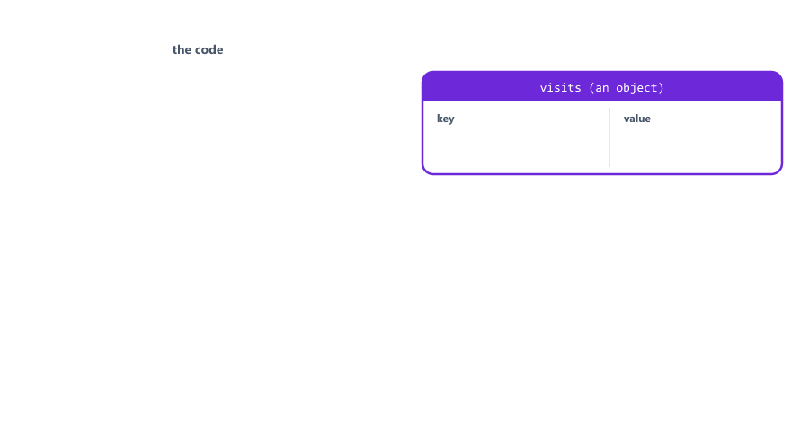
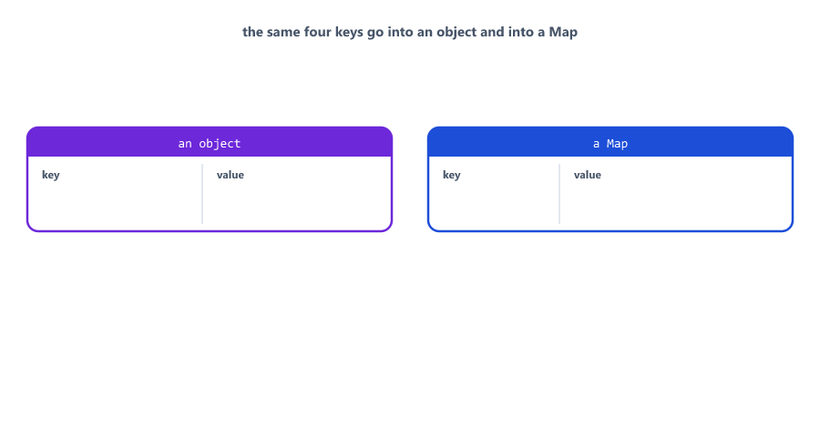
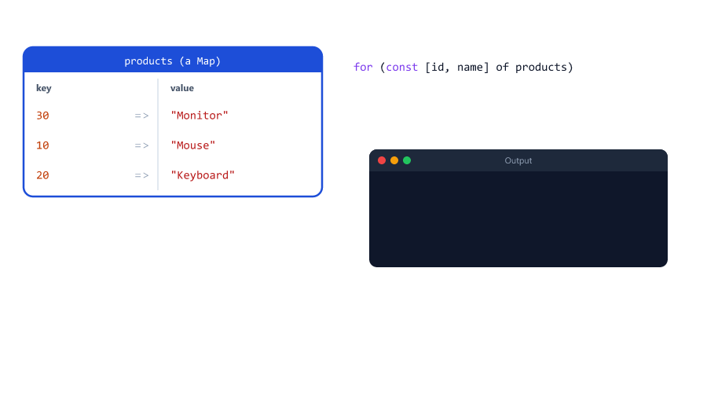
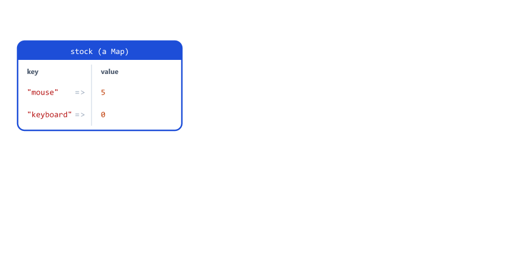
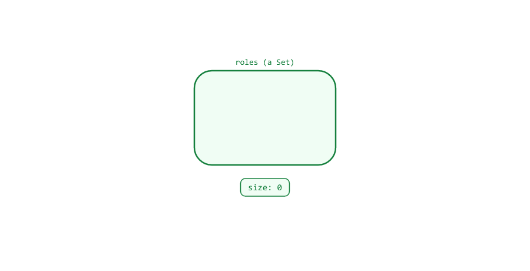
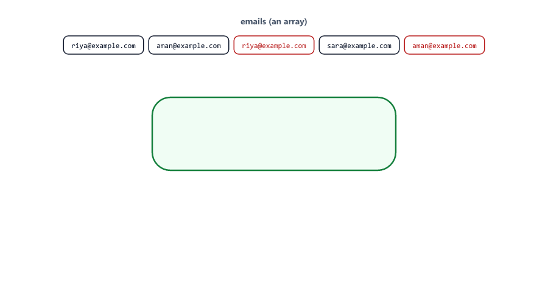
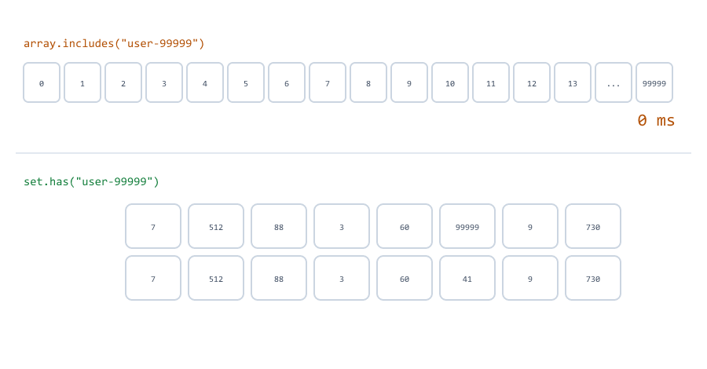
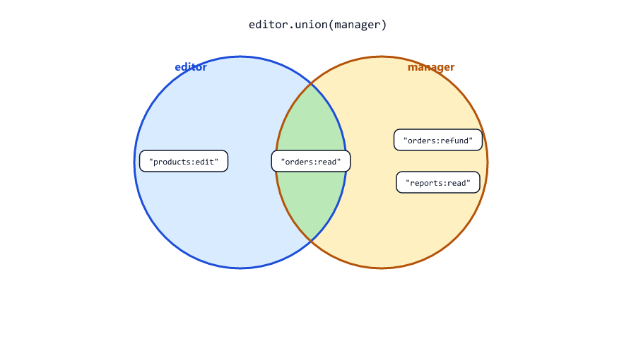
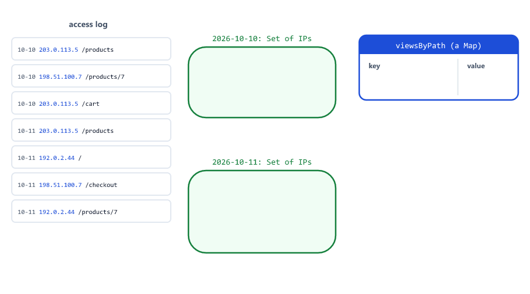

# Map and Set

> **Session 20 of 25** | Part 3: Real Programs | [All sessions](README.md#course-outline)

## Table of Contents
- [Why Map and Set?](#why-map-and-set)
- [Map Basics](#map-basics)
- [Creating a Map with Entries](#creating-a-map-with-entries)
- [Any Value Can Be a Key](#any-value-can-be-a-key)
- [Looping Over a Map](#looping-over-a-map)
- [Grouping with Map.groupBy](#grouping-with-mapgroupby)
- [Map or Object?](#map-or-object)
- [Maps and JSON](#maps-and-json)
- [A Cache with a Size Limit](#a-cache-with-a-size-limit)
- [Set Basics](#set-basics)
- [Removing Duplicates](#removing-duplicates)
- [Looping Over and Converting a Set](#looping-over-and-converting-a-set)
- [has() Is Fast](#has-is-fast)
- [Set Operations](#set-operations)
- [Objects in a Set Are Compared by Reference](#objects-in-a-set-are-compared-by-reference)
- [Copying Maps and Sets](#copying-maps-and-sets)
- [WeakMap and WeakSet](#weakmap-and-weakset)
- [Mini Example 1: A Login Session Store](#mini-example-1-a-login-session-store)
- [Mini Example 2: Unique Visitors per Day](#mini-example-2-unique-visitors-per-day)
- [Beginner Mistakes](#beginner-mistakes)
- [Practice Exercises](#practice-exercises)
- [Interview Questions](#interview-questions)

---

## Why Map and Set?

Objects (Session 13) and arrays (Session 12) can do almost everything. But when an object is used as a **lookup table**, where the keys come from data (user ids, emails, product codes), it has some surprising problems

object-keys.js

```javascript
const visits = {};

visits[1] = "number key";
visits["1"] = "text key";          // the same key!
console.log(visits);

const riya = { id: 7 };
const aman = { id: 8 };
visits[riya] = "Riya's data";
visits[aman] = "Aman's data";      // overwrites Riya's
console.log(Object.keys(visits));
console.log(visits[riya]);

console.log("constructor" in {});  // a key you never added
```

Output

```text
{ '1': 'text key' }
[ '1', '[object Object]' ]
Aman's data
true
```



- Object keys are always text: `1` becomes `"1"`, and every object becomes `"[object Object]"` (Session 08).
- Even an "empty" object already answers `true` for keys like `"constructor"`, which it gets from `Object.prototype` (Session 17).
- An object has no `size`; you need `Object.keys(obj).length`.

JavaScript has two collections built for these jobs:

| Collection | Holds                               | Like                                        |
| ---------- | ----------------------------------- | ------------------------------------------- |
| `Map`      | **Key -> value** pairs, keys of any type | A dictionary: look up a word, get its meaning |
| `Set`      | **Unique values**, no duplicates    | A guest list: each name appears only once   |

---

## Map Basics

Create a Map with `new Map()` (Session 17), then use its methods

map-basics.js

```javascript
const prices = new Map();

prices.set("mouse", 49900);
prices.set("keyboard", 149900);
prices.set("monitor", 899900);

console.log(prices.get("keyboard"));
console.log(prices.get("webcam"));
console.log(prices.has("mouse"), prices.has("webcam"));
console.log(prices.size);

prices.set("mouse", 39900);          // the same key: replaces the value
prices.delete("monitor");
console.log(prices);
console.log(prices.size);
```

Output

```text
149900
undefined
true false
3
Map(2) { 'mouse' => 39900, 'keyboard' => 149900 }
2
```


| Method               | Does                                                 | Returns                    |
| -------------------- | ---------------------------------------------------- | -------------------------- |
| `map.set(key, value)` | Adds the pair, or replaces the value of an existing key | The map itself         |
| `map.get(key)`       | Looks up a value                                     | The value, or `undefined`  |
| `map.has(key)`       | Checks whether the key exists                        | `true` / `false`           |
| `map.delete(key)`    | Removes the pair                                     | `true` if it was there     |
| `map.size`           | The number of pairs (a property, no `()`)            | A number                   |
| `map.clear()`        | Removes everything                                   | `undefined`                |

Node.js prints a Map with arrows: `'mouse' => 39900`. Always use `set` and `get`: `prices["mouse"] = ...` does **not** add an entry to the Map (see [Mistake 1](#mistake-1-using-brackets-instead-of-set-and-get)).

---

## Creating a Map with Entries

Pass an array of `[key, value]` pairs to fill a Map at once. `set()` returns the map, so calls can be chained

map-create.js

```javascript
const statusText = new Map([
  [200, "OK"],
  [201, "Created"],
  [404, "Not Found"],
]);

statusText.set(400, "Bad Request").set(500, "Internal Server Error");

console.log(statusText.get(404));
console.log(statusText.get("404"));
console.log(statusText.size);
```

Output

```text
Not Found
undefined
5
```

The keys `200`, `404` and so on stay **numbers**. `get("404")` with text finds nothing, because `404` and `"404"` are different keys in a Map. This matters on a server: ids from a URL are text (Session 05), so convert them first (see [Mistake 3](#mistake-3-looking-up-a-number-key-with-text)).

---

## Any Value Can Be a Key

A Map key can be anything: text, a number, even an object. The key is kept exactly as it is

map-object-keys.js

```javascript
const riya = { id: 7, name: "Riya" };
const aman = { id: 8, name: "Aman" };

const cartByUser = new Map();
cartByUser.set(riya, ["Mouse"]);
cartByUser.set(aman, ["Keyboard", "Monitor"]);

console.log(cartByUser.get(riya));
console.log(cartByUser.get(aman));
console.log(cartByUser.size);
console.log(cartByUser.get({ id: 7, name: "Riya" }));
```

Output

```text
[ 'Mouse' ]
[ 'Keyboard', 'Monitor' ]
2
undefined
```



The two users get two separate entries, unlike the object in [Why Map and Set?](#why-map-and-set). The last line finds nothing: an object key is matched **by reference** (Sessions 04 and 15), so a new object with the same content is a different key. Object keys are useful for attaching extra data to objects you already hold; most of the time, you will use ids and text as keys.

---

## Looping Over a Map

A Map remembers the order in which keys were added, and `for...of` (Session 07) gives you each pair as `[key, value]`

map-loop.js

```javascript
const products = new Map([
  [30, "Monitor"],
  [10, "Mouse"],
  [20, "Keyboard"],
]);

for (const [id, name] of products) {
  console.log(id, name);
}

console.log([...products.keys()]);
console.log([...products.values()]);
products.forEach((name, id) => console.log(`#${id}: ${name}`));

const sameAsObject = { 30: "Monitor", 10: "Mouse", 20: "Keyboard" };
console.log(Object.keys(sameAsObject));
```

Output

```text
30 Monitor
10 Mouse
20 Keyboard
[ 30, 10, 20 ]
[ 'Monitor', 'Mouse', 'Keyboard' ]
#30: Monitor
#10: Mouse
#20: Keyboard
[ '10', '20', '30' ]
```



| Way                          | Gives                              |
| ---------------------------- | ---------------------------------- |
| `for (const [key, value] of map)` | Each pair, destructured (Session 14) |
| `map.keys()`, `map.values()`, `map.entries()` | Lists you can loop over or spread into an array: `[...map.keys()]` |
| `map.forEach((value, key) => ...)` | **Value first**, then key (see [Mistake 11](#mistake-11-swapping-value-and-key-in-mapforeach)) |

The last line shows another object surprise: keys that look like numbers are sorted first, so the order you added them in is lost. A Map always keeps insertion order.

---

## Grouping with Map.groupBy

`Map.groupBy(array, callback)` (Node.js 21 and newer) puts the items of an array into groups. The callback returns the group key for each item

map-group.js

```javascript
const orders = [
  { id: 1, status: "paid", totalPaise: 49900 },
  { id: 2, status: "pending", totalPaise: 149900 },
  { id: 3, status: "paid", totalPaise: 89900 },
  { id: 4, status: "cancelled", totalPaise: 29900 },
];

const byStatus = Map.groupBy(orders, (order) => order.status);

for (const [status, list] of byStatus) {
  const total = list.reduce((sum, order) => sum + order.totalPaise, 0);
  console.log(`${status}: ${list.length} order${list.length === 1 ? "" : "s"}, Rs ${total / 100}`);
}
```

Output

```text
paid: 2 orders, Rs 1398
pending: 1 order, Rs 1499
cancelled: 1 order, Rs 299
```

The result is a Map from each status to an array of its orders. A dashboard or a daily report does this kind of grouping all the time. `Object.groupBy` does the same and returns an object instead.

---

## Map or Object?

| Use an **object** when ...                                    | Use a **Map** when ...                                      |
| ------------------------------------------------------------- | ----------------------------------------------------------- |
| It describes **one thing** with known fields: a user, an order | It is a **lookup table**: id -> user, email -> session, code -> price |
| The keys are fixed and written in your code                   | The keys come from data and change while the program runs   |
| It will be sent or saved as JSON                              | You add and delete entries often                            |
| You use dot notation: `user.email`                            | Keys may be numbers or objects, or you need `size` and insertion order |


Both are fine for small, simple cases. The Node.js course mostly uses objects and arrays, because its data travels as JSON and lives in MongoDB. Maps shine inside a running server: caches, sessions and counters.

---

## Maps and JSON

Session 19 warned that a Map becomes `{}` in JSON. Convert it to an object first with `Object.fromEntries`, and back with `Object.entries` (Session 13)

map-json.js

```javascript
const stock = new Map([
  ["mouse", 5],
  ["keyboard", 0],
]);

console.log(JSON.stringify(stock));                 // the data is lost
const asObject = Object.fromEntries(stock);
console.log(JSON.stringify(asObject));

const back = new Map(Object.entries(JSON.parse('{"mouse":5,"keyboard":0}')));
console.log(back.get("mouse"), back.size);
```

Output

```text
{}
{"mouse":5,"keyboard":0}
5 2
```



| Direction             | Code                                                |
| --------------------- | --------------------------------------------------- |
| Map -> object -> JSON | `JSON.stringify(Object.fromEntries(map))`           |
| JSON -> object -> Map | `new Map(Object.entries(JSON.parse(text)))`         |
| Map -> array of pairs | `[...map]`, which gives `[ [key, value], ... ]`     |

`Object.fromEntries` turns every key into text, so number keys come back as text. If the keys must stay numbers, send `[...map]` (an array of pairs) instead.

---

## A Cache with a Size Limit

Session 16 built a cache in a closure and promised a better store. A Map is that store, and its insertion order makes it easy to throw away the **oldest** entry when the cache is full

map-cache.js

```javascript
const MAX_ENTRIES = 3;
const cache = new Map();
let lookups = 0;

function getShippingCost(pincode) {
  if (cache.has(pincode)) {
    return cache.get(pincode);
  }
  lookups++;
  const cost = pincode.startsWith("4") ? 40 : 70;     // pretend this is slow
  if (cache.size >= MAX_ENTRIES) {
    const [oldest] = cache.keys();                    // a Map remembers the order keys were added
    cache.delete(oldest);
  }
  cache.set(pincode, cost);
  return cost;
}

["411001", "110001", "411001", "560001", "700001", "411001"].forEach((pin) => getShippingCost(pin));

console.log([...cache.keys()]);
console.log(`Lookups: ${lookups}`);
```

Output

```text
[ '560001', '700001', '411001' ]
Lookups: 5
```


| Request    | Cache before                    | What happens                          |
| ---------- | ------------------------------- | ------------------------------------- |
| `411001`   | empty                           | Looked up and saved                   |
| `110001`   | 411001                          | Looked up and saved                   |
| `411001`   | 411001, 110001                  | Found in the cache: no lookup         |
| `560001`   | 411001, 110001                  | Looked up and saved (the cache is now full) |
| `700001`   | 411001, 110001, 560001          | The oldest, `411001`, is removed      |
| `411001`   | 110001, 560001, 700001          | Looked up again; `110001` is removed  |

`const [oldest] = cache.keys();` destructures the first key (Session 14). The size limit stops the cache from growing forever (Session 16). This simple rule removes the oldest **added** entry; real caches often remove the least recently **used** one instead (see [Exercise 6](#exercise-6)).

---

## Set Basics

A **Set** holds values, and each value only once. Adding a value that is already there does nothing

set-basics.js

```javascript
const roles = new Set();

roles.add("user");
roles.add("editor");
roles.add("user");                 // already there: ignored

console.log(roles);
console.log(roles.size);
console.log(roles.has("editor"), roles.has("admin"));

roles.delete("editor");
console.log(roles);
```

Output

```text
Set(2) { 'user', 'editor' }
2
true false
Set(1) { 'user' }
```



| Method             | Does                                          |
| ------------------ | --------------------------------------------- |
| `set.add(value)`   | Adds the value if it is not there yet (returns the set) |
| `set.has(value)`   | Checks whether the value is in the set        |
| `set.delete(value)` | Removes the value                            |
| `set.size`         | The number of values                          |
| `set.clear()`      | Removes everything                            |

A Set has no index and no `get`: `roles[0]` does not work. You only ask "is this value in it?", or loop over all of them.

---

## Removing Duplicates

Session 12 removed duplicate emails with `filter` and `indexOf`, and promised an easier way. Put the array into a Set, then spread it back into an array (Session 14)

set-dedupe.js

```javascript
const emails = ["riya@example.com", "aman@example.com", "riya@example.com", "sara@example.com", "aman@example.com"];

const unique = [...new Set(emails)];

console.log(unique);
console.log(`${emails.length} emails, ${unique.length} unique`);
```

Output

```text
[ 'riya@example.com', 'aman@example.com', 'sara@example.com' ]
5 emails, 3 unique
```



`new Set(array)` keeps the first copy of each value, in its original order. `[...set]` (or `Array.from(set)`) turns the Set back into an array, so you can use `map`, `filter` and `sort` again. This works for text, numbers and booleans; objects need another way (see [Objects in a Set Are Compared by Reference](#objects-in-a-set-are-compared-by-reference)).

---

## Looping Over and Converting a Set

`for...of` and `forEach` go through a Set in the order values were added. Spread it into an array to sort it or to send it as JSON

set-tags.js

```javascript
const products = [
  { name: "Mouse", tags: ["electronics", "wireless"] },
  { name: "Keyboard", tags: ["electronics", "office"] },
  { name: "Desk", tags: ["office", "furniture"] },
];

const allTags = new Set();
for (const product of products) {
  product.tags.forEach((tag) => allTags.add(tag));
}

console.log(allTags.size);
console.log([...allTags].toSorted());
console.log(JSON.stringify({ tags: [...allTags] }));
```

Output

```text
4
[ 'electronics', 'furniture', 'office', 'wireless' ]
{"tags":["electronics","wireless","office","furniture"]}
```

Six tags went in, four different ones came out. Like a Map, a Set becomes `{}` in JSON (Session 19), so always send `[...set]`. A tag filter on a shop's website is built exactly like this: collect every product's tags into a Set and send the list.

---

## has() Is Fast

To check whether a value is in an **array**, `includes` (Session 12) looks at the items one by one. A Set finds a value directly, however many values it holds. On a server that checks every request against a long list, this difference is huge

set-speed.js

```javascript
const blockedIds = [];
for (let i = 0; i < 100_000; i++) {
  blockedIds.push(`user-${i}`);
}
const blockedSet = new Set(blockedIds);

let start = Date.now();
let found = 0;
for (let i = 0; i < 2_000; i++) {
  if (blockedIds.includes(`user-${99_999 - i}`)) found++;
}
console.log(`Array includes: ${Date.now() - start} ms (${found} found)`);

start = Date.now();
found = 0;
for (let i = 0; i < 2_000; i++) {
  if (blockedSet.has(`user-${99_999 - i}`)) found++;
}
console.log(`Set has:        ${Date.now() - start} ms (${found} found)`);
```

Output (yours will be different)

```text
Array includes: 470 ms (2000 found)
Set has:        0 ms (2000 found)
```



The same 2,000 checks took 470 ms with an array and less than 1 ms with a Set (`Date.now()`, Session 19). For a few items, either is fine. For long lists that are checked often (blocked users, used coupon codes, logged-out tokens), use a Set. `map.has()` and `map.get()` are just as fast.

---

## Set Operations

Comparing two groups is common: which permissions does a role have, which are missing? Node.js 22 and newer have these methods on every Set

set-operations.js

```javascript
const required = new Set(["orders:read", "orders:refund"]);
const editor = new Set(["orders:read", "products:edit"]);
const manager = new Set(["orders:read", "orders:refund", "reports:read"]);

console.log(editor.union(manager));
console.log(editor.intersection(manager));
console.log(manager.difference(editor));
console.log(required.isSubsetOf(editor), required.isSubsetOf(manager));
console.log(required.difference(editor));      // what the editor is missing
```

Output

```text
Set(4) {
  'orders:read',
  'products:edit',
  'orders:refund',
  'reports:read'
}
Set(1) { 'orders:read' }
Set(2) { 'orders:refund', 'reports:read' }
false true
Set(1) { 'orders:refund' }
```



| Method                    | Gives                                       | In words                    |
| ------------------------- | ------------------------------------------- | --------------------------- |
| `a.union(b)`              | Everything in `a` or `b`                    | All of both                 |
| `a.intersection(b)`       | Only what is in both                        | What they share             |
| `a.difference(b)`         | What is in `a` but not in `b`               | What `b` is missing from `a` |
| `a.isSubsetOf(b)`         | `true` if everything in `a` is also in `b`  | Does `b` have all of `a`?   |

`required.isSubsetOf(manager)` is a permission check: the manager has every required permission, the editor does not. The Node.js course checks one role with `requireRole("admin")` (Session 14); permission sets are how bigger apps do it. On an older Node.js, write the same with `filter` and `has`: `[...a].filter((x) => b.has(x))` is the intersection.

---

## Objects in a Set Are Compared by Reference

A Set (and a Map key) checks objects by reference, like `===` (Session 04). Two objects with the same content are still two different values

set-objects.js

```javascript
const users = [
  { id: 1, name: "Riya" },
  { id: 2, name: "Aman" },
  { id: 1, name: "Riya" },
];

console.log(new Set(users).size);           // 3: every object is a different object

const byId = new Map(users.map((user) => [user.id, user]));
console.log([...byId.values()]);
```

Output

```text
3
[ { id: 1, name: 'Riya' }, { id: 2, name: 'Aman' } ]
```

To remove duplicate objects, use a Map keyed by something unique, like the `id`. `users.map((user) => [user.id, user])` builds the `[key, value]` pairs; a later user with the same id replaces the earlier one, and `values()` gives back one user per id.

---

## Copying Maps and Sets

`new Map(oldMap)` and `new Set(oldSet)` make **shallow** copies: a new collection, with the same values inside (Session 15). `structuredClone` copies every level

copy-map.js

```javascript
const stock = new Map([["mouse", { qty: 5 }]]);

const shallow = new Map(stock);
const deep = structuredClone(stock);

shallow.get("mouse").qty = 0;

console.log(stock.get("mouse").qty);
console.log(deep.get("mouse").qty);
```

Output

```text
0
5
```

The shallow copy shares the `{ qty: 5 }` object with the original, so changing it through the copy changed the original too. Session 15 promised this: `structuredClone` copies Maps and Sets, including the objects inside them.

---

## WeakMap and WeakSet

`WeakMap` and `WeakSet` are special versions you will see in libraries. Their keys must be objects, and they do not keep those objects alive: when nothing else uses an object, it is removed from memory, and its entry disappears too. They have no `size` and cannot be looped over.

They are used to attach extra data to objects without causing memory leaks (Session 16), for example caching a result per request object. In your own code, a normal `Map` or `Set` is almost always what you need.

---

## Mini Example 1: A Login Session Store

When a user logs in, many servers create a **session**: a random session id, sent to the browser in a cookie, that points to the user. The server must look up the session on every request, forget sessions after 30 minutes of inactivity, and know who is online. A Map from session id to session data is a natural fit

session-store.js

```javascript
const SESSION_MINUTES = 30;
const MINUTE_MS = 60 * 1000;

const sessions = new Map();         // sessionId -> { userId, lastSeen }

function login(sessionId, userId, now) {
  sessions.set(sessionId, { userId, lastSeen: now });
}

function getUserId(sessionId, now) {
  const session = sessions.get(sessionId);
  if (!session) {
    return null;
  }
  if (now - session.lastSeen > SESSION_MINUTES * MINUTE_MS) {
    sessions.delete(sessionId);       // expired
    return null;
  }
  session.lastSeen = now;             // still active: keep it alive
  return session.userId;
}

function removeExpired(now) {
  for (const [sessionId, session] of sessions) {
    if (now - session.lastSeen > SESSION_MINUTES * MINUTE_MS) {
      sessions.delete(sessionId);
    }
  }
}

function onlineUsers() {
  return new Set([...sessions.values()].map((session) => session.userId));
}

const start = Date.UTC(2026, 9, 11, 9, 0);      // 09:00 UTC
login("s1", "riya", start);
login("s2", "aman", start);
login("s3", "riya", start + 5 * MINUTE_MS);     // Riya on a second device

console.log(sessions.size, onlineUsers());
console.log(getUserId("s1", start + 20 * MINUTE_MS));   // 09:20: Riya is active
console.log(getUserId("s2", start + 40 * MINUTE_MS));   // 09:40: Aman has expired
removeExpired(start + 40 * MINUTE_MS);
console.log(sessions.size, onlineUsers());
console.log(getUserId("s9", start));
```

Output

```text
3 Set(2) { 'riya', 'aman' }
riya
null
1 Set(1) { 'riya' }
null
```


| Part                                 | Why                                                              |
| ------------------------------------ | ---------------------------------------------------------------- |
| `new Map()` with session ids as keys | One fast lookup per request, and easy `delete` on logout or expiry |
| `lastSeen` timestamps                | Date math from Session 19: `now - lastSeen` in milliseconds      |
| Deleting inside `for...of`           | Allowed for a Map: removing the current entry does not break the loop |
| `new Set(... userId)`                | Riya has two sessions (two devices) but is one online user       |
| `now` as a parameter                 | The output is the same on every run, and it is easy to test      |

A real server would run `removeExpired` every few minutes with a timer (Session 22). Keeping sessions in a Map has a weakness: a restart forgets everyone, and a second server cannot see them, which is why production apps keep sessions in a database like Redis. The Node.js course avoids server-side sessions by using JWT tokens, which carry the user's id themselves (Session 22).

---

## Mini Example 2: Unique Visitors per Day

A shop owner asks two questions about the access log (Node.js course, Session 26 writes logs like this): how many **different** visitors came each day, and which page is viewed most? A Map of Sets answers the first, and a Map of counters the second

visitors.js

```javascript
const log = `2026-10-10 09:12:01 203.0.113.5 GET /products
2026-10-10 09:15:44 198.51.100.7 GET /products/7
2026-10-10 10:02:13 203.0.113.5 GET /cart
2026-10-11 08:30:00 203.0.113.5 GET /products
2026-10-11 08:31:10 192.0.2.44 GET /
2026-10-11 09:05:59 198.51.100.7 GET /checkout
2026-10-11 09:06:30 192.0.2.44 GET /products/7`;

const visitorsByDay = new Map();          // day -> Set of IP addresses
const viewsByPath = new Map();            // path -> number of views

for (const line of log.split("\n")) {
  const [day, , ip, , path] = line.split(" ");

  if (!visitorsByDay.has(day)) {
    visitorsByDay.set(day, new Set());
  }
  visitorsByDay.get(day).add(ip);

  viewsByPath.set(path, (viewsByPath.get(path) ?? 0) + 1);
}

for (const [day, ips] of visitorsByDay) {
  console.log(`${day}: ${ips.size} unique visitors`);
}

const [topPath, topViews] = [...viewsByPath].toSorted((a, b) => b[1] - a[1])[0];
console.log(`Most viewed: ${topPath} (${topViews} views)`);
console.log(JSON.stringify(Object.fromEntries(viewsByPath)));
```

Output

```text
2026-10-10: 2 unique visitors
2026-10-11: 3 unique visitors
Most viewed: /products (2 views)
{"/products":2,"/products/7":2,"/cart":1,"/":1,"/checkout":1}
```



- `line.split(" ")` with destructuring that skips the time and the method (`[day, , ip, , path]`, Session 14).
- For each day, the Map holds a **Set** of IP addresses. `203.0.113.5` visited three times on 10 October, but it is counted once.
- `if (!visitorsByDay.has(day)) visitorsByDay.set(day, new Set());` creates the Set the first time a day appears.
- `viewsByPath.get(path) ?? 0` starts each counter at 0 (Session 04), the same counting pattern as the rate limiter in Session 16.
- `[...viewsByPath]` turns the Map into `[path, count]` pairs, so they can be sorted by count with `toSorted` (Session 12).
- The IP addresses come from ranges reserved for examples, so they belong to nobody.

---

## Beginner Mistakes

### Mistake 1: Using brackets instead of set and get

**Incorrect**

```javascript
const prices = new Map();
prices["mouse"] = 49900;              // NOT a Map entry

console.log(prices.get("mouse"));
console.log(prices.size);
console.log(prices);
```

```text
undefined
0
Map(0) { mouse: 49900 }
```

The brackets added a normal property to the Map **object**, not an entry. The Map is still empty. **Correct:** `prices.set("mouse", 49900)` and `prices.get("mouse")`.

### Mistake 2: Using length on a Map or Set

**Incorrect**

```javascript
const tags = new Set(["node", "express"]);

console.log(tags.length);
console.log(tags.size);
```

```text
undefined
2
```

**Correct:** Maps and Sets use `size`, a property without `()`. Arrays and strings use `length`.

### Mistake 3: Looking up a number key with text

**Incorrect**

```javascript
const products = new Map([[7, "Wireless Mouse"]]);

const idFromUrl = "7";                       // values from a URL are text
console.log(products.get(idFromUrl));
console.log(products.get(Number(idFromUrl)));
```

```text
undefined
Wireless Mouse
```

In a Map, `7` and `"7"` are different keys. Values from `req.params` and `req.query` are always text (Session 05). **Correct:** convert first with `Number(...)`, or use text keys everywhere.

### Mistake 4: Passing a string to new Set

**Incorrect**

```javascript
const roles = new Set("admin");     // meant: a set with one role

console.log(roles);
console.log(roles.has("admin"));
```

```text
Set(5) { 'a', 'd', 'm', 'i', 'n' }
false
```

`new Set(...)` takes a list and adds each item, and a string is a list of characters (Session 07). **Correct:** `new Set(["admin"])`.

### Mistake 5: Sending a Map or Set as JSON directly

**Incorrect:** `JSON.stringify(stock)` or `res.json({ tags: tagSet })`. Both become `{}`, and the data is silently lost (see [Maps and JSON](#maps-and-json)).

**Correct:** `Object.fromEntries(map)` for a Map, `[...set]` for a Set.

### Mistake 6: Expecting a Set to remove duplicate objects

**Incorrect:** `new Set(users)` to remove duplicate users. Objects are compared by reference, so two objects with the same content both stay (see [Objects in a Set Are Compared by Reference](#objects-in-a-set-are-compared-by-reference)).

**Correct:** use a Map keyed by the id: `new Map(users.map((user) => [user.id, user]))`.

### Mistake 7: Looking up an object key with a new object

**Incorrect:** `cartByUser.get({ id: 7, name: "Riya" })` returns `undefined`, even though an equal-looking object is a key (see [Any Value Can Be a Key](#any-value-can-be-a-key)).

**Correct:** use the same object you stored, or better, use the user's id as the key.

### Mistake 8: Using includes for big lookups

**Incorrect:** checking every request against a 100,000-item array with `includes`. It looks at the items one by one (see [has() Is Fast](#has-is-fast)).

**Correct:** keep the list in a Set and use `has`.

### Mistake 9: A Map cache with no limit

**Incorrect:** `cache.set(key, value)` for every new key on a server that runs for weeks. The Map grows until the server runs out of memory (Session 16).

**Correct:** remove old entries when the Map reaches a size limit (see [A Cache with a Size Limit](#a-cache-with-a-size-limit)).

### Mistake 10: Changing a Map through a shallow copy

**Incorrect:** `const copy = new Map(stock);` then changing an object inside `copy`. The objects are shared, so the original changes too (see [Copying Maps and Sets](#copying-maps-and-sets)).

**Correct:** `structuredClone(stock)` when you need to change the values inside.

### Mistake 11: Swapping value and key in map.forEach

**Incorrect**

```javascript
const stock = new Map([["mouse", 5]]);

stock.forEach((key, value) => {
  console.log(`${key}: ${value}`);       // the names are swapped!
});
```

```text
5: mouse
```

`forEach` passes the **value first**, then the key, like an array's `forEach((item, index))`. **Correct:** `stock.forEach((value, key) => ...)`, or use `for (const [key, value] of stock)`, where the order matches the entries.

---

## Practice Exercises

### Exercise 1

Count how often each word appears in `"the cat and the dog and the bird"` using a Map. Print each word with its count, then print the 2 most common words (spread the Map and sort it, as in [Mini Example 2](#mini-example-2-unique-visitors-per-day)).

### Exercise 2

Build a phone book as a Map from name to phone number. Add three people, change one number, delete one person, and print the remaining entries sorted by name.

### Exercise 3

Given `const orders = [["riya", "Mouse"], ["aman", "Desk"], ["riya", "Keyboard"], ["sara", "Mouse"]];`, build a Map from each customer to a **Set** of the products they bought, and print each customer with their products joined by commas.

### Exercise 4

Riya follows `["aman", "sara", "kabir"]` and Aman follows `["sara", "neha", "riya"]`. Using Sets, print who they both follow, everyone either of them follows, and "people you may know": the people Aman follows that Riya does not (leaving out Riya).

### Exercise 5

Convert `new Map([["mouse", 5], ["desk", 2]])` to JSON text, then turn the text back into a Map. Check that `get("mouse")` gives `5` again.

### Exercise 6

Change the cache in [A Cache with a Size Limit](#a-cache-with-a-size-limit) so that it removes the **least recently used** entry instead: when a key is found, `delete` it and `set` it again, so it moves to the end. Run the same six requests and compare the cache and the number of lookups.

### Exercise 7

Add `logout(sessionId)` and `logoutEverywhere(userId)` to [Mini Example 1](#mini-example-1-a-login-session-store). The second must delete every session of that user (loop over the Map). Print `onlineUsers()` after each.

### Exercise 8

Extend [Mini Example 2](#mini-example-2-unique-visitors-per-day) so that it also finds, for each IP address, the Set of pages it visited, and prints the IP that visited the most **different** pages.

---

## Interview Questions

### What is a Map, and how is it different from an object?

A Map is a collection of key-value pairs. Its keys can be any type (numbers, objects), not only text, and are kept as they are. It remembers insertion order, has a `size`, has no inherited keys, and is built for adding and removing entries often. You use `set`, `get`, `has` and `delete` instead of dot or bracket access.

### When would you use a Map instead of an object?

For lookup tables whose keys come from data and change at run time: sessions by id, a cache by URL, counters by IP address. Use an object for a record with fixed, known fields that will be sent as JSON, like a user or an order.

### What is a Set?

A collection of unique values. Adding a value that is already there does nothing. It has `add`, `has`, `delete` and `size`, keeps insertion order, and has no indexes.

### How do you remove duplicates from an array?

`[...new Set(array)]` for primitive values like text and numbers. For objects, use a Map keyed by a unique field: `[...new Map(items.map((item) => [item.id, item])).values()]`.

### How are keys compared in a Map or a Set?

Primitives are compared by value (`1` and `"1"` are different keys, and `NaN` matches `NaN`). Objects are compared by reference: two separate objects with the same content are two different keys.

### Can you use an object as a Map key?

Yes. The key is the object itself, matched by reference, so you must look it up with the same object. This is useful to attach data to objects you already hold; often an id is a simpler key.

### How do you loop over a Map?

`for (const [key, value] of map)`, or `map.forEach((value, key) => ...)`, or loop over `map.keys()`, `map.values()` or `map.entries()`. All of them follow insertion order.

### How do you turn a Map or a Set into JSON?

`JSON.stringify` turns both into `{}`. Convert first: `JSON.stringify(Object.fromEntries(map))` for a Map, or `JSON.stringify([...set])` for a Set. To get a Map back, use `new Map(Object.entries(JSON.parse(text)))`.

### Why is set.has() faster than array.includes()?

`includes` checks the items one by one, so the time grows with the length of the array. A Set uses a hash table internally and finds a value in about the same time however big it is. For large lists that are checked often, a Set is much faster.

### What are union, intersection and difference?

Union: everything in either set. Intersection: only what is in both. Difference: what is in the first set but not the second. Node.js 22+ has `a.union(b)`, `a.intersection(b)`, `a.difference(b)` and `a.isSubsetOf(b)`; older versions use `filter` with `has`.

### What are WeakMap and WeakSet?

Versions of Map and Set whose keys (or values, for WeakSet) must be objects, held "weakly": they do not stop an object from being removed from memory. They have no `size` and cannot be looped over. They are used to attach data to objects without memory leaks.

### Why do Map and Set use size and not length?

`length` belongs to things with numbered positions, like arrays and strings. Maps and Sets have no positions, only a count of entries, which is `size`.

### How do you copy a Map or a Set?

`new Map(map)` and `new Set(set)` make shallow copies: a new collection whose values are shared with the original. `structuredClone(map)` makes a deep copy, including the objects inside.

### What does Map.groupBy do?

`Map.groupBy(array, callback)` (Node.js 21+) groups the items of an array into a Map: the callback returns a key for each item, and each key maps to an array of the items with that key. `Object.groupBy` does the same and returns a plain object.

---

| Previous | All sessions | Next |
| :--- | :---: | ---: |
| [19. JSON and Dates](19-json-and-dates.md) | [Course outline](README.md#course-outline) | [21. Modules](21-modules.md) |
