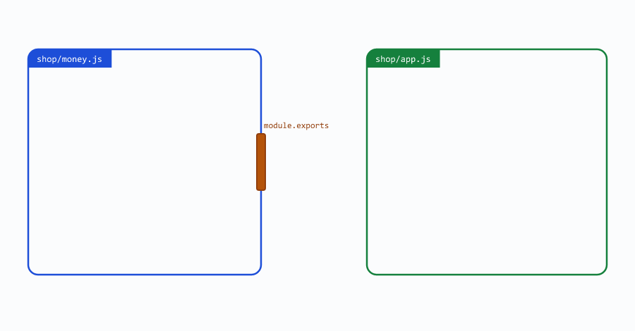
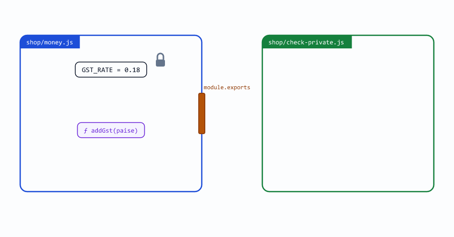
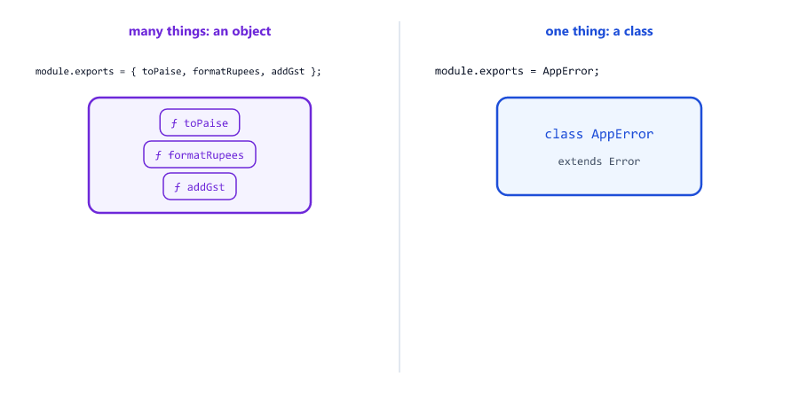
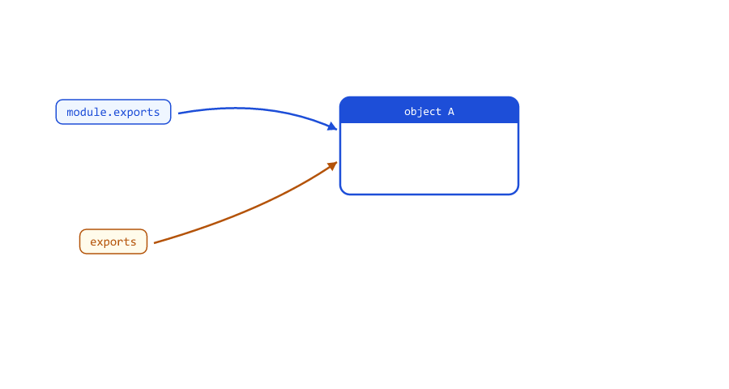
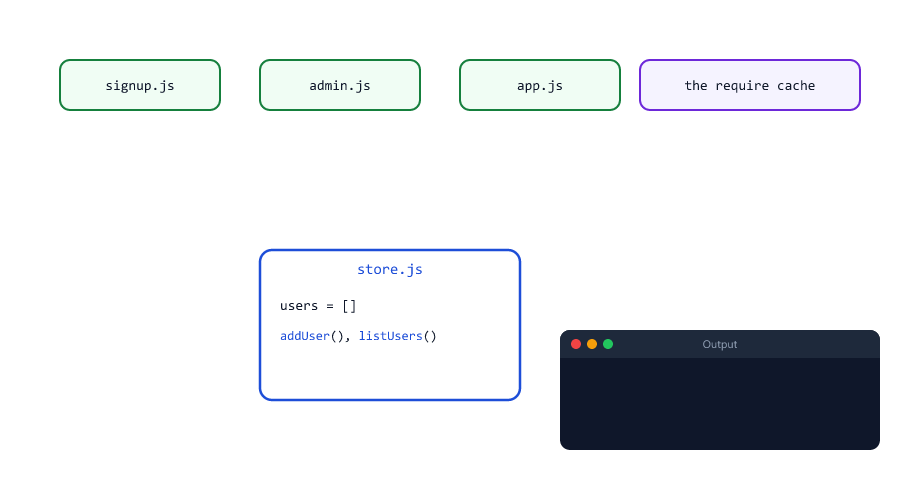
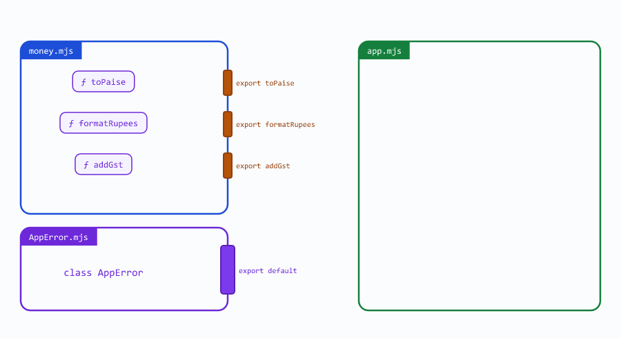
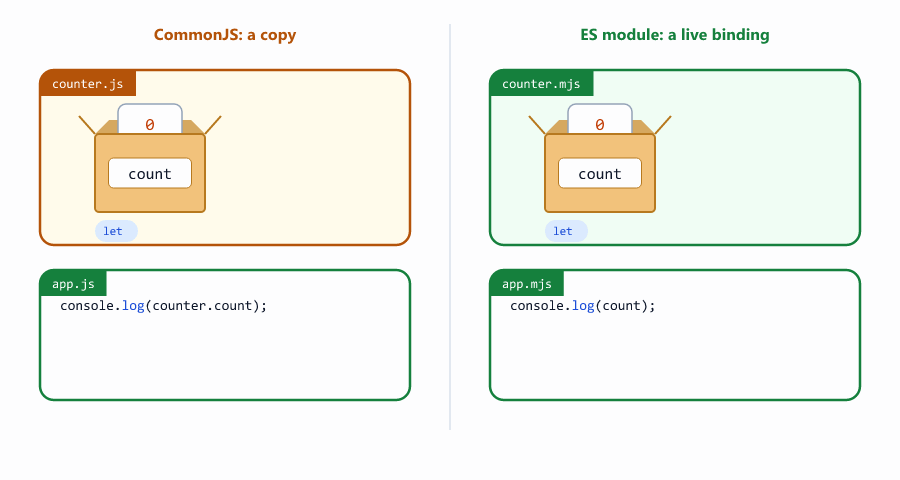
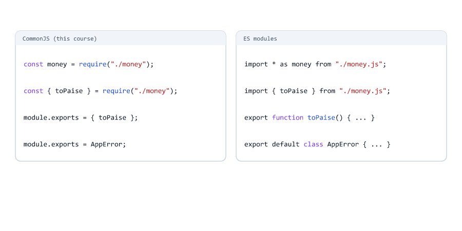
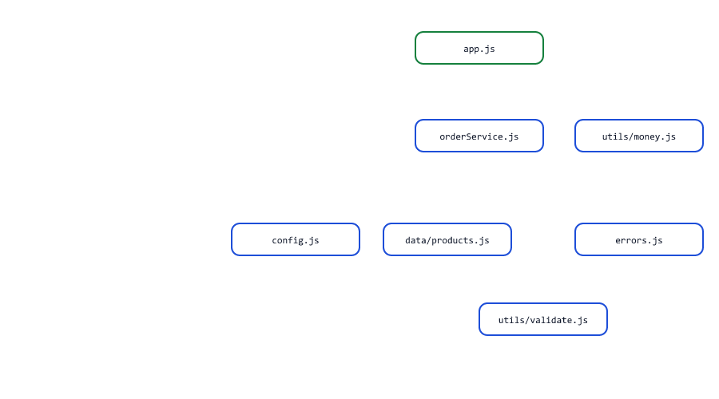
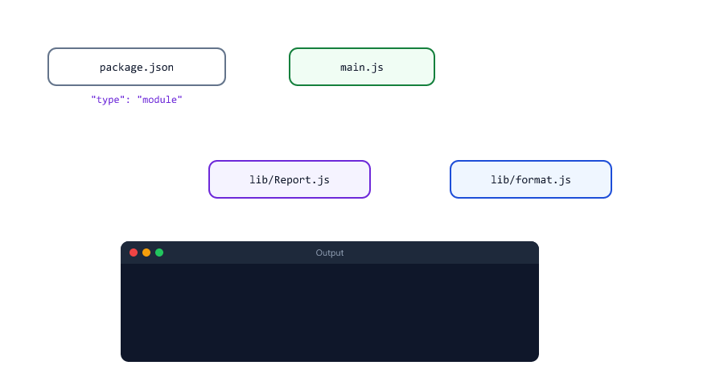

# Modules

## Table of Contents
- [What is a Module?](#what-is-a-module)
- [Your First Module](#your-first-module)
- [How require Works](#how-require-works)
- [What a Module Keeps Private](#what-a-module-keeps-private)
- [Exporting One Thing](#exporting-one-thing)
- [The exports Shortcut and Its Trap](#the-exports-shortcut-and-its-trap)
- [A Module Runs Only Once](#a-module-runs-only-once)
- [Built-in Modules and npm Packages](#built-in-modules-and-npm-packages)
- [How require Finds a Module](#how-require-finds-a-module)
- [A Folder with index.js](#a-folder-with-indexjs)
- [ES Modules: import and export](#es-modules-import-and-export)
- [Using ES Modules in Node.js](#using-es-modules-in-nodejs)
- [ES Module Rules](#es-module-rules)
- [Live Bindings: a Difference You Can See](#live-bindings-a-difference-you-can-see)
- [CommonJS or ES Modules?](#commonjs-or-es-modules)
- [Mini Example 1: Splitting a Shop into Modules](#mini-example-1-splitting-a-shop-into-modules)
- [Mini Example 2: A Sales Report as ES Modules](#mini-example-2-a-sales-report-as-es-modules)
- [Beginner Mistakes](#beginner-mistakes)
- [Practice Exercises](#practice-exercises)
- [Interview Questions](#interview-questions)

---

## What is a Module?

So far, every program in this course was one file. A real server has thousands of lines: routes, database code, validation, error classes, helpers. In one file, nobody could find anything. So the code is split into many small files, each with one job.

In Node.js, **every file is a module**. A module keeps its code to itself, and decides what other files may use.

| Without modules (one big file)              | With modules (many small files)               |
| ------------------------------------------- | --------------------------------------------- |
| Hard to find anything                       | Each file has one clear job: `money.js`, `validate.js` |
| Names clash: two `format` functions         | Each file has its own names (Session 16)      |
| Copying code between projects               | Reuse a file with one `require`               |
| One change can break anything               | A file only shares what it exports            |

The Node.js course uses a picture for this: a module is a room, and `module.exports` is its door. Only what you put through the door can be used outside (Node.js course, Session 04).



---

## Your First Module

Create a folder `shop` inside `js-practice`, with two files. Session 13 promised this exact pattern: a `money` object of helpers, used from another file

shop/money.js

```javascript
const GST_RATE = 0.18;                 // private: not exported

function toPaise(rupees) {
  return Math.round(rupees * 100);
}

function formatRupees(paise) {
  return `Rs ${(paise / 100).toFixed(2)}`;
}

function addGst(paise) {
  return paise + Math.round(paise * GST_RATE);
}

module.exports = { toPaise, formatRupees, addGst };
```

shop/app.js

```javascript
const money = require("./money");

const pricePaise = money.toPaise(499.5);

console.log(pricePaise);
console.log(money.formatRupees(pricePaise));
console.log(money);
```

Run it from the `js-practice` folder with `node shop/app.js`.

Output

```text
49950
Rs 499.50
{
  toPaise: [Function: toPaise],
  formatRupees: [Function: formatRupees],
  addGst: [Function: addGst]
}
```

| Code                                        | Meaning                                                    |
| ------------------------------------------- | ---------------------------------------------------------- |
| `module.exports = { toPaise, formatRupees, addGst }` | What `money.js` gives to other files: an object of three functions (shorthand, Session 13) |
| `require("./money")`                        | Load `money.js` from the same folder and return its `module.exports` |
| `./`                                        | "Start from the folder of **this** file". The `.js` can be left out |
| `money.toPaise(...)`                        | Use what was exported, like methods of an object           |

Session 14 showed the shorter form: destructure only what you need

shop/app-destructure.js

```javascript
const { toPaise, formatRupees } = require("./money");

console.log(formatRupees(toPaise(1499)));
```

Output

```text
Rs 1499.00
```

This is the style you will see in the Node.js course: `const { add } = require("./math")` (Session 04) and `const express = require("express")` (Session 12).

---

## How require Works

When `require("./money")` runs, Node.js does four things

| Step | What happens                                                                    |
| ---- | ------------------------------------------------------------------------------- |
| 1    | Finds the file: `./money` becomes `shop/money.js`                               |
| 2    | Wraps the file's code in a function (the module wrapper, Session 16) and runs it once |
| 3    | Remembers the result in a **cache**                                             |
| 4    | Returns `module.exports`, which is stored in your variable                      |


`require` is just a function that returns a value, so it can be used anywhere. But by convention, every `require` goes at the **top** of the file, so you can see at a glance what a file depends on.

---

## What a Module Keeps Private

Session 16 said that top-level variables belong to their file. Here is the proof

shop/check-private.js

```javascript
const money = require("./money");

console.log(money.addGst(10000));    // uses GST_RATE inside money.js
console.log(money.GST_RATE);         // not exported
console.log(typeof GST_RATE);        // not a variable in this file either
```

Output

```text
11800
undefined
undefined
```



`addGst` can still use `GST_RATE`: it was written in the same file, so `GST_RATE` is on its scope chain (a closure, Session 16). Other files cannot see it at all. This is how a module hides its details: other files use the functions, and the module can change how they work inside without breaking anyone.

---

## Exporting One Thing

`module.exports` can be anything: an object of many things, or **one** function or class. Session 17 promised a class in its own file; here is the `AppError` class from Session 18

errors-demo/AppError.js

```javascript
class AppError extends Error {
  constructor(message, statusCode) {
    super(message);
    this.name = "AppError";
    this.statusCode = statusCode;
  }
}

module.exports = AppError;
```

errors-demo/app.js

```javascript
const AppError = require("./AppError");

const error = new AppError("Product not found", 404);
console.log(error.name, error.statusCode, error.message);
console.log(error instanceof AppError);
```

Output

```text
AppError 404 Product not found
true
```



| Export                                   | Require it as                           | Common for                        |
| ---------------------------------------- | --------------------------------------- | --------------------------------- |
| `module.exports = { a, b };`             | `const { a, b } = require("./file");`   | A file of helper functions        |
| `module.exports = AppError;`             | `const AppError = require("./AppError");` | One class or one function per file |

This is exactly how the Node.js course organises its project: `utils/AppError.js` exports one class (Session 24), and each Mongoose model file exports one model: `module.exports = mongoose.model("Student", studentSchema)` (Session 19). A file that exports one class is usually named after it, with a capital letter.

---

## The exports Shortcut and Its Trap

Node.js also gives every module a variable called `exports`, which starts as the **same object** as `module.exports`. Adding properties to it works. Replacing it does not

exports-trap/math.js

```javascript
exports.add = (a, b) => a + b;              // works: adds to module.exports

exports = { subtract: (a, b) => a - b };    // breaks the link: NOT exported
```

exports-trap/app.js

```javascript
const math = require("./math");

console.log(math);
console.log(math.add(2, 3));
console.log(math.subtract);
```

Output

```text
{ add: [Function (anonymous)] }
5
undefined
```



`require` always returns `module.exports`. After `exports = { ... }`, the variable `exports` points to a new object, but `module.exports` still points to the old one (references, Session 15). The rule is simple: use `module.exports = { ... }` and you never meet this problem.

---

## A Module Runs Only Once

The first `require` of a file runs it. Every later `require` of the same file returns the **same** `module.exports` from the cache, without running the file again

runs-once/store.js

```javascript
console.log("store.js is loading...");

const users = [];

function addUser(name) {
  users.push(name);
}

function listUsers() {
  return [...users];
}

module.exports = { addUser, listUsers };
```

runs-once/signup.js

```javascript
const store = require("./store");

function signup(name) {
  store.addUser(name);
}

module.exports = signup;
```

runs-once/admin.js

```javascript
const store = require("./store");

function report() {
  return `Users: ${store.listUsers().join(", ")}`;
}

module.exports = report;
```

runs-once/app.js

```javascript
const signup = require("./signup");
const report = require("./admin");
const storeAgain = require("./store");

signup("Riya");
signup("Aman");

console.log(report());
console.log(storeAgain.listUsers().length);
```

Output

```text
store.js is loading...
Users: Riya, Aman
2
```



- `store.js` was required three times, but "loading" was printed **once**.
- `signup.js` and `admin.js` got the same `users` array, so users added in one file show up in the other.
- `listUsers()` returns a copy, `[...users]` (Session 15), so no other file can change the list directly.

This is how one database connection or one in-memory store is shared by a whole server: create it in a module, and require that module wherever it is needed (like the single `UserStore` in Session 17).

---

## Built-in Modules and npm Packages

Node.js comes with built-in modules. Load them by name, with the `node:` prefix

builtins.js

```javascript
const path = require("node:path");

console.log(path.extname("invoice-1001.pdf"));
console.log(path.basename("uploads/photos/avatar.png"));
console.log(path.basename("uploads/photos/avatar.png", ".png"));
```

Output

```text
.pdf
avatar.png
avatar
```

Session 09 promised a safe way to make OTP codes: the built-in `crypto` module

otp.js

```javascript
const { randomInt } = require("node:crypto");

const otp = randomInt(0, 1_000_000);              // a safe random number
console.log(String(otp).padStart(6, "0"));        // a 6-digit code (Session 09)
```

Output (yours will be different)

```text
334001
```

| Kind of module       | Example                               | Comes from                                   |
| -------------------- | ------------------------------------- | -------------------------------------------- |
| Built-in (core)      | `require("node:path")`, `require("node:fs")` | Node.js itself (Node.js course, Sessions 05 to 09) |
| Your own (local)     | `require("./money")`                  | A file in your project: always starts with `./` or `../` |
| npm package          | `require("express")`                  | Installed with `npm install express` into `node_modules` (Node.js course, Session 02) |

`node:path` and `path` load the same module; the `node:` prefix makes it clear that it is built in, and is the modern style.

---

## How require Finds a Module

The text you pass to `require` decides where Node.js looks

| `require(...)`        | Node.js looks for                                                 |
| --------------------- | ----------------------------------------------------------------- |
| `"./money"`           | `money.js` in the same folder as this file                        |
| `"../errors"`         | `errors.js` in the folder **above**                               |
| `"./utils"`           | `utils.js`, or else the folder `utils` with an `index.js` inside  |
| `"node:path"`         | The built-in `path` module                                        |
| `"express"` (no `./`) | A built-in module with that name, or else a package in `node_modules` |


The paths are relative to the file that calls `require`, not to the folder you run `node` from. That is why `node shop/app.js` works from `js-practice`: `./money` means "next to `app.js`". Forgetting `./` makes Node.js look for a package instead (see [Mistake 2](#mistake-2-leaving-out--in-a-local-require)).

---

## A Folder with index.js

When you `require` a folder, Node.js loads the `index.js` inside it. An `index.js` that re-exports the other files of its folder gives the whole folder one door

utils-folder/utils/money.js

```javascript
function formatRupees(paise) {
  return `Rs ${(paise / 100).toFixed(2)}`;
}

module.exports = { formatRupees };
```

utils-folder/utils/text.js

```javascript
function slugify(text) {
  return text.trim().toLowerCase().split(" ").filter((word) => word !== "").join("-");
}

module.exports = { slugify };
```

utils-folder/utils/index.js

```javascript
// One door for the whole folder
module.exports = {
  ...require("./money"),
  ...require("./text"),
};
```

utils-folder/app.js

```javascript
const { formatRupees, slugify } = require("./utils");     // loads utils/index.js

console.log(formatRupees(149900));
console.log(slugify("  Wireless   Mouse Pro "));
```

Output

```text
Rs 1499.00
wireless-mouse-pro
```

The folder looks like this

```text
utils-folder/
  app.js
  utils/
    index.js
    money.js
    text.js
```

`...require("./money")` spreads the exported functions into one object (Session 14). The files that use the helpers do not need to know which file each function lives in. A file like this is sometimes called a **barrel**.

---

## ES Modules: import and export

Everything so far is **CommonJS**, the module system Node.js has used since the start. JavaScript itself later got its own module system, **ES Modules** (ESM), with the keywords `import` and `export` (reserved since Session 02). Here is the same shop, written as ES modules

esm/money.mjs

```javascript
const GST_RATE = 0.18;

export function toPaise(rupees) {
  return Math.round(rupees * 100);
}

export function formatRupees(paise) {
  return `Rs ${(paise / 100).toFixed(2)}`;
}

export function addGst(paise) {
  return paise + Math.round(paise * GST_RATE);
}
```

esm/AppError.mjs

```javascript
export default class AppError extends Error {
  constructor(message, statusCode) {
    super(message);
    this.name = "AppError";
    this.statusCode = statusCode;
  }
}
```

esm/app.mjs

```javascript
import { toPaise, formatRupees as rupees } from "./money.mjs";
import * as money from "./money.mjs";
import AppError from "./AppError.mjs";

console.log(rupees(toPaise(499.5)));
console.log(money.formatRupees(money.addGst(10000)));

const error = new AppError("Out of stock", 409);
console.log(error.name, error.statusCode);
```

Output

```text
Rs 499.50
Rs 118.00
AppError 409
```



| Syntax                                          | Meaning                                                      |
| ----------------------------------------------- | ------------------------------------------------------------ |
| `export function toPaise() { }`                 | A **named** export: other files must use the name `toPaise`  |
| `export default class AppError { }`             | The **default** export: one per file, the importer picks any name |
| `import { toPaise } from "./money.mjs"`         | Import named exports, with braces                            |
| `import { formatRupees as rupees } from ...`    | Import a named export under another name                     |
| `import * as money from "./money.mjs"`          | Import all named exports as one object                       |
| `import AppError from "./AppError.mjs"`         | Import the default export, without braces                    |

The braces in `import { toPaise }` look like destructuring (Session 14), but they are a separate syntax: renaming uses `as`, not `:`.

---

## Using ES Modules in Node.js

Node.js treats a file as an ES module in two cases

| Way                                         | When to use                                             |
| ------------------------------------------- | ------------------------------------------------------- |
| The file ends in `.mjs`                     | A single file or a small demo, like `esm/app.mjs` above |
| `package.json` has `"type": "module"`       | A whole project: every `.js` file is an ES module       |

The second way, in a project's package.json

report/package.json

```json
{
  "name": "sales-report",
  "type": "module"
}
```

A project created with `npm init` gets `"type": "commonjs"`: every `.js` file uses `require`. In the same way, a `.cjs` file is always CommonJS. [Mini Example 2](#mini-example-2-a-sales-report-as-es-modules) is a whole project with `"type": "module"`.

---

## ES Module Rules

ES modules are stricter than CommonJS. Four rules catch everyone at first

esm-errors/dirname.mjs

```javascript
console.log(import.meta.dirname);
console.log(import.meta.filename);
console.log(__dirname);
```

Output

```text
D:\js-practice\esm-errors
D:\js-practice\esm-errors\dirname.mjs
file:///D:/js-practice/esm-errors/dirname.mjs:3
console.log(__dirname);
            ^

ReferenceError: __dirname is not defined in ES module scope
```

esm-errors/use-require.mjs

```javascript
const money = require("./money.mjs");
```

Output

```text
file:///D:/js-practice/esm-errors/use-require.mjs:1
const money = require("./money.mjs");
              ^

ReferenceError: require is not defined in ES module scope, you can use import instead
```


| Rule                                   | CommonJS                         | ES modules                                     |
| -------------------------------------- | -------------------------------- | ---------------------------------------------- |
| File extension in local paths          | Optional: `require("./money")`   | **Required**: `import ... from "./money.mjs"` (see [Mistake 8](#mistake-8-leaving-out-the-file-extension-in-an-import)) |
| The folder of the current file         | `__dirname`, `__filename`        | `import.meta.dirname`, `import.meta.filename` (Node.js 20.11+) |
| Loading code                           | `require(...)`                   | `import ...`; `require` does not exist         |
| Strict mode (Session 16)               | Only with `"use strict";`        | Always                                         |
| `this` at the top of the file (Session 17) | `module.exports` (an empty object) | `undefined`                                |

`__dirname`, `__filename` and `require` were parameters of the CommonJS module wrapper (Session 16). ES modules have no wrapper, so they do not exist there. The Node.js course meets the same error when it builds file paths with `__dirname` (Session 06).

`import` lines are processed before any code in the file runs, so they always go at the top. (There is also an `import()` function that loads a module later; it uses promises, Session 24.)

---

## Live Bindings: a Difference You Can See

CommonJS exports **values**. ES modules export **live bindings**: a connection to the variable itself. You can see the difference with a counter

live/counter.js

```javascript
let count = 0;

function increment() {
  count++;
}

module.exports = { count, increment };
```

live/app.js

```javascript
const counter = require("./counter");

counter.increment();
counter.increment();
console.log(counter.count);
```

Output

```text
0
```

live/counter.mjs

```javascript
export let count = 0;

export function increment() {
  count++;
}
```

live/app.mjs

```javascript
import { count, increment } from "./counter.mjs";

increment();
increment();
console.log(count);
```

Output

```text
2
```



- In CommonJS, `{ count, increment }` copies the **number** 0 into a new object (Sessions 02 and 15). `increment` changes the module's own `count`, but the exported copy stays 0.
- In an ES module, the imported `count` always shows the current value of the exported variable. (You still cannot assign to it from the importing file.)
- In CommonJS, export a function instead, like `getCount()`, when the value changes over time.

---

## CommonJS or ES Modules?

| Feature                      | CommonJS                              | ES Modules                                |
| ---------------------------- | ------------------------------------- | ----------------------------------------- |
| Import                       | `const x = require("./x")`            | `import x from "./x.js"`                  |
| Export                       | `module.exports = ...`                | `export` / `export default`               |
| Files                        | `.js` (or `.cjs`)                     | `.mjs`, or `.js` with `"type": "module"`  |
| Extension in local paths     | Optional                              | Required                                  |
| `__dirname`                  | Yes                                   | `import.meta.dirname`                     |
| Exports                      | Values (copies)                       | Live bindings                             |
| Where you will see it        | The Node.js course, most existing Node.js code and tutorials | New Node.js projects, browsers, modern libraries |



This course and the Node.js course use **CommonJS**, because most Node.js code you will read and most Express tutorials use it. New projects increasingly choose ES modules. You need to read both; in one project, pick one and use it everywhere. Mixing them in one project is possible but confusing.

---

## Mini Example 1: Splitting a Shop into Modules

The checkout from Session 18 grew into one long file. Here it is split the way real Node.js projects are organised: settings, data, errors, helpers, business logic and the entry file each get their own module

```text
store/
  app.js                    the entry file: handles requests
  config.js                 settings in one place
  errors.js                 AppError and its children
  data/products.js          the product list
  utils/money.js            formatting helpers
  utils/validate.js         input checks
  services/orderService.js  the business logic: creating orders
```

store/config.js

```javascript
module.exports = Object.freeze({
  GST_RATE: 0.18,
  FREE_DELIVERY_FROM_PAISE: 50000,
  DELIVERY_FEE_PAISE: 4000,
});
```

store/errors.js

```javascript
class AppError extends Error {
  constructor(message, statusCode) {
    super(message);
    this.name = "AppError";
    this.statusCode = statusCode;
  }
}

class ValidationError extends AppError {
  constructor(message) {
    super(message, 400);
    this.name = "ValidationError";
  }
}

class NotFoundError extends AppError {
  constructor(what) {
    super(`${what} not found`, 404);
    this.name = "NotFoundError";
  }
}

module.exports = { AppError, ValidationError, NotFoundError };
```

store/data/products.js

```javascript
module.exports = [
  { id: 1, name: "Mouse", pricePaise: 49900 },
  { id: 2, name: "Keyboard", pricePaise: 149900 },
];
```

store/utils/money.js

```javascript
function formatRupees(paise) {
  return `Rs ${(paise / 100).toFixed(2)}`;
}

module.exports = { formatRupees };
```

store/utils/validate.js

```javascript
const { ValidationError } = require("../errors");

function requirePositiveInteger(value, field) {
  if (!Number.isInteger(value) || value < 1) {
    throw new ValidationError(`${field} must be a whole number of at least 1`);
  }
  return value;
}

module.exports = { requirePositiveInteger };
```

store/services/orderService.js

```javascript
const config = require("../config");
const products = require("../data/products");
const { NotFoundError } = require("../errors");
const { requirePositiveInteger } = require("../utils/validate");

function createOrder({ productId, quantity }) {
  requirePositiveInteger(quantity, "quantity");
  const product = products.find((p) => p.id === productId);
  if (!product) {
    throw new NotFoundError(`Product ${productId}`);
  }
  const subtotalPaise = product.pricePaise * quantity;
  const gstPaise = Math.round(subtotalPaise * config.GST_RATE);
  const deliveryPaise = subtotalPaise >= config.FREE_DELIVERY_FROM_PAISE ? 0 : config.DELIVERY_FEE_PAISE;
  return { product: product.name, quantity, totalPaise: subtotalPaise + gstPaise + deliveryPaise };
}

module.exports = { createOrder };
```

store/app.js

```javascript
const { createOrder } = require("./services/orderService");
const { AppError } = require("./errors");
const { formatRupees } = require("./utils/money");

function handleOrder(body) {
  try {
    const order = createOrder(body);
    return `201 Created: ${order.quantity} x ${order.product}, ${formatRupees(order.totalPaise)}`;
  } catch (error) {
    if (error instanceof AppError) {
      return `${error.statusCode} ${error.message}`;
    }
    throw error;
  }
}

console.log(handleOrder({ productId: 1, quantity: 1 }));
console.log(handleOrder({ productId: 2, quantity: 2 }));
console.log(handleOrder({ productId: 1, quantity: 0 }));
console.log(handleOrder({ productId: 9, quantity: 1 }));
```

Output

```text
201 Created: 1 x Mouse, Rs 628.82
201 Created: 2 x Keyboard, Rs 3537.64
400 quantity must be a whole number of at least 1
404 Product 9 not found
```



| File                      | Job                                       | Knows about                         |
| ------------------------- | ----------------------------------------- | ----------------------------------- |
| `config.js`               | Numbers that may change: GST, delivery    | Nothing else. Frozen (Session 15) so no file can change it |
| `errors.js`               | The error classes from Session 18         | Nothing else                        |
| `utils/validate.js`       | Checks input, throws `ValidationError`    | `errors.js`                         |
| `services/orderService.js` | Calculates the order                     | Config, data, errors, validation; nothing about responses |
| `app.js`                  | Turns orders and errors into responses    | The service, errors, money format   |

- `../` goes one folder up: from `services/`, `../config` is `store/config.js`.
- Each file has one job and requires only what it needs, at the top.
- Mouse: 49900 + 18% GST (8982) + delivery 4000 = 62882 paise. Keyboard x 2: 299800 + 53964, free delivery = 353764 paise.

The Node.js course builds the same shape with Express: `config/`, `models/`, `controllers/`, `routes/` and `utils/` folders (Sessions 21 and 29).

---

## Mini Example 2: A Sales Report as ES Modules

The same idea with ES modules: a small project whose package.json says `"type": "module"`, a named-export helper file, and a class as the default export

```text
report/
  package.json      { "type": "module" }
  main.js
  lib/format.js     named exports
  lib/Report.js     a default export (a class)
```

report/lib/format.js

```javascript
export function formatRupees(paise) {
  return `Rs ${(paise / 100).toFixed(2)}`;
}

export function padRight(text, width) {
  return String(text).padEnd(width);
}
```

report/lib/Report.js

```javascript
import { formatRupees, padRight } from "./format.js";

export default class Report {
  #rows = [];

  constructor(title) {
    this.title = title;
  }

  add(name, paise) {
    this.#rows.push({ name, paise });
  }

  get totalPaise() {
    return this.#rows.reduce((sum, row) => sum + row.paise, 0);
  }

  toText() {
    const lines = this.#rows.map((row) => `${padRight(row.name, 12)}${formatRupees(row.paise)}`);
    return [this.title, ...lines, `${padRight("Total", 12)}${formatRupees(this.totalPaise)}`].join("\n");
  }
}
```

report/main.js

```javascript
import Report from "./lib/Report.js";
import { formatRupees } from "./lib/format.js";

const report = new Report("Sales on 11 Oct 2026");
report.add("Mouse", 99800);
report.add("Keyboard", 149900);
report.add("Monitor", 899900);

console.log(report.toText());
console.log(`Average: ${formatRupees(Math.round(report.totalPaise / 3))}`);
```

Output

```text
Sales on 11 Oct 2026
Mouse       Rs 998.00
Keyboard    Rs 1499.00
Monitor     Rs 8999.00
Total       Rs 11496.00
Average: Rs 3832.00
```



- Because of `"type": "module"`, plain `.js` files are ES modules here, and the paths in `import` end in `.js`.
- `Report.js` has one default export, so `import Report from ...` needs no braces; `format.js` has named exports, imported with braces.
- Two modules both import `format.js`; like CommonJS, it is loaded only once.
- The class uses a private field, a getter (Session 17) and `padEnd` (Session 08).

---

## Beginner Mistakes

### Mistake 1: Forgetting module.exports

**Incorrect**

```javascript
function formatRupees(paise) {
  return `Rs ${(paise / 100).toFixed(2)}`;
}
// forgot: module.exports = { formatRupees };
```

```javascript
const money = require("./money");

console.log(money);
console.log(money.formatRupees(49900));
```

```text
{}
TypeError: money.formatRupees is not a function
```

Without `module.exports`, a module exports an empty object. **Correct:** end the file with `module.exports = { formatRupees };`.

### Mistake 2: Leaving out ./ in a local require

**Incorrect**

```javascript
const money = require("money");      // forgot "./"
```

```text
Error: Cannot find module 'money'
Require stack:
- D:\js-practice\missing-dot\app.js
```

Without `./`, Node.js looks for a built-in module or an npm package called `money`. **Correct:** `require("./money")`.

### Mistake 3: Wrong capital letters in a path

**Incorrect:** `require("./Money")` when the file is `money.js`. It works on Windows and macOS, whose file systems ignore capital letters, but fails with `Cannot find module './Money'` on a Linux server, where most Node.js apps run.

**Correct:** write file names exactly as they are. Many teams use only lowercase file names, except for files named after a class (`AppError.js`).

### Mistake 4: Replacing exports

**Incorrect:** `exports = { subtract };`. It breaks the link to `module.exports`, so nothing is exported (see [The exports Shortcut and Its Trap](#the-exports-shortcut-and-its-trap)).

**Correct:** `module.exports = { subtract };`.

### Mistake 5: Destructuring a name that is not exported

**Incorrect:** `const { formatRupee } = require("./money");` (missing `s`). There is no error on that line: `formatRupee` is just `undefined`, and the program crashes later with `TypeError: formatRupee is not a function`.

**Correct:** check the exact names in the module's `module.exports` line.

### Mistake 6: Using import in a CommonJS project

**Incorrect**

```javascript
import { formatRupees } from "./money.mjs";
```

```text
Warning: Failed to load the ES module: D:\js-practice\cjs-project\app.js. Make sure to set "type": "module" in the nearest package.json file or use the .mjs extension.

import { formatRupees } from "./money.mjs";
^^^^^^

SyntaxError: Cannot use import statement outside a module
```

The project's package.json says `"type": "commonjs"`, so `.js` files cannot use `import`. **Correct:** use `require`, or rename the file to `.mjs`, or switch the whole project to `"type": "module"`.

### Mistake 7: Using require in an ES module

**Incorrect:** `const money = require("./money.mjs");` in a `.mjs` file gives `ReferenceError: require is not defined in ES module scope, you can use import instead` (see [ES Module Rules](#es-module-rules)).

**Correct:** `import { formatRupees } from "./money.mjs";`.

### Mistake 8: Leaving out the file extension in an import

**Incorrect**

```javascript
import { formatRupees } from "./money";     // forgot ".mjs"
```

```text
Error [ERR_MODULE_NOT_FOUND]: Cannot find module 'D:\js-practice\esm-errors\money' imported from D:\js-practice\esm-errors\no-extension.mjs
```

ES modules never guess the extension. **Correct:** `from "./money.mjs"` (or `"./money.js"` in a `"type": "module"` project).

### Mistake 9: Using __dirname in an ES module

**Incorrect:** `path.join(__dirname, "uploads")` in an ES module gives `ReferenceError: __dirname is not defined in ES module scope`.

**Correct:** `import.meta.dirname` (Node.js 20.11 and newer).

### Mistake 10: Two modules that require each other

**Incorrect**

```javascript
const b = require("./b");

function hello() {
  return "hello from a";
}

module.exports = { hello };

console.log(b.callA());
```

```javascript
const a = require("./a");         // a.js is still loading: its exports are empty

function callA() {
  return a.hello();
}

module.exports = { callA };
```

```text
TypeError: a.hello is not a function
```

`a.js` starts, requires `b.js`; `b.js` requires `a.js`, which is only half loaded, so `b` gets its empty exports object. This is called a **circular dependency**. **Correct:** move the shared code into a third module that both require, so the arrows only go one way.

### Mistake 11: Expecting a module to run again

**Incorrect:** putting code that must run on every request, like resetting a counter, at the top of a module and requiring it again. The file runs only on the first `require` (see [A Module Runs Only Once](#a-module-runs-only-once)).

**Correct:** put that code in a function the module exports, and call the function when needed.

### Mistake 12: Exporting a value that changes, in CommonJS

**Incorrect:** `module.exports = { count, increment };` and expecting `counter.count` to grow. The exported `count` is a copy of the value at export time (see [Live Bindings](#live-bindings-a-difference-you-can-see)).

**Correct:** export a function: `getCount() { return count; }`.

---

## Practice Exercises

### Exercise 1

Create `text/strings.js` that exports `capitalize(word)` and `slugify(text)` (Session 08), and `text/app.js` that requires them with destructuring and prints `capitalize("riya")` and `slugify("Wireless Mouse Pro")`.

### Exercise 2

Move the `UserStore` class from Session 17 into `users/UserStore.js`. Create `users/store.js` that exports **one** shared instance: `module.exports = new UserStore();`. Require `./store` from two different files, add a user in one and print the count in the other.

### Exercise 3

Add a `utils/index.js` to Exercise 1's project that re-exports `strings.js` and a new `numbers.js` (with `formatRupees`), and change `app.js` to `require("./utils")`.

### Exercise 4

Rewrite Exercise 1 as ES modules: `strings.mjs` with named exports and `app.mjs` with `import`. Then try leaving out `.mjs` in the import and read the error.

### Exercise 5

Write a `config.js` that exports a frozen settings object (Session 15) with `port`, `appName` and `maxUploadMb`. In another file, try to change `config.port` and print it. Then add `"use strict";` (Session 16) to that file and see what changes.

### Exercise 6

Recreate the circular dependency from [Mistake 10](#mistake-10-two-modules-that-require-each-other), run it, and then fix it by moving `hello` into a third file `shared.js` that both `a.js` and `b.js` require.

### Exercise 7

Add a `services/refundService.js` to [Mini Example 1](#mini-example-1-splitting-a-shop-into-modules) with `refundOrder({ orderTotalPaise, reason })` that throws a `ValidationError` when the reason is empty. Use it from `app.js` without changing any other file.

### Exercise 8

In [Mini Example 2](#mini-example-2-a-sales-report-as-es-modules), add a named export `formatPercent(part, total)` to `format.js`, and make `toText()` show each row's share of the total, like `Mouse  Rs 998.00  (8.7%)`.

---

## Interview Questions

### What is a module in Node.js?

A file whose code is private by default. It shares what it chooses through `module.exports` (CommonJS) or `export` (ES modules), and other files load it with `require` or `import`. Modules split a program into small files with one job each.

### What is the difference between require and import?

`require` is CommonJS: a function that loads a module and returns its `module.exports`, used in `.js` files by default and in `.cjs`. `import` is ES modules: a statement processed before the code runs, used in `.mjs` files or when package.json has `"type": "module"`. ES modules need file extensions in local paths and have live bindings.

### What is the difference between module.exports and exports?

`exports` starts as a reference to the same object as `module.exports`. Adding properties to either works. But `require` returns `module.exports`, so assigning a new object to `exports` breaks the link and exports nothing. Use `module.exports = ...`.

### What happens when you require the same module twice?

The file runs only the first time. Node.js caches its `module.exports`, and every later `require` of that file returns the same object. That is why a module can hold shared state, like one database connection or one store.

### Are variables declared at the top of a module global?

No. CommonJS wraps each file in a function, so top-level variables are local to that file. ES modules have their own module scope. Other files can only use what is exported.

### How does require find a module?

Paths starting with `./`, `../` or `/` are files relative to the current file (`.js` is added if missing; a folder loads its `index.js`). Names without a path are built-in modules (like `node:path`) or packages in `node_modules`, searched upward through the parent folders.

### What are named and default exports?

Named exports (`export function toPaise`) are imported with braces and their exact names: `import { toPaise } from ...`. A file can have many. A default export (`export default class Report`) is one per file and is imported without braces, under any name: `import Report from ...`.

### How do you use ES modules in Node.js?

Either give the file the `.mjs` extension, or set `"type": "module"` in package.json so every `.js` file is an ES module. Then use `import`/`export`, write file extensions in local imports, and use `import.meta.dirname` instead of `__dirname`.

### Why are __dirname and require not available in ES modules?

They are parameters of the CommonJS module wrapper function. ES modules are not wrapped, so these names do not exist. Use `import.meta.dirname`, `import.meta.filename` and `import` instead.

### What is a circular dependency?

Two (or more) modules that require each other. One of them receives the other's exports before it has finished loading, so it gets an incomplete (often empty) object, and functions are missing. Fix it by moving the shared code into a separate module.

### What are live bindings?

In ES modules, an imported name is connected to the exported variable, so it always shows the current value. CommonJS exports values: `module.exports = { count }` copies `count` at that moment, so later changes are not seen.

### What does the node: prefix mean?

It marks a built-in Node.js module: `require("node:path")`, `import fs from "node:fs"`. It works the same as `require("path")`, but makes clear that the module comes from Node.js, not from an npm package with the same name.

### What is an index.js file in a folder for?

`require("./utils")` on a folder loads `utils/index.js`. That file often re-exports the other files of the folder, so the rest of the app can import everything from one place.

### Why split code into modules?

Each file stays small and has one job, names do not clash, details stay private behind exports, code can be reused and tested on its own, and a team can work on different files at the same time.
