# Timers

## Table of Contents
- [Timers in a Node.js Server](#timers-in-a-nodejs-server)
- [setTimeout](#settimeout)
- [Timers Run in Order of Their Delay](#timers-run-in-order-of-their-delay)
- [Passing Arguments to the Callback](#passing-arguments-to-the-callback)
- [Arguments Are Read Only Once](#arguments-are-read-only-once)
- [Cancelling with clearTimeout](#cancelling-with-cleartimeout)
- [setInterval and clearInterval](#setinterval-and-clearinterval)
- [The Delay Is a Minimum](#the-delay-is-a-minimum)
- [setInterval or a Repeated setTimeout?](#setinterval-or-a-repeated-settimeout)
- [Waiting Between Retries](#waiting-between-retries)
- [Debouncing](#debouncing)
- [Giving Up After a Timeout](#giving-up-after-a-timeout)
- [Background Timers and unref](#background-timers-and-unref)
- [Timers Are Not a Scheduler](#timers-are-not-a-scheduler)
- [Mini Example 1: Connecting to a Database with Retries](#mini-example-1-connecting-to-a-database-with-retries)
- [Mini Example 2: A Rate Limit That Resets Every Window](#mini-example-2-a-rate-limit-that-resets-every-window)
- [Beginner Mistakes](#beginner-mistakes)
- [Practice Exercises](#practice-exercises)
- [Interview Questions](#interview-questions)

---

## Timers in a Node.js Server

Session 11 introduced `setTimeout`: "run this callback later". A server uses timers all the time

| Job                                          | Timer                                  | In this session                          |
| -------------------------------------------- | -------------------------------------- | ---------------------------------------- |
| Try again later when something fails         | `setTimeout`, with growing delays      | [Waiting Between Retries](#waiting-between-retries) |
| Cancel a plan (a reminder) if the user acts first | `clearTimeout`                    | [Cancelling with clearTimeout](#cancelling-with-cleartimeout) |
| Do something every few seconds or minutes    | `setInterval`                          | [setInterval and clearInterval](#setinterval-and-clearinterval) |
| Save only after the user stops typing        | `setTimeout` + `clearTimeout` (debounce) | [Debouncing](#debouncing)              |
| Give up on work that takes too long          | A timeout timer                        | [Giving Up After a Timeout](#giving-up-after-a-timeout) |
| Clean up expired sessions, reset rate limits | A background `setInterval` with `unref()` | [Background Timers and unref](#background-timers-and-unref) |

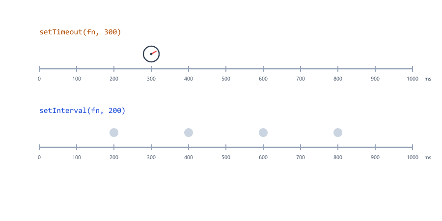

All timer functions are global in Node.js (Session 16: they live on `globalThis`), so they need no `require`.

---

## setTimeout

`setTimeout(callback, delayMs)` asks Node.js to call the callback after (at least) `delayMs` milliseconds. It does not wait: the code after it runs at once (Session 11)

timeout-basics.js

```javascript
console.log("1. Order received");

const timer = setTimeout(() => {
  console.log("4. Confirmation email sent");
}, 500);

console.log("2. Response sent to the customer");
console.log("3. timer is an", typeof timer);
```

Output

```text
1. Order received
2. Response sent to the customer
3. timer is an object
4. Confirmation email sent
```

| Part                       | Meaning                                                           |
| -------------------------- | ----------------------------------------------------------------- |
| `setTimeout(callback, 500)` | Call `callback` in 500 ms (1000 ms is 1 second)                  |
| The return value           | A `Timeout` object in Node.js (a number in browsers). Keep it to cancel the timer later |
| The program                | Stays running until every timer has fired, then ends              |

This is how a server answers quickly: send the response now, and do slow extra work (like an email) a little later.

---

## Timers Run in Order of Their Delay

The order of the lines does not matter; the delays do

timeout-order.js

```javascript
setTimeout(() => console.log("300 ms: send the invoice"), 300);
setTimeout(() => console.log("100 ms: save the order"), 100);
setTimeout(() => console.log("200 ms: update the stock"), 200);

console.log("all three timers are scheduled");
```

Output

```text
all three timers are scheduled
100 ms: save the order
200 ms: update the stock
300 ms: send the invoice
```

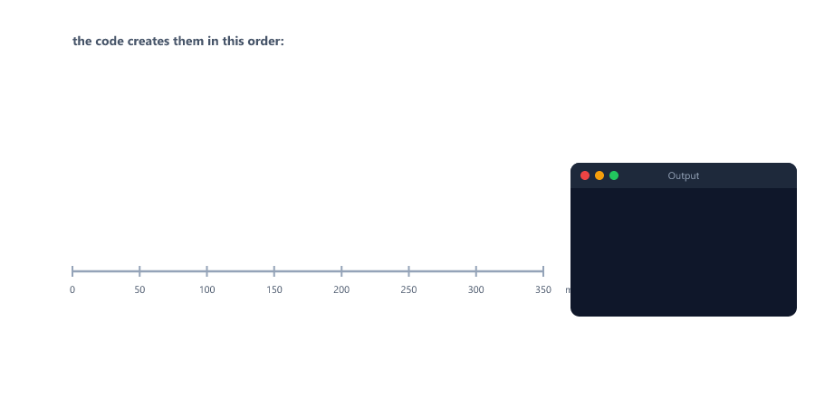

All three timers are scheduled in about 0 ms. Then the normal code finishes, and each callback runs when its time comes. Session 23 explains how Node.js keeps track of them (the event loop).

---

## Passing Arguments to the Callback

There are two ways to give values to a timer callback

timeout-args.js

```javascript
function sendReminder(email, orderId) {
  console.log(`Reminder to ${email}: complete order ${orderId}`);
}

setTimeout(sendReminder, 100, "riya@example.com", "ORD-1001");
setTimeout(() => sendReminder("aman@example.com", "ORD-1002"), 200);
```

Output

```text
Reminder to riya@example.com: complete order ORD-1001
Reminder to aman@example.com: complete order ORD-1002
```

| Way                                          | How                                                          |
| -------------------------------------------- | ------------------------------------------------------------ |
| Extra arguments after the delay              | `setTimeout(fn, 100, a, b)` calls `fn(a, b)` later           |
| An arrow function (the usual way)            | `setTimeout(() => fn(a, b), 100)`, easy to read and flexible |

Both pass the function itself, not `fn()` (Session 11; see [Mistake 1](#mistake-1-calling-the-function-instead-of-passing-it)).

---

## Arguments Are Read Only Once

Extra arguments are worked out **once**, when the timer is created, not each time it fires. The earlier version of this lesson had exactly this bug

args-once.js

```javascript
let attempts = 0;

function showStatus(message, count) {
  console.log(`${message}: attempt ${count}`);
}

const timer = setInterval(showStatus, 100, "Retrying", attempts++);   // attempts++ runs only once!

setTimeout(() => {
  clearInterval(timer);
  console.log(`attempts is now ${attempts}`);
}, 350);
```

Output

```text
Retrying: attempt 0
Retrying: attempt 0
Retrying: attempt 0
attempts is now 1
```

`attempts++` ran one time, when `setInterval` was called: it gave the value `0` (post-increment, Session 04) and set `attempts` to 1. That `0` was stored with the timer and passed again on every tick.


To use a value that changes, read it **inside** the callback

args-fixed.js

```javascript
let attempts = 0;

const timer = setInterval(() => {
  attempts++;                                   // runs every time the timer fires
  console.log(`Retrying: attempt ${attempts}`);
  if (attempts === 3) {
    clearInterval(timer);
  }
}, 100);
```

Output

```text
Retrying: attempt 1
Retrying: attempt 2
Retrying: attempt 3
```

The arrow function is a closure (Session 16): it reads the **current** `attempts` every time it runs.

---

## Cancelling with clearTimeout

`clearTimeout(timer)` cancels a timer that has not fired yet. A shop schedules a "you left items in your cart" reminder, and cancels it if the customer pays first

clear-timeout.js

```javascript
function scheduleReminder(orderId) {
  console.log(`${orderId}: reminder scheduled`);
  return setTimeout(() => {
    console.log(`${orderId}: "You left items in your cart!"`);
  }, 300);
}

const riyaTimer = scheduleReminder("ORD-1001");
scheduleReminder("ORD-1002");

setTimeout(() => {
  clearTimeout(riyaTimer);                 // ORD-1001 was paid: cancel its reminder
  console.log("ORD-1001: paid, reminder cancelled");
}, 100);
```

Output

```text
ORD-1001: reminder scheduled
ORD-1002: reminder scheduled
ORD-1001: paid, reminder cancelled
ORD-1002: "You left items in your cart!"
```

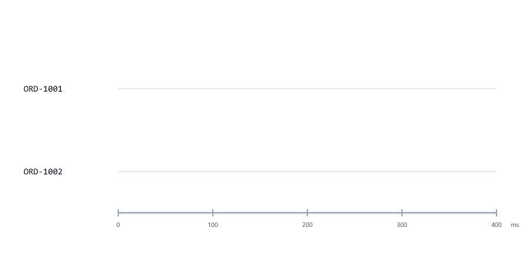

- `scheduleReminder` returns the timer, so the caller can cancel it later.
- `clearTimeout` on a timer that already fired (or on `null`) does nothing, and does not throw.
- Without the saved timer object, a timer can never be cancelled (see [Mistake 5](#mistake-5-not-keeping-the-timer)).

---

## setInterval and clearInterval

`setInterval(callback, delayMs)` calls the callback again and again, every `delayMs`, until `clearInterval` stops it

interval-countdown.js

```javascript
let secondsLeft = 3;

const timer = setInterval(() => {
  console.log(`Server restarting in ${secondsLeft}...`);
  secondsLeft--;
  if (secondsLeft === 0) {
    clearInterval(timer);
    console.log("Restarting now");
  }
}, 200);
```

Output

```text
Server restarting in 3...
Server restarting in 2...
Server restarting in 1...
Restarting now
```

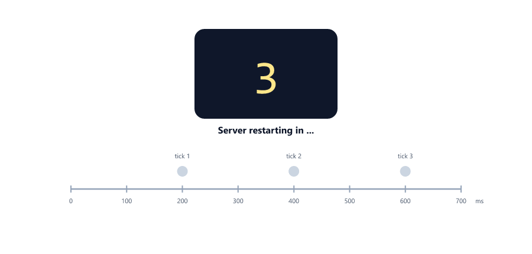

An interval never stops by itself: without `clearInterval`, the program runs forever (see [Mistake 4](#mistake-4-forgetting-clearinterval)). The Node.js course's memory monitor uses the same shape: count the checks, and `clearInterval(timer)` after the fifth (Session 07).

---

## The Delay Is a Minimum

A timer runs **no earlier** than its delay, but it can run later. JavaScript does one thing at a time (Session 07), so while other code is busy, a timer that is due must wait

delay-minimum.js

```javascript
const start = Date.now();

setTimeout(() => {
  console.log(`Asked for 100 ms, waited ${Date.now() - start} ms`);
}, 100);

// keep the program busy for 300 ms
while (Date.now() - start < 300) {
  // blocking: nothing else can run
}
console.log(`Busy loop finished after ${Date.now() - start} ms`);
```

Output (yours will be different)

```text
Busy loop finished after 300 ms
Asked for 100 ms, waited 304 ms
```

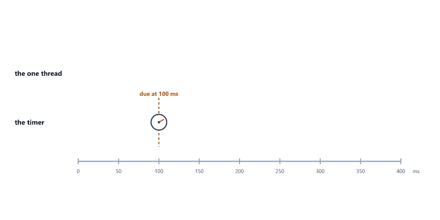

The timer was due at 100 ms, but the busy loop held the only thread until 300 ms (`Date.now()`, Session 19). On a server, slow synchronous code delays every timer and every request; Session 23 shows why. Never use timers for exact time measurement: use `Date.now()` to see how long something really took.

---

## setInterval or a Repeated setTimeout?

`setInterval` starts the callback every 100 ms, whether the last run has finished or not. When each run does slow work (a database query, a request to another server), the runs pile up

interval-overlap.js

```javascript
let started = 0;
let running = 0;

const timer = setInterval(() => {
  started++;
  running++;
  const id = started;
  console.log(`check ${id} started (${running} running)`);
  setTimeout(() => {                       // each check takes 250 ms
    running--;
    console.log(`check ${id} finished`);
  }, 250);
  if (started === 3) {
    clearInterval(timer);
  }
}, 100);
```

Output

```text
check 1 started (1 running)
check 2 started (2 running)
check 3 started (3 running)
check 1 finished
check 2 finished
check 3 finished
```

Three checks were running at the same time. A `setTimeout` that schedules the next run **after** the work is done keeps them apart

recursive-timeout.js

```javascript
let checks = 0;

function runCheck() {
  checks++;
  console.log(`check ${checks} started`);
  setTimeout(() => {                       // the check takes 250 ms
    console.log(`check ${checks} finished`);
    if (checks < 3) {
      setTimeout(runCheck, 100);           // wait 100 ms AFTER it finished
    }
  }, 250);
}

runCheck();
```

Output

```text
check 1 started
check 1 finished
check 2 started
check 2 finished
check 3 started
check 3 finished
```

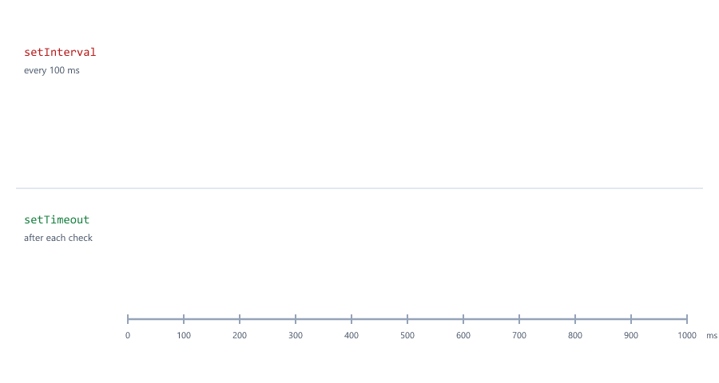

| Use                         | When                                                         |
| --------------------------- | ------------------------------------------------------------ |
| `setInterval`               | Quick work that always finishes long before the next tick: a counter, a quick clean-up |
| A repeated `setTimeout`     | Slow or unpredictable work: polling another server, health checks, retries |

---

## Waiting Between Retries

Session 07 retried a database connection in a loop, and Session 09 calculated growing delays with `2 ** attempt`. A timer adds the actual waiting

retry-simple.js

```javascript
let attempt = 0;

function trySend() {
  attempt++;
  if (attempt < 3) {
    const delay = 100 * 2 ** (attempt - 1);      // 100, 200, 400, ... (Session 09)
    console.log(`attempt ${attempt} failed, trying again in ${delay} ms`);
    setTimeout(trySend, delay);
    return;
  }
  console.log(`attempt ${attempt}: email sent`);
}

trySend();
```

Output

```text
attempt 1 failed, trying again in 100 ms
attempt 2 failed, trying again in 200 ms
attempt 3: email sent
```

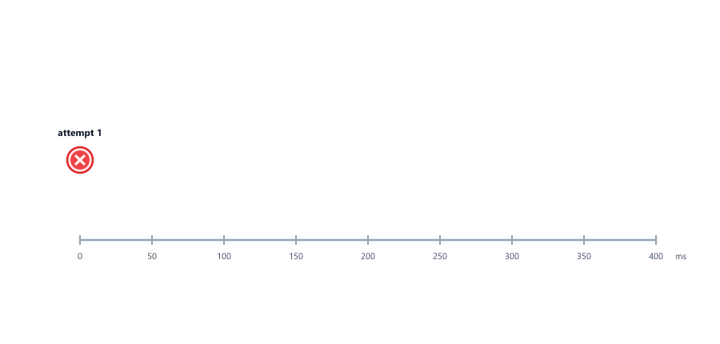

A `while` loop cannot wait without blocking the whole program ([The Delay Is a Minimum](#the-delay-is-a-minimum)), so the function schedules **itself** again with `setTimeout`. Doubling the wait each time is called **exponential backoff**: a struggling database or email service gets more and more time to recover. [Mini Example 1](#mini-example-1-connecting-to-a-database-with-retries) adds a maximum delay and a limit on attempts.

---

## Debouncing

A user types "Hello" in a notes app, and the app wants to save the draft to the database. Saving after every key press means five database writes. **Debouncing** waits until the calls stop for a moment, then runs only the last one

debounce.js

```javascript
function debounce(fn, waitMs) {
  let timer = null;                        // remembered between calls (a closure, Session 16)
  return (...args) => {
    clearTimeout(timer);                   // cancel the previous plan
    timer = setTimeout(() => fn(...args), waitMs);
  };
}

const saveDraft = debounce((text) => {
  console.log(`Saved to the database: "${text}"`);
}, 200);

saveDraft("H");
saveDraft("He");
saveDraft("Hel");
saveDraft("Hello");
setTimeout(() => saveDraft("Hello!"), 500);
```

Output

```text
Saved to the database: "Hello"
Saved to the database: "Hello!"
```


- `debounce` is a higher-order function (Session 11) that returns a new function.
- `timer` lives in the closure, so every call can cancel the timer of the call before.
- `(...args)` collects any arguments, and `fn(...args)` passes them on (rest and spread, Session 14).
- Four quick calls became one save; the call 500 ms later is a new burst and saves again.

Servers use debouncing to save drafts, to group many file-change events into one restart (tools like `nodemon` wait briefly before restarting, Node.js course, Session 02), and to send one notification instead of ten.

---

## Giving Up After a Timeout

A request to a slow database or another server might never answer. A server cannot let its user wait forever, so it starts a **timeout** timer, and whichever finishes first wins

with-timeout.js

```javascript
function withTimeout(task, ms, callback) {
  let finished = false;

  const timer = setTimeout(() => {
    finished = true;
    callback(new Error(`timed out after ${ms} ms`));
  }, ms);

  task((err, result) => {
    if (finished) {
      return;                              // too late: the timeout already answered
    }
    finished = true;
    clearTimeout(timer);
    callback(err, result);
  });
}

function fastQuery(done) {
  setTimeout(() => done(null, "3 orders"), 100);
}

function slowQuery(done) {
  setTimeout(() => done(null, "3000 orders"), 500);
}

withTimeout(fastQuery, 300, (err, result) => console.log(err ? `fast: ${err.message}` : `fast: ${result}`));
withTimeout(slowQuery, 300, (err, result) => console.log(err ? `slow: ${err.message}` : `slow: ${result}`));
```

Output

```text
fast: 3 orders
slow: timed out after 300 ms
```

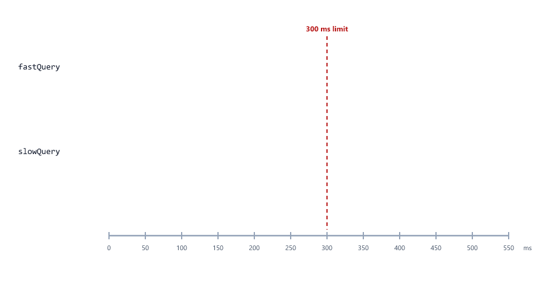

| Part                    | Job                                                                 |
| ----------------------- | ------------------------------------------------------------------- |
| `finished`              | Makes sure the callback is called only **once** (Session 11)        |
| `clearTimeout(timer)`   | The task won: the timeout is no longer needed                       |
| `if (finished) return;` | The timeout won: the late result is ignored                         |
| Error-first callbacks   | `callback(err, result)`, the Node.js style from Session 11          |

Database drivers and HTTP clients have timeout options built in, and Session 24 shows a shorter way with promises (`Promise.race`). The idea is always this race.

---

## Background Timers and unref

A server often runs background jobs: Session 16's rate limiter resets its counts, and Session 20's session store removes expired sessions. An interval keeps the program running forever, which is right for a server but wrong for a script or a test that should end. In Node.js, `timer.unref()` says "do not keep the program alive just for this timer"

unref.js

```javascript
const cleanup = setInterval(() => {
  console.log("cleaning expired sessions...");
}, 100);

cleanup.unref();                           // do not keep the program alive just for this timer

setTimeout(() => {
  console.log("main work finished");
}, 350);
```

Output

```text
cleaning expired sessions...
cleaning expired sessions...
cleaning expired sessions...
main work finished
```

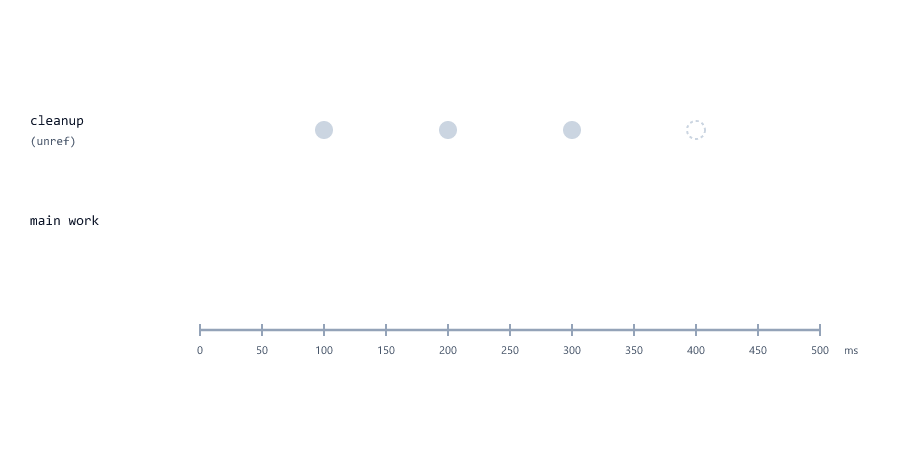

| Method                         | Does                                                           |
| ------------------------------ | -------------------------------------------------------------- |
| `timer.unref()`                | This timer alone does not keep the program running             |
| `timer.ref()`                  | Undoes `unref()`                                               |
| `timer.refresh()`              | Restarts the timer's countdown from now, keeping its callback   |

These methods exist on Node.js timer objects only, not in browsers. In a running server, the server itself keeps the program alive, and an `unref` cleanup timer simply runs alongside it. When the server shuts down, the cleanup timer does not stop the program from exiting.

---

## Timers Are Not a Scheduler

Timers live in the memory of one running program. That makes them wrong for anything far in the future

| Problem                                   | What happens                                                         |
| ----------------------------------------- | -------------------------------------------------------------------- |
| A delay longer than about 24.8 days (2,147,483,647 ms) | Node.js warns, sets the delay to 1 ms, and runs the callback almost at once (see [Mistake 10](#mistake-10-a-delay-longer-than-248-days)) |
| The server restarts (a deploy, a crash)   | Every waiting timer is gone. A "send the invoice in 3 days" timer never fires |
| The app runs on two servers               | Each server has its own timers; jobs run twice, or on the wrong server |

For "end the trial in 14 days" or "send a report every morning", store the time in the database (Session 19 date math) and let a scheduled job check it: a cron job, a job queue, or a hosting platform's scheduler. Use timers for seconds and minutes, inside one running program.

---

## Mini Example 1: Connecting to a Database with Retries

Session 07 promised that real retry code waits between attempts. When a server starts, the database may still be starting too. The server tries to connect, waits longer after each failure, and gives up after a few attempts

db-retry.js

```javascript
const MAX_ATTEMPTS = 5;
const BASE_DELAY_MS = 100;
const MAX_DELAY_MS = 400;
const DATABASE_READY_ON_ATTEMPT = 4;       // pretend the database needs a moment to start

function connectToDatabase(attempt, callback) {
  setTimeout(() => {                       // a real connection takes time too
    if (attempt < DATABASE_READY_ON_ATTEMPT) {
      callback(new Error("ECONNREFUSED"));
    } else {
      callback(null, "connected to the database");
    }
  }, 20);
}

function connectWithRetry(callback, attempt = 1) {
  connectToDatabase(attempt, (err, result) => {
    if (!err) {
      callback(null, `${result} (attempt ${attempt})`);
      return;
    }
    if (attempt === MAX_ATTEMPTS) {
      callback(new Error(`gave up after ${attempt} attempts: ${err.message}`));
      return;
    }
    const delay = Math.min(MAX_DELAY_MS, BASE_DELAY_MS * 2 ** (attempt - 1));
    console.log(`attempt ${attempt} failed (${err.message}), retrying in ${delay} ms`);
    setTimeout(() => connectWithRetry(callback, attempt + 1), delay);
  });
}

connectWithRetry((err, message) => {
  if (err) {
    console.log(`Server not started: ${err.message}`);
    return;
  }
  console.log(`Server started: ${message}`);
});
```

Output

```text
attempt 1 failed (ECONNREFUSED), retrying in 100 ms
attempt 2 failed (ECONNREFUSED), retrying in 200 ms
attempt 3 failed (ECONNREFUSED), retrying in 400 ms
Server started: connected to the database (attempt 4)
```

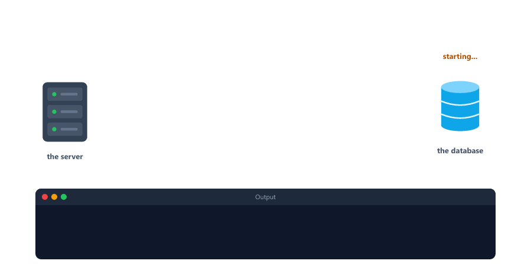

| Part                                           | Why                                                          |
| ---------------------------------------------- | ------------------------------------------------------------ |
| `ECONNREFUSED`                                 | The real error code Node.js gives when nothing is listening on the database's port |
| `Math.min(MAX_DELAY_MS, BASE_DELAY_MS * 2 ** (attempt - 1))` | Exponential backoff with a ceiling: 100, 200, 400, 400, ... (Session 09) |
| `attempt === MAX_ATTEMPTS`                     | Stop at some point, and report the failure                   |
| `attempt = 1` default parameter                | The first call needs no attempt number (Session 10)          |
| Error-first callbacks                          | `callback(err)` or `callback(null, result)` (Session 11)      |

Change `DATABASE_READY_ON_ATTEMPT` to `9` to see the "gave up" path. Database drivers have a similar setting built in: the MongoDB driver behind Mongoose keeps trying to reach the server until `serverSelectionTimeoutMS` (30 seconds by default) runs out (Node.js course, Session 19). Session 25 rewrites this kind of code with `async`/`await`, where it reads almost like the loop from Session 07.

---

## Mini Example 2: A Rate Limit That Resets Every Window

Session 16's rate limiter counted requests forever. A real limiter allows a number of requests **per time window**, for example 2 per window, and starts counting again when the window ends. A background interval clears the counts

rate-window.js

```javascript
const WINDOW_MS = 300;
const LIMIT = 2;
const counts = new Map();                  // userId -> requests in this window (Session 20)

const resetTimer = setInterval(() => {
  counts.clear();
  console.log("--- new window: counts reset ---");
}, WINDOW_MS);
resetTimer.unref();                        // the reset timer alone must not keep the program running

function handleRequest(userId) {
  const used = (counts.get(userId) ?? 0) + 1;
  counts.set(userId, used);
  const answer = used <= LIMIT ? "200 OK" : "429 Too Many Requests";
  console.log(`${userId}: ${answer}`);
}

// requests arriving over time: [milliseconds after start, user]
const arrivals = [[0, "riya"], [50, "riya"], [100, "riya"], [150, "aman"], [400, "riya"], [450, "riya"], [500, "riya"]];
for (const [at, userId] of arrivals) {
  setTimeout(() => handleRequest(userId), at);
}
```

Output

```text
riya: 200 OK
riya: 200 OK
riya: 429 Too Many Requests
aman: 200 OK
--- new window: counts reset ---
riya: 200 OK
riya: 200 OK
riya: 429 Too Many Requests
```

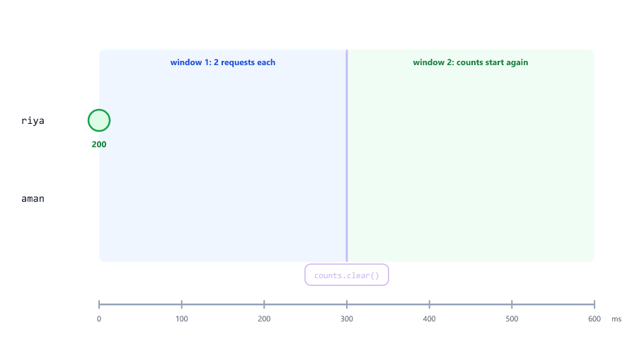

- `setTimeout(..., at)` in a loop fakes requests arriving at different times, using `[at, userId]` pairs and destructuring (Session 14).
- The Map holds one counter per user (Session 20), and `counts.get(userId) ?? 0` starts each at 0.
- Every 300 ms, the interval clears all counters, so each user gets 2 requests per window.
- `unref()` lets the program end after the last request; in a real server, the server itself keeps running.

This is a **fixed window** limiter: `express-rate-limit` in the Node.js course works this way by default, with `windowMs: 60 * 1000` and `limit: 3` (Session 14).

---

## Beginner Mistakes

### Mistake 1: Calling the function instead of passing it

**Incorrect**

```javascript
function sendEmail() {
  console.log("Email sent");
}

setTimeout(sendEmail(), 1000);
```

```text
Email sent
TypeError [ERR_INVALID_ARG_TYPE]: The "callback" argument must be of type function. Received undefined
```

`sendEmail()` runs at once, and its result (`undefined`) is passed to `setTimeout`. **Correct:** `setTimeout(sendEmail, 1000)` or `setTimeout(() => sendEmail(), 1000)` (Session 11).

### Mistake 2: Expecting setTimeout to pause the code

**Incorrect:** writing `setTimeout(...)` and expecting the next lines to wait. They run at once; only the callback waits (see [setTimeout](#settimeout)).

**Correct:** put the code that must run later **inside** the callback.

### Mistake 3: Passing a changing value as an extra argument

**Incorrect:** `setInterval(showStatus, 100, "Retrying", attempts++)`. The argument is worked out once, so every tick gets the same value (see [Arguments Are Read Only Once](#arguments-are-read-only-once)).

**Correct:** read and change the value inside an arrow callback.

### Mistake 4: Forgetting clearInterval

**Incorrect**

```javascript
let checks = 0;

setInterval(() => {
  checks++;
  console.log(`health check ${checks}: ok`);
}, 1000);
```

```text
health check 1: ok
health check 2: ok
health check 3: ok
... (forever, until you press Ctrl + C)
```

**Correct:** save the timer and call `clearInterval(timer)` when the job is done, or `unref()` it if it is a background job (see [Background Timers and unref](#background-timers-and-unref)).

### Mistake 5: Not keeping the timer

**Incorrect:** `setTimeout(sendReminder, 300000);` without saving the result. If the customer pays, there is nothing to pass to `clearTimeout`.

**Correct:** `const reminder = setTimeout(sendReminder, 300000);`, then `clearTimeout(reminder)` (see [Cancelling with clearTimeout](#cancelling-with-cleartimeout)).

### Mistake 6: Expecting exact timing

**Incorrect:** assuming a 100 ms timer runs at exactly 100 ms, for example to measure how long a request took. Busy code delays it (see [The Delay Is a Minimum](#the-delay-is-a-minimum)).

**Correct:** measure with `Date.now()` before and after.

### Mistake 7: setInterval for slow work

**Incorrect:** `setInterval(checkPaymentStatus, 1000)` when each check can take several seconds. The checks pile up and run at the same time (see [setInterval or a Repeated setTimeout?](#setinterval-or-a-repeated-settimeout)).

**Correct:** schedule the next check with `setTimeout` when the current one has finished.

### Mistake 8: Keeping the debounce timer inside the function

**Incorrect**

```javascript
function saveDraft(text) {
  let timer = null;                        // a NEW timer variable on every call
  clearTimeout(timer);
  timer = setTimeout(() => console.log(`Saved: "${text}"`), 200);
}

saveDraft("H");
saveDraft("He");
saveDraft("Hello");
```

```text
Saved: "H"
Saved: "He"
Saved: "Hello"
```

Each call gets a fresh `timer` (Session 10), so `clearTimeout(timer)` cancels nothing. **Correct:** keep the timer in a closure that all calls share, as in [Debouncing](#debouncing).

### Mistake 9: Passing a method to a timer

**Incorrect:** `setTimeout(report.print, 1000)`. The method runs without its object, and `this` is lost (Session 17).

**Correct:** `setTimeout(() => report.print(), 1000)`.

### Mistake 10: A delay longer than 24.8 days

**Incorrect**

```javascript
const THIRTY_DAYS = 30 * 24 * 60 * 60 * 1000;

setTimeout(() => {
  console.log("Your trial has ended");     // meant: in 30 days
}, THIRTY_DAYS);
```

```text
TimeoutOverflowWarning: 2592000000 does not fit into a 32-bit signed integer.
Timeout duration was set to 1.
Your trial has ended
```

Timer delays must fit in 32 bits (at most 2,147,483,647 ms). Bigger delays become 1 ms, so the trial "ends" at once. **Correct:** store the end date and check it with a scheduled job (see [Timers Are Not a Scheduler](#timers-are-not-a-scheduler)).

### Mistake 11: Trusting timers to survive a restart

**Incorrect:** scheduling "send the invoice in 2 hours" with `setTimeout` on a server that is redeployed several times a day. Each restart deletes every waiting timer.

**Correct:** save the job and its due time in the database, and process due jobs on startup and on a schedule.

---

## Practice Exercises

### Exercise 1

Write a countdown that prints `5`, `4`, `3`, `2`, `1` every 300 ms with `setInterval`, then `"Sale is live!"`, and stops itself with `clearInterval`.

### Exercise 2

Schedule four messages so that they print in the **reverse** order of the lines in your code, using only `setTimeout` and different delays. Then print, at the very end, how long the whole program took (use `Date.now()`).

### Exercise 3

This code should print `tick 1`, `tick 2`, `tick 3` but prints `tick 0` three times: `let n = 0; const t = setInterval(console.log, 100, "tick", n++);`. Explain why, fix it, and stop it after three ticks.

### Exercise 4

Write `debounce(fn, waitMs)` from memory and use it for `notifySeller(orderCount)`: call it 10 times in a loop with counts 1 to 10, and check that only `10` is printed.

### Exercise 5

Write `throttle(fn, waitMs)`: the function runs at most once every `waitMs`; calls in between are ignored. Test it with a `setInterval` that calls it every 50 ms for 1 second, with `waitMs` 300, and count how many times `fn` ran.

### Exercise 6

Use `withTimeout` from [Giving Up After a Timeout](#giving-up-after-a-timeout) for three tasks that take 100, 290 and 310 ms, with a 300 ms limit. Predict the output before you run it.

### Exercise 7

Add **jitter** to [Mini Example 1](#mini-example-1-connecting-to-a-database-with-retries): add a random 0 to 50 ms (Session 09) to every delay, so that many servers restarting together do not all retry at the same moment. Print the delay you chose each time.

### Exercise 8

Add a cleanup job to the session store from Session 20: call `removeExpired(Date.now())` every 100 ms with `setInterval`, `unref()` it, and create sessions that expire after 250 ms. Print `sessions.size` at 0, 200 and 400 ms.

---

## Interview Questions

### What is the difference between setTimeout and setInterval?

`setTimeout` calls its callback once after the delay. `setInterval` calls it again and again, every delay, until `clearInterval` is called. Both return a timer that can be cancelled.

### How do you cancel a timer?

Keep the value the timer function returned, and pass it to `clearTimeout` or `clearInterval`. Cancelling a timer that already fired does nothing.

### Is the delay exact?

No. It is a minimum. The callback runs when the delay has passed **and** JavaScript is free. Busy synchronous code, or many callbacks waiting, makes timers run late.

### What does setTimeout return in Node.js?

A `Timeout` object, with methods like `unref()`, `ref()` and `refresh()`. In browsers it returns a number. In both, you pass it to `clearTimeout`.

### What does setTimeout(fn, 0) mean?

"Run `fn` as soon as possible, after the current code has finished", not "run it right now". The callback waits until the synchronous code is done (Session 11; the event loop, Session 23).

### When are the extra arguments of setTimeout and setInterval evaluated?

Once, when the timer is created. `setInterval(fn, 100, count++)` passes the same value on every tick. To use a changing value, read it inside an arrow function callback.

### Why can setInterval be a problem for slow tasks?

It starts the callback on schedule even if the previous run (for example a slow database query) has not finished, so runs pile up and overlap. A `setTimeout` that schedules the next run after the current one finishes avoids this.

### What is debouncing?

Waiting until calls have stopped for a set time, then running the function once with the latest values. Each call cancels the previous timer and starts a new one. It is used for autosave, search-as-you-type and grouping bursts of events.

### What is throttling, and how is it different from debouncing?

Throttling runs a function at most once per time window, however often it is called. Debouncing runs it only after the calls stop. Throttling suits regular updates during a burst; debouncing suits "act when things settle".

### How do timers affect when a Node.js program exits?

A pending timer keeps the program running. When nothing is left to do (no timers, no open servers or connections), the program ends. `timer.unref()` tells Node.js not to stay alive just for that timer.

### What happens with a delay longer than about 24.8 days?

The delay must fit in a 32-bit signed integer (2,147,483,647 ms). A bigger value triggers a `TimeoutOverflowWarning`, and the delay is set to 1 ms, so the callback runs almost immediately.

### How do you retry a failing operation with exponential backoff?

On each failure, schedule the next attempt with `setTimeout`, doubling the delay each time (`base * 2 ** attempt`), with a maximum delay and a maximum number of attempts. Adding a little random jitter stops many clients from retrying at the same moment.

### How do you add a timeout to an operation that uses a callback?

Start a `setTimeout` that answers with a timeout error, and start the operation. Whichever finishes first calls the callback and sets a `finished` flag; the operation clears the timer if it wins, and a late result is ignored.

### Why should you not use setTimeout to schedule work days ahead?

Timers live only in the memory of one running process. A restart or deploy deletes them, two servers would each run their own, and delays over about 24.8 days overflow. Long-term jobs belong in a database with a scheduler or job queue.
