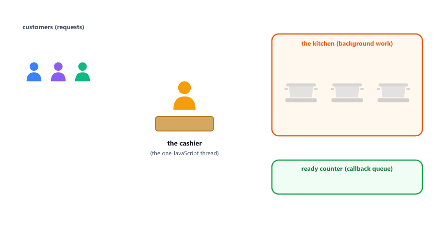
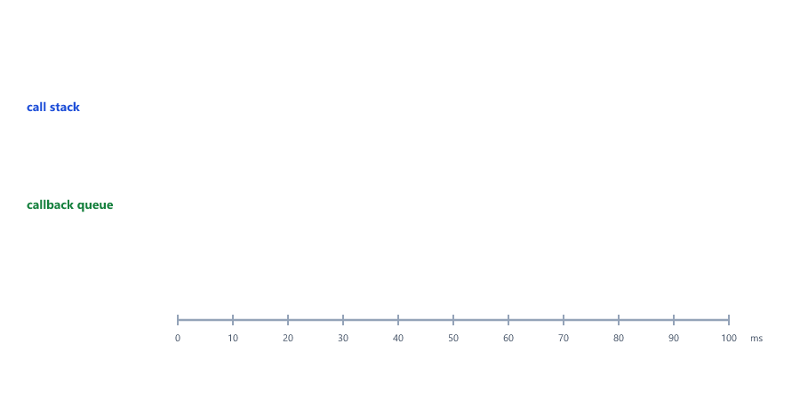
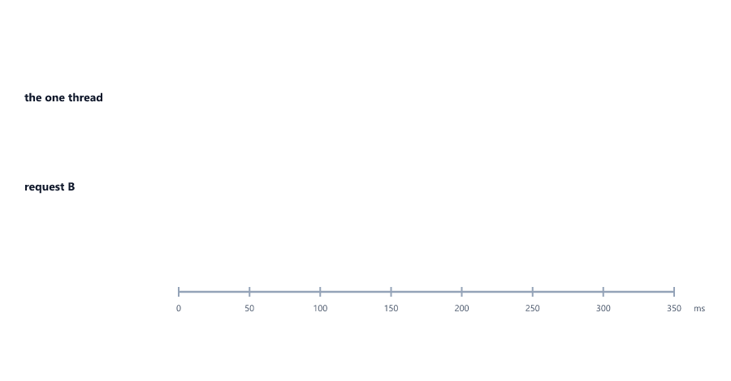
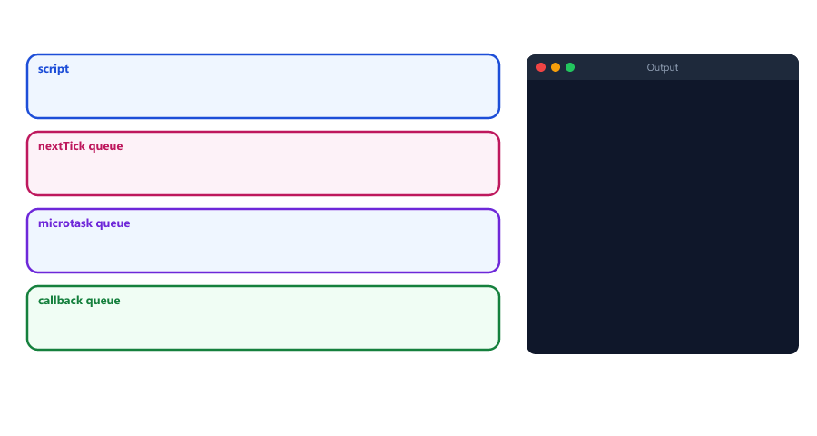
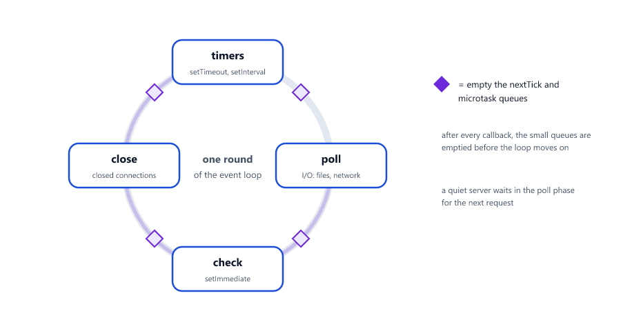
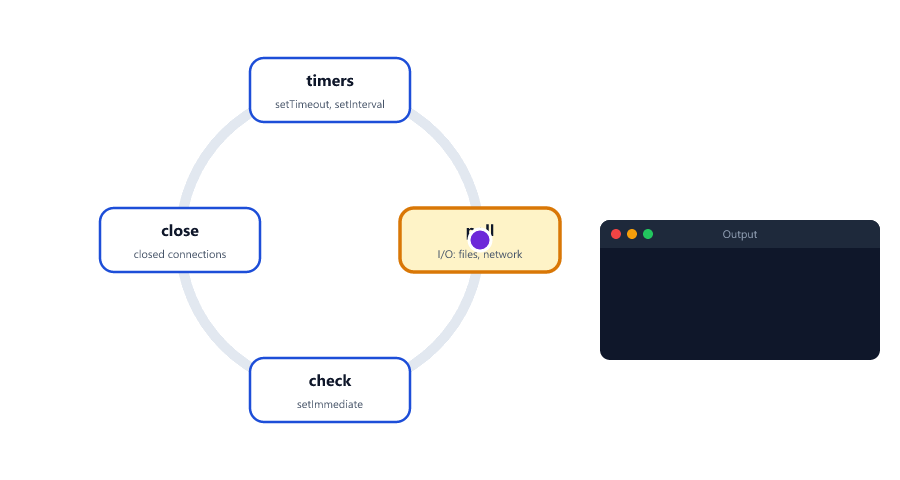
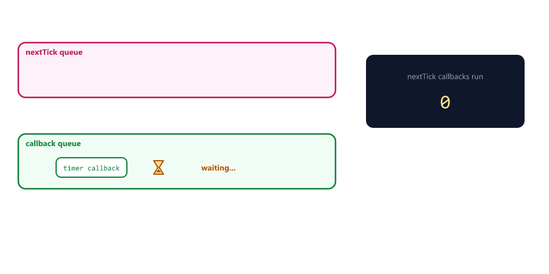
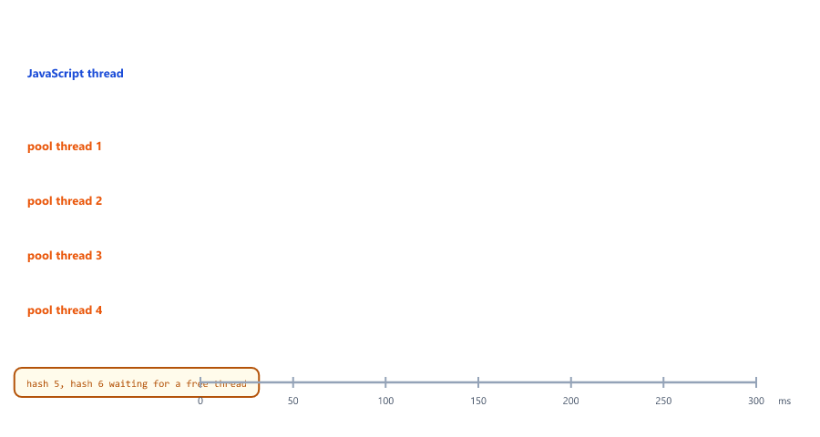
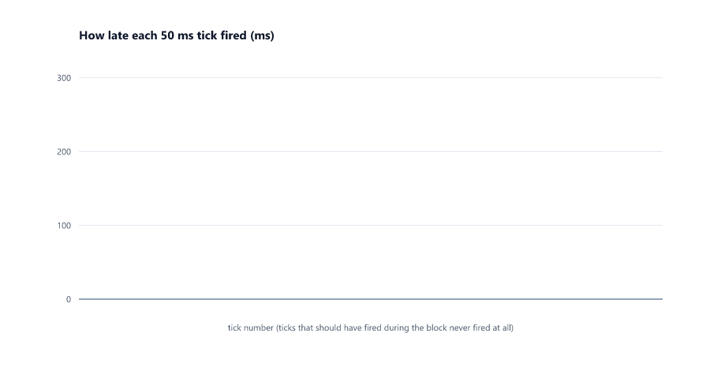

# The Event Loop

## Table of Contents
- [One Thread, Many Requests](#one-thread-many-requests)
- [The Parts of the Event Loop](#the-parts-of-the-event-loop)
- [Step by Step: a Timer](#step-by-step-a-timer)
- [Callbacks Wait for an Empty Call Stack](#callbacks-wait-for-an-empty-call-stack)
- [Blocking Code Stops the Whole Server](#blocking-code-stops-the-whole-server)
- [Splitting Long Work into Chunks](#splitting-long-work-into-chunks)
- [Microtasks: process.nextTick and queueMicrotask](#microtasks-processnexttick-and-queuemicrotask)
- [Microtasks Can Add More Microtasks](#microtasks-can-add-more-microtasks)
- [The Phases of the Event Loop](#the-phases-of-the-event-loop)
- [setImmediate or setTimeout(fn, 0)?](#setimmediate-or-settimeoutfn-0)
- [Starving the Event Loop](#starving-the-event-loop)
- [Background Threads: the libuv Thread Pool](#background-threads-the-libuv-thread-pool)
- [Which Queue Does a Callback Go To?](#which-queue-does-a-callback-go-to)
- [Mini Example 1: Predict the Order of a Request](#mini-example-1-predict-the-order-of-a-request)
- [Mini Example 2: Measuring Event Loop Lag](#mini-example-2-measuring-event-loop-lag)
- [Beginner Mistakes](#beginner-mistakes)
- [Practice Exercises](#practice-exercises)
- [Interview Questions](#interview-questions)

---

## One Thread, Many Requests

Your JavaScript runs on **one thread**: it does one thing at a time, line by line, using the call stack (Session 10). Yet one Node.js server answers thousands of users at the same time. How?

The trick is that Node.js never **waits**. When code asks for something slow (a timer, a file, a database answer), Node.js hands the slow part to the system in the background, and the thread moves straight on to the next job. When the slow part is done, its callback (Session 11) is put in a queue, and runs as soon as the thread is free. The mechanism that does this is the **event loop**.

The Node.js course uses a restaurant to picture it (Session 03)

| Restaurant                                   | Node.js                                       |
| -------------------------------------------- | --------------------------------------------- |
| One cashier                                  | The one JavaScript thread                     |
| The kitchen, cooking many orders at once     | The background: the operating system and the thread pool |
| "Order ready!" on the counter                | A callback waiting in a queue                 |
| The cashier serves ready orders between new customers | The event loop runs callbacks when the thread is free |



The cashier never stands at the kitchen door waiting for one meal. That is why one thread is enough, **as long as nobody keeps the cashier busy** (see [Blocking Code Stops the Whole Server](#blocking-code-stops-the-whole-server)).

---

## The Parts of the Event Loop

| Part                  | What it is                                                         |
| --------------------- | ------------------------------------------------------------------ |
| Call stack            | The functions running right now (Session 10). Only one at a time   |
| Node.js APIs          | Work done in the background: timers, files, network, password hashing |
| Callback queue        | Callbacks whose background work is done, waiting for their turn (also called the task queue) |
| Microtask queue       | Small, urgent callbacks that run before anything in the callback queue |
| Event loop            | The manager: when the call stack is empty, it moves the next waiting callback onto it |


These are the same names the Node.js course uses in Session 03, which goes over them again from the server's point of view.

---

## Step by Step: a Timer

The example from Session 11, now with the event loop in view

step-by-step.js

```javascript
console.log("Start");

setTimeout(() => {
  console.log("Timer");
}, 1000);

console.log("End");
```

Output

```text
Start
End
Timer
```


| Step | What happens                                                                      |
| ---- | --------------------------------------------------------------------------------- |
| 1    | `console.log("Start")` goes onto the call stack, runs, and leaves                 |
| 2    | `setTimeout` gives the callback and the 1000 ms timer to the Node.js APIs, and returns at once |
| 3    | `console.log("End")` runs. The script is finished: the call stack is empty        |
| 4    | After 1000 ms, the timer is done: its callback moves into the callback queue      |
| 5    | The event loop sees the empty call stack and moves the callback onto it: `Timer`  |

When the queues are empty and no background work is left, the event loop has nothing to do and the program ends.

---

## Callbacks Wait for an Empty Call Stack

Session 11 said that `setTimeout(fn, 0)` means "as soon as possible", not "now", and promised the reason. Here it is: a callback only runs when the call stack is **empty**, that is, when the current code has finished

timeout-zero.js

```javascript
setTimeout(() => {
  console.log("timer (0 ms)");
}, 0);

let total = 0;
for (let i = 0; i < 100_000_000; i++) {
  total += i;
}
console.log(`loop finished: ${total}`);
```

Output

```text
loop finished: 4999999950000000
timer (0 ms)
```



The timer was done almost at once, and its callback was waiting in the queue the whole time the loop ran. The event loop never interrupts running code: it moves a callback only when the stack is empty. This is also why the busy loop in Session 22 made a 100 ms timer fire after 300 ms.

---

## Blocking Code Stops the Whole Server

On a server, every request is handled by a callback. While one callback runs, no other request can be handled. Two requests: A builds a report with 300 ms of synchronous work; B only needs a quick lookup and arrives 50 ms later

blocking-server.js

```javascript
const start = Date.now();
const at = () => `about ${Math.round((Date.now() - start) / 100) * 100} ms`;

function handleRequest(name, work) {
  console.log(`${name}: request received (${at()})`);
  work();
  console.log(`${name}: response sent (${at()})`);
}

function buildReport() {                 // synchronous: blocks for about 300 ms
  const end = Date.now() + 300;
  while (Date.now() < end) {
    // busy
  }
}

function findProduct() {}                // takes almost no time

// request A arrives at 0 ms, request B at 50 ms
setTimeout(() => handleRequest("A (report)", buildReport), 0);
setTimeout(() => handleRequest("B (product page)", findProduct), 50);
```

Output

```text
A (report): request received (about 0 ms)
A (report): response sent (about 300 ms)
B (product page): request received (about 300 ms)
B (product page): response sent (about 300 ms)
```



B arrived at 50 ms but was not even **looked at** until 300 ms, because A held the only thread. With 100 users, one slow request makes all of them wait. This is called **blocking the event loop**.

| Blocks the event loop                                  | Does not block                                        |
| ------------------------------------------------------ | ----------------------------------------------------- |
| Long loops and heavy calculations in your code         | Waiting for a timer (`setTimeout`)                    |
| `JSON.parse`/`JSON.stringify` of very large data (Session 19) | Waiting for a database or another server        |
| "Sync" functions like `fs.readFileSync` (Node.js course, Session 05) | `fs.readFile` with a callback                 |
| A `while` loop that waits for time to pass             | Password hashing with `bcrypt.hash` (thread pool, Node.js course, Session 23) |

The rule from the Node.js course: keep each piece of JavaScript work short, and let Node.js do slow work in the background (Session 03).

---

## Splitting Long Work into Chunks

When heavy work cannot be avoided (a big import, a long report), split it into chunks and give the event loop a turn between chunks with `setImmediate(callback)`, which means "run this after the waiting callbacks"

chunking.js

```javascript
const ROWS = 3_000_000;
const CHUNK = 1_000_000;
let processed = 0;
let total = 0;

setTimeout(() => console.log("health check: ok"), 0);   // another request waiting for a turn

function processChunk() {
  const end = Math.min(processed + CHUNK, ROWS);
  for (let i = processed; i < end; i++) {
    total += i % 7;                     // pretend work on one row
  }
  processed = end;
  console.log(`processed ${processed} rows`);
  if (processed < ROWS) {
    setImmediate(processChunk);         // let waiting callbacks run, then continue
  } else {
    console.log(`done: total ${total}`);
  }
}

processChunk();
```

Output

```text
processed 1000000 rows
health check: ok
processed 2000000 rows
processed 3000000 rows
done: total 8999994
```


In one big loop, the health check would wait until all 3 million rows were done. With chunks, it got its turn after the first chunk. The total work is the same; it is just shared fairly. For truly heavy calculations, Node.js also has worker threads (`node:worker_threads`), which run JavaScript on extra threads; that is beyond this course.

---

## Microtasks: process.nextTick and queueMicrotask

Some callbacks are more urgent than timers. They go into the **microtask queue**, which the event loop empties completely right after the current code finishes, before it looks at the callback queue

microtasks.js

```javascript
console.log("1. script starts");

setTimeout(() => console.log("5. timer callback"), 0);
queueMicrotask(() => console.log("4. microtask"));
process.nextTick(() => console.log("3. nextTick callback"));

console.log("2. script ends");
```

Output

```text
1. script starts
2. script ends
3. nextTick callback
4. microtask
5. timer callback
```



| Function                      | Queue                     | Runs                                                   |
| ----------------------------- | ------------------------- | ------------------------------------------------------ |
| `process.nextTick(fn)`        | The nextTick queue (Node.js only) | First, right after the current code             |
| `queueMicrotask(fn)`          | The microtask queue       | Right after the nextTick queue                         |
| `setTimeout(fn, 0)`, `setImmediate(fn)` | The callback queue | After all microtasks                                |

Promise callbacks (`.then`) also go into the microtask queue; Session 24 shows them. The Node.js course shows the same order with a promise and a timer (Session 03).

`process.nextTick` sounds like "on the next tick", but it actually runs **sooner** than anything else. Despite its name, `setImmediate` runs later. Node.js keeps these names for historical reasons.

---

## Microtasks Can Add More Microtasks

A microtask can queue another microtask, and the new one also runs before any timer

microtask-chain.js

```javascript
setTimeout(() => console.log("timer"), 0);

queueMicrotask(() => {
  console.log("microtask 1");
  queueMicrotask(() => console.log("microtask 2 (added by microtask 1)"));
});
```

Output

```text
microtask 1
microtask 2 (added by microtask 1)
timer
```

The event loop keeps going until the microtask queue is **completely empty**, including microtasks added along the way. Only then does the timer get its turn. That is useful (a chain of small steps finishes together), and dangerous (see [Starving the Event Loop](#starving-the-event-loop)).

---

## The Phases of the Event Loop

The callback queue is really several queues. In each round, the event loop visits them in a fixed order, called **phases**

| Phase      | Runs callbacks of                                    |
| ---------- | ---------------------------------------------------- |
| Timers     | `setTimeout` and `setInterval` whose time is up      |
| Poll       | Finished I/O: files read, network data arrived, database answers. If nothing is waiting, the loop waits here for new events |
| Check      | `setImmediate`                                       |
| Close      | Closed connections, like a socket that ended         |



Two things to remember:

1. After **every single callback**, Node.js empties the nextTick queue and then the microtask queue before moving on.
2. The poll phase is where a quiet server spends its time: waiting for the next request to arrive.

You rarely need the exact phases in daily work. They explain the next section, and they come up in interviews.

---

## setImmediate or setTimeout(fn, 0)?

Both mean "soon". Which runs first? Inside an I/O callback, `setImmediate` always wins

phases-io.js

```javascript
const fs = require("node:fs");

fs.readFile(__filename, () => {          // an I/O callback: the file has been read
  console.log("1. file read");
  setTimeout(() => console.log("3. setTimeout 0"), 0);
  setImmediate(() => console.log("2. setImmediate"));
});
```

Output

```text
1. file read
2. setImmediate
3. setTimeout 0
```



`fs.readFile` reads a file in the background and calls back with an error-first callback (Session 11; Node.js course, Session 05); `__filename` is this file (Session 21). The read finishes in the **poll** phase. The next phase is **check**, so `setImmediate` runs first; the timer has to wait for the **timers** phase of the next round.

In the main file (outside any I/O callback), the order of `setTimeout(fn, 0)` and `setImmediate(fn)` is **not guaranteed**: it depends on how fast the computer starts the loop. Do not write code that relies on it (see [Mistake 6](#mistake-6-relying-on-the-order-of-settimeout-0-and-setimmediate)).

---

## Starving the Event Loop

Because the microtask and nextTick queues are always emptied completely, a callback that keeps adding new ones can keep timers and I/O waiting

starvation.js

```javascript
let count = 0;

setTimeout(() => console.log(`timer finally ran, after ${count} nextTick callbacks`), 0);

function again() {
  count++;
  if (count < 100_000) {
    process.nextTick(again);            // each one adds another before the timer can run
  }
}

process.nextTick(again);
```

Output

```text
timer finally ran, after 100000 nextTick callbacks
```



The timer was ready after 1 ms, but 100,000 nextTick callbacks went first. Without the `if`, the timer, and every request of a server, would wait **forever**. This is called **starving** the event loop. For repeated work, use `setImmediate` or `setTimeout`, which let the other queues run in between ([Splitting Long Work into Chunks](#splitting-long-work-into-chunks)).

---

## Background Threads: the libuv Thread Pool

"Node.js is single-threaded" is only half the story. **Your JavaScript** runs on one thread, but Node.js itself uses a library called **libuv** with extra threads for slow work that the operating system cannot do in the background by itself

thread-pool.js

```javascript
const crypto = require("node:crypto");

const start = Date.now();
for (let i = 1; i <= 6; i++) {
  crypto.pbkdf2("yourpassword", "salt", 200_000, 64, "sha512", () => {
    console.log(`hash ${i} done after ${Date.now() - start} ms`);
  });
}
console.log("all 6 hashes started");
```

Output (yours will be different)

```text
all 6 hashes started
hash 2 done after 140 ms
hash 3 done after 141 ms
hash 1 done after 158 ms
hash 4 done after 183 ms
hash 6 done after 261 ms
hash 5 done after 263 ms
```



- `crypto.pbkdf2` hashes a password slowly on purpose (like `bcrypt` in the Node.js course, Session 23). It runs in the thread pool, so "all 6 hashes started" prints at once: the JavaScript thread is not blocked.
- The pool has **4 threads** by default, so four hashes finish together, and the last two have to wait for a free thread. The order they finish in can change from run to run.
- The pool handles file system work, `crypto` and compression. Network work (HTTP, databases) is handled by the operating system itself, without the pool.
- The size can be changed with the environment variable `UV_THREADPOOL_SIZE` (Node.js course, Session 16 covers environment variables).

So the full answer the Node.js course gives (Session 03): JavaScript execution is single-threaded; Node.js uses background threads for slow work like files.

---

## Which Queue Does a Callback Go To?

| Code                                        | Where the callback waits     | When it runs                                   |
| ------------------------------------------- | ---------------------------- | ---------------------------------------------- |
| Normal code                                 | Runs on the call stack now   | Immediately, line by line                      |
| `process.nextTick(fn)`                      | nextTick queue               | Right after the current code (and after every callback) |
| `queueMicrotask(fn)`, promise `.then` (Session 24) | Microtask queue       | Right after the nextTick queue                 |
| `setTimeout(fn, ms)`, `setInterval(fn, ms)` | Timers phase                 | When the time is up and the stack is empty     |
| `fs.readFile(...)`, network and database callbacks | Poll phase            | When the background work is done              |
| `setImmediate(fn)`                          | Check phase                  | After the poll phase of the current round      |

---

## Mini Example 1: Predict the Order of a Request

A request handler that uses every kind of callback. Before reading the output, try to predict the order

predict-order.js

```javascript
const fs = require("node:fs");

function handleRequest() {
  console.log("A. request received");

  setTimeout(() => console.log("F. timer: send the welcome email"), 0);

  fs.readFile(__filename, () => {
    console.log("G. I/O callback: template loaded");
    setImmediate(() => console.log("I. setImmediate: write the log line"));
    process.nextTick(() => console.log("H. nextTick inside the I/O callback"));
  });

  queueMicrotask(() => console.log("E. microtask: update the cache"));
  process.nextTick(() => console.log("D. nextTick: count the request"));

  console.log("B. input checked");
  console.log("C. response sent");
}

handleRequest();
```

Output

```text
A. request received
B. input checked
C. response sent
D. nextTick: count the request
E. microtask: update the cache
F. timer: send the welcome email
G. I/O callback: template loaded
H. nextTick inside the I/O callback
I. setImmediate: write the log line
```


| Lines   | Why in this order                                                         |
| ------- | ------------------------------------------------------------------------- |
| A, B, C | Normal code runs first, from top to bottom                                |
| D       | The nextTick queue is emptied first, right after the current code         |
| E       | Then the microtask queue                                                   |
| F       | Timers phase: the 0 ms timer is due. Reading a file takes longer than 1 ms |
| G       | Poll phase: the file has been read                                         |
| H       | After every callback, the nextTick queue is emptied again                  |
| I       | Check phase, in the same round as G                                       |

This is how a real handler behaves: the response goes out first (C), and the follow-up work (email, cache, log) happens just after. If you can explain this table, you can answer almost any event loop interview question.

---

## Mini Example 2: Measuring Event Loop Lag

How do you know if a server's event loop is blocked? Measure how late a regular timer fires. A timer set for every 50 ms should be on time; if it is late, the thread was busy. Here the same 300 ms of work is done twice: once in one block, once in six chunks

lag-monitor.js

```javascript
const TICK = 50;
const start = Date.now();
let last = start;
const ticks = [];                        // [time since start, how late the tick was]

const monitor = setInterval(() => {
  const now = Date.now();
  ticks.push([now - start, now - last - TICK]);
  last = now;
}, TICK);

function busy(ms) {
  const end = Date.now() + ms;
  while (Date.now() < end) {
    // blocking work
  }
}

// at 100 ms: a report built in one go (300 ms of blocking work)
setTimeout(() => busy(300), 100);

// at 600 ms: the same work in 6 chunks of 50 ms, with setImmediate in between
setTimeout(() => {
  let chunks = 0;
  function nextChunk() {
    busy(50);
    chunks++;
    if (chunks < 6) {
      setImmediate(nextChunk);
    }
  }
  nextChunk();
}, 600);

setTimeout(() => {
  clearInterval(monitor);
  const worst = (from, to) => Math.max(...ticks.filter(([time]) => time > from && time <= to).map(([, lag]) => lag));
  console.log(`worst lag, one big block:  ${worst(100, 550)} ms`);
  console.log(`worst lag, 6 small chunks: ${worst(600, 1100)} ms`);
}, 1100);
```

Output (yours will be different)

```text
worst lag, one big block:  297 ms
worst lag, 6 small chunks: 66 ms
```



- Every tick records `[time, lag]`: how many milliseconds later than expected it fired.
- The single block made one tick almost 300 ms late: every request during that time would have waited that long.
- The chunked version did the same work but never delayed the timer by much more than one chunk.
- `Math.max(...array)` (Session 14) finds the worst value; `filter` picks the ticks of each experiment (Session 12).

Real servers measure this all the time: Node.js has a built-in `monitorEventLoopDelay()` in `node:perf_hooks`, and monitoring tools show "event loop lag" next to memory and CPU.

---

## Beginner Mistakes

### Mistake 1: Thinking setTimeout(fn, 0) runs immediately

**Incorrect:** expecting the callback of `setTimeout(fn, 0)` to run before the next line. It waits until the current code has finished and the microtasks have run (see [Callbacks Wait for an Empty Call Stack](#callbacks-wait-for-an-empty-call-stack)).

**Correct:** put the code that must run first before the timer, or call the function directly.

### Mistake 2: Heavy synchronous work in a request handler

**Incorrect:** building a big report, sorting a huge array or parsing a giant JSON text inside a request handler. Every other user waits (see [Blocking Code Stops the Whole Server](#blocking-code-stops-the-whole-server)).

**Correct:** keep handlers short, do heavy work in chunks with `setImmediate`, move it to a background job, or use worker threads.

### Mistake 3: Waiting in a loop for a callback

**Incorrect**

```javascript
let done = false;

setTimeout(() => {
  done = true;                          // never gets a chance to run
}, 100);

while (!done) {
  // waiting for the timer...
}
console.log("finished");
```

```text
(nothing is printed: the loop runs forever, until you press Ctrl + C)
```

The timer callback can only run when the call stack is empty, but the `while` loop never ends, so the stack is never empty. **Correct:** put the "after" code inside the callback (or use promises and `await`, Sessions 24 and 25).

### Mistake 4: Using sync functions in a server

**Incorrect:** `fs.readFileSync("big-file.csv")` inside a request handler. "Sync" functions block the event loop until the work is done.

**Correct:** use the callback (or promise) version, like `fs.readFile`. Sync versions are fine at startup, before the server accepts requests (Node.js course, Session 05).

### Mistake 5: Recursive process.nextTick or microtasks

**Incorrect:** a function that keeps calling `process.nextTick(itself)` or `queueMicrotask(itself)` without end. Timers and I/O never run (see [Starving the Event Loop](#starving-the-event-loop)).

**Correct:** use `setImmediate` for repeated work, so other callbacks get turns.

### Mistake 6: Relying on the order of setTimeout 0 and setImmediate

**Incorrect:** code in the main file that only works if `setTimeout(fn, 0)` runs before `setImmediate(fn)` (or the other way round). Outside an I/O callback, the order can change from run to run.

**Correct:** if one thing must happen after another, call it from the other's callback.

### Mistake 7: Thinking more threads make your JavaScript faster

**Incorrect:** increasing `UV_THREADPOOL_SIZE` to speed up a slow loop in your code. The thread pool only runs Node.js's own background work (files, crypto, compression), never your JavaScript.

**Correct:** make the JavaScript lighter, split it into chunks, or use worker threads.

### Mistake 8: Mixing up nextTick and setImmediate

**Incorrect:** using `process.nextTick` to "let other things run first". It runs before everything else, so nothing else gets a turn.

**Correct:** `setImmediate` gives the other callbacks a turn first; `process.nextTick` is for "right after this code, before anything else".

### Mistake 9: Blocking with big array work

**Incorrect:** `orders.map(...).filter(...).toSorted(...)` over a million items for every request. Array methods are synchronous loops (Session 12).

**Correct:** let the database filter and sort (Node.js course, Session 20), paginate (Session 09), or process big lists in chunks.

### Mistake 10: Expecting timers to keep time while the thread is busy

**Incorrect:** a `setInterval(..., 1000)` "clock" that drifts behind while the server does heavy work, used to measure durations.

**Correct:** compare `Date.now()` values; use timers only to schedule, not to measure (Session 22).

---

## Practice Exercises

### Exercise 1

Predict, then run: `console.log("a"); setTimeout(() => console.log("b"), 0); queueMicrotask(() => console.log("c")); process.nextTick(() => console.log("d")); console.log("e");`. Explain each line's position.

### Exercise 2

Schedule a 50 ms timer that prints how late it fired (`Date.now() - start - 50`). Then add a `while` loop that blocks for 200 ms after scheduling it, and compare the lateness.

### Exercise 3

Write `sumTo(n, callback)` that adds the numbers from 1 to `n` in chunks of 1 million, using `setImmediate` between chunks, and calls `callback(total)` at the end. While it runs, a `setInterval` should print "still responsive" every 10 ms. Test with `n = 20_000_000`.

### Exercise 4

Queue three microtasks and three `setTimeout(fn, 0)` callbacks, alternating them in your code. Predict the output, then run it.

### Exercise 5

Turn [Mini Example 2](#mini-example-2-measuring-event-loop-lag) into a reusable `startLagMonitor(tickMs)` that returns a function `stop()`, which stops the monitor and returns the average and worst lag.

### Exercise 6

Inside an `fs.readFile(__filename, ...)` callback, schedule `setTimeout(fn, 0)`, `setImmediate(fn)`, `process.nextTick(fn)` and `queueMicrotask(fn)`. Predict the order, run it, and explain it with the phases.

### Exercise 7

Run [thread-pool.js](#background-threads-the-libuv-thread-pool) with 8 hashes. Then run it again with the environment variable `UV_THREADPOOL_SIZE=8` (in PowerShell: `$env:UV_THREADPOOL_SIZE=8; node thread-pool.js`) and compare the times.

### Exercise 8

Explain, using the restaurant from [One Thread, Many Requests](#one-thread-many-requests), why a cashier who personally cooks one complicated order makes every other customer wait, and what the cashier should do instead.

---

## Interview Questions

### Is Node.js single-threaded?

Your JavaScript runs on a single thread, with one call stack. But Node.js uses extra threads in the background (the libuv thread pool) for work like file access, crypto and compression, and the operating system handles network I/O. So JavaScript execution is single-threaded, while Node.js as a whole is not.

### What is the event loop?

The mechanism that lets single-threaded JavaScript handle many tasks. Slow work runs in the background; when it finishes, its callback waits in a queue. Whenever the call stack is empty, the event loop takes the next callback (microtasks first, then the phases: timers, poll, check, close) and runs it.

### What are the call stack, the callback queue and the microtask queue?

The call stack holds the functions running right now. The callback (task) queue holds callbacks of finished background work, like timers and I/O. The microtask queue holds urgent callbacks (`queueMicrotask`, promise `.then`), which all run before the next callback from the callback queue.

### Why does setTimeout(fn, 0) not run immediately?

The callback can only run when the call stack is empty and the microtasks are done. "0 ms" only means the timer is ready at once; the callback still waits for the current code to finish.

### What is the difference between microtasks and macrotasks?

Macrotasks (tasks) are callbacks from timers, I/O and `setImmediate`, one per turn of a phase. Microtasks (`queueMicrotask`, promise callbacks) run right after the current callback, and the whole microtask queue is emptied before the next macrotask.

### What is the difference between process.nextTick, setImmediate and setTimeout(fn, 0)?

`process.nextTick` runs right after the current code, before microtasks and before anything else. `setTimeout(fn, 0)` runs in the timers phase. `setImmediate` runs in the check phase, after the poll phase. Inside an I/O callback, `setImmediate` always runs before `setTimeout(fn, 0)`; in the main file their order is not guaranteed.

### What are the phases of the Node.js event loop?

Timers (`setTimeout`, `setInterval`), pending callbacks (some system errors), poll (I/O callbacks, and waiting for new events), check (`setImmediate`) and close callbacks. Between every callback, the nextTick and microtask queues are emptied.

### What does blocking the event loop mean, and how do you avoid it?

Running synchronous code for so long that no other callback can run, so every request waits. Avoid it by keeping handlers short, using asynchronous APIs instead of "Sync" functions, splitting heavy work into chunks with `setImmediate`, and moving CPU-heavy work to worker threads or background jobs.

### What is libuv, and what does the thread pool do?

libuv is the C library under Node.js that provides the event loop and asynchronous I/O. Its thread pool (4 threads by default, set with `UV_THREADPOOL_SIZE`) runs work the operating system cannot do asynchronously: file system calls, DNS lookups, crypto like `pbkdf2`, and compression.

### Can microtasks starve the event loop?

Yes. The nextTick and microtask queues are emptied completely before the loop moves on, including callbacks added along the way. Code that keeps adding new ones keeps timers and I/O waiting forever.

### How does Node.js handle thousands of requests with one thread?

Most of a request's time is spent waiting for databases, files and other servers. Node.js does that waiting in the background, without blocking the thread, and runs each request's short JavaScript callbacks when their data is ready. As long as each callback is short, one thread can serve many requests at once.

### What is queueMicrotask?

A global function that puts a callback in the microtask queue, so it runs right after the current code, before timers and I/O. It is the same queue promise callbacks use.

### How can you detect event loop lag?

Measure how late a regular timer fires compared to when it should (like [Mini Example 2](#mini-example-2-measuring-event-loop-lag)), or use `monitorEventLoopDelay()` from `node:perf_hooks`. Monitoring tools report this lag next to CPU and memory.

### Where do promise callbacks go?

Into the microtask queue. A `.then` callback runs after the current code and before any timer or I/O callback, together with other microtasks (Session 24).
