# Promises

> **Session 24 of 25** | Part 4: Async JavaScript | [All sessions](README.md#course-outline)

## Table of Contents
- [Why Promises?](#why-promises)
- [The Three States of a Promise](#the-three-states-of-a-promise)
- [Creating a Promise with new Promise](#creating-a-promise-with-new-promise)
- [The Executor Runs Right Away](#the-executor-runs-right-away)
- [then, catch and finally](#then-catch-and-finally)
- [A Promise Settles Only Once](#a-promise-settles-only-once)
- [then Callbacks Always Run Later](#then-callbacks-always-run-later)
- [Chaining: Each then Returns a New Promise](#chaining-each-then-returns-a-new-promise)
- [Passing Values Down a Chain](#passing-values-down-a-chain)
- [Errors Jump to the Nearest catch](#errors-jump-to-the-nearest-catch)
- [catch Can Rescue the Chain](#catch-can-rescue-the-chain)
- [Unhandled Rejections Stop Node.js](#unhandled-rejections-stop-nodejs)
- [Promise.resolve and Promise.reject](#promiseresolve-and-promisereject)
- [Turning Callback Functions into Promises](#turning-callback-functions-into-promises)
- [Promise.all: Run Tasks at the Same Time](#promiseall-run-tasks-at-the-same-time)
- [Promise.allSettled: Every Result, Even Failures](#promiseallsettled-every-result-even-failures)
- [Promise.race and Promise.any](#promiserace-and-promiseany)
- [Which Promise Method?](#which-promise-method)
- [Promises You Will Meet in Node.js](#promises-you-will-meet-in-nodejs)
- [Mini Example 1: An Order Pipeline](#mini-example-1-an-order-pipeline)
- [Mini Example 2: A Dashboard with a Time Limit](#mini-example-2-a-dashboard-with-a-time-limit)
- [Beginner Mistakes](#beginner-mistakes)
- [Practice Exercises](#practice-exercises)
- [Interview Questions](#interview-questions)

---

## Why Promises?

Two earlier sessions ended with a problem:

* Session 11: when slow steps must happen one after another, each callback goes inside the one before. The code becomes a pyramid (callback hell).
* Session 18: an error thrown inside a timer callback escapes `try...catch`, because the `try` has already finished when the callback runs.

A **promise** fixes both. The Node.js course explains it with a food order (Session 03)

```text
You order food online and get an Order ID.
The food is not ready yet, but you are promised it will arrive or you will be told it failed.
```

The order ID is the promise. You get it **straight away**, and you can do other things while you wait. Later it turns into the food, or into a message that says what went wrong.

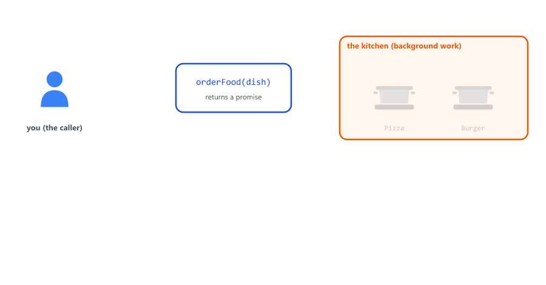

| Problem with callbacks                                   | With a promise                                                    |
| -------------------------------------------------------- | ----------------------------------------------------------------- |
| The function needs a callback parameter                  | The function **returns** a promise; code is attached to it later  |
| Each next step goes inside the step before (a pyramid)   | Steps are written one under another with `.then()`                |
| Every level needs its own error check                    | One `.catch()` at the end handles errors from every step          |
| A buggy function can call the callback twice (Session 11) | A promise settles only once                                       |
| An error thrown later escapes `try...catch` (Session 18) | An error thrown inside `.then()` goes to `.catch()`               |

Most promises you use are made for you by Node.js and by libraries: reading files, database queries, password hashing. This session shows how they work inside, so you can use them well. Session 25's `async`/`await` is built on promises, so everything here is needed there too.

---

## The Three States of a Promise

A promise is an object (a built-in class, Session 17). Here is the `orderFood` function from Session 11, written to return a promise

states.js

```javascript
function orderFood(dish) {
  return new Promise((resolve, reject) => {
    setTimeout(() => {
      if (dish === "Pizza") {
        resolve("Pizza is ready");
      } else {
        reject(new Error(`Sorry, we do not have ${dish}`));
      }
    }, 1000);
  });
}

const order = orderFood("Pizza");
console.log("Right away:", order);

setTimeout(() => {
  console.log("After 1.5 seconds:", order);
}, 1500);
```

Output

```text
Right away: Promise { <pending> }
After 1.5 seconds: Promise { 'Pizza is ready' }
```

The same object, printed twice: first it is still waiting, later it holds the result.

| State     | Meaning                         | It holds                          |
| --------- | ------------------------------- | --------------------------------- |
| Pending   | Still waiting                   | Nothing yet                       |
| Fulfilled | Finished successfully           | A **value** (`"Pizza is ready"`)  |
| Rejected  | Failed                          | A **reason**, usually an `Error`  |

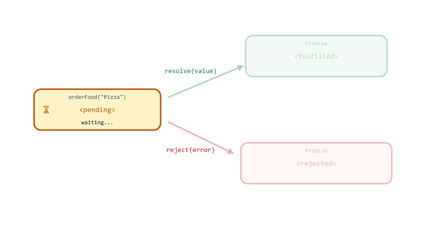

A promise that is fulfilled or rejected is called **settled**. Once settled, it never changes again.

---

## Creating a Promise with new Promise

You make a promise with `new Promise(...)`. You give it a function, and that function receives two functions to call when the work is done

order-food.js

```javascript
function orderFood(dish) {
  return new Promise((resolve, reject) => {
    setTimeout(() => {
      if (dish === "Pizza") {
        resolve("Pizza is ready");
      } else {
        reject(new Error(`Sorry, we do not have ${dish}`));
      }
    }, 1000);
  });
}

orderFood("Pizza")
  .then((message) => {
    console.log(message);
  })
  .catch((err) => {
    console.log("Error:", err.message);
  });

orderFood("Burger")
  .then((message) => {
    console.log(message);
  })
  .catch((err) => {
    console.log("Error:", err.message);
  });

console.log("Orders placed. Waiting...");
```

Output

```text
Orders placed. Waiting...
Pizza is ready
Error: Sorry, we do not have Burger
```

| Part                              | Job                                                              |
| --------------------------------- | ---------------------------------------------------------------- |
| `new Promise(...)`                | Creates the promise object                                       |
| `(resolve, reject) => { ... }`    | The **executor**: the function that starts the work              |
| `resolve(value)`                  | The work succeeded: the promise becomes fulfilled with `value`   |
| `reject(error)`                   | The work failed: the promise becomes rejected with `error`       |
| `return new Promise(...)`         | `orderFood` hands back the promise at once, before the food is ready |
| `.then(...)` / `.catch(...)`      | The code to run later, on success or on failure                  |

Notice there is no callback parameter anymore. The caller decides what happens next, by attaching `.then()` and `.catch()` to the returned promise.

The Node.js course writes the same function in Session 03, but rejects with plain text: `reject("Sorry, we do not have " + dish)`. In this course, always reject with an `Error` object, the same rule as `throw` in Session 18. It has a `message` and a stack trace, and `instanceof` works on it (see [Mistake 7](#mistake-7-rejecting-with-a-string)). Node.js course Session 11 does it this way: `reject(new Error("Invalid JSON"))`.

---

## The Executor Runs Right Away

`new Promise` does **not** make code asynchronous. The executor runs immediately, during `new Promise`

executor.js

```javascript
console.log("1. before new Promise");

const promise = new Promise((resolve) => {
  console.log("2. inside the executor");
  resolve("done");
  console.log("3. still inside, after resolve");
});

promise.then((value) => {
  console.log("5. then received:", value);
});

console.log("4. after new Promise");
```

Output

```text
1. before new Promise
2. inside the executor
3. still inside, after resolve
4. after new Promise
5. then received: done
```

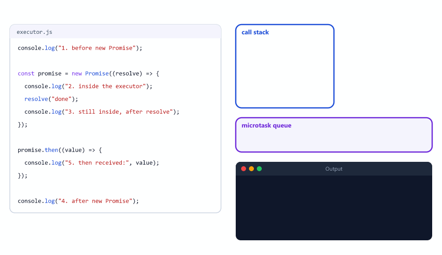

Three things to remember:

| What happened                          | Why                                                                     |
| -------------------------------------- | ----------------------------------------------------------------------- |
| Line 2 printed before line 4           | The executor runs at once. Only the slow work inside it (a timer, a file) finishes later |
| Line 3 printed after `resolve`         | `resolve` is a normal function call. It does not stop the executor like `return` does |
| Line 5 printed last                    | A `.then()` callback never runs straight away, even if the promise is already fulfilled ([then Callbacks Always Run Later](#then-callbacks-always-run-later)) |

---

## then, catch and finally

A promise has three methods for attaching code

find-product.js

```javascript
const products = new Map([
  [1, { id: 1, name: "Keyboard", price: 149900 }],
  [2, { id: 2, name: "Mouse", price: 49900 }],
]);

// A pretend database: every answer takes 300 ms
function findProduct(id) {
  return new Promise((resolve, reject) => {
    setTimeout(() => {
      const product = products.get(id);
      if (product) {
        resolve(product);
      } else {
        reject(new Error(`Product ${id} not found`));
      }
    }, 300);
  });
}

function showProduct(id) {
  console.log(`Loading product ${id}...`);

  findProduct(id)
    .then((product) => {
      console.log("200", product.name);
    })
    .catch((err) => {
      console.log("404", err.message);
    })
    .finally(() => {
      console.log(`Done with product ${id}`);
    });
}

showProduct(1);
showProduct(7);
```

Output

```text
Loading product 1...
Loading product 7...
200 Keyboard
Done with product 1
404 Product 7 not found
Done with product 7
```

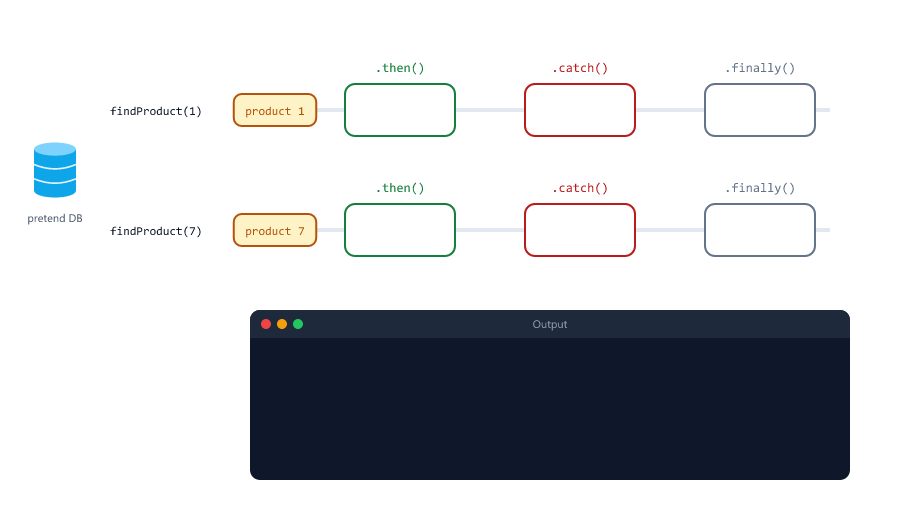

| Method          | Runs when                                      | Its callback receives |
| --------------- | ---------------------------------------------- | --------------------- |
| `.then(fn)`     | The promise is fulfilled                       | The value             |
| `.catch(fn)`    | The promise is rejected (or a step before it threw) | The error        |
| `.finally(fn)`  | Either way                                     | Nothing               |

`finally` is for clean-up that must happen whether the work succeeded or not, like `finally` in Session 18: logging how long a request took, closing a file, giving a database connection back. It does not change the result: the value or the error passes through it unchanged.

Both "Loading" lines print first, because they are normal synchronous code. After 300 ms the two timers fire one after the other, and product 1's whole chain runs before product 7's timer callback: Node.js runs all waiting microtasks after each timer callback (Session 23).

---

## A Promise Settles Only Once

Here is a stock check with a missing `return` after `reject`

settle-once.js

```javascript
function reserveStock(quantity) {
  return new Promise((resolve, reject) => {
    if (quantity < 1) {
      reject(new Error("Quantity must be at least 1"));
    }
    console.log("This line still runs");
    resolve(`Reserved ${quantity}`);
  });
}

reserveStock(0)
  .then((message) => console.log(message))
  .catch((err) => console.log("Error:", err.message));
```

Output

```text
This line still runs
Error: Quantity must be at least 1
```

The promise was rejected first, so the later `resolve` call is **ignored**: a settled promise never changes. Compare this with Session 11, where a callback called twice made a server answer twice ("Cannot set headers after they are sent to the client"). A promise protects you from that.

But the line after `reject` still ran. If that line had changed stock or saved something, that work would have happened anyway. So still write `return reject(...)`, or use `if...else`, exactly as with callbacks.

---

## then Callbacks Always Run Later

Session 23 promised to show where promise callbacks go: into the **microtask queue**

then-order.js

```javascript
console.log("1. sync: start");

setTimeout(() => console.log("5. timer callback"), 0);

Promise.resolve("cached user").then((value) => {
  console.log("4. then callback:", value);
});

process.nextTick(() => console.log("3. nextTick callback"));

console.log("2. sync: end");
```

Output

```text
1. sync: start
2. sync: end
3. nextTick callback
4. then callback: cached user
5. timer callback
```

`Promise.resolve(value)` makes a promise that is already fulfilled (more in [Promise.resolve and Promise.reject](#promiseresolve-and-promisereject)). Even so, its `.then()` callback waits until the call stack is empty. Then it runs in the microtask queue: after `process.nextTick` callbacks and **before** any timer or I/O callback.

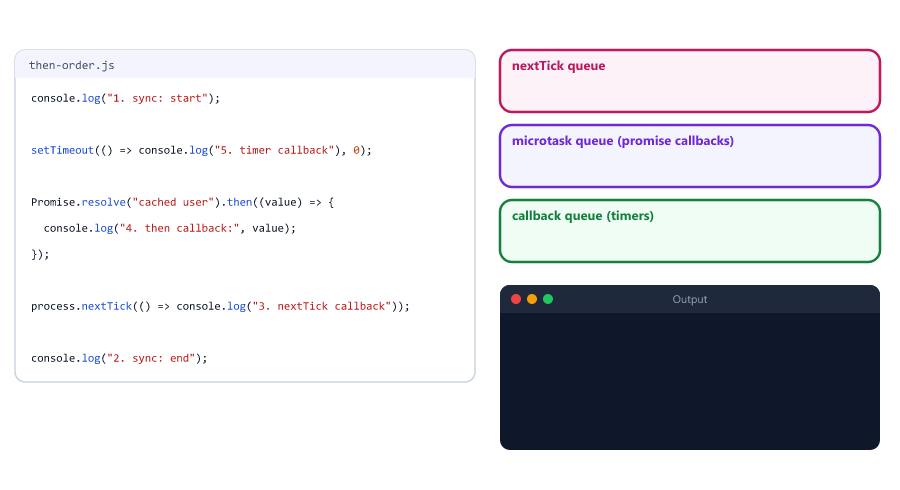

| Callback                         | Queue (Session 23)   | Runs                                   |
| -------------------------------- | -------------------- | -------------------------------------- |
| `process.nextTick(fn)`           | nextTick queue       | First, as soon as the stack is empty   |
| `.then`, `.catch`, `.finally`    | Microtask queue      | Next, together with `queueMicrotask`   |
| `setTimeout(fn, 0)`              | Callback queue       | After all microtasks                   |

This rule makes promise code predictable. The code after `.then()` **always** runs before the callback, whether the value came from a cache in no time or from a database after 50 ms. The Node.js course shows the same order with a promise and a timer (Session 03).

---

## Chaining: Each then Returns a New Promise

Here are the four steps from Session 11's callback hell again. This time `step` returns a promise instead of taking a callback

step-chain.js

```javascript
function step(message) {
  return new Promise((resolve) => {
    setTimeout(() => {
      console.log(message);
      resolve();
    }, 500);
  });
}

step("Order taken")
  .then(() => step("Food cooked"))
  .then(() => step("Food packed"))
  .then(() => step("Food delivered"))
  .then(() => console.log("Customer is happy"));
```

Output (one line every half second)

```text
Order taken
Food cooked
Food packed
Food delivered
Customer is happy
```


Same output, same timing, but the code reads from top to bottom, and adding a step is one more line. This is a **promise chain**.

How it works: `.then()` always returns a **new** promise. If its callback returns a promise, the new promise waits for it. `() => step("Food cooked")` returns the promise from `step` (an arrow function with one expression returns it, Session 10), so the chain waits 500 ms before the next `.then()` runs.

---

## Passing Values Down a Chain

Whatever a `.then()` callback returns becomes the input of the next `.then()`

user-orders.js

```javascript
const users = new Map([[7, { id: 7, name: "Riya" }]]);
const orders = new Map([
  [7, [{ id: 101, totalPaise: 149900 }, { id: 102, totalPaise: 49900 }]],
]);

function findUser(id) {
  return new Promise((resolve, reject) => {
    setTimeout(() => {
      const user = users.get(id);
      if (user) {
        resolve(user);
      } else {
        reject(new Error(`User ${id} not found`));
      }
    }, 200);
  });
}

function findOrders(userId) {
  return new Promise((resolve) => {
    setTimeout(() => {
      resolve(orders.get(userId) || []);
    }, 200);
  });
}

function showSpending(userId) {
  findUser(userId)
    .then((user) => {
      console.log("User:", user.name);
      return findOrders(user.id);               // a promise: the chain waits for it
    })
    .then((userOrders) => {
      console.log("Orders:", userOrders.length);
      return userOrders.reduce((sum, order) => sum + order.totalPaise, 0);   // a value
    })
    .then((totalPaise) => {
      console.log("Spent: Rs", (totalPaise / 100).toFixed(2));
    })
    .catch((err) => {
      console.log("Error:", err.message);
    });
}

showSpending(7);
```

Output

```text
User: Riya
Orders: 2
Spent: Rs 1998.00
```

| The callback...                      | The next `.then()` receives                                  |
| ------------------------------------ | ------------------------------------------------------------ |
| Returns a value (`return 1998`)      | That value, straight away                                    |
| Returns a promise (`return findOrders(...)`) | The promise's value, after it settles: the chain **waits** |
| Returns nothing                      | `undefined` (see [Mistake 1](#mistake-1-forgetting-return-inside-then)) |
| Throws an error                      | Nothing: the chain jumps to the next `.catch()`              |

Each callback is its own function, so a variable from one step (`user`) is not visible in a later step (scope, Session 16). If a later step needs it, return it along with the new data, or save it in a variable outside the chain. With `await` (Session 25), every result is a normal variable and this problem goes away.

---

## Errors Jump to the Nearest catch

When a promise in the chain is rejected, every `.then()` after it is **skipped**, until the next `.catch()`

user-missing.js

```javascript
const users = new Map([[7, { id: 7, name: "Riya" }]]);

function findUser(id) {
  return new Promise((resolve, reject) => {
    setTimeout(() => {
      const user = users.get(id);
      if (user) {
        resolve(user);
      } else {
        reject(new Error(`User ${id} not found`));
      }
    }, 200);
  });
}

findUser(99)
  .then((user) => {
    console.log("User:", user.name);
    return user.id;
  })
  .then((id) => {
    console.log("Loading orders for", id);
  })
  .catch((err) => {
    console.log("Error:", err.message);
  });
```

Output

```text
Error: User 99 not found
```

A `throw` inside a `.then()` callback does the same. That lets you write validation steps as normal functions that throw. Here is a sign-up with the `ValidationError` class from Session 18 and the email check from Session 08

signup-chain.js

```javascript
class ValidationError extends Error {
  constructor(message) {
    super(message);
    this.name = "ValidationError";
  }
}

const takenUsernames = new Set(["admin", "riya"]);

function checkEmail(data) {
  if (!/^\S+@\S+\.\S+$/.test(data.email)) {
    throw new ValidationError("Email is not valid");
  }
  return data;                                   // pass the whole object on
}

function checkPassword(data) {
  if (data.password.length < 8) {
    throw new ValidationError("Password must have at least 8 characters");
  }
  return data;
}

// A pretend database lookup that takes 200 ms
function checkUsernameFree(data) {
  return new Promise((resolve, reject) => {
    setTimeout(() => {
      if (takenUsernames.has(data.username)) {
        reject(new ValidationError(`Username ${data.username} is taken`));
      } else {
        resolve(data);
      }
    }, 200);
  });
}

function signUp(data) {
  return Promise.resolve(data)
    .then(checkEmail)
    .then(checkPassword)
    .then(checkUsernameFree)
    .then((user) => {
      return { status: 201, body: `Welcome, ${user.username}` };
    })
    .catch((err) => {
      if (err instanceof ValidationError) {
        return { status: 400, body: err.message };
      }
      throw err;                                 // a bug, not the user's fault: pass it on
    });
}

function show(response) {
  console.log(response.status, response.body);
}

signUp({ username: "sam", email: "sam-at-example", password: "yourpassword" }).then(show);
signUp({ username: "sam", email: "sam@example.com", password: "abc" }).then(show);
signUp({ username: "riya", email: "riya@example.com", password: "yourpassword" }).then(show);
signUp({ username: "sam", email: "sam@example.com", password: "yourpassword" }).then(show);
```

Output

```text
400 Email is not valid
400 Password must have at least 8 characters
400 Username riya is taken
201 Welcome, sam
```

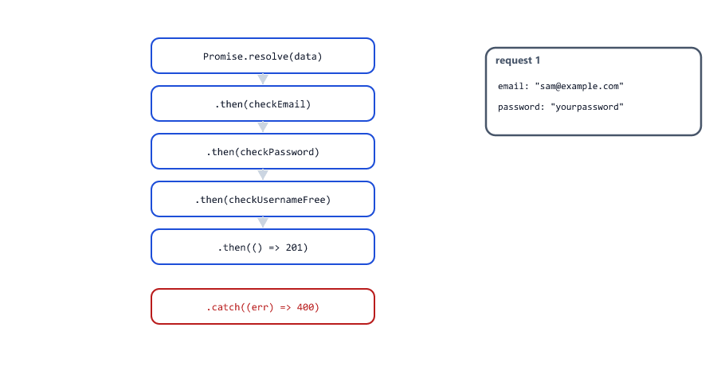

| Part                           | Why                                                                       |
| ------------------------------ | ------------------------------------------------------------------------- |
| `.then(checkEmail)`            | Passes the function itself; the chain calls it with the value (Session 11) |
| `return data;` in every check  | Each step gets the **whole** object, so the next step has everything it needs (see [Mistake 6](#mistake-6-passing-only-part-of-the-data-down-the-chain)) |
| `throw` and `reject`           | Both send the chain to `.catch()`                                         |
| `instanceof ValidationError`   | The user's mistake: answer 400. Anything else is a bug: rethrow it (Session 18) |

The first two sign-ups failed without waiting for the database, so they answered first. An error thrown inside the executor itself also rejects the promise, so `new Promise(() => { JSON.parse("{bad"); })` gives a rejected promise, not a crash.

---

## catch Can Rescue the Chain

Session 18 showed that a `try...catch` cannot catch an error thrown later, in a timer callback. A promise chain can

settings.js

```javascript
// The settings file arrives later, and it is broken (a missing })
function readSettings() {
  return new Promise((resolve) => {
    setTimeout(() => {
      resolve('{ "port": 3000, "debug": true');
    }, 300);
  });
}

readSettings()
  .then((text) => JSON.parse(text))
  .catch((err) => {
    console.log(`Settings are broken (${err.name}), using the defaults`);
    return { port: 8080, debug: false };
  })
  .then((settings) => {
    console.log("Starting on port", settings.port);
  });
```

Output

```text
Settings are broken (SyntaxError), using the defaults
Starting on port 8080
```

`JSON.parse` threw (Session 19) 300 ms after the code started, and `.catch()` still received the error. Because the `.catch()` callback **returned a value**, the chain is fulfilled again, and the next `.then()` runs with the defaults.

| Where the `.catch()` is | What it does                                                                 |
| ----------------------- | ---------------------------------------------------------------------------- |
| At the end              | Handles an error from any step. Nothing after it, except `.finally()`        |
| In the middle           | Rescues the steps above it. The steps below run with whatever it returned    |
| A `.catch()` that throws | Passes the error (or a new one) on to the next `.catch()`                   |

---

## Unhandled Rejections Stop Node.js

A rejected promise with no `.catch()` is called an **unhandled rejection**

unhandled.js

```javascript
function findUser(id) {
  return new Promise((resolve, reject) => {
    setTimeout(() => reject(new Error(`User ${id} not found`)), 250);
  });
}

setInterval(() => console.log("server is still running"), 100);

findUser(99).then((user) => console.log(user.name));
```

Output

```text
server is still running
server is still running
D:\js-practice\unhandled.js:3
    setTimeout(() => reject(new Error(`User ${id} not found`)), 250);
                            ^

Error: User 99 not found
    at Timeout._onTimeout (D:\js-practice\unhandled.js:3:29)
```

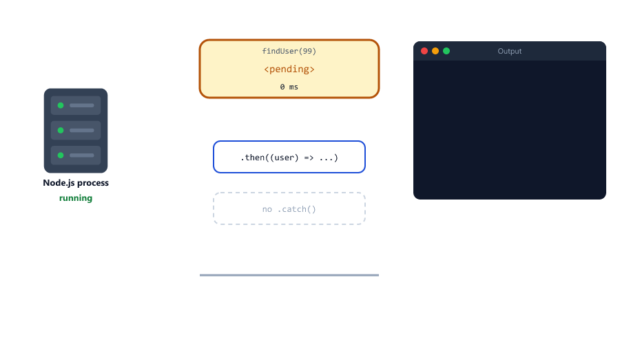

Since Node.js 15, an unhandled rejection **stops the whole program**, just like an uncaught `throw` (Session 18). On a server, that means every connected user is cut off. The fix is a `.catch()` at the end of every chain

```javascript
findUser(99)
  .then((user) => console.log(user.name))
  .catch((err) => console.log("Error:", err.message));
```

The Node.js course adds a safety net at the top of `server.js`, so an escaped rejection is at least logged before the server stops (Session 24)

```javascript
process.on("unhandledRejection", (err) => {
  console.error("UNHANDLED REJECTION! Shutting down...");
  console.error(err);
  process.exit(1);
});
```

The safety net is a last resort. The real fix is always the missing `.catch()`.

---

## Promise.resolve and Promise.reject

These two make a promise that is already settled

| Method                  | Gives you                                  |
| ----------------------- | ------------------------------------------ |
| `Promise.resolve(value)` | A promise already fulfilled with `value`  |
| `Promise.reject(error)`  | A promise already rejected with `error`   |

They are useful when a function **sometimes** has the answer at once. Here is a user lookup with the Map cache from Session 20

cache.js

```javascript
const cache = new Map();

// A pretend database: every answer takes 500 ms
function loadUserFromDb(id) {
  return new Promise((resolve) => {
    setTimeout(() => resolve({ id, name: "Riya" }), 500);
  });
}

function getUser(id) {
  if (!Number.isInteger(id)) {
    return Promise.reject(new Error("id must be a whole number"));
  }
  if (cache.has(id)) {
    return Promise.resolve(cache.get(id));        // already here: still a promise
  }
  return loadUserFromDb(id).then((user) => {
    cache.set(id, user);
    return user;
  });
}

function timeGetUser(id) {
  const start = Date.now();
  return getUser(id).then((user) => {
    const ms = Math.round((Date.now() - start) / 100) * 100;
    console.log(`${user.name} in about ${ms} ms`);
  });
}

timeGetUser(7)
  .then(() => timeGetUser(7))
  .then(() => timeGetUser("7"))
  .catch((err) => console.log("Error:", err.message));
```

Output

```text
Riya in about 500 ms
Riya in about 0 ms
Error: id must be a whole number
```

`getUser` **always** returns a promise: from the database, from the cache, or for a bad id. So every caller writes the same chain with one `.catch()`. If the bad id were thrown instead of returned as `Promise.reject(...)`, the error would happen before any `.catch()` is attached, and the program would crash (see [Mistake 9](#mistake-9-throwing-before-the-promise-exists)).

---

## Turning Callback Functions into Promises

Many older functions use error-first callbacks (Session 11). You can wrap one in a promise: call it inside the executor, and connect its callback to `resolve` and `reject`

wrap-callback.js

```javascript
const fs = require("node:fs");

function readText(file) {
  return new Promise((resolve, reject) => {
    fs.readFile(file, "utf8", (err, text) => {
      if (err) {
        reject(err);
        return;
      }
      resolve(text);
    });
  });
}

readText(__filename)
  .then((text) => {
    console.log("This file has", text.trim().split("\n").length, "lines");
    return readText("missing.txt");
  })
  .then((text) => {
    console.log(text);
  })
  .catch((err) => {
    console.log("Error:", err.code);
  });
```

Output

```text
This file has 25 lines
Error: ENOENT
```

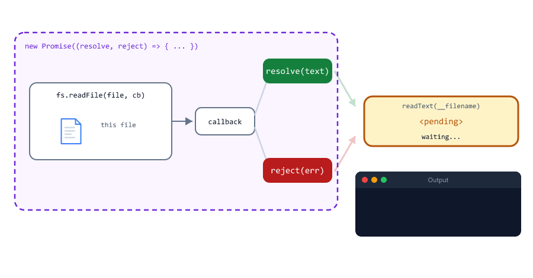

`__filename` is the path of the file itself (Session 21), and `ENOENT` is Node.js's code for "no such file". The Node.js course wraps request events the same way in Session 11: `readBody(req)` returns a promise that resolves when the `end` event arrives.

The most common wrapper of all turns `setTimeout` into a promise

wait.js

```javascript
function wait(ms) {
  return new Promise((resolve) => setTimeout(resolve, ms));
}

console.log("Sending the email...");

wait(1000)
  .then(() => {
    console.log("Email sent");
    return wait(500);
  })
  .then(() => console.log("Receipt saved"));
```

Output

```text
Sending the email...
Email sent
Receipt saved
```

You rarely need to write these wrappers yourself. Node.js already has promise versions

promise-versions.js

```javascript
const fs = require("node:fs");
const util = require("node:util");
const fsPromises = require("node:fs/promises");
const timers = require("node:timers/promises");

function countLines(text) {
  return text.trim().split("\n").length;
}

const readFile = util.promisify(fs.readFile);

readFile(__filename, "utf8")
  .then((text) => console.log("promisify:", countLines(text), "lines"))
  .then(() => fsPromises.readFile(__filename, "utf8"))
  .then((text) => console.log("fs/promises:", countLines(text), "lines"))
  .then(() => timers.setTimeout(500, "waited 500 ms"))
  .then((message) => console.log("timers/promises:", message));
```

Output

```text
promisify: 17 lines
fs/promises: 17 lines
timers/promises: waited 500 ms
```

| Tool                               | What it gives you                                                 |
| ---------------------------------- | ----------------------------------------------------------------- |
| `util.promisify(fn)`               | A promise version of any function that takes an error-first callback |
| `require("node:fs/promises")`      | Promise versions of the `fs` functions (Node.js course, Session 05) |
| `require("node:timers/promises")`  | `setTimeout(ms, value)` that returns a promise                    |

Use a promise version when one exists. Write your own wrapper only for code that has none, like events.

---

## Promise.all: Run Tasks at the Same Time

A dashboard needs three numbers from the database. The queries do not depend on each other, so there is no reason to wait for one before starting the next

all-vs-sequence.js

```javascript
function query(result, ms) {
  return new Promise((resolve) => {
    setTimeout(() => resolve(result), ms);
  });
}

const start = Date.now();

function elapsed() {
  return Math.round((Date.now() - start) / 100) * 100;   // rounded to 100 ms
}

// One by one: each query starts when the one before has finished
const oneByOne = [];
query("1200 users", 300)
  .then((users) => {
    oneByOne.push(users);
    return query("87 orders", 200);
  })
  .then((orders) => {
    oneByOne.push(orders);
    return query("Rs 52,340 revenue", 100);
  })
  .then((revenue) => {
    oneByOne.push(revenue);
    console.log(`One by one, about ${elapsed()} ms:`, oneByOne);
  });

// All at once: the three queries start together
Promise.all([
  query("1200 users", 300),
  query("87 orders", 200),
  query("Rs 52,340 revenue", 100),
]).then((results) => {
  console.log(`Promise.all, about ${elapsed()} ms:`, results);
});
```

Output

```text
Promise.all, about 300 ms: [ '1200 users', '87 orders', 'Rs 52,340 revenue' ]
One by one, about 600 ms: [ '1200 users', '87 orders', 'Rs 52,340 revenue' ]
```

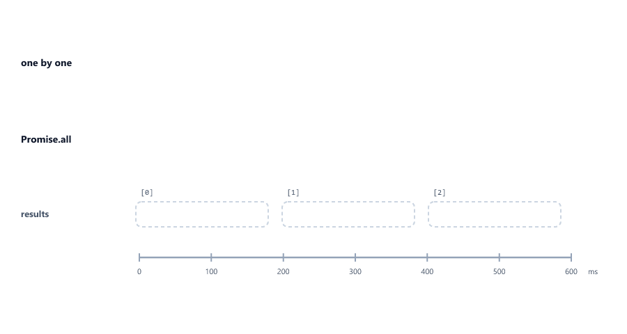

`Promise.all([...])` takes an array of promises and returns **one** promise that

* fulfils when **all** of them have fulfilled, after as long as the slowest one takes (300 ms, not 600 ms)
* gives an array of results in the **same order as the input**, not the order they finished (users finished last but comes first)

Destructuring (Session 14) gives each result a name

```javascript
Promise.all([countUsers(), countOrders(), sumRevenue()])
  .then(([users, orders, revenue]) => {
    console.log(users, orders, revenue);
  });
```

But if **one** promise rejects, `Promise.all` rejects at once, with that error

all-fails.js

```javascript
function service(name, ms, works) {
  return new Promise((resolve, reject) => {
    setTimeout(() => {
      if (works) {
        resolve(`${name} data`);
      } else {
        reject(new Error(`${name} service is down`));
      }
    }, ms);
  });
}

Promise.all([
  service("users", 300, true),
  service("orders", 100, false),
  service("revenue", 200, true),
])
  .then((results) => {
    console.log(results);
  })
  .catch((err) => {
    console.log("Dashboard failed:", err.message);
  });
```

Output

```text
Dashboard failed: orders service is down
```

The other two queries keep running, but their results are thrown away. Use `Promise.all` when you need **every** result, for example a product and its stock before an order can be placed.

---

## Promise.allSettled: Every Result, Even Failures

When some results are optional, wait for all of them and look at each one

all-settled.js

```javascript
function service(name, ms, works) {
  return new Promise((resolve, reject) => {
    setTimeout(() => {
      if (works) {
        resolve(`${name} data`);
      } else {
        reject(new Error(`${name} service is down`));
      }
    }, ms);
  });
}

const names = ["users", "orders", "revenue"];

Promise.allSettled([
  service("users", 300, true),
  service("orders", 100, false),
  service("revenue", 200, true),
]).then((results) => {
  results.forEach((result, i) => {
    if (result.status === "fulfilled") {
      console.log(`${names[i]}: fulfilled, value = ${result.value}`);
    } else {
      console.log(`${names[i]}: rejected, reason = ${result.reason.message}`);
    }
  });
});
```

Output

```text
users: fulfilled, value = users data
orders: rejected, reason = orders service is down
revenue: fulfilled, value = revenue data
```

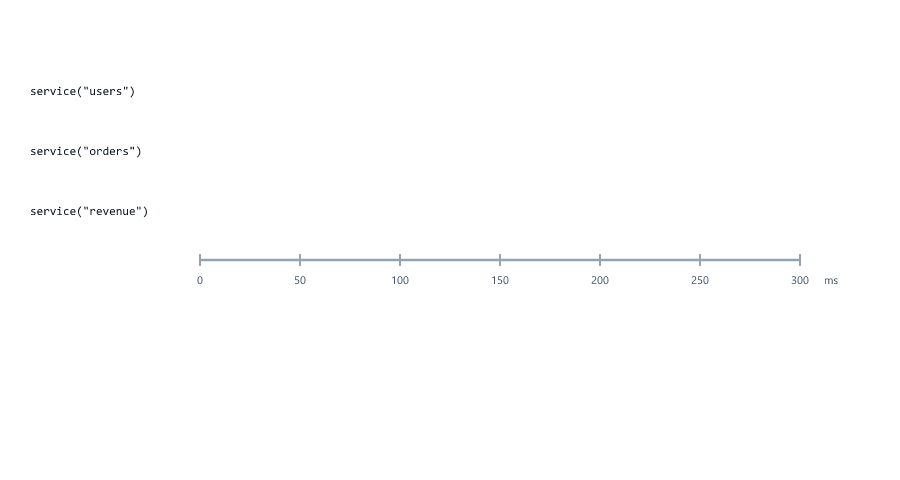

`Promise.allSettled` **never rejects**. Each result is an object

| `status`       | Other property                 |
| -------------- | ------------------------------ |
| `"fulfilled"`  | `value`: the result            |
| `"rejected"`   | `reason`: the error            |

Use it when a failure in one part must not stop the rest, like sending a newsletter to 500 users: you want to know who failed, not stop at the first failure.

---

## Promise.race and Promise.any

`Promise.race` settles as soon as the **first** promise settles, fulfilled or rejected. Session 22 built a timeout race with a `finished` flag and promised a shorter way. Here it is

race-timeout.js

```javascript
function query(result, ms) {
  return new Promise((resolve) => {
    setTimeout(() => resolve(result), ms);
  });
}

function withTimeout(promise, ms) {
  let timer;
  const timeout = new Promise((resolve, reject) => {
    timer = setTimeout(() => reject(new Error(`timed out after ${ms} ms`)), ms);
  });

  return Promise.race([promise, timeout]).finally(() => clearTimeout(timer));
}

withTimeout(query("3 orders", 100), 300)
  .then((result) => console.log("fast:", result))
  .catch((err) => console.log("fast:", err.message));

withTimeout(query("3000 orders", 500), 300)
  .then((result) => console.log("slow:", result))
  .catch((err) => console.log("slow:", err.message));
```

Output

```text
fast: 3 orders
slow: timed out after 300 ms
```

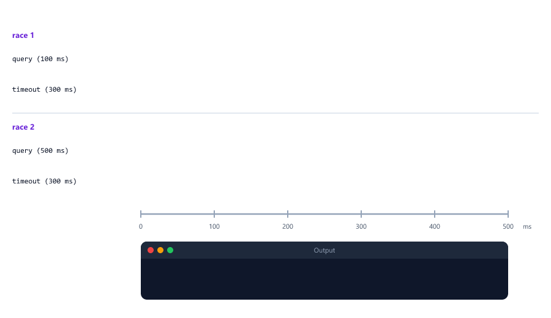

| Part                                | Job                                                                |
| ----------------------------------- | ------------------------------------------------------------------ |
| `timeout`                           | A promise that only ever rejects, after `ms`                       |
| `Promise.race([promise, timeout])`  | Whichever settles first decides the result                         |
| No `finished` flag                  | Not needed: a promise settles only once, so the loser is ignored   |
| `.finally(() => clearTimeout(timer))` | The query won: stop the timer so it does not keep running        |

`race` only stops **waiting** for the slow query. The query itself keeps running until it finishes.

`Promise.any` waits for the first promise that **fulfils**, and ignores failures. It rejects only if all of them fail

any.js

```javascript
function mirror(name, ms, works) {
  return new Promise((resolve, reject) => {
    setTimeout(() => {
      if (works) {
        resolve(`price list from ${name}`);
      } else {
        reject(new Error(`${name} is down`));
      }
    }, ms);
  });
}

Promise.any([
  mirror("mirror A", 100, false),
  mirror("mirror B", 300, true),
  mirror("mirror C", 200, true),
])
  .then((result) => console.log("Got:", result));

Promise.any([
  mirror("mirror A", 100, false),
  mirror("mirror B", 400, false),
])
  .catch((err) => {
    console.log(err.name + ":", err.message);
    err.errors.forEach((e) => console.log(" -", e.message));
  });
```

Output

```text
Got: price list from mirror C
AggregateError: All promises were rejected
 - mirror A is down
 - mirror B is down
```

Mirror A failed first, but `any` waited for the first success (mirror C, 200 ms). In the second group everything failed, so `any` rejected with an `AggregateError`, whose `errors` array holds every error (after 400 ms, when the last one failed).

---

## Which Promise Method?

| Method                | Settles when                                  | Gives                                   | Use it for                         |
| --------------------- | --------------------------------------------- | --------------------------------------- | ---------------------------------- |
| `Promise.all`         | All fulfil, or the first one rejects          | An array of values, in input order      | Tasks that **all** must work       |
| `Promise.allSettled`  | All have settled                              | An array of `{ status, value / reason }` | Do everything, report what failed |
| `Promise.race`        | The first one settles (either way)            | That value or that error                | Timeouts                           |
| `Promise.any`         | The first one fulfils, or all reject          | That value, or an `AggregateError`      | The fastest copy that works        |

All four take an array of promises and return one new promise, so you attach `.then()` and `.catch()` to them like any other promise.

---

## Promises You Will Meet in Node.js

| Code                                    | Gives a promise of                           | Where                          |
| --------------------------------------- | -------------------------------------------- | ------------------------------ |
| `fsPromises.readFile(file, "utf8")`     | The file's text                              | Node.js course, Session 05     |
| `import("./money.mjs")`                 | The module                                   | Session 21                     |
| `Student.find()`                        | The documents (a Mongoose query that works like a promise) | Node.js course, Session 19 |
| `bcrypt.hash(password, 10)`             | The password hash                            | Node.js course, Session 23     |
| `fetch(url)`                            | The response from another server             | Session 25; Node.js course, Session 11 |

Session 21 mentioned that `import()` loads a module later and returns a promise. It is useful for loading a big module only when it is needed

import-later/money.mjs

```javascript
export function formatRupees(paise) {
  return "Rs " + (paise / 100).toFixed(2);
}
```

import-later/app.js

```javascript
console.log("Server starting");

import("./money.mjs")
  .then((money) => {
    console.log(money.formatRupees(149900));
  })
  .catch((err) => {
    console.log("Could not load the module:", err.message);
  });

console.log("Loading the money module...");
```

Run it from the `js-practice` folder with `node import-later/app.js`.

```text
Server starting
Loading the money module...
Rs 1499.00
```

The promise fulfils with the module object, which holds everything the module exports. `import()` works in CommonJS files as well as ES modules.

---

## Mini Example 1: An Order Pipeline

An online shop places an order in steps: check the request, reserve the stock, charge the wallet. Each step can fail with its own status code, and one `.catch()` turns every failure into an answer, like the central error handler in Session 18. The pretend database is a few Maps (Session 20)

order-pipeline.js

```javascript
class AppError extends Error {
  constructor(message, statusCode) {
    super(message);
    this.name = "AppError";
    this.statusCode = statusCode;
  }
}

const prices = new Map([["keyboard", 149900], ["mouse", 49900]]);
const stock = new Map([["keyboard", 5], ["mouse", 0]]);
const wallets = new Map([["riya", 500000], ["kabir", 100000]]);

function wait(ms) {
  return new Promise((resolve) => setTimeout(resolve, ms));
}

function validateOrder(order) {
  if (!prices.has(order.item)) {
    throw new AppError(`We do not sell ${order.item}`, 404);
  }
  if (!Number.isInteger(order.quantity) || order.quantity < 1) {
    throw new AppError("Quantity must be a whole number of at least 1", 400);
  }
  return order;
}

function reserveStock(order) {
  return wait(100).then(() => {
    const available = stock.get(order.item);
    if (available < order.quantity) {
      throw new AppError(`Only ${available} ${order.item} left`, 409);
    }
    stock.set(order.item, available - order.quantity);
    return { ...order, totalPaise: prices.get(order.item) * order.quantity };
  });
}

function chargeWallet(order) {
  return wait(200).then(() => {
    const balance = wallets.get(order.user);
    if (balance < order.totalPaise) {
      stock.set(order.item, stock.get(order.item) + order.quantity);   // give the stock back
      throw new AppError("Not enough money in the wallet", 402);
    }
    wallets.set(order.user, balance - order.totalPaise);
    return order;
  });
}

function formatRupees(paise) {
  return "Rs " + (paise / 100).toFixed(2);
}

function placeOrder(order) {
  return Promise.resolve(order)
    .then(validateOrder)
    .then(reserveStock)
    .then(chargeWallet)
    .then((paid) => {
      return { status: 201, body: `${paid.quantity} x ${paid.item} for ${formatRupees(paid.totalPaise)}` };
    })
    .catch((err) => {
      if (err instanceof AppError) {
        return { status: err.statusCode, body: err.message };
      }
      console.log("[log]", err.message);         // a bug: log it for the developer
      return { status: 500, body: "Something went wrong" };
    });
}

const requests = [
  { user: "riya", item: "keyboard", quantity: 2 },
  { user: "riya", item: "mouse", quantity: 1 },
  { user: "riya", item: "keyboard", quantity: 0 },
  { user: "kabir", item: "keyboard", quantity: 1 },
  { user: "riya", item: "monitor", quantity: 1 },
  null,
];

Promise.all(requests.map(placeOrder)).then((responses) => {
  responses.forEach((res) => console.log(res.status, res.body));
  console.log("Keyboards left:", stock.get("keyboard"));
  console.log("Riya's wallet:", formatRupees(wallets.get("riya")));
});
```

Output

```text
[log] Cannot read properties of null (reading 'item')
201 2 x keyboard for Rs 2998.00
409 Only 0 mouse left
400 Quantity must be a whole number of at least 1
402 Not enough money in the wallet
404 We do not sell monitor
500 Something went wrong
Keyboards left: 3
Riya's wallet: Rs 2002.00
```


| Request                     | Where it stopped     | Answer                                         |
| --------------------------- | -------------------- | ---------------------------------------------- |
| 2 keyboards for Riya        | Went all the way     | 201, and the wallet drops from Rs 5000.00 to Rs 2002.00 |
| 1 mouse                     | `reserveStock`       | 409: none left                                 |
| 0 keyboards                 | `validateOrder`      | 400                                            |
| 1 keyboard for Kabir        | `chargeWallet`       | 402 Payment Required; the keyboard is put back, so 3 are left, not 2 |
| A monitor                   | `validateOrder`      | 404                                            |
| `null`                      | `validateOrder` threw a `TypeError` | 500, and the bug is logged          |

Things to notice:

* `Promise.all(requests.map(placeOrder))` starts all six orders at the same time. The answers come back in request order, even though they finished at different times.
* The `[log]` line printed first because the `null` request failed in the very first step, before any order had waited.
* `placeOrder` never rejects: its `.catch()` always returns an answer. That is why the final `Promise.all` needs no `.catch()` of its own.
* The Node.js course does the same with Express: route code throws an `AppError`, and one error-handling middleware sends the status code (Session 24).

---

## Mini Example 2: A Dashboard with a Time Limit

A dashboard collects data from three services. One of them is slow today. A slow part must not make the whole page slow, so each service gets 300 ms, and a part that misses the deadline is shown as `null` with a warning

dashboard.js

```javascript
function service(result, ms) {
  return new Promise((resolve) => {
    setTimeout(() => resolve(result), ms);
  });
}

function withTimeout(promise, ms) {
  let timer;
  const timeout = new Promise((resolve, reject) => {
    timer = setTimeout(() => reject(new Error(`timed out after ${ms} ms`)), ms);
  });
  return Promise.race([promise, timeout]).finally(() => clearTimeout(timer));
}

// Pretend services: the recommendations service is having a slow day
const sources = {
  users: () => service(1200, 100),
  orders: () => service(87, 200),
  recommendations: () => service(["Keyboard", "Mouse"], 900),
};

function loadDashboard() {
  const names = Object.keys(sources);
  const jobs = names.map((name) => withTimeout(sources[name](), 300));

  return Promise.allSettled(jobs).then((results) => {
    const dashboard = {};
    const warnings = [];
    results.forEach((result, i) => {
      if (result.status === "fulfilled") {
        dashboard[names[i]] = result.value;
      } else {
        dashboard[names[i]] = null;
        warnings.push(`${names[i]}: ${result.reason.message}`);
      }
    });
    dashboard.warnings = warnings;
    return dashboard;
  });
}

const start = Date.now();

loadDashboard().then((dashboard) => {
  const ms = Math.round((Date.now() - start) / 100) * 100;
  console.log(`Answered in about ${ms} ms`);
  console.log(JSON.stringify(dashboard, null, 2));
});
```

Output

```text
Answered in about 300 ms
{
  "users": 1200,
  "orders": 87,
  "recommendations": null,
  "warnings": [
    "recommendations: timed out after 300 ms"
  ]
}
```

| Part                                   | Job                                                              |
| -------------------------------------- | ---------------------------------------------------------------- |
| `sources`                              | An object of functions (Session 13); each one starts a service   |
| `names.map(... withTimeout(..., 300))` | Starts all three at once, each with its own 300 ms limit         |
| `Promise.allSettled(jobs)`             | Waits for every part; a failed part does not stop the others     |
| `null` + `warnings`                    | The page still shows what worked, and says what is missing       |
| `JSON.stringify(dashboard, null, 2)`   | The JSON a server would send with `res.json` (Session 19; Node.js course, Session 12) |

The answer is ready after 300 ms instead of 900 ms. The program itself ends only after 900 ms, when the slow service finally finishes: as with `race`, giving up on a promise does not stop the work behind it.

---

## Beginner Mistakes

### Mistake 1: Forgetting return inside then

m-no-return.js

```javascript
function step(message) {
  return new Promise((resolve) => {
    setTimeout(() => {
      console.log(message);
      resolve();
    }, 500);
  });
}

step("Order taken")
  .then(() => {
    step("Food cooked");                          // no return
  })
  .then(() => console.log("Customer is happy"));
```

Output

```text
Order taken
Customer is happy
Food cooked
```

With `{ }`, an arrow function returns nothing unless you write `return` (Session 10). The callback returned `undefined`, so the chain did not wait for the cooking. **Correct:** `return step("Food cooked");`, or leave out the braces

```javascript
  .then(() => step("Food cooked"))
```

### Mistake 2: Leaving out catch

A chain without `.catch()` crashes Node.js when it is rejected (see [Unhandled Rejections Stop Node.js](#unhandled-rejections-stop-nodejs)). **Correct:** end every chain with `.catch()`, or return the promise to a caller that has one.

### Mistake 3: Using the promise as if it were the value

m-print-promise.js

```javascript
function findUser(id) {
  return new Promise((resolve) => {
    setTimeout(() => resolve({ id, name: "Riya" }), 200);
  });
}

const user = findUser(7);
console.log(user.name);
console.log(user);
```

Output

```text
undefined
Promise { <pending> }
```

`findUser` returns a promise, not the user. A promise has no `name` property. **Correct:** use the value inside `.then()`

```javascript
findUser(7).then((user) => {
  console.log("Hello,", user.name);
});
```

### Mistake 4: Reading a result outside then

m-outside.js

```javascript
function findUser(id) {
  return new Promise((resolve) => {
    setTimeout(() => resolve({ id, name: "Riya" }), 200);
  });
}

let userName;
findUser(7).then((user) => {
  userName = user.name;
});

console.log("Hello,", userName);
```

Output

```text
Hello, undefined
```

The last line runs straight away; the `.then()` callback runs 200 ms later. This is the same timing problem as callbacks (Session 11). **Correct:** put the code that needs the value inside the `.then()`, as in Mistake 3. In Session 25, `await` makes this read like normal code.

### Mistake 5: Nesting then inside then

```javascript
findUser(7).then((user) => {
  findOrders(user.id).then((userOrders) => {
    console.log(userOrders.length);
  });
});
```

This is callback hell again, and an error in `findOrders` would not reach a `.catch()` on the outer chain. **Correct:** return the promise and chain

```javascript
findUser(7)
  .then((user) => findOrders(user.id))
  .then((userOrders) => console.log(userOrders.length))
  .catch((err) => console.log("Error:", err.message));
```

### Mistake 6: Passing only part of the data down the chain

m-part-data.js

```javascript
function checkEmail(data) {
  if (!data.email.includes("@")) {
    throw new Error("Email is not valid");
  }
  return { email: data.email };                   // only the email goes on
}

function checkPassword(data) {
  if (data.password.length < 8) {
    throw new Error("Password must have at least 8 characters");
  }
  return data;
}

Promise.resolve({ email: "sam@example.com", password: "yourpassword" })
  .then(checkEmail)
  .then(checkPassword)
  .then(() => console.log("All checks passed"))
  .catch((err) => console.log("Error:", err.message));
```

Output

```text
Error: Cannot read properties of undefined (reading 'length')
```

The data was valid, yet the sign-up failed: `checkEmail` passed on an object with only the email, so `checkPassword` found no password. **Correct:** every check returns the whole `data` object, as in [signup-chain.js](#errors-jump-to-the-nearest-catch).

### Mistake 7: Rejecting with a string

m-string-reject.js

```javascript
function findUser(id) {
  return new Promise((resolve, reject) => {
    setTimeout(() => reject(`User ${id} not found`), 200);
  });
}

findUser(99).catch((err) => {
  console.log("Error:", err.message);
  console.log("Is it an Error?", err instanceof Error);
});
```

Output

```text
Error: undefined
Is it an Error? false
```

A string has no `message` and no stack trace, and `instanceof` checks fail, so a central error handler cannot tell what happened. **Correct:** reject with an `Error` (or your own error class), the same rule as `throw` (Session 18)

```javascript
    setTimeout(() => reject(new Error(`User ${id} not found`)), 200);
```

### Mistake 8: Calling the function in then instead of passing it

m-call-in-then.js

```javascript
function step(message, ms) {
  return new Promise((resolve) => {
    setTimeout(() => {
      console.log(message);
      resolve();
    }, ms);
  });
}

step("Order taken", 500)
  .then(step("Food cooked", 300))
  .then(step("Food delivered", 100));
```

Output

```text
Food delivered
Food cooked
Order taken
```

`step("Food cooked", 300)` runs **immediately**, while the chain is being built, so all three steps start at the same time. `.then()` gets a promise instead of a function, and silently ignores anything that is not a function. The same rule as Session 11: pass the function, do not call it. **Correct:**

```javascript
step("Order taken", 500)
  .then(() => step("Food cooked", 300))
  .then(() => step("Food delivered", 100));
```

### Mistake 9: Throwing before the promise exists

m-sync-throw.js

```javascript
function getUser(id) {
  if (!Number.isInteger(id)) {
    throw new Error("id must be a whole number");
  }
  return Promise.resolve({ id, name: "Riya" });
}

getUser("7")
  .then((user) => console.log(user.name))
  .catch((err) => console.log("Error:", err.message));
```

Output

```text
D:\js-practice\m-sync-throw.js:3
    throw new Error("id must be a whole number");
    ^

Error: id must be a whole number
    at getUser (D:\js-practice\m-sync-throw.js:3:11)
```

`getUser` threw **before** returning a promise, so `.then()` and `.catch()` were never attached, and the program crashed. **Correct:** a function that returns a promise should report every failure through the promise: `return Promise.reject(new Error("id must be a whole number"));`, as in [cache.js](#promiseresolve-and-promisereject).

### Mistake 10: Starting promises in forEach and expecting the results

m-foreach.js

```javascript
function findUser(id) {
  return new Promise((resolve) => {
    setTimeout(() => resolve({ id, name: `User ${id}` }), 100 * id);
  });
}

const names = [];
[3, 1, 2].forEach((id) => {
  findUser(id).then((user) => names.push(user.name));
});

console.log("Names:", names);
```

Output

```text
Names: []
```

`forEach` starts the three lookups and moves on; nothing has finished when the last line runs. **Correct:** `map` the ids to promises and wait for all of them

m-foreach-fix.js

```javascript
function findUser(id) {
  return new Promise((resolve) => {
    setTimeout(() => resolve({ id, name: `User ${id}` }), 100 * id);
  });
}

Promise.all([3, 1, 2].map((id) => findUser(id))).then((users) => {
  console.log("Names:", users.map((user) => user.name));
});
```

Output

```text
Names: [ 'User 3', 'User 1', 'User 2' ]
```

User 3 took longest, but it is still first: `Promise.all` keeps the input order.

### Mistake 11: Wrapping a promise in new Promise

m-wrap-promise.js

```javascript
function findUser(id) {
  return new Promise((resolve, reject) => {
    setTimeout(() => reject(new Error(`User ${id} not found`)), 200);
  });
}

function getUserName(id) {
  return new Promise((resolve) => {
    findUser(id).then((user) => resolve(user.name));   // nobody calls reject
  });
}

getUserName(99)
  .then((name) => console.log("Name:", name))
  .catch((err) => console.log("Error:", err.message));
```

Output

```text
D:\js-practice\m-wrap-promise.js:3
    setTimeout(() => reject(new Error(`User ${id} not found`)), 200);
                            ^

Error: User 99 not found
    at Timeout._onTimeout (D:\js-practice\m-wrap-promise.js:3:29)
```

The caller has a `.catch()`, and the program still crashed. The inner promise was rejected with nobody handling it, and the outer promise was never settled at all. `findUser` already returns a promise, so there is nothing to wrap. **Correct:** return the chain

```javascript
function getUserName(id) {
  return findUser(id).then((user) => user.name);
}
```

Use `new Promise` only to wrap code that does **not** use promises yet: timers, callbacks, events.

### Mistake 12: Using Promise.all when one failure should not stop the rest

`Promise.all` rejects at the first failure and throws away every other result. For a newsletter to 500 users, one bad email address would hide the 499 that worked. **Correct:** `Promise.allSettled`, then count the `"rejected"` results.

---

## Practice Exercises

### Exercise 1

Write `checkPort(port)`, which returns a promise. After 200 ms it fulfils with `"Port 3000 is free"` when `port` is `3000`, and otherwise rejects with `new Error("Port 80 is in use")` (using the real number). Call it with `3000` and with `80`, and use `.then()`, `.catch()` and `.finally()` (print `"check finished"`).

### Exercise 2

Predict the output, then run it:
`console.log("A"); setTimeout(() => console.log("B"), 0); Promise.resolve().then(() => console.log("C")); process.nextTick(() => console.log("D")); console.log("E");`

### Exercise 3

Rewrite the error-first `findUser(id, callback)` from Session 11 so that it returns a promise instead. Find user `1`, then (in the same chain) user `99`, and handle the error with one `.catch()`.

### Exercise 4

Using `findUser` and `findOrders` from [user-orders.js](#passing-values-down-a-chain), print the id of the user's most expensive order. Test it with user `7` and user `99`, and make sure both end with a clear message, not a crash.

### Exercise 5

Write `wait(ms)` and use one chain to print `3`, `2`, `1` and `Server started`, one second apart.

### Exercise 6

Three pretend services take 400 ms, 100 ms and 250 ms. Use `Promise.all` and print the results with the time taken (about 400 ms). Then make the 100 ms service fail, and change the code so the two working results are still printed.

### Exercise 7

Give a pretend database query that takes 500 ms a limit of 200 ms with `withTimeout`. On a timeout, answer `{ status: 504, body: "Database too slow" }`; otherwise `{ status: 200, body: result }`. Test it once with a 100 ms query too.

### Exercise 8

Add a `sendReceipt(order)` step to the [order pipeline](#mini-example-1-an-order-pipeline) that waits 100 ms and fulfils. Add an `emails` Map; when the user has no email address, the step should log a warning, but the order must still answer `201`. (Hint: give this one step its own `.catch()`.)

---

## Interview Questions

### What is a promise?

An object that stands for a result that is not ready yet. It starts as pending, and later becomes fulfilled with a value or rejected with an error. Code is attached with `.then()`, `.catch()` and `.finally()`, instead of passing a callback into the function.

### What are the states of a promise?

Pending (still waiting), fulfilled (finished with a value) and rejected (failed with a reason). Fulfilled and rejected together are called settled. A settled promise never changes again, and later calls to `resolve` or `reject` are ignored.

### Does the function passed to new Promise run asynchronously?

No. The executor runs immediately, during `new Promise`. Only the slow work it starts, like a timer or a file read, finishes later. `.then()` callbacks, however, always run later, as microtasks.

### How does promise chaining work?

Every `.then()` returns a new promise. If its callback returns a value, the next `.then()` receives that value. If it returns a promise, the chain waits for it and passes on its result. If it throws, the chain skips to the next `.catch()`.

### How are errors handled in a promise chain?

A rejection, or a `throw` inside any callback, skips the following `.then()` callbacks until the nearest `.catch()`. One `.catch()` at the end handles every step. A `.catch()` that returns a value rescues the chain; one that throws passes the error on.

### What happens when a promise is rejected and nobody catches it?

It is an unhandled rejection. Since Node.js 15, it stops the process, like an uncaught exception. `process.on("unhandledRejection", ...)` can log it as a last resort, but the fix is to add the missing `.catch()` (or `try...catch` with `await`).

### What is printed first: a setTimeout(fn, 0) callback or a Promise.resolve().then() callback?

The `.then()` callback. Promise callbacks go into the microtask queue, which is emptied before the event loop moves on to timers. In Node.js, `process.nextTick` callbacks run even before promise callbacks.

### What is the difference between Promise.all, Promise.allSettled, Promise.race and Promise.any?

`all` waits for every promise and rejects at the first failure. `allSettled` waits for every promise and never rejects, giving a status for each. `race` settles with the first promise to settle, success or failure. `any` fulfils with the first success and rejects with an `AggregateError` only if all fail.

### How do promises fix callback hell?

A function returns a promise instead of taking a callback, so the steps are chained one under another with `.then()` instead of nested inside each other. Errors from every step reach one `.catch()`.

### How do you turn a callback-based function into one that returns a promise?

Wrap it in `new Promise`, call `reject(err)` when the callback gets an error and `resolve(result)` otherwise. For error-first callbacks, `util.promisify` does this for you, and many Node.js modules have ready promise versions, like `fs/promises`.

### What does finally do?

It runs a callback whether the promise was fulfilled or rejected, for clean-up work like closing a connection or logging the time taken. It receives no value and passes the original result or error through unchanged.

### Why should you reject with an Error object instead of a string?

An `Error` has a `message`, a `name` and a stack trace that shows where it happened, and error classes let handlers use `instanceof` to choose the right status code. A string has none of these.

### How do you add a timeout to a promise?

Race it against a promise that rejects after the time limit: `Promise.race([work, timeout])`. Clear the timer in `.finally()` so it does not keep running. The work itself is not stopped; only the waiting is.

### When would you use Promise.resolve?

When a function sometimes has the answer straight away, for example from a cache, but must still return a promise like the slow path does. Then every caller can use the same `.then()` and `.catch()`.

### What is wrong with wrapping an existing promise in new Promise?

It adds code for nothing, and it is easy to forget to pass errors on. If the inner promise rejects and nobody calls `reject`, the outer promise never settles and the inner rejection is unhandled. Return the existing promise, or its `.then()` chain, instead.

---

| Previous | All sessions | Next |
| :--- | :---: | ---: |
| [23. The Event Loop](23-event-loop.md) | [Course outline](README.md#course-outline) | [25. async/await and fetch](25-async-await-and-fetch.md) |
