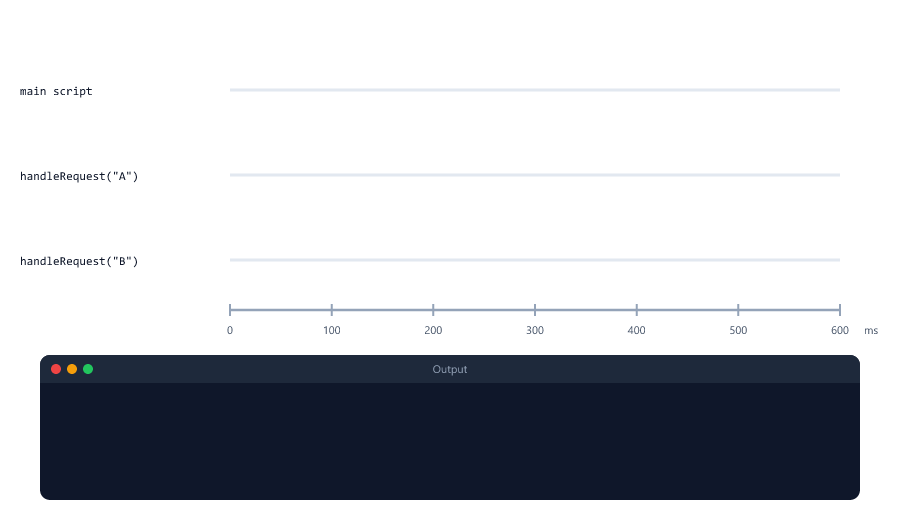
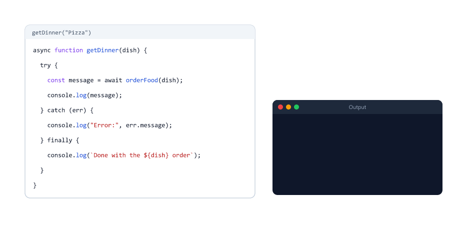
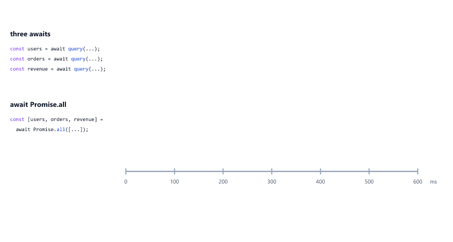
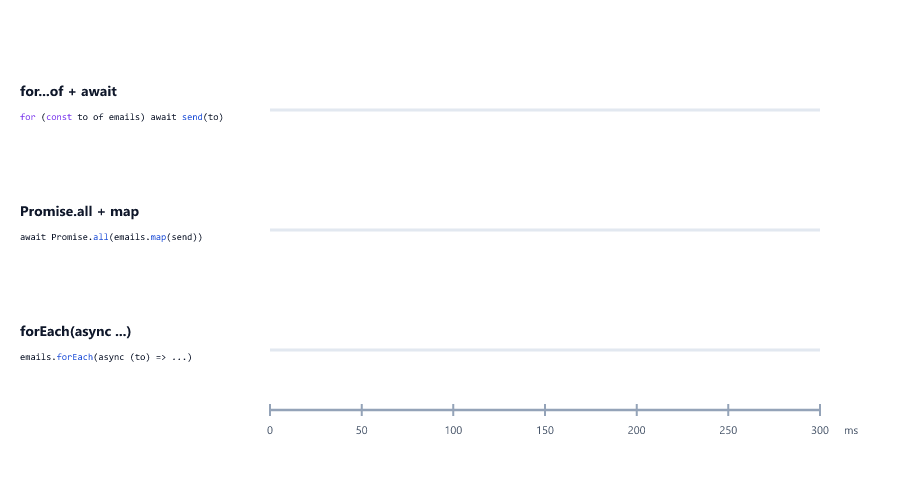
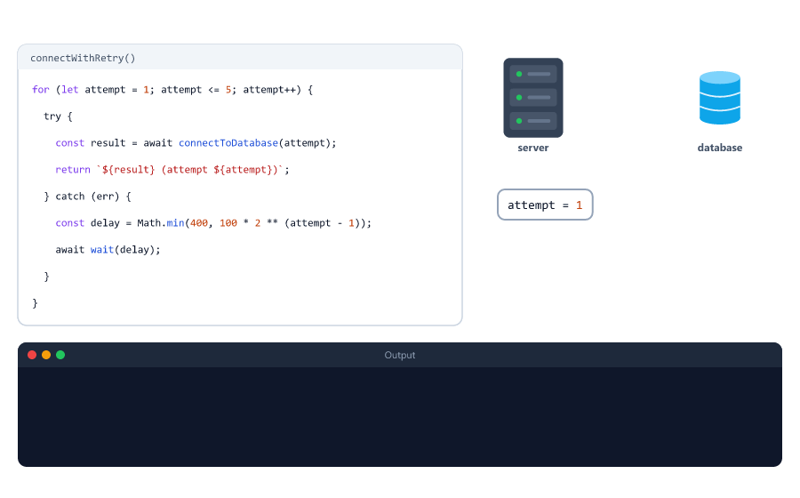

# async/await and fetch

> **Session 25 of 25** | Part 4: Async JavaScript | [All sessions](README.md#course-outline)

## Table of Contents
- [Why async and await?](#why-async-and-await)
- [async Functions Always Return a Promise](#async-functions-always-return-a-promise)
- [await Waits for a Promise](#await-waits-for-a-promise)
- [await Pauses the Function, Not the Program](#await-pauses-the-function-not-the-program)
- [try...catch Works Again](#trycatch-works-again)
- [Errors Travel Up to the Caller](#errors-travel-up-to-the-caller)
- [From then Chains to await](#from-then-chains-to-await)
- [Where You Can Use await](#where-you-can-use-await)
- [One After Another or All at Once](#one-after-another-or-all-at-once)
- [Loops with await](#loops-with-await)
- [Retrying with a Loop](#retrying-with-a-loop)
- [The Practice API](#the-practice-api)
- [fetch: Asking Another Server](#fetch-asking-another-server)
- [Check response.ok](#check-responseok)
- [Sending JSON with POST](#sending-json-with-post)
- [When the Other Server Fails](#when-the-other-server-fails)
- [Mini Example 1: A Cart Price Service](#mini-example-1-a-cart-price-service)
- [Mini Example 2: Importing Every Page of Products](#mini-example-2-importing-every-page-of-products)
- [Beginner Mistakes](#beginner-mistakes)
- [Practice Exercises](#practice-exercises)
- [Interview Questions](#interview-questions)

---

## Why async and await?

Session 11 wrote four slow steps with callbacks, and the code grew into a pyramid. Session 24 turned the pyramid into a flat promise chain

```javascript
step("Order taken")
  .then(() => step("Food cooked"))
  .then(() => step("Food packed"))
  .then(() => step("Food delivered"))
  .then(() => console.log("Customer is happy"));
```

`async` and `await` go one step further: the same steps, written like normal code

step-await.js

```javascript
function step(message) {
  return new Promise((resolve) => {
    setTimeout(() => {
      console.log(message);
      resolve();
    }, 500);
  });
}

async function deliverOrder() {
  await step("Order taken");
  await step("Food cooked");
  await step("Food packed");
  await step("Food delivered");
  console.log("Customer is happy");
}

deliverOrder();
```

Output (one line every half second)

```text
Order taken
Food cooked
Food packed
Food delivered
Customer is happy
```


| Keyword | What it does                                                         |
| ------- | -------------------------------------------------------------------- |
| `async` | Put before a function. The function can now use `await`, and it always returns a promise |
| `await` | Put before a promise. Waits until the promise settles, then gives its value (or throws its error) |

`async`/`await` is not a new kind of asynchronous code. It is a nicer way to **write** promise code: `step` still returns a promise, exactly as in Session 24. The Node.js course introduces it in Session 03 and then uses it for reading files, database queries, password hashing and route handlers.

---

## async Functions Always Return a Promise

Whatever an `async` function returns is wrapped in a promise, and whatever it throws becomes a rejected promise

async-returns.js

```javascript
async function getPort() {
  return 3000;
}

async function startServer() {
  throw new Error("Port 3000 is already in use");
}

const result = getPort();
console.log(result);

result.then((port) => console.log("then received:", port));
startServer().catch((err) => console.log("catch received:", err.message));
```

Output

```text
Promise { 3000 }
then received: 3000
catch received: Port 3000 is already in use
```


| Inside the `async` function | The caller gets                         |
| --------------------------- | --------------------------------------- |
| `return value`              | A promise fulfilled with `value`        |
| No `return`                 | A promise fulfilled with `undefined`    |
| `throw error`               | A promise rejected with `error`         |

So an `async` function works with everything from Session 24: `.then()`, `.catch()`, `Promise.all`, and `await` in another `async` function.

---

## await Waits for a Promise

`await` takes a promise and gives back its value. Here is the `orderFood` function from Session 24, used with `await` like in Node.js course Session 03

first-await.js

```javascript
function orderFood(dish) {
  return new Promise((resolve, reject) => {
    setTimeout(() => {
      if (dish === "Pizza") {
        resolve("Pizza is ready");
      } else {
        reject(new Error(`Sorry, we do not have ${dish}`));
      }
    }, 1000);
  });
}

async function getDinner() {
  console.log("Ordering...");
  const message = await orderFood("Pizza");
  console.log(message);
  console.log("Eating dinner");
}

getDinner();
console.log("Doing other things while the food cooks");
```

Output

```text
Ordering...
Doing other things while the food cooks
Pizza is ready
Eating dinner
```

`const message = await orderFood("Pizza");` reads like a normal function call, but `message` is the **result**, `"Pizza is ready"`, not the promise. The lines after `await` run only when the food is ready.

| The promise after `await` | `await` ...                                          |
| ------------------------- | ---------------------------------------------------- |
| Fulfils with a value      | Gives that value (`message = "Pizza is ready"`)      |
| Rejects with an error     | Throws that error, as if the line said `throw err`   |
| Is not a promise at all (`await 5`) | Just gives the value                       |

---

## await Pauses the Function, Not the Program

Look at the output above again: "Doing other things" printed **before** "Pizza is ready". `await` pauses only the `async` function it is in. The rest of the program keeps running. That is what lets one Node.js server handle many requests at the same time (Session 23)

await-order.js

```javascript
function wait(ms) {
  return new Promise((resolve) => setTimeout(resolve, ms));
}

const start = Date.now();

function elapsed() {
  return Math.round((Date.now() - start) / 100) * 100;     // rounded to 100 ms
}

async function handleRequest(name) {
  console.log(`${name}: request received`);
  await wait(500);                               // pretend database query
  console.log(`${name}: response sent after about ${elapsed()} ms`);
}

handleRequest("A");
handleRequest("B");
console.log("Both requests started");
```

Output

```text
A: request received
B: request received
Both requests started
A: response sent after about 500 ms
B: response sent after about 500 ms
```



Both requests were answered after about 500 ms, not 500 ms for A and 1000 ms for B. While A waited for its "database", the thread was free for B.

Behind the scenes, `await` works like `.then()`: the rest of the function is saved, the function returns its promise at once, and when the awaited promise settles, the rest continues as a microtask (Session 23). `await` never blocks the thread the way a `while` loop does.

---

## try...catch Works Again

Session 18 showed that `try...catch` cannot catch an error that happens later, in a callback. With `await`, it can: a rejected promise makes `await` **throw**, inside the `try`

try-catch.js

```javascript
function orderFood(dish) {
  return new Promise((resolve, reject) => {
    setTimeout(() => {
      if (dish === "Pizza") {
        resolve("Pizza is ready");
      } else {
        reject(new Error(`Sorry, we do not have ${dish}`));
      }
    }, 1000);
  });
}

async function getDinner(dish) {
  try {
    const message = await orderFood(dish);
    console.log(message);
  } catch (err) {
    console.log("Error:", err.message);
  } finally {
    console.log(`Done with the ${dish} order`);
  }
}

async function main() {
  await getDinner("Pizza");
  await getDinner("Burger");
}

main();
```

Output

```text
Pizza is ready
Done with the Pizza order
Error: Sorry, we do not have Burger
Done with the Burger order
```



| Promise style (Session 24) | `async`/`await` style      |
| -------------------------- | -------------------------- |
| `.then((value) => ...)`    | `const value = await ...`  |
| `.catch((err) => ...)`     | `try { ... } catch (err) { ... }` |
| `.finally(() => ...)`      | `finally { ... }`          |

Everything Session 18 taught about `try`, `catch`, `finally`, `throw` and error classes now works for slow code too. `main` waits for the Pizza order before it starts the Burger order, so the output is in order.

---

## Errors Travel Up to the Caller

You do not need a `try...catch` in every function. An `async` function without one simply rejects, and the error travels up to whoever awaited it, like a `throw` travels up the call stack (Session 18)

errors-travel.js

```javascript
class NotFoundError extends Error {
  constructor(message) {
    super(message);
    this.name = "NotFoundError";
  }
}

const users = new Map([[7, { id: 7, name: "Riya", email: "riya@example.com" }]]);

function wait(ms) {
  return new Promise((resolve) => setTimeout(resolve, ms));
}

async function findUser(id) {
  await wait(200);                               // pretend database query
  const user = users.get(id);
  if (!user) {
    throw new NotFoundError(`User ${id} not found`);
  }
  return user;
}

// No try...catch here: an error simply travels up to the caller
async function getProfile(id) {
  const user = await findUser(id);
  return { name: user.name, email: user.email };
}

async function handleRequest(id) {
  try {
    const profile = await getProfile(id);
    console.log(200, profile);
  } catch (err) {
    if (err instanceof NotFoundError) {
      console.log(404, err.message);
    } else {
      console.log(500, "Something went wrong");
    }
  }
}

async function main() {
  await handleRequest(7);
  await handleRequest(99);
}

main();
```

Output

```text
200 { name: 'Riya', email: 'riya@example.com' }
404 User 99 not found
```

`findUser` throws, `getProfile` does not catch, and the error reaches `handleRequest`, which turns it into a status code. This is how the Node.js course organises its code: the functions that do the work throw, and one place near the top catches (Express error middleware, Session 24).

---

## From then Chains to await

Session 24 promised that with `await`, every result is a normal variable. Here is its user-and-orders chain again

user-orders-await.js

```javascript
const users = new Map([[7, { id: 7, name: "Riya" }]]);
const orders = new Map([
  [7, [{ id: 101, totalPaise: 149900 }, { id: 102, totalPaise: 49900 }]],
]);

function findUser(id) {
  return new Promise((resolve, reject) => {
    setTimeout(() => {
      const user = users.get(id);
      if (user) {
        resolve(user);
      } else {
        reject(new Error(`User ${id} not found`));
      }
    }, 200);
  });
}

function findOrders(userId) {
  return new Promise((resolve) => {
    setTimeout(() => {
      resolve(orders.get(userId) || []);
    }, 200);
  });
}

async function showSpending(userId) {
  try {
    const user = await findUser(userId);
    const userOrders = await findOrders(user.id);
    const totalPaise = userOrders.reduce((sum, order) => sum + order.totalPaise, 0);
    console.log(`${user.name} spent Rs ${(totalPaise / 100).toFixed(2)} on ${userOrders.length} orders`);
  } catch (err) {
    console.log("Error:", err.message);
  }
}

async function main() {
  await showSpending(7);
  await showSpending(99);
}

main();
```

Output

```text
Riya spent Rs 1998.00 on 2 orders
Error: User 99 not found
```


The last line uses `user`, `userOrders` and `totalPaise` together. In the chain version, `user` lived only inside the first callback (Session 16), so this line was not possible without extra work. Same functions, same promises, easier code.

---

## Where You Can Use await

`await` works only inside an `async` function. Anywhere else, the file does not even start (see [Mistake 3](#mistake-3-using-await-outside-an-async-function)). In a CommonJS file (the `require` style the Node.js course uses), that leaves three ways to run `await` code from the top of a file

**1. An async IIFE**, as Session 16 promised: an `async` arrow function that is called at once

iife.js

```javascript
function wait(ms) {
  return new Promise((resolve) => setTimeout(resolve, ms));
}

(async () => {
  console.log("Warming up the cache...");
  await wait(300);
  console.log("Cache ready");
})();
```

Output

```text
Warming up the cache...
Cache ready
```

**2. A `main` function with a `.catch()`.** This is the usual way to start a server: connect to the database first, and stop with a clear message if that fails

start-server.js

```javascript
function wait(ms) {
  return new Promise((resolve) => setTimeout(resolve, ms));
}

// Pretend the database is not running
async function connectToDatabase() {
  await wait(300);
  throw new Error("connect ECONNREFUSED 127.0.0.1:27017");
}

async function main() {
  console.log("Connecting to the database...");
  await connectToDatabase();
  console.log("Server started on port 3000");
}

main().catch((err) => {
  console.error("Could not start the server:", err.message);
  process.exit(1);
});
```

Output

```text
Connecting to the database...
Could not start the server: connect ECONNREFUSED 127.0.0.1:27017
```

`27017` is MongoDB's port, and `ECONNREFUSED` is what Node.js reports when nothing is listening there (Node.js course, Session 17). `process.exit(1)` stops the program with an error code, so a hosting platform knows the start failed.

**3. Top-level await in an ES module.** In a `.mjs` file (or a project with `"type": "module"`, Session 21), `await` works at the top level of the file

top-level.mjs

```javascript
function wait(ms) {
  return new Promise((resolve) => setTimeout(resolve, ms));
}

console.log("Loading settings...");
await wait(300);
console.log("Settings loaded");
```

Output

```text
Loading settings...
Settings loaded
```

Route handlers are usually `async` functions too. This is how an Express route with a Mongoose query reads in the Node.js course (Sessions 19 and 20)

```javascript
app.get("/api/students", async (req, res) => {
  const students = await Student.find();
  res.json(students);
});
```

---

## One After Another or All at Once

Each `await` waits before the next line runs. When tasks do not depend on each other, that waiting adds up. Combine `await` with `Promise.all` (Session 24) to start them together

all-await.js

```javascript
function query(result, ms) {
  return new Promise((resolve) => {
    setTimeout(() => resolve(result), ms);
  });
}

function elapsed(start) {
  return Math.round((Date.now() - start) / 100) * 100;     // rounded to 100 ms
}

async function oneByOne() {
  const start = Date.now();
  const users = await query("1200 users", 300);
  const orders = await query("87 orders", 200);
  const revenue = await query("Rs 52,340 revenue", 100);
  console.log(`One by one, about ${elapsed(start)} ms: ${users}, ${orders}, ${revenue}`);
}

async function allAtOnce() {
  const start = Date.now();
  const [users, orders, revenue] = await Promise.all([
    query("1200 users", 300),
    query("87 orders", 200),
    query("Rs 52,340 revenue", 100),
  ]);
  console.log(`Promise.all, about ${elapsed(start)} ms: ${users}, ${orders}, ${revenue}`);
}

async function main() {
  await oneByOne();
  await allAtOnce();
}

main();
```

Output

```text
One by one, about 600 ms: 1200 users, 87 orders, Rs 52,340 revenue
Promise.all, about 300 ms: 1200 users, 87 orders, Rs 52,340 revenue
```



| Do this                                   | When                                                              |
| ----------------------------------------- | ----------------------------------------------------------------- |
| One `await` after another                 | The next task needs the result of the one before (find the user, **then** their orders) |
| `await Promise.all([...])` + destructuring (Session 14) | The tasks do not depend on each other                |
| `await Promise.allSettled([...])`         | Some tasks may fail and the rest should still count               |

`await` works with every Promise method from Session 24, for example

```javascript
const results = await Promise.allSettled([countUsers(), countOrders(), sumRevenue()]);
```

---

## Loops with await

`await` inside a `for...of` loop (Session 12) waits for each round before starting the next. `Promise.all` with `map` starts all rounds together

loops-await.js

```javascript
function sendEmail(to) {
  return new Promise((resolve) => {
    setTimeout(() => {
      console.log("  sent to", to);
      resolve();
    }, 100);
  });
}

function elapsed(start) {
  return Math.round((Date.now() - start) / 100) * 100;
}

const emails = ["riya@example.com", "kabir@example.com", "sam@example.com"];

async function oneAtATime() {
  const start = Date.now();
  for (const to of emails) {
    await sendEmail(to);
  }
  console.log(`for...of: all sent after about ${elapsed(start)} ms`);
}

async function allTogether() {
  const start = Date.now();
  await Promise.all(emails.map((to) => sendEmail(to)));
  console.log(`Promise.all: all sent after about ${elapsed(start)} ms`);
}

async function main() {
  await oneAtATime();
  await allTogether();
}

main();
```

Output

```text
  sent to riya@example.com
  sent to kabir@example.com
  sent to sam@example.com
for...of: all sent after about 300 ms
  sent to riya@example.com
  sent to kabir@example.com
  sent to sam@example.com
Promise.all: all sent after about 100 ms
```



| Loop                                     | What happens                                                    |
| ---------------------------------------- | --------------------------------------------------------------- |
| `for...of` with `await`                  | One at a time, in order. Use it when order matters, or when the other side allows only a few requests at once |
| `await Promise.all(list.map(...))`       | All at once. Use it when the tasks are independent              |
| `forEach` with an `async` callback       | Starts them all, but does **not** wait for any (see [Mistake 4](#mistake-4-using-foreach-with-an-async-callback)) |

---

## Retrying with a Loop

Session 07 retried a database connection with a loop, and Session 22 made it wait between attempts with timers and callbacks. Session 22 promised that `async`/`await` makes it read almost like the loop from Session 07. Here it is

db-retry-await.js

```javascript
const MAX_ATTEMPTS = 5;
const BASE_DELAY_MS = 100;
const MAX_DELAY_MS = 400;
const DATABASE_READY_ON_ATTEMPT = 4;       // pretend the database needs a moment to start

function wait(ms) {
  return new Promise((resolve) => setTimeout(resolve, ms));
}

async function connectToDatabase(attempt) {
  await wait(20);                          // a real connection takes time too
  if (attempt < DATABASE_READY_ON_ATTEMPT) {
    throw new Error("ECONNREFUSED");
  }
  return "connected to the database";
}

async function connectWithRetry() {
  for (let attempt = 1; attempt <= MAX_ATTEMPTS; attempt++) {
    try {
      const result = await connectToDatabase(attempt);
      return `${result} (attempt ${attempt})`;
    } catch (err) {
      if (attempt === MAX_ATTEMPTS) {
        throw new Error(`gave up after ${attempt} attempts: ${err.message}`);
      }
      const delay = Math.min(MAX_DELAY_MS, BASE_DELAY_MS * 2 ** (attempt - 1));
      console.log(`attempt ${attempt} failed (${err.message}), retrying in ${delay} ms`);
      await wait(delay);
    }
  }
}

async function startServer() {
  try {
    const message = await connectWithRetry();
    console.log(`Server started: ${message}`);
  } catch (err) {
    console.log(`Server not started: ${err.message}`);
  }
}

startServer();
```

Output

```text
attempt 1 failed (ECONNREFUSED), retrying in 100 ms
attempt 2 failed (ECONNREFUSED), retrying in 200 ms
attempt 3 failed (ECONNREFUSED), retrying in 400 ms
Server started: connected to the database (attempt 4)
```



The output is exactly the same as Session 22's callback version. Compare the two:

| Session 22 (callbacks)                          | Here (`async`/`await`)                          |
| ----------------------------------------------- | ----------------------------------------------- |
| The function calls itself from a `setTimeout` callback | A plain `for` loop                       |
| `callback(err)` / `callback(null, result)`      | `throw` / `return`                              |
| Every caller checks `err` first                 | One `try...catch` in `startServer`              |
| `attempt` passed as a parameter                 | `attempt` is the loop counter                   |

`return` inside the loop ends the loop **and** the function, with a result. `await wait(delay)` pauses only this function; a server would keep answering other requests meanwhile. Change `DATABASE_READY_ON_ATTEMPT` to `9` to see the "gave up" path.

---

## The Practice API

`fetch` asks another server for data. To practise without the internet, run a small API on your own computer. Create `api-server.js` in your `js-practice` folder

api-server.js

```javascript
// The practice API for Session 25. Start it with: node api-server.js
// You do not need to understand this file yet: the Node.js course builds servers like it (Sessions 09 to 11).
const http = require("node:http");

const PORT = 4000;

const products = [
  { id: 1, name: "Keyboard", pricePaise: 149900, stock: 5 },
  { id: 2, name: "Mouse", pricePaise: 49900, stock: 0 },
  { id: 3, name: "Monitor", pricePaise: 1299900, stock: 2 },
  { id: 4, name: "USB cable", pricePaise: 19900, stock: 40 },
  { id: 5, name: "Webcam", pricePaise: 349900, stock: 7 },
];

function send(res, statusCode, data) {
  res.writeHead(statusCode, { "Content-Type": "application/json" });
  res.end(JSON.stringify(data));
}

function placeOrder(body) {
  let order;
  try {
    order = JSON.parse(body);
  } catch (err) {
    return [400, { error: "The body must be JSON" }];
  }
  const product = products.find((p) => p.id === order.productId);
  if (!product) {
    return [404, { error: `Product ${order.productId} not found` }];
  }
  if (!Number.isInteger(order.quantity) || order.quantity < 1) {
    return [400, { error: "quantity must be a whole number of at least 1" }];
  }
  if (product.stock < order.quantity) {
    return [409, { error: `Only ${product.stock} ${product.name} left` }];
  }
  return [201, { message: "Order placed", item: product.name, quantity: order.quantity, totalPaise: product.pricePaise * order.quantity }];
}

function handle(req, res, url, body) {
  const parts = url.pathname.split("/");                // "/products/2" -> ["", "products", "2"]

  if (req.method === "GET" && url.pathname === "/products") {
    const page = Number(url.searchParams.get("page"));
    if (!page) {
      return send(res, 200, products);
    }
    const data = products.slice((page - 1) * 2, page * 2);
    const nextPage = page * 2 < products.length ? page + 1 : null;
    return send(res, 200, { page, data, nextPage });
  }
  if (req.method === "GET" && parts[1] === "products" && parts.length === 3) {
    const product = products.find((p) => p.id === Number(parts[2]));
    if (!product) {
      return send(res, 404, { error: `Product ${parts[2]} not found` });
    }
    return send(res, 200, product);
  }
  if (req.method === "POST" && url.pathname === "/orders") {
    const [statusCode, data] = placeOrder(body);
    return send(res, statusCode, data);
  }
  if (url.pathname === "/broken") {
    return send(res, 500, { error: "The database is down" });
  }
  if (url.pathname === "/welcome") {
    res.writeHead(200, { "Content-Type": "text/html" });
    return res.end("<h1>Welcome</h1>");
  }
  send(res, 404, { error: "Not found" });
}

const server = http.createServer((req, res) => {
  const url = new URL(req.url, `http://localhost:${PORT}`);
  const delay = Number(url.searchParams.get("delay")) || 0;   // ?delay=500 makes the answer slow
  let body = "";
  req.on("data", (chunk) => {
    body += chunk;
  });
  req.on("end", () => {
    setTimeout(() => handle(req, res, url, body), delay);
  });
});

server.listen(PORT, () => {
  console.log(`Practice API running at http://localhost:${PORT}`);
  console.log("Leave this terminal open. Press Ctrl + C to stop it.");
});
```

Start it with `node api-server.js`.

Output (the server keeps running)

```text
Practice API running at http://localhost:4000
Leave this terminal open. Press Ctrl + C to stop it.
```

The server keeps running and waits for requests, so this terminal stays busy. Open a **second terminal** (in VS Code: the `+` button in the terminal panel) and run every `fetch` example of this session there. The Node.js course tests its APIs the same way, with a server in one terminal and a `fetch` script in another (Session 11).


| Request                        | Answer                                                    |
| ------------------------------ | --------------------------------------------------------- |
| `GET /products`                | All 5 products                                            |
| `GET /products?page=1`         | 2 products per page, and the number of the `nextPage` (or `null`) |
| `GET /products/1`              | One product, or `404` with `{ error }`                    |
| `POST /orders`                 | Places an order `{ productId, quantity }`: `201`, `400`, `404` or `409` |
| `GET /broken`                  | Always `500`                                              |
| `GET /welcome`                 | HTML instead of JSON                                      |
| `?delay=500` on any address    | The answer comes 500 ms later                             |

Prices are in paise, like in Session 09. Read this file again after Node.js course Sessions 09 to 11, which explain every part of it.

---

## fetch: Asking Another Server

Backend code often calls **other** servers: a payment provider, a delivery company, another team's service. Node.js (version 18 and newer) has `fetch()` built in for this. It sends a request and returns a promise of the response

get-products.js

```javascript
async function listProducts() {
  const response = await fetch("http://localhost:4000/products");
  console.log("Status:", response.status, response.ok);
  console.log("Content-Type:", response.headers.get("content-type"));

  const products = await response.json();
  for (const product of products) {
    console.log(`${product.id}. ${product.name}: Rs ${(product.pricePaise / 100).toFixed(2)}`);
  }
}

listProducts();
```

Output

```text
Status: 200 true
Content-Type: application/json
1. Keyboard: Rs 1499.00
2. Mouse: Rs 499.00
3. Monitor: Rs 12999.00
4. USB cable: Rs 199.00
5. Webcam: Rs 3499.00
```


There are **two** `await`s. The first gives the response as soon as the status and the headers arrive; the body may still be on its way. The second reads the whole body and parses it as JSON, like `JSON.parse` (Session 19).

| Part of the response                   | What it is                                              |
| -------------------------------------- | ------------------------------------------------------- |
| `response.status`                      | The status code: `200`, `404`, `500`, ...               |
| `response.ok`                          | `true` for 200 to 299, `false` otherwise                |
| `response.headers.get("content-type")` | One header, here the type of the body                   |
| `await response.json()`                | The body, parsed as JSON                                |
| `await response.text()`                | The body as plain text                                  |

Try a real public test API too (it needs the internet): change the address to `https://jsonplaceholder.typicode.com/users/1`.

---

## Check response.ok

`fetch` rejects only when it gets **no answer at all**. A `404` or a `500` is still an answer, so the promise is fulfilled, and you must check the status yourself

get-product.js

```javascript
async function getProduct(id) {
  const response = await fetch(`http://localhost:4000/products/${id}`);
  const data = await response.json();
  if (!response.ok) {
    throw new Error(`${response.status}: ${data.error}`);
  }
  return data;
}

async function main() {
  for (const id of [1, 9]) {
    try {
      const product = await getProduct(id);
      console.log("Found:", product.name);
    } catch (err) {
      console.log("Error:", err.message);
    }
  }
}

main();
```

Output

```text
Found: Keyboard
Error: 404: Product 9 not found
```


| What happened                     | `fetch` promise | `response.ok` |
| --------------------------------- | --------------- | ------------- |
| `200 OK`, `201 Created`           | Fulfilled       | `true`        |
| `404 Not Found`, `400 Bad Request` | Fulfilled      | `false`       |
| `500 Internal Server Error`       | Fulfilled       | `false`       |
| No server at that address, no network, or over the time limit | Rejected | (no response) |

Without the `if (!response.ok)` check, the code would treat `{ error: "Product 9 not found" }` as a product (see [Mistake 8](#mistake-8-not-checking-responseok)).

---

## Sending JSON with POST

To send data, give `fetch` a second argument: the method, a header that says the body is JSON, and the body itself as JSON text (Session 19)

post-order.js

```javascript
async function placeOrder(order) {
  const response = await fetch("http://localhost:4000/orders", {
    method: "POST",
    headers: { "Content-Type": "application/json" },
    body: JSON.stringify(order),
  });
  const data = await response.json();
  console.log(response.status, data);
}

async function main() {
  await placeOrder({ productId: 1, quantity: 2 });
  await placeOrder({ productId: 2, quantity: 1 });
  await placeOrder({ productId: 1, quantity: 0 });
}

main();
```

Output

```text
201 {
  message: 'Order placed',
  item: 'Keyboard',
  quantity: 2,
  totalPaise: 299800
}
409 { error: 'Only 0 Mouse left' }
400 { error: 'quantity must be a whole number of at least 1' }
```


| Option      | Value                                       | Why                                          |
| ----------- | ------------------------------------------- | -------------------------------------------- |
| `method`    | `"POST"` (also `"PUT"`, `"PATCH"`, `"DELETE"`) | `fetch` sends `GET` when you leave it out |
| `headers`   | `{ "Content-Type": "application/json" }`    | Tells the server how to read the body        |
| `body`      | `JSON.stringify(order)`                     | A request body is text, not an object        |

This is exactly how Node.js course Session 11 tests its first API: `fetch(BASE, { method: "POST", headers: { ... }, body: JSON.stringify({ ... }) })`.

---

## When the Other Server Fails

Another server can be switched off, or very slow. Give every request a time limit with `signal: AbortSignal.timeout(ms)`, and catch the errors

fetch-errors.js

```javascript
async function tryFetch(label, url, ms) {
  try {
    const response = await fetch(url, { signal: AbortSignal.timeout(ms) });
    console.log(`${label}: status ${response.status}`);
  } catch (err) {
    const code = err.cause ? ` (${err.cause.code})` : "";
    console.log(`${label}: ${err.name}: ${err.message}${code}`);
  }
}

async function main() {
  await tryFetch("working API", "http://localhost:4000/products", 1000);
  await tryFetch("nothing on port 4999", "http://localhost:4999/products", 1000);
  await tryFetch("3 seconds, 0.5 s limit", "http://localhost:4000/products?delay=3000", 500);
}

main();
```

Output

```text
working API: status 200
nothing on port 4999: TypeError: fetch failed (ECONNREFUSED)
3 seconds, 0.5 s limit: TimeoutError: The operation was aborted due to timeout
```


| Problem                        | What you get                                              |
| ------------------------------ | --------------------------------------------------------- |
| Nothing listening at that port | `TypeError: fetch failed`, with `err.cause.code` `ECONNREFUSED` |
| The host name does not exist   | `TypeError: fetch failed`, with `err.cause.code` `ENOTFOUND` |
| Too slow for `AbortSignal.timeout(ms)` | `TimeoutError`                                    |

`AbortSignal.timeout(500)` does what Session 24's `withTimeout` did, but it also **cancels** the request. Without a time limit, `fetch` can wait for minutes, and every user of your server waits with it.

---

## Mini Example 1: A Cart Price Service

A shop's checkout server does not store prices itself; it asks the catalogue service. It fetches every product in the cart at the same time, adds up the total, and turns each kind of failure into the right answer for its own client. Run it while the practice API is running

cart-price.js

```javascript
const CATALOGUE = "http://localhost:4000";

class UpstreamError extends Error {
  constructor(message, statusCode) {
    super(message);
    this.name = "UpstreamError";
    this.statusCode = statusCode;
  }
}

// GET some JSON from another server, with a time limit and a status check
async function getJSON(url, ms = 1000) {
  const response = await fetch(url, { signal: AbortSignal.timeout(ms) });
  const data = await response.json();
  if (!response.ok) {
    throw new UpstreamError(data.error, response.status);
  }
  return data;
}

function formatRupees(paise) {
  return "Rs " + (paise / 100).toFixed(2);
}

async function priceCart(cart, catalogue = CATALOGUE) {
  try {
    const products = await Promise.all(
      cart.map((item) => getJSON(`${catalogue}/products/${item.productId}`))
    );
    let totalPaise = 0;
    const lines = products.map((product, i) => {
      const linePaise = product.pricePaise * cart[i].quantity;
      totalPaise += linePaise;
      return `${cart[i].quantity} x ${product.name} = ${formatRupees(linePaise)}`;
    });
    return { status: 200, body: { lines, total: formatRupees(totalPaise) } };
  } catch (err) {
    if (err instanceof UpstreamError && err.statusCode === 404) {
      return { status: 400, body: { error: err.message } };          // the client asked for a wrong product
    }
    if (err.name === "TimeoutError") {
      return { status: 504, body: { error: "The catalogue is too slow" } };
    }
    const reason = err.cause ? err.cause.code : err.message;
    console.log("[log] catalogue failed:", reason);
    return { status: 502, body: { error: "The catalogue cannot be reached" } };
  }
}

async function main() {
  const normal = await priceCart([{ productId: 1, quantity: 2 }, { productId: 4, quantity: 3 }]);
  console.log(normal.status, normal.body);

  const unknown = await priceCart([{ productId: 1, quantity: 1 }, { productId: 9, quantity: 1 }]);
  console.log(unknown.status, unknown.body);

  const down = await priceCart([{ productId: 1, quantity: 1 }], "http://localhost:4999");
  console.log(down.status, down.body);
}

main();
```

Output

```text
200 {
  lines: [ '2 x Keyboard = Rs 2998.00', '3 x USB cable = Rs 597.00' ],
  total: 'Rs 3595.00'
}
400 { error: 'Product 9 not found' }
[log] catalogue failed: ECONNREFUSED
502 { error: 'The catalogue cannot be reached' }
```

| The catalogue...                         | `priceCart` answers                 | Why                                            |
| ---------------------------------------- | ----------------------------------- | ---------------------------------------------- |
| Answers every product                    | `200` with the lines and the total  |                                                |
| Answers `404` for one product            | `400 Bad Request`                   | The cart asked for a product that does not exist: the client's mistake |
| Is too slow (over 1 second)              | `504 Gateway Timeout`               | The service behind us did not answer in time   |
| Cannot be reached, or answers `500`      | `502 Bad Gateway`, and a log line   | The service behind us is broken: our problem, not the client's |

Things to notice:

* `Promise.all` with `map` asks for both products at the same time. One failing product rejects the whole cart, which is what a checkout needs.
* `getJSON` has no `try...catch`. Its errors travel up to `priceCart`, which decides the answer in one place ([Errors Travel Up to the Caller](#errors-travel-up-to-the-caller)).
* `UpstreamError` keeps the other server's status code, so `instanceof` and `statusCode` tell the cases apart (Session 18).
* The `[log]` line is for the developer. The client only sees a short, safe message (Node.js course, Session 24).

---

## Mini Example 2: Importing Every Page of Products

APIs often send long lists one **page** at a time (Session 09's pagination, Node.js course Session 20). An import job asks for page 1, then the next page, until there is none, and saves everything to a file with `fs/promises` (Node.js course, Session 05)

import-products.js

```javascript
const fs = require("node:fs/promises");

const API = "http://localhost:4000";

async function getPage(page) {
  const response = await fetch(`${API}/products?page=${page}`, { signal: AbortSignal.timeout(2000) });
  if (!response.ok) {
    throw new Error(`page ${page} failed with status ${response.status}`);
  }
  return response.json();
}

async function importProducts() {
  const all = [];
  let page = 1;
  while (page !== null) {
    const result = await getPage(page);
    console.log(`page ${result.page}: ${result.data.map((p) => p.name).join(", ")}`);
    all.push(...result.data);
    page = result.nextPage;
  }
  await fs.writeFile("products.json", JSON.stringify(all, null, 2));
  return all;
}

importProducts()
  .then((products) => {
    const inStock = products.filter((p) => p.stock > 0).length;
    console.log(`Saved ${products.length} products to products.json (${inStock} in stock)`);
  })
  .catch((err) => {
    console.log("Import failed:", err.message);
  });
```

Output

```text
page 1: Keyboard, Mouse
page 2: Monitor, USB cable
page 3: Webcam
Saved 5 products to products.json (4 in stock)
```

| Part                                 | Why                                                                |
| ------------------------------------ | ------------------------------------------------------------------ |
| `while (page !== null)`              | We do not know how many pages there are; the API says when to stop with `nextPage: null` |
| `await` inside the loop              | Page 2's number is only known after page 1 arrives, so the pages must come one by one |
| `all.push(...result.data)`           | Spread adds each product, not the array itself (Session 14)        |
| `return response.json();`            | Returning a promise from an `async` function is fine: the caller's `await` waits for it |
| `importProducts().then(...)`         | An `async` function returns a promise, so `.then()` and `.catch()` work on it too |
| `fs.writeFile` from `fs/promises`    | The promise version of `fs`, used with `await` (Session 24)        |

Open `products.json` afterwards: it holds all 5 products as pretty-printed JSON. Change `API` to a wrong port to see the "Import failed" path.

---

## Beginner Mistakes

### Mistake 1: Forgetting await

m-forgot-await.js

```javascript
function wait(ms) {
  return new Promise((resolve) => setTimeout(resolve, ms));
}

async function findUser(id) {
  await wait(200);
  return { id, name: "Riya" };
}

async function showUser() {
  const user = findUser(7);                      // no await
  console.log(user.name);
  console.log(user);
}

showUser();
```

Output

```text
undefined
Promise { <pending> }
```

Without `await`, `user` is the promise, not the user. Node.js course Session 03 shows the same mistake. **Correct:**

```javascript
  const user = await findUser(7);
```

### Mistake 2: Forgetting await in an if

m-if-promise.js

```javascript
const users = new Map([["riya@example.com", { name: "Riya" }]]);

function wait(ms) {
  return new Promise((resolve) => setTimeout(resolve, ms));
}

async function emailExists(email) {
  await wait(100);                               // pretend database query
  return users.has(email);
}

async function signUp(email) {
  if (emailExists(email)) {                      // no await
    return `409 ${email} is already registered`;
  }
  return `201 Welcome, ${email}`;
}

async function main() {
  console.log(await signUp("riya@example.com"));
  console.log(await signUp("new@example.com"));
}

main();
```

Output

```text
409 riya@example.com is already registered
409 new@example.com is already registered
```

A promise is an object, and every object is truthy (Session 05), so the `if` is **always** true and nobody can sign up. There is no error message to warn you. The same bug happens with database calls, like `if (User.findOne({ email }))` without `await`. **Correct:**

```javascript
  if (await emailExists(email)) {
```

### Mistake 3: Using await outside an async function

m-await-outside.js

```javascript
function orderFood(dish) {
  return new Promise((resolve) => {
    setTimeout(() => resolve(`${dish} is ready`), 1000);
  });
}

function getDinner() {
  const message = await orderFood("Pizza");
  console.log(message);
}

getDinner();
```

Output

```text
D:\js-practice\m-await-outside.js:8
  const message = await orderFood("Pizza");
                  ^^^^^

SyntaxError: await is only valid in async functions and the top level bodies of modules
```

It is a `SyntaxError`, so nothing in the file runs. **Correct:** `async function getDinner() {`. The same applies to callbacks: an arrow function that uses `await` needs `async` too, like `async (req, res) => { ... }`. At the top level of a CommonJS file, use one of the ways from [Where You Can Use await](#where-you-can-use-await).

### Mistake 4: Using forEach with an async callback

m-foreach.js

```javascript
function wait(ms) {
  return new Promise((resolve) => setTimeout(resolve, ms));
}

async function getPrice(id) {
  await wait(100);                               // pretend database query
  return id * 1000;
}

async function cartTotal(ids) {
  let total = 0;
  ids.forEach(async (id) => {
    total += await getPrice(id);
  });
  return total;
}

cartTotal([1, 2, 3]).then((total) => console.log("Total:", total));
```

Output

```text
Total: 0
```

`forEach` calls the `async` callback three times and ignores the promises it returns, so `return total` runs before any price has arrived. **Correct:** a `for...of` loop (or `Promise.all` with `map`)

m-foreach-fix.js

```javascript
function wait(ms) {
  return new Promise((resolve) => setTimeout(resolve, ms));
}

async function getPrice(id) {
  await wait(100);                               // pretend database query
  return id * 1000;
}

async function cartTotal(ids) {
  let total = 0;
  for (const id of ids) {
    total += await getPrice(id);
  }
  return total;
}

cartTotal([1, 2, 3]).then((total) => console.log("Total:", total));
```

Output

```text
Total: 6000
```

### Mistake 5: Awaiting independent tasks one by one

Three `await`s in a row take as long as all three tasks together. If the tasks do not need each other's results, start them together with `await Promise.all([...])`: 300 ms instead of 600 ms in [One After Another or All at Once](#one-after-another-or-all-at-once). On a busy server, that time is added to every request.

### Mistake 6: No catch anywhere

m-no-catch.js

```javascript
function wait(ms) {
  return new Promise((resolve) => setTimeout(resolve, ms));
}

async function loadConfig() {
  await wait(100);
  throw new Error("config.json not found");
}

console.log("Starting...");
loadConfig();
```

Output

```text
Starting...
D:\js-practice\m-no-catch.js:7
  throw new Error("config.json not found");
        ^

Error: config.json not found
    at loadConfig (D:\js-practice\m-no-catch.js:7:9)
```

The `async` function returned a rejected promise, and nobody handled it: an unhandled rejection stops Node.js (Session 24). **Correct:** a `try...catch` around the `await` in the caller, or a `.catch()` where the chain starts

```javascript
loadConfig().catch((err) => console.log("Could not load the config:", err.message));
```

### Mistake 7: return without await inside try

m-return-no-await.js

```javascript
function wait(ms) {
  return new Promise((resolve) => setTimeout(resolve, ms));
}

async function findUser(id) {
  await wait(100);
  throw new Error(`User ${id} not found`);
}

async function findUserOrNull(id) {
  try {
    return findUser(id);                         // no await
  } catch (err) {
    return null;
  }
}

findUserOrNull(99)
  .then((user) => console.log("User:", user))
  .catch((err) => console.log("Escaped the try:", err.message));
```

Output

```text
Escaped the try: User 99 not found
```

`return findUser(id)` hands the promise straight back; the `try` block has already finished when the promise rejects 100 ms later, so the `catch` never runs. **Correct:** inside `try`, write `return await`

```javascript
    return await findUser(id);
```

Outside a `try`, `return promise` and `return await promise` behave the same.

### Mistake 8: Not checking response.ok

m-no-ok-check.js

```javascript
async function showProduct(id) {
  const response = await fetch(`http://localhost:4000/products/${id}`);
  const product = await response.json();
  console.log(`${product.name} costs Rs ${(product.pricePaise / 100).toFixed(2)}`);
}

showProduct(9);
```

Output

```text
undefined costs Rs NaN
```

The API answered `404` with `{ error: "Product 9 not found" }`, and `fetch` was fulfilled anyway. The error object was used as if it were a product. **Correct:** check the status before using the data, as in [Check response.ok](#check-responseok)

```javascript
  const data = await response.json();
  if (!response.ok) {
    throw new Error(`${response.status}: ${data.error}`);
  }
```

### Mistake 9: Forgetting await on response.json()

m-json-no-await.js

```javascript
async function countProducts() {
  const response = await fetch("http://localhost:4000/products");
  const products = response.json();              // no await
  console.log(products.length);
  console.log(products);
}

countProducts();
```

Output

```text
undefined
Promise { <pending> }
```

Reading the body takes time too, so `response.json()` also returns a promise. **Correct:**

```javascript
  const products = await response.json();
```

### Mistake 10: Sending an object as the body

m-body-object.js

```javascript
async function placeOrder() {
  const response = await fetch("http://localhost:4000/orders", {
    method: "POST",
    body: { productId: 1, quantity: 2 },         // an object, not JSON text
  });
  console.log(response.status, await response.json());
}

placeOrder();
```

Output

```text
400 { error: 'The body must be JSON' }
```

The object was turned into the text `"[object Object]"` (Session 08), which is not JSON. **Correct:** send JSON text and say so in a header

```javascript
    headers: { "Content-Type": "application/json" },
    body: JSON.stringify(order),
```

### Mistake 11: Reading the body twice

m-body-twice.js

```javascript
async function showProduct() {
  const response = await fetch("http://localhost:4000/products/1");
  console.log(await response.json());
  console.log(await response.json());
}

showProduct().catch((err) => console.log(err.name + ":", err.message));
```

Output

```text
{ id: 1, name: 'Keyboard', pricePaise: 149900, stock: 5 }
TypeError: Body is unusable: Body has already been read
```

The body arrives as a stream and can be read only once. **Correct:** read it once into a variable, and use the variable

```javascript
  const product = await response.json();
  console.log(product);
  console.log(product.name);
```

A related error: if the server sends HTML instead of JSON, `response.json()` fails

m-not-json.js

```javascript
async function readWelcome() {
  const response = await fetch("http://localhost:4000/welcome");
  console.log("Content-Type:", response.headers.get("content-type"));
  const data = await response.json();
  console.log(data);
}

readWelcome().catch((err) => console.log(err.name + ":", err.message));
```

Output

```text
Content-Type: text/html
SyntaxError: Unexpected token '<', "<h1>Welcome</h1>" is not valid JSON
```

This often means a wrong address: many servers answer an unknown page with HTML. Check `response.ok` and the `content-type` header, or read it with `response.text()` to see what came back.

### Mistake 12: fetch without a time limit

If the other server hangs, a `fetch` without a time limit waits for minutes, and your user waits with it. Add a limit to every request to another server

```javascript
const response = await fetch(url, { signal: AbortSignal.timeout(5000) });
```

---

## Practice Exercises

### Exercise 1

Rewrite this chain from Session 24 as an `async` function with `try...catch`: `findUser(7).then((user) => findOrders(user.id)).then((userOrders) => console.log(userOrders.length)).catch((err) => console.log("Error:", err.message));`

### Exercise 2

Predict the output, then run it: `async function f() { console.log("B"); await null; console.log("D"); } console.log("A"); f(); console.log("C");`

### Exercise 3

Write `async function countdown(from)` that prints the numbers from `from` down to 1, one per second, and then `"Server started"`. Use a `for` loop and a `wait(ms)` helper.

### Exercise 4

Write `async function getUsersByIds(ids)` that loads every id with `findUser` from [errors-travel.js](#errors-travel-up-to-the-caller) at the same time, and returns their names. What happens when one id does not exist? Change it so the names that worked are still returned (hint: `Promise.allSettled`).

### Exercise 5

With the practice API running, write a script that prints only the products that are in stock, with their prices in rupees.

### Exercise 6

Place three orders with `POST /orders`: one that works, one for a product that does not exist, and one for more stock than there is. Print `"OK"` or `"Failed:"` plus the error for each, using `response.ok`.

### Exercise 7

Write `getJSONWithRetry(url, attempts)` that tries `GET` up to `attempts` times, waiting 200 ms between tries, and only retries when `fetch` rejects (no answer). A `404` should not be retried. Test it with port `4999` and with `/products/1`.

### Exercise 8

Extend [Mini Example 2](#mini-example-2-importing-every-page-of-products): load the pages with `?delay=300` and print how long the import took. Then think: could the pages be loaded with `Promise.all`? Why not?

---

## Interview Questions

### What do async and await do?

`async` before a function makes it return a promise and allows `await` inside it. `await` before a promise pauses that function until the promise settles, then gives its value or throws its error. It is a nicer way to write promise code, not a different mechanism.

### What does an async function return?

Always a promise. A returned value becomes the fulfilled value; a thrown error becomes the rejection reason.

### Does await block the thread?

No. It pauses only the `async` function it is in. The function returns its promise at once, the event loop keeps running other code, and the rest of the function continues later as a microtask.

### How do you handle errors with async/await?

Put the `await` inside `try...catch`. A rejected promise makes `await` throw, so `catch` receives the error and `finally` runs either way. Functions that cannot handle an error can leave it out and let the error travel up to the caller.

### Can you use await at the top level?

In ES modules (`.mjs` files or `"type": "module"`), yes. In CommonJS files, no: wrap the code in an `async` function such as `main()` with a `.catch()`, or an async IIFE `(async () => { ... })();`.

### How do you run several async tasks at the same time with await?

Start them together and await all of them: `const [a, b] = await Promise.all([taskA(), taskB()]);`. Writing `await` before each task one after another runs them in sequence, which is slower when they do not depend on each other.

### Why does forEach not work with await?

`forEach` calls the callback and ignores what it returns, including the promise from an `async` callback. So it neither waits for each item nor for the whole loop. Use `for...of` for one at a time, or `Promise.all` with `map` for all at once.

### What is fetch?

A built-in function (in Node.js 18 and newer, and in browsers) that sends an HTTP request and returns a promise of the response. `await response.json()` then reads and parses the body.

### Does fetch reject on a 404 or 500 response?

No. Any answer from the server fulfils the promise. `fetch` rejects only when there is no answer: the server cannot be reached, the network fails, or the request is aborted. Check `response.ok` or `response.status` yourself.

### How do you send JSON with fetch?

Pass a second argument with `method: "POST"`, `headers: { "Content-Type": "application/json" }` and `body: JSON.stringify(data)`.

### How do you add a timeout to fetch?

Pass `signal: AbortSignal.timeout(ms)`. If the answer does not arrive in time, the request is cancelled and the promise rejects with a `TimeoutError`.

### Why do you need two awaits with fetch?

The first gives the response when the status and the headers arrive. The body can still be on its way, so reading it with `response.json()` or `response.text()` is a second asynchronous step.

### What is the difference between return and return await inside try?

`return promise` hands the promise back without waiting, so if it rejects later, the surrounding `catch` does not run. `return await promise` waits inside the `try`, so a rejection is caught there.

### Why should a server not wait forever for another server?

Each waiting request holds memory and a connection, and its user waits too. If the other service hangs, requests pile up. A time limit lets the server answer quickly with an error like `504 Gateway Timeout` instead.

### Callback, promise or async/await: which should you use?

`async`/`await` for new code: it reads top to bottom and uses normal `try...catch`. It is built on promises, so `Promise.all` and friends still matter. Callbacks remain for events and older APIs, which you can wrap in a promise (Session 24).

---

| Previous | All sessions | Next |
| :--- | :---: | ---: |
| [24. Promises](24-promises.md) | [Course outline](README.md#course-outline) | [The Node.js course](https://github.com/mohin-sheikh/nodejs-learning-path) |
