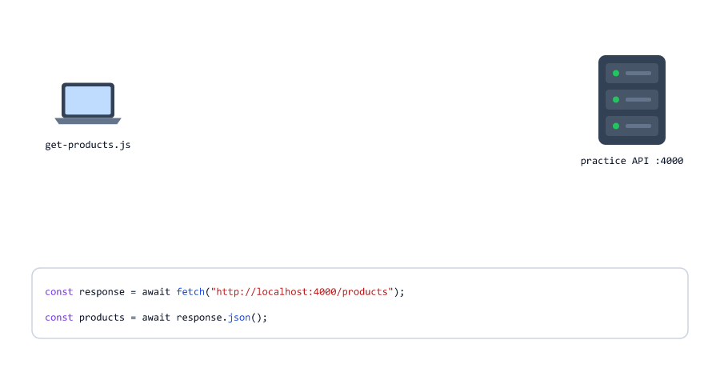

# JavaScript: Basics to Advanced

**A free, beginner-friendly JavaScript course for future backend developers.**
25 sessions take you from your first `console.log()` to promises, `async`/`await` and calling APIs with `fetch`. Everything runs with Node.js, and every example is tested.

[](#course-outline)
[](#what-you-need)
[](#what-makes-this-course-different)
[](#a-look-inside)
[](#what-is-inside-each-session)
[](#how-to-use-this-course)


---

## Table of Contents

* [What Makes This Course Different](#what-makes-this-course-different)
* [Who This Course Is For](#who-this-course-is-for)
* [What You Need](#what-you-need)
* [Quick Start](#quick-start)
* [How to Use This Course](#how-to-use-this-course)
* [Course Outline](#course-outline)
* [A Look Inside](#a-look-inside)
* [Find a Topic Fast](#find-a-topic-fast)
* [What You Will Be Able to Do](#what-you-will-be-able-to-do)
* [After This Course: Node.js](#after-this-course-nodejs)
* [Repository Structure](#repository-structure)
* [Feedback](#feedback)

---

## What Makes This Course Different

| | |
| --- | --- |
| **Backend from day one** | No web pages, buttons or browser code. You run everything with `node file.js` in a terminal, with examples from real servers: users, orders, carts, logins and APIs. |
| **Every example is tested** | 587 example files were run on Node.js 24. The output in each session is the real output, so you can compare it with yours line by line. |
| **Learn by seeing** | 319 animated diagrams show what happens inside your program: variables, the call stack, closures, the event loop, promises. |
| **Learn from mistakes** | 266 beginner mistakes, each with the wrong code, what goes wrong (often the real error message) and the fix, so you recognise them when they happen to you. |
| **Practice and interviews** | 199 practice exercises and 337 interview questions, with answers. |
| **One idea at a time** | A session only uses what earlier sessions taught. Nothing appears before it is explained. |
| **A clear next step** | The course leads straight into the [Node.js course](https://github.com/mohin-sheikh/nodejs-learning-path), which uses the same style, words and examples. |

---

## Who This Course Is For

* Complete beginners: you have never written a line of code
* Learners who want to become **backend** or **full-stack** developers
* Frontend developers who know some JavaScript, but never learned how it really works
* Anyone preparing for a JavaScript or Node.js interview

No programming experience is needed.

---

## What You Need

| You need                   | Details                                                                 |
| -------------------------- | ----------------------------------------------------------------------- |
| A computer                 | Windows, macOS or Linux                                                 |
| Node.js 22 or newer        | The LTS version from [nodejs.org](https://nodejs.org/). The course was tested with Node.js 24. [Session 01](01-introduction-to-javascript.md) shows how to install it |
| A code editor              | [VS Code](https://code.visualstudio.com/) is recommended                |
| A terminal                 | The one built into VS Code is enough                                    |
| Internet                   | Only to install the tools. Every example runs offline                   |

---

## Quick Start

**1. Install Node.js** (LTS) and check it in a terminal

```bash
node -v
```

```text
v24.19.0
```

Any version from 22 up works.

**2. Make a practice folder** called `js-practice` and open it in VS Code (**File > Open Folder**).

**3. Create `hello.js`** in that folder

```javascript
console.log("Hello, JavaScript!");
```

**4. Run it** in the VS Code terminal (**Terminal > New Terminal**)

```bash
node hello.js
```

```text
Hello, JavaScript!
```

That is how you run every example in this course. Now open [Session 01](01-introduction-to-javascript.md).

---

## How to Use This Course

**1. Go in order.** Every session builds on the ones before it. The navigation at the bottom of each session takes you to the next one.

**2. Type the code yourself.** Do not copy and paste. Typing is how your fingers and eyes learn the syntax, and your own typos teach you to read error messages.

**3. Run it and compare.** Each example shows the exact output. If yours is different, find out why before you go on: that is where most learning happens.

**4. Change things.** Change a number, remove a line, break it on purpose. Then predict what will happen before you run it.

**5. Finish each session.** Read the beginner mistakes, do the practice exercises, and answer the interview questions out loud before you look at the answers.

You can read every session right here on GitHub, or download the course to read offline

```bash
git clone https://github.com/mohin-sheikh/javascript-basics-to-advanced.git
cd javascript-basics-to-advanced
```

### What is inside each session

| Part of a session         | What it gives you                                                       |
| ------------------------- | ----------------------------------------------------------------------- |
| Short sections            | One idea at a time, in simple words, with tables for quick review       |
| Tested code examples      | A file name, the code, and the real output                              |
| Animated diagrams         | A picture of what happens while the code runs                           |
| Mini examples             | One or two small backend programs that combine the session's topics     |
| Beginner mistakes         | The wrong code, the real error, and the correct code                    |
| Practice exercises        | Tasks to do on your own                                                 |
| Interview questions       | Short questions with clear answers, to check yourself                   |

### How long it takes

Plan for **1 to 2 hours per session**, including the exercises. At one session a day, most learners finish in **4 to 5 weeks**. Going slower is fine; skipping the practice is not.

---

## Course Outline

### Part 1: Basics

The building blocks of every program: values, decisions and repetition.

| #  | Session                                                                       | You will learn                                                          |
| -- | ----------------------------------------------------------------------------- | ----------------------------------------------------------------------- |
| 01 | [Introduction to JavaScript](01-introduction-to-javascript.md)                | What JavaScript and Node.js are, setting up, your first program, reading errors |
| 02 | [Variables and Comments](02-variables-and-comments.md)                        | `let`, `const`, `var`, naming rules and comments                        |
| 03 | [Data Types](03-data-types.md)                                                | The 8 data types, `typeof`, `null` and `undefined`                      |
| 04 | [Operators](04-operators.md)                                                  | Arithmetic, comparison, `===` vs `==`, logical operators and `??`       |
| 05 | [Type Conversion](05-type-conversion.md)                                      | `Number()`, `parseInt()`, truthy and falsy, safe input handling         |
| 06 | [Conditionals](06-conditionals.md)                                            | `if`, `else if`, `switch`, the ternary operator, validation             |
| 07 | [Loops](07-loops.md)                                                          | `for`, `while`, `do...while`, `for...of`, `break` and `continue`        |
| 08 | [Strings and Template Literals](08-strings-and-template-literals.md)          | Template literals, escape characters and string methods                 |
| 09 | [Numbers and Math](09-numbers-and-math.md)                                    | Decimals, money in paise, rounding, `Math` methods and random numbers   |

### Part 2: Building Blocks

Organising code and data: functions, arrays, objects and classes.

| #  | Session                                                                       | You will learn                                                          |
| -- | ----------------------------------------------------------------------------- | ----------------------------------------------------------------------- |
| 10 | [Functions](10-functions.md)                                                  | Parameters, `return`, default values, arrow functions, the call stack, recursion |
| 11 | [Callbacks and Higher-Order Functions](11-callbacks-and-higher-order-functions.md) | Callbacks, function factories, `setTimeout` and error-first callbacks |
| 12 | [Arrays and Array Methods](12-arrays-and-array-methods.md)                    | `push`, `splice`, `map`, `filter`, `reduce`, `find`, sorting, `split` and `join` |
| 13 | [Objects](13-objects.md)                                                      | Properties, nested objects, `?.`, `Object.keys`, arrays of objects      |
| 14 | [Destructuring, Spread and Rest](14-destructuring-spread-rest.md)             | Unpacking arrays and objects, copies and merges with `...`, rest parameters |
| 15 | [Shallow and Deep Copy](15-shallow-and-deep-copy.md)                          | References, shallow copies, `structuredClone`, shared-data bugs on a server |
| 16 | [Scope, Hoisting and Closures](16-scope-hoisting-closures.md)                 | The scope chain, `var` vs `let`, hoisting, the temporal dead zone, closures |
| 17 | [this, Constructors and Classes](17-this-constructors-classes.md)             | `this`, `new`, classes, private fields, getters, `static` and `extends` |

### Part 3: Real Programs

What every real backend program needs: error handling, data formats, collections, and code split into files.

| #  | Session                                                                       | You will learn                                                          |
| -- | ----------------------------------------------------------------------------- | ----------------------------------------------------------------------- |
| 18 | [Error Handling](18-error-handling.md)                                        | `try`, `catch`, `finally`, `throw`, custom error classes, status codes  |
| 19 | [JSON and Dates](19-json-and-dates.md)                                        | `JSON.stringify`, `JSON.parse`, invalid JSON, dates, time zones, date math |
| 20 | [Map and Set](20-map-and-set.md)                                              | `Map`, `Set`, removing duplicates, caches and set operations            |
| 21 | [Modules](21-modules.md)                                                      | `require`, `module.exports`, ES modules with `import`/`export`, project structure |

### Part 4: Async JavaScript

How one Node.js thread serves many users: waiting without blocking.

| #  | Session                                                                       | You will learn                                                          |
| -- | ----------------------------------------------------------------------------- | ----------------------------------------------------------------------- |
| 22 | [Timers](22-timers.md)                                                        | `setTimeout`, `setInterval`, retries with backoff, debouncing, timeouts |
| 23 | [The Event Loop](23-event-loop.md)                                            | The call stack, queues, microtasks, blocking code and the thread pool   |
| 24 | [Promises](24-promises.md)                                                    | Creating promises, `then`/`catch`/`finally`, chaining, `Promise.all`, `race`, `any` |
| 25 | [async/await and fetch](25-async-await-and-fetch.md)                          | `async` functions, `await` with `try...catch`, parallel tasks, calling APIs with `fetch` |

---

## A Look Inside

Every session explains the hard parts with animated diagrams like these.

<table>
  <tr>
    <td width="50%"><br><b>Session 12:</b> <code>map</code> turns every item into a new one</td>
    <td width="50%"><br><b>Session 10:</b> how function calls stack up</td>
  </tr>
  <tr>
    <td width="50%"><br><b>Session 16:</b> closures as a backpack of variables</td>
    <td width="50%"><br><b>Session 23:</b> the event loop as a restaurant</td>
  </tr>
  <tr>
    <td width="50%"><br><b>Session 24:</b> the three states of a promise</td>
    <td width="50%"><br><b>Session 25:</b> what happens during a <code>fetch</code></td>
  </tr>
</table>

---

## Find a Topic Fast

Already know some JavaScript, or revising before an interview? Jump straight to a topic.

| Topic                                         | Session |
| --------------------------------------------- | ------- |
| `let` vs `const` vs `var`                     | [02](02-variables-and-comments.md), [16](16-scope-hoisting-closures.md) |
| `==` vs `===`                                 | [04](04-operators.md)  |
| Truthy and falsy values                       | [05](05-type-conversion.md) |
| Why `0.1 + 0.2` is not `0.3`                  | [09](09-numbers-and-math.md) |
| Arrow functions                               | [10](10-functions.md) |
| Callbacks and higher-order functions          | [11](11-callbacks-and-higher-order-functions.md) |
| `map`, `filter` and `reduce`                  | [12](12-arrays-and-array-methods.md) |
| Optional chaining `?.` and `??`               | [13](13-objects.md), [04](04-operators.md) |
| Destructuring and the spread operator `...`   | [14](14-destructuring-spread-rest.md) |
| Copying objects without bugs                  | [15](15-shallow-and-deep-copy.md) |
| Closures and hoisting                         | [16](16-scope-hoisting-closures.md) |
| `this` and classes                            | [17](17-this-constructors-classes.md) |
| Custom errors and `try...catch`               | [18](18-error-handling.md) |
| JSON, dates and time zones                    | [19](19-json-and-dates.md) |
| `Map` and `Set`                               | [20](20-map-and-set.md) |
| `require` vs `import`                         | [21](21-modules.md) |
| `setTimeout`, debouncing and retries          | [22](22-timers.md) |
| The event loop and microtasks                 | [23](23-event-loop.md) |
| Promises, `Promise.all` and `Promise.race`    | [24](24-promises.md) |
| `async`/`await` and `fetch`                   | [25](25-async-await-and-fetch.md) |

---

## What You Will Be Able to Do

After this course you will be able to

* Write, run and debug JavaScript programs with Node.js
* Read error messages and stack traces, and fix the cause
* Work with strings, numbers, arrays and objects the way backend code does: input checks, money in paise, lists of users and orders
* Organise code with functions, classes and modules
* Handle errors cleanly and turn them into the right HTTP status codes
* Explain closures, `this`, the event loop and promises in an interview
* Write asynchronous code with `async`/`await`, and call other servers with `fetch`

---

## After This Course: Node.js

This course teaches the JavaScript **language**. The [Node.js course](https://github.com/mohin-sheikh/nodejs-learning-path) uses it to build real servers, REST APIs with Express, and databases with MongoDB, in 30 more sessions.

| What you learn here              | Where the Node.js course uses it                            |
| -------------------------------- | ----------------------------------------------------------- |
| Functions and callbacks (10, 11) | Route handlers and middleware                               |
| Objects and JSON (13, 19)        | Request bodies and API responses                            |
| Error classes (18)               | Central error handling in Express                           |
| Modules (21)                     | Splitting an app into routes, controllers and models        |
| The event loop (23)              | How one server answers many users at once                   |
| Promises and `async`/`await` (24, 25) | Files, database queries, password hashing                |

Both courses use the same words, the same examples (orders, users, the restaurant) and the same style, so the step from one to the other is small.

---

## Repository Structure

```text
javascript-basics-to-advanced/
├── 01-introduction-to-javascript.md    one file per session
├── 02-variables-and-comments.md
├── ...
├── 25-async-await-and-fetch.md
├── images/                             animated diagrams, one folder per session
└── README.md
```

---

## Feedback

Found a mistake, or a part that is hard to understand? Please [open an issue](https://github.com/mohin-sheikh/javascript-basics-to-advanced/issues) or send a pull request. Every report helps the next learner.

If this course helps you, give it a star on GitHub so others can find it too.

---

**Ready? Start with [Session 01: Introduction to JavaScript](01-introduction-to-javascript.md).**
